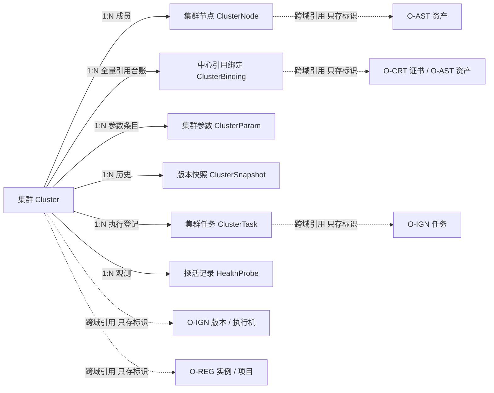
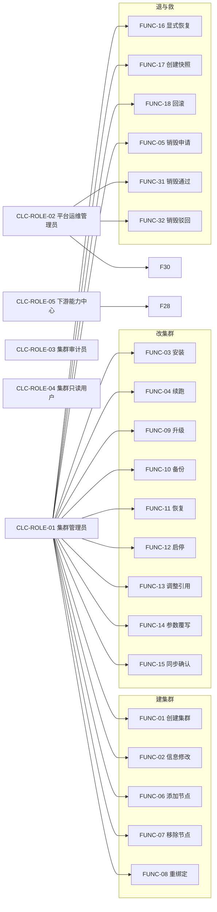
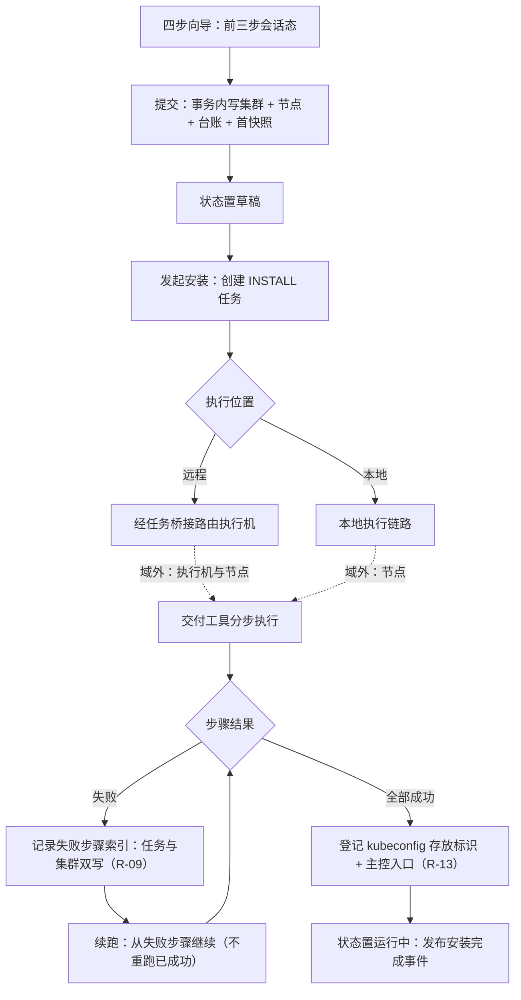
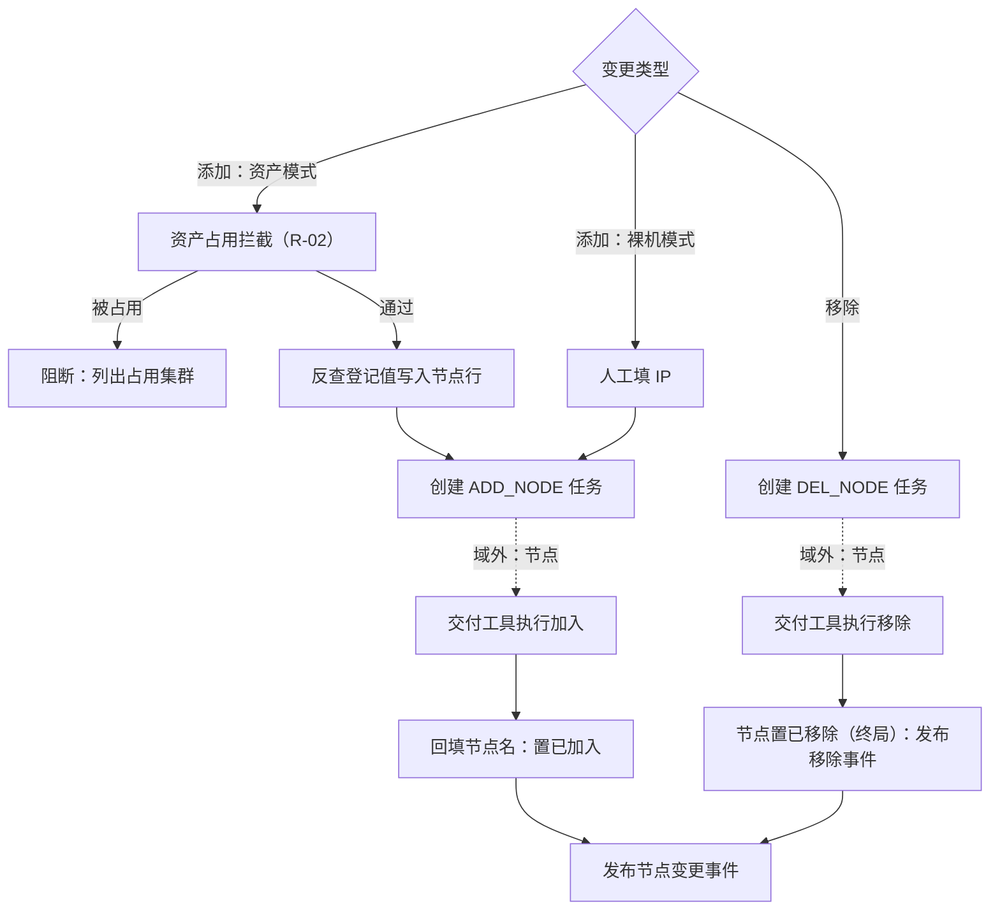
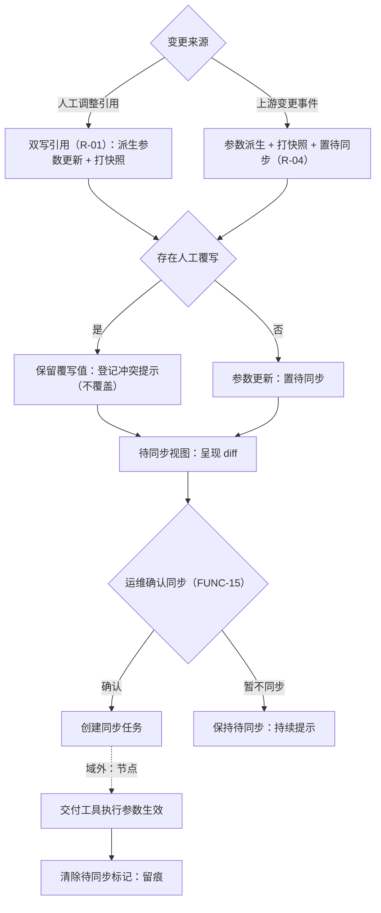
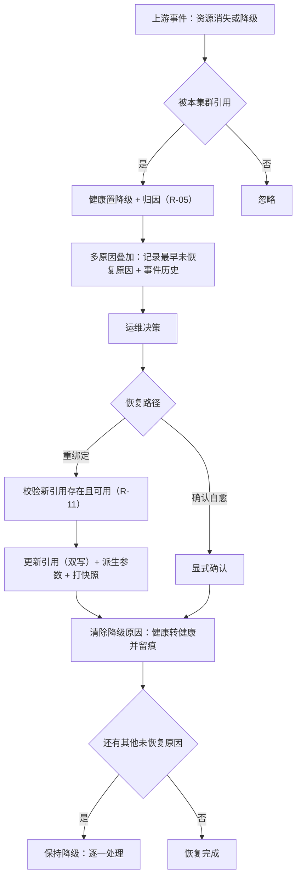
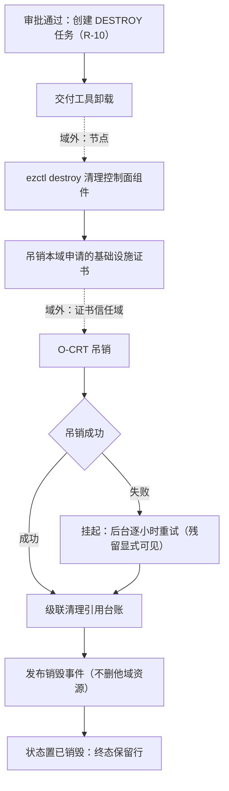
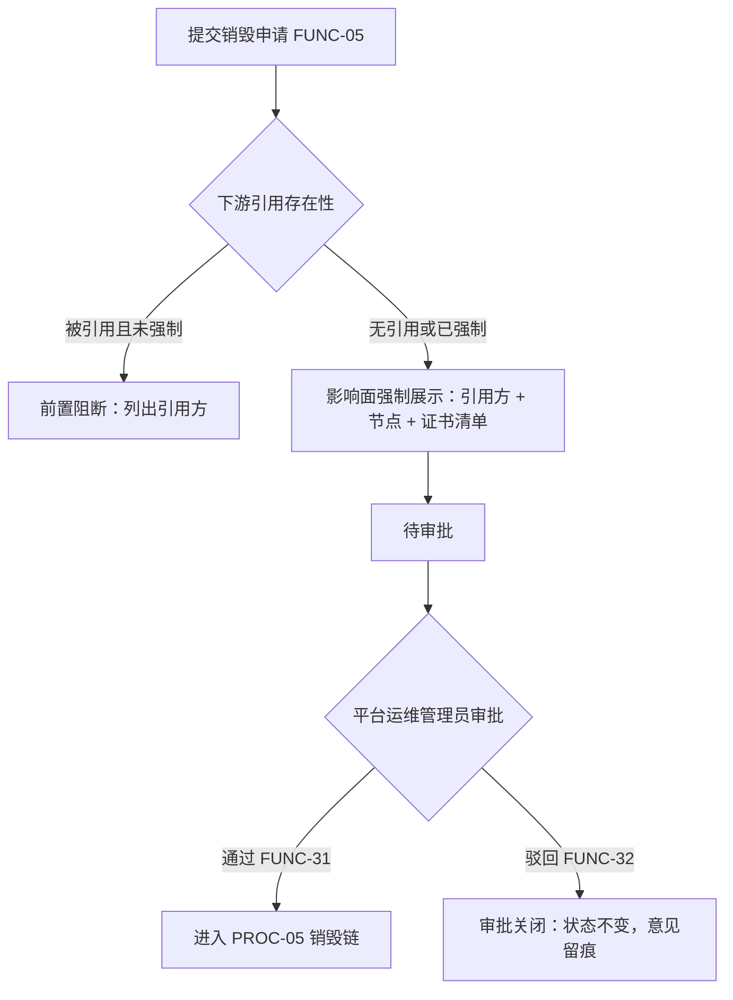

# OPIC-集群域 需求规格说明书

| 项目 | 内容 |
|---|---|
| 文档名称 | OPIC-集群域需求规格说明书 |
| 规范版本 | 软件需求编写规范 V10.0 |
| 编制日期 | 2026-09-24 |
| 文档状态 | **v1.0 完整（可进入本体建模阶段）**｜九部分 + 附录 A 全部完成、Q-1~Q-62 **全部确认**（待确认项 0）｜**阶段三（跨对象联动识别）为《编制说明》§D.5 的独立强制阶段**｜E.2 自检 **54 / 54**、第九部分 13 项自检全过、独立审核无 FAIL｜两份交付件已转**单文件自包含 HTML**（可离线渲染全部 Mermaid 图） |

> 状态标记口径：`[AI自动补全]` 系统按行业通用做法补全、用户未修改；`[已确认]` 经用户确认或修改；`[待确认]` 尚未得到用户回复，已登记入《编制说明》待澄清清单。
> 本文档按 V10.0 固定结构（九部分 + 附录 A）组织：**没有适用内容的章节不得删除**，写明「不适用」及经确认的理由，不编内容填空。
> **八阶段的问题（Q-1~Q-62，含定稿确认 Q-62）已全部按 AI 建议确认**，故全部九部分与附录 A 的状态标记统一为 `[已确认]`，本文**无待确认项**。

---

# 第一部分 项目概述与范围

> 本部分对应《AI 需求探索与确认提示词 V10.0》**阶段零：原始需求接收与总体理解确认**。
> **八阶段的问题（Q-1~Q-62，含定稿确认 Q-62）已全部按 AI 建议确认**，故全部九部分与附录 A 的状态标记统一为 `[已确认]`，本文**无待确认项**。

## 1.1 系统定位

本域（集群域，`O-CLC`；原能力中心 `cluster-center`，前缀 `CLC`）是 23 个本体论域中的**集群编排者与状态记录者**：它把「把一套 K8s 集群建起来并让它持续可管」拆成可治理的四个问题 —— **用什么建**（交付工具版本与中心引用，消费 `O-IGN` / `O-REG`）、**在哪建**（节点引用 `O-AST` 资产或手填裸 IP，双模并存）、**怎么建与怎么改**（安装 / 续跑 / 扩缩 / 升级 / 备份恢复，全部经交付执行域的任务桥接）、**坏了怎么办**（版本快照回滚、跨中心引用降级与显式恢复、下架销毁），使集群成为**平台治理的最终交付物**：扩展组件、监控、OS 使能都挂在它身上，它的下架即是一次全平台连锁清理的起点。（v3.2 更正，109 号 F-70） [已确认]

本域管理的是**集群台账与创建向导、节点清单与动态增删、交付编排任务、跨中心引用与参数派生、版本快照与回滚、健康探活与降级恢复、下架销毁**；它**不运行集群**（控制面组件由交付工具装到节点上自己跑）、**不签发 K8s 控制面证书**（apiserver / kubelet / etcd 证书始终走交付工具原生流程，**不经过证书信任域** —— 这是本域与基础设施证书的关键分界）、**不持有 SSH 凭据**（节点凭据由资产域通道按需提供，本域零持久化）。一句话：本域回答的是「**这个集群是怎么建出来的、现在能不能用、怎么改、怎么拆**」，而不是「**集群里面跑得怎么样**」（后者归可观测域）。 [已确认]

本域与其余 18 个域的耦合形态有四点特殊之处：① 它是**引用密度最高的域** —— 交付执行机、交付版本、镜像仓库实例与项目、基础设施证书、节点资产五类引用并存，且全部**可留空**（legacy 兼容模式），引用关系有独立对象并支持反向查询（见定性二）；② 它是**唯一拥有「版本快照 + 回滚」机制的域** —— 集群配置是复杂可变状态、回滚是运维刚需，这与各域「不存可推导快照」的经验不冲突：判据是「它会不会变」（集群配置会变，所以历史要存）；③ 它是**下游域的宿主登记处** —— 集群销毁不是删行，而是一次连锁清理的起点（发布事件让扩展组件域、可观测域自行清理），**本域只吊销本域申请的基础设施证书、绝不删除他域资源**；④ 它是**「降级不自动恢复」纪律的诞生地** —— 引用资源恢复事件到达不自动翻回健康，必须显式确认，因为「事件说恢复了」不等于「真的恢复了」（见定性二）。 [已确认]

### 1.1.1 四条域级定性

> 以下四条是本域在阶段零确立的定性，后续所有阶段不得违背；若确需变更，须作为需求变更显式提出（与已完成九域的定性同级）。

**定性一：集群是平台治理的最终交付物 —— 本域是它的编排者与状态记录者，不是它的运行者。** 集群的控制面组件由交付工具装到节点上自行运行，本域记录「用了哪些版本、哪些机器、哪些引用」并编排它的生（创建 / 扩缩 / 升级 / 备份恢复）与死（销毁）。三条硬性含义：① **本域是下游域的宿主登记处** —— 扩展组件域、可观测域、节点使能域都以集群为部署目标；下架集群时本域只做三件事（执行交付工具的卸载、吊销本域申请的基础设施证书、清理本域引用），**其余连锁清理由各中心订阅事件自行决定**；② **本域不修复运行中组件** —— 节点上组件的故障归可观测域发现、集群域只保证「编排动作可执行、结果可追溯」；③ **健康是观测不是治理** —— 探活结论（含观测时间）与生命周期状态正交，降级必须可归因（`degraded_reason`）且只能被显式恢复清除。**后果与补偿**：本域无法直接触碰节点内部 ⇒ 补偿手段是**探活 + 降级显式化 + 显式恢复 + 快照回滚**，把「修不了」变成「看得见、退得回」。 [已确认]

**定性二：跨中心引用是本域的一等公民 —— 「绝不静默切换」与「降级不自动恢复」是两条铁的引用纪律。** 本域引用五类外部资源且全部可留空（legacy 模式是显式声明的兼容路径、不是缺陷）。四条硬性含义：① **绝不静默切换** —— 远程点火机失联时**不得自动回退本地执行**：静默切换会让运维误判「在哪执行」，执行位置必须始终显式；② **降级不自动恢复** —— 引用资源恢复事件到达时不得自动翻回健康（事件说恢复不等于真恢复），探活成功也不覆盖跨中心降级，**只有显式恢复（重选引用或确认）能清除降级**；③ **引用变更派生参数但不自动生效** —— 上游实例变更自动派生新参数并打快照，**是否执行同步由运维显式决定**（自动执行等于替运维重启服务）；④ **引用要能反查** —— 引用关系有独立对象，上游域下架前可通过反向查询知道「谁在引用我」（与「跨域引用要在对方域收口」互为两侧）。 [已确认]

**定性三：节点是资产的一次使用，不是资产的副本 —— 本域不复制机器事实、不持久化 SSH 凭据。** 节点可选引用资产（资产模式）或手填 IP（裸机模式），双模并存是**演进路径**而非过渡状态。四条硬性含义：① **机器事实归资产域** —— 节点的地址、连接参数随反查写入登记值，**SSH 凭据绝不落本域库**（凭据的使用方是资产域的执行通道，判据「使用方在谁手上」）；② **资产下架不删除节点行** —— 引用置空、地址保留（供人工接管），集群降级并显式归因；③ **单节点健康变更不降级集群** —— 一台机器不可达不一定影响集群整体，只发节点级健康事件（避免把节点抖动放大成集群告警）；④ **一台资产同时只服务一个活跃集群** —— 节点占用冲突前置拦截（复用同一台机器装两个集群是运维事故的常见来源）。 [已确认]

**定性四：集群生命周期是单向治理线，快照是回滚的唯一依据 —— 但回滚前必须校验引用仍然存在。** 生命周期状态单向推进（草稿 → 安装中 → 运行中；安装失败可从失败步骤续跑；销毁为终态且**保留行供审计**）。四条硬性含义：① **快照同步引用** —— 每次配置变更打快照时同步保存当前跨中心引用，回滚时一并恢复；② **回滚先校验引用** —— 快照引用的资源已被上游删除时拒绝回滚（除非显式选择「放弃引用回滚」，此时引用置空并留痕）；③ **安装失败可续跑** —— 失败步骤索引持久化，重试从失败处继续、不重跑已成功步骤（长流程多步骤的失败恢复与 `O-IGN` 任务级失败是两个层次）；④ **销毁保留行** —— `已销毁` 是终态、记录保留供审计（集群的历史不可伪造，与 `O-AST` / `O-IGN` 终态保留同判据）。 [已确认]

> **层位说明**：本域位于三层架构的**第 2 层（平台能力层）**，属 **Tier 1**（原能力中心清单为平台层第 8 顺位；本体论域登记为第 10 号，见 `O-SEC.SEC_DOMAIN_CODES`）。MVP 最短依赖路径为 `O-SEC → O-ARC → O-SYS → O-DBS → O-CRT → O-VPN → O-REG → O-AST → O-IGN → O-CLC …`。 [已确认]
> **本域为什么排在交付执行域之后**：集群的安装 / 扩缩 / 升级全部**消费交付执行域的任务桥接**（执行机路由）与**版本目录**（交付工具版本），镜像源**消费制品仓库域**，节点**引用资产域**，基础设施证书**消费证书信任域**。五条供给线齐备后，集群才能被编排。 [已确认]
> **本域落地的紧迫性**：本域是**扩展组件域（`O-ADD`）、可观测域（`O-MON`）、节点使能域（`O-OSC`）三个域的硬前置** —— 它们都以集群为部署目标；同时它是平台价值的兑现点（交付线的终点是「一个可用的集群」）。 [已确认]
>
> **域边界一句话（十域对照）**：`O-SEC` 管「**能不能过**」｜`O-ARC` 管「**错是什么**」｜`O-SYS` 管「**平台怎么运转**」｜`O-DBS` 管「**数据放在哪、谁能连、丢了怎么回来**」｜`O-CRT` 管「**谁可以被信任**」｜`O-VPN` 管「**节点之间能不能连上**」｜`O-REG` 管「**制品放在哪、谁能拉**」｜`O-AST` 管「**机器是谁、它准备好了吗**」｜`O-IGN` 管「**用哪个版本、在哪台机器、把动作安全送过去**」｜`O-CLC` 管「**集群怎么建、怎么改、怎么拆**」。 [已确认]

## 1.2 业务范围

### 1.2.1 范围内

- **集群台账与创建向导**：四步创建（基本信息 → 节点选择 → 中心引用 → 参数确认），**前一步只做会话态校验、写库延迟到最后一步**（不产生半成品集群）；节点双模（引用资产 / 手填裸 IP）；中心引用全可选（全部留空 = 显式声明的 legacy 模式，受平台配置约束）；集群状态机（草稿 / 安装中 / 运行中 / 安装失败 / 已销毁）。 [已确认]
- **节点管理**：动态增删节点（经交付工具动作）；**资产占用拦截**（一台资产同时只服务一个活跃集群）；资产下架的引用处置（引用置空、地址保留、集群降级归因）；节点重绑定（换绑新资产）；节点级健康事件（不放大为集群降级）。 [已确认]
- **交付编排**：安装（含 **失败步骤索引与续跑**）、升级、扩缩、备份恢复、启停，全部经交付执行域任务桥接路由（远程执行机）或本地链路（legacy）；**绝不静默切换执行位置**；交付工具原生流程负责的一切（K8s 控制面证书等）本域不重复做。 [已确认]
- **跨中心引用与参数派生**：引用对象（五类资源、全量台账、支持反向查询）；参数派生（镜像源 / 交付工具镜像 / 访问凭据引用），**派生凭据只在内存流转、绝不落库**；上游变更派生新参数 + 打快照 + **提示显式同步**；**降级订阅**（引用资源消失或降级 ⇒ 集群降级并归因）；**显式恢复**（重选引用或确认后清除降级）。 [已确认]
- **版本快照与回滚**：每次配置变更打快照（hosts / 配置 / 引用一并保存）；回滚前校验快照引用仍然存在（不存在则拒绝或显式放弃引用回滚）；快照保留期受平台配置约束。 [已确认]
- **健康探活与降级**：周期探活（控制面可达性 + TLS 握手 + 节点就绪数）；连续失败转不可达；**探活与跨中心降级互不覆盖**；聚合健康接口（并行查询各中心、部分失败不整体失败、响应缓存防穿透）。 [已确认]
- **下架销毁**：卸载（交付工具原生流程）→ 吊销本域申请的基础设施证书 → 清理引用台账 → 发布销毁事件 → 终态保留行；**吊销失败挂起后台重试**（残留显式可见）；被下游引用时默认拒绝、强制须审批。 [已确认]
- **跨中心暴露与事件**：按用途的精简查询（监控目标 / 扩展目标 / 节点运行时反查）；全生命周期事件（创建、安装、参数变更、节点变更、健康、销毁）；与平台底座的对接（能力登记、审计、配置项、事件总线）。 [已确认]

### 1.2.2 范围外

| 范围外内容 | 排除理由 |
|---|---|
| **集群内部的可观测**（指标采集、日志、告警规则） | 归可观测域（`O-MON`）；本域只做「控制面可达性」级别的探活（定性一 ③）。 [已确认] |
| **K8s 控制面证书的签发与轮换**（apiserver / kubelet / etcd / front-proxy） | **始终走交付工具原生流程**、不经过证书信任域 —— 这是交付工具自洽性的边界（C.1.2 第 5 条）；本域只管基础设施证书（镜像源客户端 / 监控 mTLS / ingress 泛域名）。 [已确认] |
| **节点的机器事实与 SSH 通道** | 归资产域；本域节点只存登记值，凭据零持久化（定性三）。 [已确认] |
| **交付动作的执行与日志中继** | 归交付执行域；本域是任务桥接的**上游调用方**，消费其状态与对账结论（`Q-3` 家族同源：执行事实真相在执行机侧）。 [已确认] |
| **镜像仓库与制品内容** | 归制品仓库域；本域只做镜像源参数派生。 [已确认] |
| **扩展组件的目录与分发、监控目标的注册** | 归扩展组件域 / 可观测域；本域只提供「部署目标」的精简查询（1.2.3）。 [已确认] |
| **租户与成员管理** | 归租户门户域（`O-USR`）；本域的集群归属关系由其消费。 [已确认] |
| **任意节点的 shell 直连** | 一切节点动作经交付工具动作 + 交付执行域桥接（与 `O-IGN` 白名单口径一致）。 [已确认] |

### 1.2.3 外部边界

| 边界对象 | 交互方向 | 交互内容 | 边界口径 |
|---|---|---|---|
| 交付执行域（`O-IGN`） | 本域 → 调用 | 全部交付动作经任务桥接路由；引用执行机与交付版本 | **绝不静默切换执行位置**（远程失联不回退本地）；**版本编目在 `O-IGN`**（本域是选版消费方，`O-REG`「托管 ≠ 编目」的下游）；执行位置、版本是集群的**出生事实**（入快照）。 [已确认] |
| 资产域（`O-AST`） | 双向 | 节点引用资产；订阅资产下架与健康事件；**节点机密计算（TEE）能力标签透传**（**v3.1 增补，V3-31b / 107 号 F-49**：`capabilityFlags` 含 `TEE` 的节点信息随节点事实进入本域，供调度 / 部署约束消费） | **机器事实归 `O-AST`、节点是资产的一次使用**（定性三）；SSH 凭据零持久化；单节点健康变更不降级集群；**能力标签权威编目在 `O-AST`（`AST_CAPABILITY`），本域只透传不定义 TEE 语义**（attestation 证明归第 3 层）。 [已确认] |
| 制品仓库域（`O-REG`） | 双向 | 镜像源参数派生（实例 + 项目 + 机器人令牌引用）；订阅实例变更与移除 | **派生凭据只在内存流转、绝不落库**；实例移除 ⇒ 集群降级归因；本域是其消费方（「集群域是镜像源消费方」接口的承接）。 [已确认] |
| 证书信任域（`O-CRT`） | 双向 | 基础设施证书（镜像源客户端 / 监控 mTLS / ingress 泛域名）签发与吊销；订阅轮换事件推送节点 | **K8s 控制面证书不经过 `O-CRT`**（交付工具原生流程）；下架时只吊销本域申请的证书；轮换推送节点热加载。 [已确认] |
| 扩展组件域 / 可观测域 / 节点使能域（`O-ADD` / `O-MON` / `O-OSC`） | 对方 → 查询本域；本域 → 事件 | 按用途精简查询集群与节点；订阅销毁事件自行连锁清理 | **本域不删他域资源** —— 销毁只发布事件；引用声明（谁引用集群）由对方域维护、本域的反向查询接口供其收口（范围外声明，待探索时收口）。 [已确认] |
| 平台底座域（`O-SYS`） | 双向 | 能力登记、审计、配置项（legacy 开关、快照保留期等）、事件总线、任务日志通道 | RBAC 采用 `cluster:*` 资源命名空间（角色全局登记原则）。 [已确认] |
| 零信任安全域（`O-SEC`） | 本域 → 遵从 | 统一认证授权；legacy 别名兼容（旧隐式权限映射到 `cluster:*` 并留痕双校验） | 本域不建主体、不做判定。 [已确认] |
| 数据服务域（`O-DBS`） | 本域 → 依赖 | 业务库供给（`clc` schema） | 禁 AutoMigrate；跨中心不建外键。 [已确认] |
| 网络连通域（`O-VPN`） | 本域 → 依赖 | 平台到节点、执行机到节点的可达性 | 可达性是运行前置；本域不建覆盖网。 [已确认] |

## 1.3 业务域划分

本域划分为 **7 个子域**（与第八部分菜单一一对应）：

| 子域编号 | 子域名称 | 职责概述 | 对应菜单 |
|---|---|---|---|
| 1 | 集群台账 | 创建向导、集群清单与详情、状态机 | 集群台账 |
| 2 | 节点管理 | 节点清单、增删、重绑定、占用拦截 | 节点管理 |
| 3 | 交付编排 | 安装 / 续跑 / 升级 / 备份恢复 / 启停 / 销毁编排 | 交付编排 |
| 4 | 引用与参数 | 中心引用台账、参数派生、降级订阅、显式恢复 | 引用与参数 |
| 5 | 快照与回滚 | 版本快照、回滚校验与执行 | 快照与回滚 |
| 6 | 健康探活 | 周期探活、降级归因、聚合健康 | 健康探活 |
| 7 | 运行观测 | 统计总览、跨中心暴露、运行参数 | 运行观测 |

> **子域划分的判据**：按「**集群的一生**」划分 —— 建（1 / 2）、改（3）、连着谁（4）、退回去（5）、好不好（6）、汇总出口（7）。**「引用与参数」独立成子域**因为引用密度是本域第一特征（定性二）；**「快照与回滚」独立成子域**因为它是本域独有的恢复机制（定性四）。 [已确认]

## 1.4 核心清单索引

> 编号在各部分内独立；跨域引用冠域码。预判以实际产出为准（偏差登记入《编制说明》C.2）。

| 清单 | 数量（预判） | 所在部分 | 说明 |
|---|---|---|---|
| 业务对象 | 7 | 第二部分 | 集群 / 节点 / 引用绑定 / 参数 / 快照 / 集群任务 / 探活记录 |
| 功能点 | 待阶段二定 | 第三部分 | 预判人工约 20、查询约 12、审批 2 |
| 系统自动行为 | 待阶段二定 | 第三部分 | 预判 8~10（探活调度、降级订阅、参数派生、吊销重试、快照清理等） |
| 业务规则 | 待阶段一、二定 | 第二、三部分 | 预判 INV 约 30、R 约 12 |
| 协同流程 | 5 | 第四部分 | 创建安装、节点变更、参数派生与同步、恢复、销毁 |
| 审批流程 | 1 | 第四部分 | 集群销毁（唯一审批流） |
| 报表 | 待阶段五定 | 第五部分 | 与查询功能点一一对应 |
| 数据字典 | 待阶段六定 | 第七部分 | 状态类为主 |

## 1.5 角色总览

> 角色为局部编号（`CLC-ROLE-xx`），全局映射在 `O-SYS` 登记。

| 局部角色 | 角色名称 | 类型 | 职责概述 |
|---|---|---|---|
| `CLC-ROLE-01` | 集群管理员 | 人工 | 创建集群、节点增删、安装升级、快照回滚、销毁申请、显式恢复 |
| `CLC-ROLE-02` | 平台运维管理员 | 人工 | 销毁审批、legacy 模式开关与运行参数、跨中心引用决策支持 |
| `CLC-ROLE-03` | 集群审计员 | 人工 | 只读 + 审计台账（销毁留痕、引用变更留痕、探活异常）；**零写动作** |
| `CLC-ROLE-04` | 集群只读用户 | 人工 | 集群清单、节点、健康、统计查询 |
| `CLC-ROLE-05` | 下游能力中心 | 机器身份 | 扩展组件域 / 可观测域 / 节点使能域按用途反查集群与节点运行时信息；**只读、无界面** |

> **角色说明**：`CLC-ROLE-05` 是**服务身份**（数据通路使用方，同 `O-REG.REG-ROLE-05` / `O-IGN` 的下游中心），不是机器身份（执行机代理）—— 两类第五身份在全项目中已形成清晰的分型。 [已确认]

## 1.6 技术底座与运行前置

### 1.6.1 情形一：技术底座已就绪

- **运行载体**：MCC 独立中心，`/api/v1/cluster/...`；跨中心调用走平台网关并透传审计头。 [已确认]
- **数据落点**：业务表落 `opicdb` 的 `clc` schema 前缀；禁 AutoMigrate；跨中心不建外键（引用靠标识 + 事件对账）。 [已确认]
- **认证与授权**：统一认证；RBAC 资源命名空间 `cluster:*`（集群 / 节点 / 参数 / 操作 / 版本 / 引用），**legacy 隐式权限通过别名映射兼容且双校验留痕**。 [已确认]
- **事件与日志**：全生命周期事件走平台事件总线；任务日志复用平台统一通道（交付动作的日志在 `O-IGN` 侧中继、本域回放）。 [已确认]
- **运行前置**：网络可达（`O-VPN`）、交付线可用（`O-IGN` / `O-REG`）、节点已收编（`O-AST`）—— 三者短时不可用时**不阻塞台账与查询**，只前置阻断对应编排动作（按能力降级，全部已完成域同一手法）。 [已确认]

### 1.6.2 情形二：未指定技术底座时的降级实现

> 平台底座已确定，本节**不适用**。保留本节并记录本域自身兜底口径：事件总线短时不可用时本地暂存重放；探活调度在数据库不可用时暂停并告警（探活依赖健康结论落库，无落库能力的探活会制造「看起来在巡检」的假象）。 [已确认]

### 1.6.3 与本文其余部分的关系

本节确立的四条定性、7 个子域、5 类角色与范围边界是后续所有阶段的上位约束：第二部分**不建集群内部组件对象、不建凭据对象、不复制机器事实**；第三部分的规则不得违背「绝不静默切换」「降级不自动恢复」「派生不自动生效」三条引用纪律；第四部分的流程必须体现销毁的连锁清理边界；第五部分的报表**不含凭据与 kubeconfig 敏感内容**；第六部分以「**集群与引用归本域、机器事实归 `O-AST`、交付执行归 `O-IGN`**」为准；第八、九部分以 1.5 角色表为依据。突破须走需求变更并回改本节。 [已确认]

### 1.6.4 与第 3 层开源实现的对应关系（本域特有）

> 按 C1 铁律，本节是正文中唯一允许出现具体开源产品名的位置；产品名同时登记入《编制说明》C 区。本域与第 3 层的耦合形态是「**编排一个交付工具的命令面**」—— 本域不做任何 K8s 能力实现，交付工具是唯一的能力来源。

| 本域能力 | 对应的开源实现 / 协议 | 耦合形态 |
|---|---|---|
| 集群交付 | **kubeasz**（`ezctl` 命令族：setup / add-node / del-node / upgrade / backup / restore / destroy 等） | **命令面耦合**：本域的编排动作与 `O-IGN` 白名单按其命令面固定；交付工具可整体替换（命令面映射是本域与其的契约层）。 [已确认] |
| 控制面健康探活 | **K8s 健康端点**（`/healthz`）+ apiserver TLS 握手 | **协议级耦合**：只读探测、不做任何写操作。 [已确认] |
| 配置渲染 | **hosts 清单 + 参数模板**（交付工具的输入约定） | **格式契约耦合**：本域渲染交付工具认识的输入文件，格式随交付工具版本走。 [已确认] |
| 备份恢复 | kubeasz 原生 `backup / restore` 动作 | **命令面耦合**（同上）；备份产物归交付工具管理、本域只记录动作与结果。 [已确认] |
| 集群访问凭据（kubeconfig） | kubeasz 产出的 kubeconfig 文件 | **产物登记耦合**：本域登记其存放位置与访问方式，**敏感内容不入台账、不入报表**（凭据口径与全部已完成域一致）。 [已确认] |

> **与 `O-IGN` 的对照**：`O-IGN` 是「动作怎么送过去」（白名单、路由、桥接），本域是「动作的编排序列与状态」（多步骤安装、续跑、快照）—— 两者共同构成交付线，**命令面契约**（哪些动作存在、参数是什么）是两域的接缝，由 `O-IGN` 的白名单字典承载。 [已确认]

---

**第一部分（阶段零）小结**：四条域级定性（最终交付物的编排者与记录者、跨中心引用一等公民与两条铁纪律、节点是资产的一次使用且凭据零持久化、单向治理线与快照回滚）、7 个子域、5 类角色（服务身份第五分型）、8 条范围外边界（**K8s 控制面证书不经证书信任域**是最重要的技术边界）、9 条外部边界；登记上游九域既有约束 12 条与原 SPEC 口径矛盾 10 处（见《编制说明》C.1.1 / C.1.2）。唯一审批流预判 = **集群销毁**（判据：一次性使全部下游引用失效 + 交付工具卸载不可逆 + 修复必须重新创建）。 [已确认]

---

# 第二部分 业务对象

> 本部分对应**阶段一：业务对象识别与数据建模确认**。全部条目已按 AI 建议确认，状态标记统一为 `[已确认]`。
> **本域 7 个对象**：集群 `Cluster` / 集群节点 `ClusterNode` / 中心引用绑定 `ClusterBinding` / 集群参数 `ClusterParam` / 版本快照 `ClusterSnapshot` / 集群任务 `ClusterTask` / 探活记录 `HealthProbe`。
> **与阶段零预判一致（7 对象）**；差异仅一处口径：快照的「是否可回滚」为**派生判定不落字段**（由引用存在性即时判定）。

## 2.1 集群（Cluster）

**业务定义。** 一套由平台编排交付的 K8s 集群的**台账记录**：身份与入口、五类中心引用的**当前生效值**（内联快捷读取）、运行模式（MCC / legacy）、生命周期状态、健康结论与降级归因。它是下游域的宿主登记处。 [已确认]

**对象分类。** 主数据（本域权威源）。业务编号 `CLU` 前缀 + 4 位流水。

| 属性 | 属性英文名 | 类型 | 必填 | 唯一 | 说明 / 约束 |
|---|---|---|---|---|---|
| 集群编号 | clusterNo | 字符串 | 是 | 是 | 业务编号，创建时生成、不可修改 |
| 集群名称 | name | 字符串 | 是 | 是 | **未销毁范围内唯一**（已销毁保留行不阻塞复用） |
| 说明 | description | 字符串 | 否 | 否 | |
| 集群 DNS 域名 | clusterDnsDomain | 字符串 | 否 | 否 | |
| 交付版本引用 | versionRef | 引用 | 否 | 否 | **跨域引用** `O-IGN` 交付版本（只存标识）；空 = legacy 手填 |
| 交付执行机引用 | executorRef | 引用 | 否 | 否 | **跨域引用** `O-IGN` 执行机；空 = 本地执行链路 |
| 镜像仓库实例引用 | registryRef | 引用 | 否 | 否 | **跨域引用** `O-REG` 仓库实例；空 = external 手填镜像源 |
| 镜像仓库项目引用 | registryProjectRef | 引用 | 否 | 否 | 与实例引用**成对出现**（`INV-07`） |
| 运行模式 | runMode | 数据字典 | 是 | 否 | `CLC_RUN_MODE`：MCC / LEGACY；**与「全部引用为空」互为充要**（`INV-04`） |
| 生命周期状态 | status | 数据字典 | 是 | 否 | `CLC_CLUSTER_STATUS`：DRAFT / INSTALLING / RUNNING / INSTALL_FAILED / DESTROYING / DESTROYED |
| 失败步骤索引 | installStepIndex | 整数 | 条件 | 否 | INSTALL_FAILED 时必填（`INV-03`）；续跑从该索引继续 |
| 健康结论 | health | 数据字典 | 是 | 否 | `CLC_HEALTH`：UNKNOWN / HEALTHY / DEGRADED / UNREACHABLE；**双源写入口径**（`R-08`） |
| 降级原因 | degradedReason | 数据字典 | 条件 | 否 | `CLC_DEGRADED_REASON`：EXECUTOR_LOST / IGNITION_UNAVAILABLE / REGISTRY_REMOVED / ASSET_DECOMMISSIONED；**只能被显式恢复清除** |
| 最近探活时间 | lastProbeAt | 日期时间 | 条件 | 否 | 观测时间戳（结论与时效不可分） |
| 访问凭据存放标识 | kubeconfigRef | 字符串 | 条件 | 否 | RUNNING 及之后非空；**只存存放标识、内容绝不入库**（`INV-09`） |
| 主控入口 | masterEndpoints | JSON | 条件 | 否 | RUNNING 及之后非空（`INV-08`） |
| 创建人 | createdBy | 字符串 | 是 | 否 | |
| 登记时间 | createdAt | 日期时间 | 是 | 否 | |
| 销毁时间 | destroyedAt | 日期时间 | 条件 | 否 | 进入终态时必填 |

**刻意不建的属性（四条）。** ① **健康历史不落本对象**（独立探活记录对象 2.7 承载）；② **集群内部组件不建对象**（控制面组件归交付工具与可观测域）；③ **凭据内容不建对象**（kubeconfig 与访问凭据只存存放标识，`INV-09`）；④ **「是否可回滚」不落快照**（派生判定，见 2.5）。 [已确认]

**对象级不变量**

| 不变量编号 | 业务条件 |
|---|---|
| INV-01 | 集群名称在未销毁范围内唯一（保存即校验） |
| INV-02 | 生命周期状态迁移固定单向；DESTROYED 为终态且行保留（仅提交时强制校验） |
| INV-03 | INSTALL_FAILED 必须携带失败步骤索引；续跑从该索引继续、不重跑已成功步骤（仅提交时强制校验） |
| INV-04 | 运行模式为 LEGACY ⇔ 四类中心引用全部为空；MCC 模式至少一项非空（平台配置可强制禁用 legacy；仅提交时强制校验） |
| INV-05 | 镜像仓库项目引用与实例引用成对出现或同时为空（保存即校验） |
| INV-06 | 健康写入口径：DEGRADED 只能被显式恢复清除；探活只写 UNKNOWN / UNREACHABLE / HEALTHY 的转换并刷新最近探活时间（**写权限由 `R-08` 承载**，此处声明口径；仅提交时强制校验） |
| INV-07 | 主控入口与访问凭据存放标识仅当状态进入 RUNNING 及之后非空（保存即校验） |
| INV-08 | 访问凭据存放标识只允许存放位置标识，**kubeconfig 内容与任何凭据值不得进入本对象、任何接口响应、事件、报表与导出**（输出面约束） |
| INV-09 | DESTROYED 冻结全部登记字段（终态；仅提交时强制校验） |

**跨对象约束预分流（3 条，归属 R）**：① 「内联引用列与引用台账双写同步」—— 同集群的两处存储由写入动作同步维护，归属 R；② 「销毁编排：吊销基础设施证书 + 级联清理引用台账 + 事件通告（不删他域资源）」—— 归属 R；③ 「显式恢复的重绑定合法性校验」—— 归属 R。 [已确认]

## 2.2 集群节点（ClusterNode）

**业务定义。** 集群成员机器在本域的**使用登记**：可选引用资产（资产模式）或手填 IP（裸机模式），登记 IP 与节点名等随反查写入的登记值。**节点是资产的一次使用，不是资产的副本**（定性三）。 [已确认]

**对象分类。** 主数据（本域权威源 —— 集群成员关系；机器事实归 `O-AST`）。业务编号 `NOD` 前缀 + 4 位流水。

| 属性 | 属性英文名 | 类型 | 必填 | 唯一 | 说明 / 约束 |
|---|---|---|---|---|---|
| 节点编号 | nodeNo | 字符串 | 是 | 是 | 业务编号 |
| 所属集群 | clusterRef | 引用 | 是 | 否 | 引用本域集群 |
| 资产标识 | assetRef | 引用 | 否 | 否 | **跨域引用** `O-AST` 资产；空 = 裸 IP 模式 |
| 节点角色 | nodeRole | 数据字典 | 是 | 否 | `CLC_NODE_ROLE`：MASTER / WORKER / INFRA |
| IP 地址 | ipAddress | 字符串 | 是 | 否 | 资产模式随反查写入、裸机模式人工填写；**资产引用置空时保留不清洗**（`INV-13`） |
| K8s 节点名 | k8sNodename | 字符串 | 条件 | 否 | 加入集群后由交付工具回填；集群内唯一（`INV-15`） |
| 节点状态 | nodeStatus | 数据字典 | 是 | 否 | `CLC_NODE_STATUS`：PENDING / ADDED / REMOVING / REMOVED |
| 节点健康结论 | nodeHealth | 数据字典 | 是 | 否 | `CLC_NODE_HEALTH`：UNKNOWN / HEALTHY / UNREACHABLE；来自资产事件与节点级探测 |
| 最近健康时间 | nodeHealthAt | 日期时间 | 条件 | 否 | 观测时间戳 |
| 登记时间 | createdAt | 日期时间 | 是 | 否 | |
| 更新时间 | updatedAt | 日期时间 | 是 | 否 | |
| 备注 | remark | 字符串 | 否 | 否 | 人工接管等场景的注记 |

**刻意不建的属性（两条）。** ① **SSH 用户与凭据不建字段**（资产模式反查、裸机模式全局变量 —— 凭据零持久化）；② **机器规格与健康明细不落本对象**（机器事实归 `O-AST`，本域只保留节点级健康结论与观测时间）。 [已确认]

**对象级不变量**

| 不变量编号 | 业务条件 |
|---|---|
| INV-10 | 同一集群内 IP 地址唯一；K8s 节点名（非空时）集群内唯一（保存即校验） |
| INV-11 | 节点角色取值必须命中 `CLC_NODE_ROLE` 字典（保存即校验） |
| INV-12 | 裸机模式（无资产引用）必须可凭登记 IP 人工接管 —— **资产引用置空时 IP 地址与登记值保留不清洗**（仅提交时强制校验） |
| INV-13 | REMOVED 为该行终局；重新加入 = 登记新行（仅提交时强制校验） |
| INV-14 | ADDED 状态必须已有 K8s 节点名（加入成功的登记落点；仅提交时强制校验） |
| INV-15 | PENDING 状态的节点不得作为交付动作的目标（未加入集群；仅提交时强制校验） |

**跨对象约束预分流（2 条，归属 R）**：④ 「一台资产同时只服务一个活跃集群」—— 占用拦截需读其他集群的节点占用，归属 R；⑤ 「资产下架 ⇒ 节点引用置空 + 地址保留 + 所属集群降级归因」—— 事件驱动的跨对象处置，归属 R。 [已确认]

## 2.3 中心引用绑定（ClusterBinding）

**业务定义。** 集群对五类外部资源使用关系的**全量台账**：目标能力、资源类型、资源标识、用途与登记来源。它是反向查询的权威（上游域下架前反查「谁在引用我」），内联引用列是它的快捷读取视图（`Q-7` 双写分工）。 [已确认]

**对象分类。** 主数据（本域权威源）。业务编号 4 位流水（对外呈现以组合定位为主）。

| 属性 | 属性英文名 | 类型 | 必填 | 唯一 | 说明 / 约束 |
|---|---|---|---|---|---|
| 绑定编号 | bindingNo | 字符串 | 是 | 是 | 业务编号 |
| 所属集群 | clusterRef | 引用 | 是 | 否 | 引用本域集群 |
| 目标能力 | targetCapability | 数据字典 | 是 | 否 | `CLC_TARGET_CAPABILITY`：IGNITION / REGISTRY / CERT / ASSET |
| 资源类型 | targetKind | 数据字典 | 是 | 否 | `CLC_TARGET_KIND`：EXECUTOR / VERSION / INSTANCE / PROJECT / CERTIFICATE / ASSET |
| 资源标识 | targetRef | 字符串 | 是 | 否 | **跨域引用**（只存标识；冠域码） |
| 用途 | purpose | 数据字典 | 是 | 否 | `CLC_BINDING_PURPOSE`：EXECUTOR_RUNTIME / VERSION_BASE / IMAGE_MIRROR / HARBOR_CLIENT / MONITORING_MTLS / INGRESS_WILDCARD / NODE_ASSET |
| 登记来源 | bindingSource | 数据字典 | 是 | 否 | `CLC_BINDING_SOURCE`：MANUAL / AUTO_DERIVED / EVENT_SYNC（对账维护） |
| 登记时间 | createdAt | 日期时间 | 是 | 否 | |
| 更新时间 | updatedAt | 日期时间 | 是 | 否 | |

**对象级不变量**

| 不变量编号 | 业务条件 |
|---|---|
| INV-16 | 同一集群内「目标能力 + 资源类型 + 用途 + 资源标识」组合唯一（保存即校验） |
| INV-17 | 目标能力与资源类型的组合必须合法（枚举映射：IGNITION→EXECUTOR/VERSION；REGISTRY→INSTANCE/PROJECT；CERT→CERTIFICATE；ASSET→ASSET；保存即校验） |
| INV-18 | EVENT_SYNC 行的变更必须携带对账注记（哪些事件维护了它；仅提交时强制校验） |
| INV-19 | 引用台账行在集群销毁时**级联清理**、但**不触发他域资源删除**（`R-07` 承载；此处声明范围） |

**跨对象约束预分流（1 条，归属 R）**：⑥ 「内联引用列与台账双写同步、不一致以台账为准」—— 与 2.1 预分流 ① 同一规则两侧。 [已确认]

## 2.4 集群参数（ClusterParam）

**业务定义。** 集群的渲染参数条目（交付工具输入的一部分）：键、值、**来源**（派生 / 模板 / 人工覆写）与待同步标记。**来源三级优先**是本对象的灵魂（`Q-8`）：人工覆写优先且留痕，上游再派生不覆盖覆写、改为提示冲突。 [已确认]

**对象分类。** 主数据（本域权威源）。集群内以参数键定位、不独立对外编号。

| 属性 | 属性英文名 | 类型 | 必填 | 唯一 | 说明 / 约束 |
|---|---|---|---|---|---|
| 所属集群 | clusterRef | 引用 | 是 | 是 | 引用本域集群 |
| 参数键 | paramKey | 字符串 | 是 | 是 | 集群内唯一 |
| 参数值 | paramValue | 字符串 | 是 | 否 | |
| 参数来源 | paramSource | 数据字典 | 是 | 否 | `CLC_PARAM_SOURCE`：DERIVED / TEMPLATE / MANUAL_OVERRIDE |
| 派生来源 | derivedFrom | 数据字典 | 条件 | 否 | `CLC_PARAM_DERIVED_FROM`：REGISTRY / VERSION / CERT；DERIVED 时必填 |
| 待同步标记 | syncPending | 布尔 | 是 | 否 | 上游变更派生新值后置位；**是否执行同步由运维显式决定**（定性二 ③） |
| 更新人 | updatedBy | 字符串 | 是 | 否 | |
| 更新时间 | updatedAt | 日期时间 | 是 | 否 | |

**对象级不变量**

| 不变量编号 | 业务条件 |
|---|---|
| INV-20 | 参数键在同一集群内唯一（保存即校验） |
| INV-21 | 参数来源为 DERIVED 时派生来源必填；MANUAL_OVERRIDE 的每次修改必须留痕（保存即校验） |
| INV-22 | 待同步标记为真时必须存在对应的派生注记（哪个上游、什么变更；仅提交时强制校验） |
| INV-23 | **派生写入不得覆盖 MANUAL_OVERRIDE 行** —— 冲突时保留覆写值、登记冲突提示（由 `R-04` 承载，此处声明口径） |

**跨对象约束预分流（1 条，归属 R）**：⑦ 「上游变更 ⇒ 参数派生 + 打快照 + 置待同步（不自动执行同步）」—— 事件驱动的跨对象写入，归属 R（与 `R-04` / `R-05` 同族）。 [已确认]

## 2.5 版本快照（ClusterSnapshot）

**业务定义。** 集群配置在某时刻的**不可改写历史**：内容（hosts / 配置渲染输入）、引用（五类中心引用）与变更摘要。本域是全项目唯一拥有快照回滚机制的域（定性四）—— 判据「它会不会变」：集群配置会变，故历史要存。 [已确认]

**对象分类。** 记录型数据（只增不改；清理仅按保留期）。业务编号 `SNP` 前缀 + 4 位流水。

| 属性 | 属性英文名 | 类型 | 必填 | 唯一 | 说明 / 约束 |
|---|---|---|---|---|---|
| 快照编号 | snapshotNo | 字符串 | 是 | 是 | 业务编号 |
| 所属集群 | clusterRef | 引用 | 是 | 否 | 引用本域集群 |
| 快照序号 | revisionNo | 整数 | 是 | 否 | 集群内单调递增 |
| 变更摘要 | changeSummary | 字符串 | 是 | 否 | 含触发来源（人工修改 / 上游派生 / 回滚动作） |
| 内容快照 | contentSnapshot | JSON | 是 | 否 | hosts 清单与配置渲染输入的完整快照 |
| 引用快照 | bindingSnapshot | JSON | 是 | 否 | 五类中心引用的当前值（回滚时一并恢复） |
| 快照类型 | snapshotType | 数据字典 | 是 | 否 | `CLC_SNAPSHOT_TYPE`：CHANGE / AUTO_DERIVED / ROLLBACK |
| 创建人 | createdBy | 字符串 | 是 | 否 | AUTO_DERIVED 记「system」 |
| 创建时间 | createdAt | 日期时间 | 是 | 否 | 保留期计算基准 |

**刻意不建的属性（一条）。** **「是否可回滚」不落字段** —— 它由快照引用的资源现存性**即时判定**（落字段会引入「上游刚删、标记没跑」的错）。 [已确认]

**对象级不变量**

| 不变量编号 | 业务条件 |
|---|---|
| INV-24 | 快照序号在同一集群内单调递增、不可复用（保存即校验） |
| INV-25 | 快照创建后不可修改（终态记录；回滚产生**新**快照、不覆盖旧快照；仅提交时强制校验） |
| INV-26 | 回滚动作的前置 = 目标快照引用的资源仍然存在；不存在时拒绝或显式「放弃引用回滚」（引用置空、留痕）—— 由 `R-06` 承载，此处声明口径 |
| INV-27 | 快照清理仅按平台保留期执行、清理动作留痕（`B-AUTO` 承载；仅提交时强制校验） |

**跨对象约束预分流（1 条，归属 R）**：⑧ 「回滚校验快照引用的现存性」—— 归属 R（见 `INV-26`）。 [已确认]

## 2.6 集群任务（ClusterTask）

**业务定义。** 一次集群编排动作的**执行登记**：安装 / 续跑 / 升级 / 扩缩 / 备份恢复 / 启停 / 证书推送 / 销毁。**执行位置必须显式登记**（本地链路或远程执行机 —— 绝不静默切换的落点，`Q-3`）；执行事实真相在 `O-IGN` 侧，本域消费其状态与对账结论。 [已确认]

**对象分类。** 记录型数据（只增不改；对账修正除外且留痕）。业务编号 `CTK` 前缀 + 4 位流水。

| 属性 | 属性英文名 | 类型 | 必填 | 唯一 | 说明 / 约束 |
|---|---|---|---|---|---|
| 任务编号 | taskNo | 字符串 | 是 | 是 | 业务编号 |
| 所属集群 | clusterRef | 引用 | 是 | 否 | 引用本域集群 |
| 任务类别 | taskKind | 数据字典 | 是 | 否 | `CLC_TASK_KIND`：INSTALL / RETRY_INSTALL / UPGRADE / ADD_NODE / DEL_NODE / BACKUP / RESTORE / START / STOP / CERT_RENEW / DESTROY |
| 任务状态 | taskStatus | 数据字典 | 是 | 否 | `CLC_TASK_STATUS`：QUEUED / RUNNING / SUCCEEDED / FAILED / CANCELLED / **STALLED** |
| 执行位置 | executionPath | 数据字典 | 是 | 否 | `CLC_EXEC_PATH`：LOCAL / REMOTE_EXECUTOR；**登记值即真实执行位置**（`INV-32`） |
| 远端任务引用 | remoteTaskRef | 字符串 | 条件 | 否 | `O-IGN` 任务标识（远程执行时） |
| 失败步骤索引 | failStepIndex | 整数 | 条件 | 否 | INSTALL / RETRY_INSTALL 失败时必填（`INV-30`） |
| 失败原因 | failReason | 数据字典 | 条件 | 否 | `CLC_TASK_FAIL_REASON`：STEP_FAILED / EXECUTOR_LOST / IGNITION_UNAVAILABLE / ACTION_DENIED / EXECUTOR_ERROR |
| 结果摘要 | resultSummary | 字符串 | 条件 | 否 | 失败时必含失败阶段与原因 |
| 开始时间 | startedAt | 日期时间 | 条件 | 否 | |
| 结束时间 | endedAt | 日期时间 | 条件 | 否 | |
| 提交人 | submittedBy | 字符串 | 是 | 否 | |
| 创建时间 | createdAt | 日期时间 | 是 | 否 | |

**对象级不变量**

| 不变量编号 | 业务条件 |
|---|---|
| INV-28 | STALLED 与 FAILED 分列 —— 失联挂起（可重试或换执行机）与确定失败（需排查）恢复路径不同（仅提交时强制校验） |
| INV-29 | 终态必须有结束时间与结果摘要；FAILED 必填失败原因（仅提交时强制校验） |
| INV-30 | INSTALL / RETRY_INSTALL 失败必须携带失败步骤索引，且同步写回所属集群（`R-09` 承载写回；仅提交时强制校验） |
| INV-31 | 任务记录创建后不可改写（对账修正除外、必须留痕）；重试 = 新任务或续跑登记（仅提交时强制校验） |
| INV-32 | 执行位置的登记值必须与真实执行位置一致 —— **远程执行机失联不得改写为 LOCAL 继续**（绝不静默切换；仅提交时强制校验） |
| INV-33 | DESTROY 类任务的创建前置 = 审批通过结论（`R-10` 承载；仅提交时强制校验） |

**跨对象约束预分流（2 条，归属 R）**：⑨ 「任务失败步骤索引写回集群、STALLED ⇒ 集群降级归因」—— 归属 R；⑩ 「`O-IGN` 执行机销毁 / 失联事件 ⇒ 引用集群降级」—— 与 2.1 预分流 ③ 同族，归属 R。 [已确认]

## 2.7 探活记录（HealthProbe）

**业务定义。** 一次集群控制面健康探测的结论记录：可达性、TLS 握手、节点就绪数与结论。**高频时序数据、不是台账**（与 `O-AST` 巡检记录同定位），保留期由平台配置约束。 [已确认]

**对象分类。** 记录型数据（只增不改）。业务编号 `PRB` 前缀 + 4 位流水。

| 属性 | 属性英文名 | 类型 | 必填 | 唯一 | 说明 / 约束 |
|---|---|---|---|---|---|
| 记录编号 | probeNo | 字符串 | 是 | 是 | 业务编号 |
| 所属集群 | clusterRef | 引用 | 是 | 否 | 引用本域集群 |
| 探活时间 | probedAt | 日期时间 | 是 | 否 | |
| 触发方式 | triggerSource | 数据字典 | 是 | 否 | `CLC_TRIGGER_SOURCE`：SCHEDULED / MANUAL |
| 控制面可达 | apiserverReachable | 布尔 | 是 | 否 | 健康端点探测 |
| TLS 握手通过 | tlsHandshakeOk | 布尔 | 是 | 否 | |
| 就绪节点数 | readyNodes | 整数 | 是 | 否 | |
| 总节点数 | totalNodes | 整数 | 是 | 否 | |
| 探活结论 | probeResult | 数据字典 | 是 | 否 | `CLC_PROBE_RESULT`：HEALTHY / FAILED |
| 失败原因 | failReason | 字符串 | 条件 | 否 | 结论为 FAILED 时必填 |

**对象级不变量**

| 不变量编号 | 业务条件 |
|---|---|
| INV-34 | 探活结论为 FAILED 时失败原因必填；就绪节点数不得大于总节点数（保存即校验） |
| INV-35 | 探活记录创建后不可修改（健康结论的后续由新记录与规则表达；保存即校验） |
| INV-36 | 探活记录只读探测、**探测过程不得向集群写入任何内容**（与 `O-AST` 巡检同纪律；设计约束） |

**跨对象约束预分流（1 条，归属 R）**：⑪ 「连续探活失败 ⇒ 集群置不可达；探活成功不覆盖 DEGRADED」—— 由探活结论驱动的健康写入（`R-08`），归属 R。 [已确认]

## 2.8 对象关系总览



<p class="fig-cap">图 2-1　集群域对象关系总览（实线 = 域内归属；虚线 = 跨域引用，只存标识）</p>

- **集群是唯一归属根**：六个子对象全部归属集群；**销毁时任务与探活记录保留**（历史不可伪造）、引用台账级联清理（`R-07`）。 [已确认]
- **跨域引用五组**（全部只存标识）：版本 / 执行机（`O-IGN`）、实例 / 项目（`O-REG`）、证书（`O-CRT`）、资产 ×2（集群节点与引用台账各按用途登记 `O-AST` 资产）、任务（`O-IGN` 远端任务号）。 [已确认]
- **刻意不入图：降级历史** —— 多原因降级的完整历史由降级原因字段（最早未恢复）+ 健康事件历史承载，不建独立历史对象（事件已留痕、再建对象是第二处真相）。 [已确认]

**第二部分（阶段一）小结**：**7 个对象 / 82 个属性 / 36 条对象级不变量**（集群 19+9 / 节点 12+6 / 引用绑定 9+4 / 参数 8+4 / 快照 9+4 / 任务 13+6 / 探活 10+3）；跨对象约束**预分流 11 条**（全部归 R）；**七处刻意不建**（健康历史 / 集群组件 / 凭据内容 / 可回滚标记 / SSH 用户与凭据 / 机器规格 / 降级历史对象）；**五组跨域引用**（全部只存标识）。与阶段零预判一致（7 对象）。 [已确认]

---

# 第三部分 业务功能与规则

> 本部分对应**阶段二：功能与规则识别**。全部条目已按 AI 建议确认，状态标记统一为 `[已确认]`。

## 3.1 功能点清单

### 3.1.1 功能点清单

| 编号 | 功能点名称 | 类别 | 所属菜单 | 角色摘要 | 触发联动 |
|---|---|---|---|---|---|
| FUNC-01 | 创建集群（四步向导提交） | 人工维护 | 集群台账 | 集群管理员 | 无 |
| FUNC-02 | 集群信息修改 | 人工维护 | 集群台账 | 集群管理员 | 无 |
| FUNC-03 | 发起安装 | 人工维护 | 交付编排 | 集群管理员 | 无 |
| FUNC-04 | 安装续跑 | 人工维护 | 交付编排 | 集群管理员 | 无 |
| FUNC-05 | 集群销毁 · 提交申请 | 审批 | 交付编排 | 集群管理员 | 无 |
| FUNC-06 | 添加节点 | 人工维护 | 节点管理 | 集群管理员 | 无 |
| FUNC-07 | 移除节点 | 人工维护 | 节点管理 | 集群管理员 | 无 |
| FUNC-08 | 节点重绑定 | 人工维护 | 节点管理 | 集群管理员 | 无 |
| FUNC-09 | 发起升级 | 人工维护 | 交付编排 | 集群管理员 | 无 |
| FUNC-10 | 发起备份 | 人工维护 | 交付编排 | 集群管理员 | 无 |
| FUNC-11 | 发起恢复 | 人工维护 | 交付编排 | 集群管理员 | 无 |
| FUNC-12 | 集群启停 | 人工维护 | 交付编排 | 集群管理员 | 无 |
| FUNC-13 | 调整中心引用 | 人工维护 | 引用与参数 | 集群管理员 | 无 |
| FUNC-14 | 参数人工覆写 | 人工维护 | 引用与参数 | 集群管理员 | 无 |
| FUNC-15 | 触发参数同步（确认执行） | 人工维护 | 引用与参数 | 集群管理员 | 无 |
| FUNC-16 | 显式恢复（重绑定 / 确认） | 人工维护 | 健康探活 | 集群管理员 | 无 |
| FUNC-17 | 创建版本快照 | 人工维护 | 快照与回滚 | 集群管理员 | 无 |
| FUNC-18 | 版本回滚 | 人工维护 | 快照与回滚 | 集群管理员 | 无 |
| FUNC-19 | 集群列表查询 | 查询 | 集群台账 | 全部角色（按权限） | 无 |
| FUNC-20 | 集群详情查询 | 查询 | 集群台账 | 全部角色（按权限） | 无 |
| FUNC-21 | 节点清单查询 | 查询 | 节点管理 | 全部角色（按权限） | 无 |
| FUNC-22 | 引用台账查询 | 查询 | 引用与参数 | 全部角色（按权限） | 无 |
| FUNC-23 | 参数清单查询 | 查询 | 引用与参数 | 全部角色（按权限） | 无 |
| FUNC-24 | 快照清单查询 | 查询 | 快照与回滚 | 全部角色（按权限） | 无 |
| FUNC-25 | 任务台账查询 | 查询 | 交付编排 | 全部角色（按权限） | 无 |
| FUNC-26 | 探活历史查询 | 查询 | 健康探活 | 全部角色（按权限） | 无 |
| FUNC-27 | 聚合健康查询 | 查询 | 健康探活 | 全部角色（按权限） | 无 |
| FUNC-28 | 跨中心集群查询（多用途） | 查询 | —（服务接口） | 下游能力中心 | 无 |
| FUNC-29 | 统计总览查询 | 查询 | 运行观测 | 全部角色（按权限） | 无 |
| FUNC-30 | 运行参数维护 | 人工维护 | 运行观测 | 平台运维管理员 | 无 |
| FUNC-31 | 集群销毁 · 通过 | 审批 | 交付编排 | 平台运维管理员 | 无 |
| FUNC-32 | 集群销毁 · 驳回 | 审批 | 交付编排 | 平台运维管理员 | 无 |

**功能点结构**：**32 个功能点 = 人工维护 18 + 审批 3（唯一审批流的三个环节）+ 查询 11**。**「触发联动」列全为「无」** —— 跨对象写入全部由规则承载（`R-01`~`R-13`）与事件驱动（`B-AUTO`），**不存在「A 的变更直接驱动写 B」的因果链**（阶段三逐条核对，见 §D.5）。 [已确认]

### 3.1.2 功能点编号口径

- 编号按子域次序混排；**跨中心集群查询（`FUNC-28`）无菜单归属**（服务接口，覆盖监控目标 / 扩展目标 / 节点运行时三类用途）。 [已确认]
- **四步向导的前三步不占功能点** —— 它们是 `FUNC-01` 提交前的会话态（`Q-2`）。 [已确认]
- 系统自动行为单列 `B-AUTO-nn`（见 3.2.2(4)）。 [已确认]

### 3.1.3 角色-功能业务用例图



<p class="fig-cap">图 3-1　角色-功能业务用例图（查询类为公共交集不逐一连线；完整授权见第八部分矩阵二）</p>

### 3.1.4 用例图覆盖说明

- **用例图覆盖 32 / 32**：显式连线 21 条 + 查询公共交集 11 个（以 3.1.1 表与第八部分矩阵二为准）。 [已确认]
- **角色差异化**：`CLC-ROLE-02` 只出现在审批与运行参数；`CLC-ROLE-03` 零写动作；`CLC-ROLE-05` 只出现在跨中心查询。 [已确认]

## 3.2 功能点详述

### 3.2.1 业务单据类功能点（一个功能点一张表）

**FUNC-01　创建集群（四步向导提交）**

| 步骤 | 规则 |
|---|---|
| 第一步 基本信息 | name 唯一性**即时探测**（不建行）；DNS 域名、说明 |
| 第二步 节点选择 | **双模 tab**：资产选择（调 `O-AST` 精简视图，选中即占位校验 `R-02`）/ 手填裸 IP（沿用全局 SSH 变量口径）；可分批、可混用 |
| 第三步 中心引用 | 执行机 / 交付版本 / 镜像实例与项目三个下拉，**每个都有「不使用」**；全部留空时显式警告将进入 legacy 模式（平台配置可禁用 legacy，`REF-01`） |
| 第四步 参数确认 | 引用对应的默认参数预填（版本默认值、镜像源派生值），可逐项覆写（覆写即 MANUAL_OVERRIDE 并留痕）；**提交才落库**（`Q-2`） |

> 提交后集群置「草稿」、引用写台账（双写 `R-01`）、首个快照自动创建。 [已确认]

**FUNC-03 / FUNC-04　发起安装 / 安装续跑**

| 规则 | 说明 |
|---|---|
| 前置校验 | 版本引用可用（`REF-05` 禁用拦截）、执行机就绪、节点清单非空且校验通过 |
| 执行登记 | 创建集群任务（`INSTALL`），执行位置显式登记（`INV-32`）；远程执行经 `O-IGN` 任务桥接 |
| 失败处理 | 失败步骤索引持久化（任务与集群双写 `R-09`）；集群置「安装失败」 |
| 续跑 | 从失败步骤索引继续、**不重跑已成功步骤**（`INV-03`） |
| 成功落点 | kubeconfig 存放标识登记（内容不入库）+ 主控入口登记 + 置「运行中」（`R-13`） |

**FUNC-06 / FUNC-07　添加节点 / 移除节点**

| 规则 | 说明 |
|---|---|
| 添加（资产模式） | 资产占用拦截（`R-02`：一台资产同时只服务一个活跃集群）；反查登记值写入 |
| 添加（裸机模式） | 人工填 IP；SSH 走全局变量口径 |
| 执行 | 创建 `ADD_NODE` / `DEL_NODE` 任务经桥接执行 |
| 移除后 | 节点行置已移除（终局）；发布节点移除事件供下游清理采集 |
| 重绑定 | `FUNC-08`：新资产占用校验（`R-12`）后换绑，登记值随新资产反查刷新 |

**FUNC-14 / FUNC-15　参数人工覆写 / 触发参数同步**

| 规则 | 说明 |
|---|---|
| 人工覆写 | 参数来源置 MANUAL_OVERRIDE、留痕（`INV-21`）；此后派生不覆盖（`R-04` 冲突提示） |
| 待同步视图 | 待同步参数集中呈现（哪个上游、什么变更、新旧值 diff） |
| 同步确认 | `FUNC-15` 是**唯一**让派生参数生效的入口 —— 确认后创建升级 / 更新任务；**不做任何自动同步**（定性二 ③） |

**FUNC-16　显式恢复（重绑定 / 确认）**

| 规则 | 说明 |
|---|---|
| 入口条件 | 仅 DEGRADED 状态可调用（健康集群调用直接不渲染，`R-11`） |
| 重绑定 | 提交新引用（执行机 / 镜像实例等），平台校验新引用存在且可用；通过后更新引用（双写）、派生新参数、打快照 |
| 确认恢复 | 资源已自愈场景的显式确认；通过后清除降级原因、健康转健康并留痕 |
| 多原因叠加 | 逐一处理；全部原因清除后健康才回归（`Q-15`） |

**FUNC-18　版本回滚**

| 规则 | 说明 |
|---|---|
| 前置校验 | 目标快照引用的资源现存性校验（`R-06`）：任一已删除 ⇒ 拒绝并列出缺失项 |
| 放弃引用回滚 | 显式选择 `放弃引用` 时引用全部置空（回 legacy）、留痕 |
| 执行 | 恢复内容与引用（同事务）、创建新快照（类型 ROLLBACK、摘要指向目标版本） |

**FUNC-05 / FUNC-31 / FUNC-32　集群销毁（审批）**

| 规则 | 说明 |
|---|---|
| 影响面强制展示 | 下游引用方（扩展 / 监控等的引用声明聚合）、节点清单、基础设施证书清单 |
| 被引用拒绝 | 有下游引用时默认阻断；显式强制进入审批（**强制不免审批**） |
| 审批通过 | 创建 `DESTROY` 任务（`INV-33` / `R-10`）：交付工具卸载 → 吊销本域申请的基础设施证书（失败挂起重试 `B-AUTO-06`）→ 清理引用台账 → 发布销毁事件 → 置终态 |
| 驳回 | 审批关闭、状态不变、意见留痕 |
| 角色互斥 | 提交 = `01`；裁决 = `02` |

### 3.2.2 主数据 · 字典 · 查询 · 审批 · 自动行为（矩阵化详述）

**(1) 查询类功能点（11 个）**

| 编号 | 名称 | 核心过滤 / 展示 | 关键口径 |
|---|---|---|---|
| FUNC-19 | 集群列表查询 | 状态 / 运行模式 / 健康 / 关键字 | 健康列带观测时间；已销毁默认可见 |
| FUNC-20 | 集群详情查询 | 登记 + 引用摘要 + 健康归因 + 最近任务 | kubeconfig 只出存放标识与获取方式 |
| FUNC-21 | 节点清单查询 | 集群 / 角色 / 状态 / 健康 | 资产引用跳 `O-AST`；单节点健康不放大 |
| FUNC-22 | 引用台账查询 | 集群 / 目标能力 / 用途 / 来源 | 反向查询视角可用（按资源标识反查引用集群） |
| FUNC-23 | 参数清单查询 | 集群 / 来源 / 待同步 | 覆写与派生冲突显式呈现 |
| FUNC-24 | 快照清单查询 | 集群 / 类型 / 时间 | 「可回滚」为即时判定列（不落库） |
| FUNC-25 | 任务台账查询 | 集群 / 类别 / 状态 / 时间 | STALLED 与 FAILED 分列；执行位置显式 |
| FUNC-26 | 探活历史查询 | 集群 / 时间 / 结论 | 时序窗口受保留期约束 |
| FUNC-27 | 聚合健康查询 | 单集群聚合视图 | 并行查各中心、**部分失败不整体失败**（unknown + 原因）；响应缓存（`REF-07`） |
| FUNC-28 | 跨中心集群查询 | 按用途（监控 / 扩展 / 节点运行时） | 精简字段集；**绝不含凭据与 kubeconfig 内容** |
| FUNC-29 | 统计总览查询 | 状态 / 模式 / 健康 / 任务成败分布 | 计数与观测视觉可分 |

**(2) 审批类（已详述，见 3.2.1）**

`FUNC-05` / `FUNC-31` / `FUNC-32` 构成本域唯一审批流（单级）—— **集群销毁**。 [已确认]

**(3) 跨对象规则承载（13 条 `R-01`~`R-13`）**

见 3.3.3。 [已确认]

**(4) 系统自动行为（9 条）**

| 编号 | 名称 | 触发 | 说明 |
|---|---|---|---|
| B-AUTO-01 | 健康探活调度 | 定时（`REF-03`） | 对运行中集群周期探活并落探活记录；连续失败转不可达（`R-08`） |
| B-AUTO-02 | 降级事件订阅处置 | 事件 | 执行机销毁 / 交付域降级 / 实例移除 / 资产下架 ⇒ 引用集群降级归因（`R-03` / `R-05`） |
| B-AUTO-03 | 节点健康事件发布 | 事件 | 单节点资产健康变更只发节点级事件、不降级集群（`Q-11`） |
| B-AUTO-04 | 上游变更参数派生 | 事件 | 实例升级 / 版本切换 ⇒ 派生新参数 + 打快照 + 置待同步（`R-04`；**不自动执行**） |
| B-AUTO-05 | 证书轮换推送 | 事件（`O-CRT`） | 基础设施证书轮换 ⇒ 创建推送任务经桥接覆盖节点侧并热加载 |
| B-AUTO-06 | 挂起吊销重试 | 定时 | 销毁时吊销失败的证书逐小时重试直至成功（残留显式可见，`R-07`） |
| B-AUTO-07 | 探活记录清理 | 定时 | 按保留期（`REF-08`）清理探活记录并留痕 |
| B-AUTO-08 | 快照保留期清理 | 定时 | 按保留期（`REF-02`）清理快照并留痕 |
| B-AUTO-09 | 安装成功收尾 | 任务事件 | 安装成功后登记 kubeconfig 存放标识、置运行中、发布安装完成事件（`R-13`） |

## 3.3 业务规则

### 3.3.1 属性级规则（REF）

| 编号 | 规则内容 | 关联属性 |
|---|---|---|
| REF-01 | legacy 模式开关取平台配置（禁用时创建必须至少一项中心引用） | `Cluster.runMode` |
| REF-02 | 快照保留期取平台配置（缺省 365 天） | `ClusterSnapshot.createdAt` |
| REF-03 | 探活周期与连续失败阈值取平台配置（缺省 60 秒 / 3 次） | `B-AUTO-01` 调度基准 |
| REF-04 | 创建向导默认引用取平台配置（默认执行机 / 版本 / 仓库实例） | `FUNC-01` 第三步 |
| REF-05 | 交付版本引用必须命中 `O-IGN` 未归档且就绪及之后的版本（禁用版本拦截） | `Cluster.versionRef` |
| REF-06 | 镜像源派生规则为固定映射模板（实例 + 项目 → 镜像源地址与工具镜像引用） | `ClusterParam` 派生 |
| REF-07 | 聚合健康响应缓存时长取平台配置（缺省 60 秒，防下游穿透） | `FUNC-27` |
| REF-08 | 探活记录保留期取平台配置 | `HealthProbe.probedAt` |
| REF-09 | 降级原因与订阅事件的映射为固定枚举映射 | `Cluster.degradedReason` |
| REF-10 | 待同步参数的提示口径固定（banner + diff 呈现 + 显式确认入口） | `FUNC-15` |
| REF-11 | 探活恢复健康需连续成功达到阈值（平台配置，防抖动） | `Cluster.health` 转换 |
| REF-12 | 交付动作日志复用平台统一任务通道回放（不在本域另建日志存储） | `FUNC-25` |

### 3.3.2 对象级不变量（INV）

第二部分已逐对象登记 **36 条（`INV-01`~`INV-36`）**，此处不重复；**校验时机分组**见 3.4。 [已确认]

### 3.3.3 跨对象规则（R）

| 编号 | 规则内容 | 读 / 写对象 | 校验时机 |
|---|---|---|---|
| R-01 | 内联引用列与引用台账**双写同步**：创建与调整引用时两处同时写；不一致以台账为准（全量权威、支持反查） | 写 `Cluster` 引用列 + `ClusterBinding` | 仅提交时强制 |
| R-02 | **资产占用拦截**：一台资产同时只服务一个活跃集群 —— 添加 / 重绑定时读其他集群的节点占用（含 `O-AST` 引用声明），被占用阻断并列出占用集群 | 读节点占用；写 `ClusterNode` | 仅提交时强制 |
| R-03 | 资产下架处置：节点引用置空、IP 与登记值保留（人工接管）、所属集群降级归因（ASSET_DECOMMISSIONED） | 写 `ClusterNode.assetRef` / `Cluster.health` | 事件触发 |
| R-04 | 参数派生与覆写保护：上游变更派生新参数 + 打快照 + 置待同步；**不覆盖 MANUAL_OVERRIDE 行**（冲突提示）；**不自动执行同步** | 写 `ClusterParam` / `ClusterSnapshot` | 事件触发 |
| R-05 | 引用资源消失 ⇒ 集群降级归因（EXECUTOR_LOST / IGNITION_UNAVAILABLE / REGISTRY_REMOVED）；**恢复事件不自动清除降级** | 写 `Cluster.health` / `degradedReason` | 事件触发 |
| R-06 | 快照回滚校验：目标快照引用的资源现存性校验，缺失即拒绝并列出；显式放弃引用回滚时引用置空并留痕 | 读引用现存性；写 `Cluster` / `ClusterSnapshot` | 仅提交时强制 |
| R-07 | 销毁编排：交付工具卸载 → 吊销本域申请的基础设施证书（失败挂起重试、残留可见）→ 级联清理引用台账 → 发布销毁事件 → 终态；**不删他域资源** | 写 `Cluster` / `ClusterBinding`；调 `O-CRT` | 仅提交时强制 |
| R-08 | **健康双源写入口径**：探活连续失败 ⇒ UNREACHABLE；探活连续成功 ⇒ HEALTHY（防抖阈值 `REF-11`）；**探活不覆盖 DEGRADED**；DEGRADED 只能被显式恢复清除 | 写 `Cluster.health` | 事件 / 定时触发 |
| R-09 | 任务失败写回集群：失败步骤索引同步、STALLED ⇒ 降级归因（EXECUTOR_LOST）；**执行位置不得改写**（绝不静默切换） | 写 `Cluster` / `ClusterTask` | 事件触发 |
| R-10 | 销毁任务的前置 = 审批通过结论；影响面 = 下游引用方聚合（强制不免审批） | 读审批对象；写 `ClusterTask` | 仅提交时强制 |
| R-11 | 显式恢复校验：仅 DEGRADED 可调用；新引用必须存在且可用；通过后更新引用（双写）+ 派生参数 + 清除降级 | 读引用可用性；写 `Cluster` / `ClusterParam` | 仅提交时强制 |
| R-12 | 节点重绑定校验：新资产未被占用（`R-02` 同口径）且登记值可反查；通过后换绑并刷新登记值 | 写 `ClusterNode` | 仅提交时强制 |
| R-13 | 安装成功落点：kubeconfig 存放标识登记（内容不入库）+ 主控入口登记 + 状态置运行中 + 发布安装完成事件 | 写 `Cluster` | 事件触发 |

### 3.3.4 规则归属口径

- **归属判据**（与上游九域一致）：读另一个对象 → `R`；单属性（含配置单值）→ `REF`；同对象内部 → `INV`；同一判断不跨层重复建模。 [已确认]
- **预分流对账**：阶段一预分流 11 条 → `R-01`（①+⑥ 同侧）、`R-02`（④）、`R-03`（⑤）、`R-04`（⑦）、`R-05`（③）、`R-06`（⑧）、`R-07`（②）、`R-08`（⑪）、`R-09`（⑨）、`R-10`（⑨ 前置）+ 新增 `R-11`（恢复校验）、`R-12`（重绑定校验）、`R-13`（安装落点）；**合并 2 组**，无遗漏无重复。 [已确认]
- **本域特有声明**：**「绝不静默切换」与「降级不自动恢复」不是校验规则而是治理纪律** —— 它们由 `INV-32`（执行位置不可改写）与 `R-08` / `R-11`（健康写入与恢复路径）在机制层强制，界面层只呈现结论。 [已确认]

## 3.4 校验时机：保存松、提交严

- **保存即校验**：格式与字典类（`INV-01` / `05` / `10` / `11` / `14` / `16` / `17` / `20` / `21` / `24` / `34`）与唯一性（`INV-15`）。 [已确认]
- **仅提交时强制**：状态机与终态（`INV-02` / `03` / `09` / `12` / `13` / `25` / `31`）、聚合判定（`INV-04` / `06` / `07` / `19` / `22` / `23` / `26` / `29` / `30` / `32` / `33` / `35`）与全部 `R-01`~`R-13`。 [已确认]
- **设计约束（非校验）**：机器人令牌等派生凭据只在内存流转（`O-REG` 边界）；探活只读不写集群；向导前三步不落库。 [已确认]
- **两处刻意放宽**：① 集群允许长期停留在「草稿」（创建是重决策，编目先行）；② 引用允许全部留空（legacy 是显式模式、受配置约束而非一刀切禁止）。 [已确认]
- **两类刻意不校验**：① 「下游是否真的在用这个集群」—— 使用强度不可观测（引用声明由下游域负责，`R-07` 事件通告边界）；② 「集群内部组件是否配置正确」—— 归交付工具与可观测域（定性一 ②）。 [已确认]

## 3.5 统一编号生成规则

### 3.5.1 规则明细

| 对象 | 属性（英文名） | 对象英文名 | 三位缩写 | 编号格式 | 示例 |
|---|---|---|---|---|---|
| 集群 | `Cluster.clusterNo` | Cluster | `CLU` | `CLU-YYYYMMDD-NNNN` | `CLU-20260924-0001` |
| 集群节点 | `ClusterNode.nodeNo` | ClusterNode | `NOD` | `NOD-YYYYMMDD-NNNN` | `NOD-20260924-0001` |
| 中心引用绑定 | `ClusterBinding.bindingNo` | ClusterBinding | `RFB` | `RFB-YYYYMMDD-NNNN` | `RFB-20260924-0001` |
| 版本快照 | `ClusterSnapshot.snapshotNo` | ClusterSnapshot | `SNP` | `SNP-YYYYMMDD-NNNN` | `SNP-20260924-0001` |
| 集群任务 | `ClusterTask.taskNo` | ClusterTask | `CTK` | `CTK-YYYYMMDD-NNNN` | `CTK-20260924-0001` |
| 探活记录 | `HealthProbe.probeNo` | HealthProbe | `PRB` | `PRB-YYYYMMDD-NNNN` | `PRB-20260924-0001` |

1. 流水号按日重置、保存时分配、生成后只读；统一取号不并发冲突。 [已确认]
2. **集群参数不独立编号**（集群内键唯一，从属配置不是独立主数据实体）。 [已确认]
3. 跨域引用冠域码（`O-CLC.CLU-20260924-0001`）。 [已确认]

**第三部分（阶段二）小结**：**32 个功能点**（人工 18 + 审批 3 + 查询 11）+ **9 条系统自动行为** + **12 条 REF** + **36 条 INV** + **13 条 R**（预分流 11 条 → 合并 2 组 + 新增 3 条）；**「触发联动」列 32 行全为「无」**；菜单骨架 **2 一级 / 7 二级**（集群台账 / 节点管理 / 交付编排 / 引用与参数 / 快照与回滚 / 健康探活 / 运行观测 —— 与 7 子域一一对应）；**「绝不静默切换」与「降级不自动恢复」在机制层强制**（INV-32 / R-08 / R-11）；两处刻意放宽 + 两类刻意不校验显式登记。 [已确认]

---

# 第四部分 流程定义

> 本部分对应**阶段四：流程与审批识别**。全部条目已按 AI 建议确认，状态标记统一为 `[已确认]`。
> **流程清单**：5 条协同流程（`PROC-01` 集群创建与安装 / `PROC-02` 节点变更 / `PROC-03` 引用变更与参数同步 / `PROC-04` 降级与显式恢复 / `PROC-05` 集群销毁）+ 1 条审批流程（`PROC-APP-01` 集群销毁审批，单级）。**域外环节以虚线标注** —— 5 条协同流程**全部含域外环节**（执行机与节点侧、证书信任域、上游域事件）。

## 4.1 端到端协同流程定义

### 4.1.1 PROC-01 集群创建与安装

| 项 | 内容 |
|---|---|
| 流程目标 | 从四步向导到一个运行中的集群 |
| 触发 | 集群管理员 |
| 涉及对象 | `Cluster` / `ClusterNode` / `ClusterBinding` / `ClusterParam` / `ClusterSnapshot` / `ClusterTask` |
| 参与角色 | `CLC-ROLE-01`；域外 = 交付执行域（执行机）、节点侧 |



<p class="fig-cap">图 4-1　PROC-01 集群创建与安装（虚线 = 域外环节）</p>

> **结束触发规则：`[]`** —— 状态与登记写入由 `R-09` / `R-13` 承载。 [已确认]

### 4.1.2 PROC-02 节点变更

| 项 | 内容 |
|---|---|
| 流程目标 | 安全地增删集群成员 |
| 触发 | 集群管理员 |
| 涉及对象 | `ClusterNode` / `ClusterTask` |
| 参与角色 | `CLC-ROLE-01`；域外 = 节点侧 |



<p class="fig-cap">图 4-2　PROC-02 节点变更（虚线 = 域外环节）</p>

> **结束触发规则：`[]`** —— 占用拦截由 `R-02`、事件由 `B-AUTO-03` 家族承载。 [已确认]

### 4.1.3 PROC-03 引用变更与参数同步

| 项 | 内容 |
|---|---|
| 流程目标 | 引用与参数的受控变更 —— 派生归派生、生效归运维 |
| 触发 | 管理员调整引用（`FUNC-13`）或上游变更事件（`B-AUTO-04`） |
| 涉及对象 | `ClusterBinding` / `ClusterParam` / `ClusterSnapshot` / `ClusterTask` |
| 参与角色 | `CLC-ROLE-01`；域外 = 上游域事件、节点侧（同步执行） |



<p class="fig-cap">图 4-3　PROC-03 引用变更与参数同步（虚线 = 域外环节；派生与生效分离）</p>

> **结束触发规则：`[]`** —— 派生与覆写保护由 `R-04` 承载；**唯一生效入口是显式确认**（定性二 ③）。 [已确认]

### 4.1.4 PROC-04 降级与显式恢复

| 项 | 内容 |
|---|---|
| 流程目标 | 引用受损可见、可归因、只能显式恢复 |
| 触发 | 降级事件（`B-AUTO-02`）或运维发起恢复（`FUNC-16`） |
| 涉及对象 | `Cluster` / `ClusterBinding` / `ClusterParam` |
| 参与角色 | `CLC-ROLE-01` / `02`；域外 = 上游域 |



<p class="fig-cap">图 4-4　PROC-04 降级与显式恢复（恢复事件不自动清除降级 —— 铁纪律）</p>

> **结束触发规则：`[]`** —— 降级写入由 `R-05`、恢复由 `R-11` 承载。 [已确认]

### 4.1.5 PROC-05 集群销毁

| 项 | 内容 |
|---|---|
| 流程目标 | 不可逆地把集群退出治理，并启动全平台连锁清理 |
| 触发 | 销毁审批通过（`R-10`） |
| 涉及对象 | `Cluster` / `ClusterBinding` / `ClusterTask` |
| 参与角色 | `CLC-ROLE-01` / `02`；域外 = 节点侧（交付工具卸载）、证书信任域 |



<p class="fig-cap">图 4-5　PROC-05 集群销毁（虚线 = 域外环节；卸载不可逆不回滚）</p>

> **结束触发规则：`[]`** —— 拆除链由 `R-07` 承载；下游连锁清理由各中心订阅事件自行决定（C.1.1 第 11 条）。 [已确认]

## 4.2 审批流程定义

### 4.2.1 PROC-APP-01 集群销毁审批（单级）

| 项 | 内容 |
|---|---|
| 审批对象 | 集群销毁申请（`FUNC-05` 提交） |
| 审批角色 | 平台运维管理员（`CLC-ROLE-02`），与提交角色互斥 |
| 判据 | **一次性使全部下游引用失效 + 交付工具卸载不可逆 + 修复必须重新创建** |
| 情形 | ① 无下游引用：正常审批；② 有下游引用：默认阻断在提交前，显式强制进入审批（**强制不免审批**），影响面 = 引用方聚合 |



<p class="fig-cap">图 4-6　PROC-APP-01 集群销毁审批（单级）</p>

> **结束触发规则：`[]`** —— 销毁链由 `R-07` / `R-10` 承载。 [已确认]

## 4.3 流程一致性核对（十二项）

1. **五条流程覆盖全部写类动作**：建（`PROC-01` / `02`）、改（`PROC-03`）、救（`PROC-04`）、拆（`PROC-05`）；探活是自动行为、不独立成流程。 [已确认]
2. **状态机与流程一致**：六态迁移全部有流程承载（`R-09` / `R-13` / `R-07`）；`DESTROYED` 终态只经 `PROC-05`。 [已确认]
3. **`R-02` 占用拦截在 `PROC-02` 落点**：添加与重绑定的入口分支。 [已确认]
4. **`R-04` 派生与覆写保护在 `PROC-03` 落点**：冲突分支显式呈现（保留覆写 + 提示，不覆盖）。 [已确认]
5. **审批与 `R-10`**：销毁任务唯一入口是审批通过；强制不免审批。 [已确认]
6. **域外环节标注完整**：5 条流程共 8 处域外环节（节点侧 4 + 执行机 1 + 证书信任域 1 + 上游域事件 2），全部虚线标注。 [已确认]
7. **结束触发规则全为 `[]`**：5 条协同 + 审批共 6 处；后果由 `R-01`~`R-13` 与 `B-AUTO` 承载。 [已确认]
8. **绝不静默切换的流程落点**：`PROC-01` 执行位置分支显式、失败不改写执行位置（`INV-32`）；续跑不换道。 [已确认]
9. **派生与生效分离的流程落点**：`PROC-03` 的「确认」是唯一生效入口；暂不同步是合法停留态。 [已确认]
10. **销毁不可逆的补偿链**：影响面强制展示 → 审批 → 吊销挂起重试可见 → 事件通告下游 → 终态保留行；无静默失败。 [已确认]
11. **敏感内容出口核对**：kubeconfig 与访问凭据内容不出现在任何流程产物（登记、事件、日志、报表）（`INV-08` / `INV-09`）。 [已确认]
12. **对后续阶段规模预判**：报表预判 **11 张、与查询功能点一一对应**；主数据预判 **3~4 权威源**（集群 / 节点 / 绑定 / 参数）+ 记录型 2（快照 / 任务 / 探活）；字典预判 **12~15 类**。 [已确认]

**第四部分（阶段四）小结**：5 条协同流程 + 1 条审批流程（单级），**6 张 Mermaid 图**；**5 条协同流程全部含域外环节**（8 处）；`PROC-05` 属**后果型**（卸载不可逆 + 连锁清理由下游决定 ⇒ 义务边界显式）；结束触发规则全为 `[]`；4.3 核对十二项全一致；**派生与生效分离、绝不静默切换的流程落点显式**。 [已确认]

---

# 第五部分 查询统计与报表

> 本部分对应**阶段五：查询统计与报表**。全部条目已按 AI 建议确认，状态标记统一为 `[已确认]`。

## 5.1 总览

| 报表 | 名称 | 类型 | 绑定查询功能点 |
|---|---|---|---|
| REP-01 | 集群列表 | 列表 | `FUNC-19` |
| REP-02 | 集群详情 | 明细 | `FUNC-20` |
| REP-03 | 节点清单 | 列表 | `FUNC-21` |
| REP-04 | 引用台账 | 列表 | `FUNC-22` |
| REP-05 | 参数清单 | 列表 | `FUNC-23` |
| REP-06 | 快照清单 | 列表 | `FUNC-24` |
| REP-07 | 任务台账 | 列表 | `FUNC-25` |
| REP-08 | 探活历史 | 列表 | `FUNC-26` |
| REP-09 | 聚合健康 | 明细（聚合） | `FUNC-27` |
| REP-10 | 跨中心集群视图 | 精简列表（服务接口） | `FUNC-28` |
| REP-11 | 统计总览 | 固定统计 | `FUNC-29` |

**11 张报表与 11 个查询功能点一一对应、无共用**。**七条报表级口径**（第七条本域特有）：

1. **任何报表与导出不含 kubeconfig 内容与任何凭据** —— 访问凭据只出存放标识与获取方式；派生凭据从未落库（天然豁免）；节点 / 引用 / 参数对象无凭据字段（结构性豁免）。 [已确认]
2. **观测失败显示「不可用」并给原因** —— 聚合健康各中心部分失败返回 unknown + 原因，不整体失败（`Q-23`）。 [已确认]
3. **默认不排除终态对象** —— 已销毁集群、已移除节点默认可见（可筛除）。 [已确认]
4. **「可回滚」为即时计算列**（快照引用现存性判定，不落库，`Q-10`）。 [已确认]
5. **导出 = 查询权限子集**、按角色分权、留痕；**快照内容导出须二次确认**（含基础设施拓扑信息）。 [已确认]
6. **不设趋势类报表**（探活时序的长期趋势归可观测域）。 [已确认]
7. **（本域特有）凡展示健康结论的列，必须同时展示「结论来源与时间」** —— 探活 / 事件降级 / 显式恢复三选一 + 观测时间（多源汇聚写入点的报表层落点：**健康字段有多个写入者，来源标注是可信度的唯一载体**；与 `O-IGN`「状态可信来源」同判据家族）。 [已确认]

## 5.2 REP-01 集群列表（绑定 `FUNC-19`）

| 项 | 内容 |
|---|---|
| 类型 / 角色 | 列表；全部角色按权限 |
| 过滤 | 状态 / 运行模式 / 健康 / 关键字 |
| 列结构 | 集群编号、名称、运行模式、生命周期状态、健康（含来源与时间）、节点数、最近任务 |
| 口径注记 | 已销毁默认可见（口径 3）；健康列口径 7 |

## 5.3 REP-02 集群详情（绑定 `FUNC-20`）

| 项 | 内容 |
|---|---|
| 类型 / 角色 | 明细；全部角色按权限 |
| 分区结构 | 登记信息 ｜ 引用摘要（内联列 + 台账计数）｜ 健康归因 ｜ 最近任务 ｜ kubeconfig 获取方式（只出标识） |
| 口径注记 | **降级原因与恢复入口同屏**（DEGRADED 时渲染显式恢复按钮，健康集群不渲染）；kubeconfig 内容绝不出现在任何位置（口径 1） |

## 5.4 REP-03 节点清单（绑定 `FUNC-21`）

| 项 | 内容 |
|---|---|
| 类型 / 角色 | 列表；全部角色按权限 |
| 过滤 | 集群 / 角色 / 状态 / 健康 |
| 列结构 | 节点编号、角色、IP、K8s 节点名、资产引用（跳 `O-AST`）、状态、健康（含时间） |
| 口径注记 | 资产引用置空的行显示「人工接管」注记（`Q-11`）；单节点健康不放大为集群告警的口径在页脚声明 |

## 5.5 REP-04 引用台账（绑定 `FUNC-22`）

| 项 | 内容 |
|---|---|
| 类型 / 角色 | 列表；全部角色按权限 |
| 过滤 | 集群 / 目标能力 / 用途 / 来源 |
| 列结构 | 绑定编号、集群、目标能力、资源类型、资源标识（跨域跳转）、用途、来源 |
| 口径注记 | **支持按资源标识反查引用集群**（上游域收口依赖的接口形态） |

## 5.6 REP-05 参数清单（绑定 `FUNC-23`）

| 项 | 内容 |
|---|---|
| 类型 / 角色 | 列表；全部角色按权限 |
| 过滤 | 集群 / 来源 / 待同步 |
| 列结构 | 参数键、值、来源、派生来源、待同步标记、覆写与派生冲突提示 |
| 口径注记 | 覆写与派生冲突显式呈现（`R-04`）；待同步行显示变更来源与 diff 入口 |

## 5.7 REP-06 快照清单（绑定 `FUNC-24`）

| 项 | 内容 |
|---|---|
| 类型 / 角色 | 列表；全部角色按权限 |
| 过滤 | 集群 / 类型 / 时间 |
| 列结构 | 快照编号、序号、类型、变更摘要、创建人、时间、**可回滚（即时判定）** |
| 口径注记 | 不可回滚时显示缺失引用清单（口径 4）；内容导出须二次确认（口径 5） |

## 5.8 REP-07 任务台账（绑定 `FUNC-25`）

| 项 | 内容 |
|---|---|
| 类型 / 角色 | 列表；全部角色按权限 |
| 过滤 | 集群 / 类别 / 状态 / 时间 |
| 列结构 | 任务编号、类别、执行位置（显式）、状态、失败原因、失败步骤索引、起止时间 |
| 口径注记 | STALLED 与 FAILED 分列；执行位置列**绝不显示与登记值不符的语义**（绝不静默切换的报表层呈现） |

## 5.9 REP-08 探活历史（绑定 `FUNC-26`）

| 项 | 内容 |
|---|---|
| 类型 / 角色 | 列表；全部角色按权限 |
| 过滤 | 集群 / 时间 / 结论 |
| 列结构 | 记录编号、探活时间、触发方式、控制面可达、TLS 握手、就绪 / 总节点数、结论 |
| 口径注记 | 时序窗口受保留期约束（口径 5 家族）；失败行显示原因 |

## 5.10 REP-09 聚合健康（绑定 `FUNC-27`）

| 项 | 内容 |
|---|---|
| 类型 / 角色 | 明细（聚合）；全部角色按权限 |
| 分区结构 | 集群自身健康 ｜ 交付执行机状态 ｜ 基础设施证书剩余天数 ｜ 镜像仓库状态 ｜ 节点资产健康 |
| 口径注记 | 各中心并行查询、**部分失败返回 unknown + 原因**（口径 2）；响应缓存（`REF-07`） |

## 5.11 REP-10 跨中心集群视图（绑定 `FUNC-28`）

| 项 | 内容 |
|---|---|
| 类型 / 角色 | 精简列表；下游能力中心服务身份 |
| 用途形态 | 监控目标（运行中 + 健康 / 降级）｜ 扩展目标（运行中 + 健康）｜ 节点运行时反查（节点与资产标识清单） |
| 口径注记 | 按用途返回精简字段集；**绝不含凭据与 kubeconfig 内容**（口径 1） |

## 5.12 REP-11 统计总览（绑定 `FUNC-29`）

| 项 | 内容 |
|---|---|
| 类型 / 角色 | 固定统计报表；全部角色按权限 |
| 统计块 | 生命周期分布 ｜ 运行模式分布 ｜ 健康分布（含降级原因分布）｜ 任务成败计数 ｜ 待同步参数数 ｜ 挂起吊销数 |
| 口径注记 | 计数与观测视觉可分；降级原因分布是「多源汇聚」健康度的直接呈现 |

## 5.13 查询行为绑定总览

| 查询功能点 | 报表 | 绑定关系 |
|---|---|---|
| `FUNC-19` / `20` / `21` / `22` / `23` | `REP-01` ~ `REP-05` | 一一对应 |
| `FUNC-24` / `25` / `26` / `27` / `28` / `29` | `REP-06` ~ `REP-11` | 一一对应 |

**5.13 绑定核对（十一项全一致）**：① 11 ↔ 11 一一对应无共用；② 无游离查询与游离报表；③ 数据来源全部可在第二部分对象定位；④ 口径 1~7 逐报表可追溯；⑤ 服务接口视图登记在案（`FUNC-28` 无菜单归属、三类用途）；⑥ 健康来源标注全覆盖健康类列；⑦ 可回滚即时判定列；⑧ 快照导出二次确认；⑨ 覆写冲突显式；⑩ kubeconfig 内容零出口；⑪ 导出分权与角色表一致。 [已确认]

**第五部分（阶段五）小结**：**11 张报表与 11 个查询功能点一一对应、无共用**；**七条报表级口径**（第七条本域特有：**凡展示健康结论的列必须同时展示「结论来源与时间」** —— 多源汇聚写入点的报表层落点）；5.13 绑定核对十一项全一致；**回填 D.6**。 [已确认]

---

# 第六部分 主数据维护

> 本部分对应**阶段六（上）：主数据维护**。全部条目已按 AI 建议确认，状态标记统一为 `[已确认]`。

## 6.1 主数据清单与统一维护规则

### 6.1.1 统一维护规则

| 主数据 | 对象 | 权威源 | 维护入口 | 维护规则要点 |
|---|---|---|---|---|
| 集群 | `Cluster` | 本域 | `FUNC-01` / `02` / `13` / `16` | 状态只随流程推进；健康双源写入（`R-08`）；终态冻结 |
| 集群节点 | `ClusterNode` | 本域 | `FUNC-06` / `07` / `08` | 成员关系权威源；登记值随反查刷新；占用拦截（`R-02`） |
| 中心引用绑定 | `ClusterBinding` | 本域 | `FUNC-01` / `13` + 事件对账 | **全量引用权威**（反查依据）；内联列是快捷读取（`R-01` 双写） |
| 集群参数 | `ClusterParam` | 本域 | `FUNC-14` / `15` + 派生 | **来源三级优先**（人工覆写 > 派生 / 模板）；覆写留痕、冲突提示 |

> **记录型数据（只增不改，非主数据）**：版本快照（回滚产生新快照）、集群任务（对账修正留痕）、探活记录（保留期清理）。 [已确认]

**八个「不建」清单（各有上位归属）**：① **集群内部组件**（apiserver / etcd 等）→ 交付工具与可观测域；② **K8s 控制面证书** → 交付工具原生流程（`Q-5`）；③ **凭据对象**（kubeconfig / 机器人令牌）→ kubeconfig 只存存放标识、令牌只在内存流转；④ **机器事实**（规格 / 巡检）→ `O-AST`；⑤ **交付动作执行细节** → `O-IGN` 任务（本域消费其状态与对账）；⑥ **镜像与制品** → `O-REG`；⑦ **降级历史对象** → 健康事件历史承载（多原因叠加不建第二处真相）；⑧ **扩展组件与监控目标** → 下游域（本域只提供部署目标查询）。 [已确认]

## 6.2 各主数据的权威定义位置

| 概念 | 权威源 | 说明 |
|---|---|---|
| 集群台账与生命周期 | **本域** | 全平台唯一；下游以集群为部署目标 |
| 集群成员关系（节点） | **本域** | 机器事实归 `O-AST`（节点是资产的一次使用） |
| 引用关系 | **本域**（全量台账）/ 上游域（资源本体） | 反向查询接口供上游域收口（引用是双方的事） |
| 渲染参数 | **本域** | 来源三级优先；派生凭据不落库 |
| 版本编目 | `O-IGN` | 本域是选版消费方（托管 ≠ 编目的下游） |
| 交付执行事实 | `O-IGN` 执行机侧 | 本域消费状态与对账结论 |
| 集群内部运行状态 | 可观测域 | 本域只做控制面可达性探活 |

## 6.3 引用失效与删除策略总表

| 被引用对象 | 引用方 | 引用失效 / 删除策略 |
|---|---|---|
| 集群 | 下游域（扩展 / 监控 / 使能，声明式） | **不物理删除**：销毁为终态保留行；销毁只发事件、下游自行清理（`R-07`） |
| 集群节点 | 交付工具 hosts 渲染 | 移除为终局、行保留；资产下架引用置空、IP 保留（`Q-11`） |
| 中心引用绑定 | 反向查询接口 | 集群销毁级联清理；上游资源删除 ⇒ 降级归因而非删行（`R-05`） |
| 版本快照 | 回滚 | 保留期清理（`B-AUTO-08`）；清理动作留痕 |
| 集群任务 / 探活记录 | 台账与排障 | 永不删除（探活按保留期）；对账修正留痕 |

# 第七部分 数据字典定义

> 本部分对应**阶段六（下）：数据字典**。全部条目已按 AI 建议确认，状态标记统一为 `[已确认]`。

## 7.1 字典清单

| 序号 | 字典编码 | 字典名称 | 取值数 | 引用字段 |
|---|---|---|---|---|
| 1 | `CLC_CLUSTER_STATUS` | 集群生命周期状态 | 6 | `Cluster.status` |
| 2 | `CLC_HEALTH` | 集群健康结论 | 4 | `Cluster.health` |
| 3 | `CLC_DEGRADED_REASON` | 降级原因 | 4 | `Cluster.degradedReason` |
| 4 | `CLC_NODE_STATUS` | 节点状态 | 4 | `ClusterNode.nodeStatus` |
| 5 | `CLC_NODE_HEALTH` | 节点健康结论 | 3 | `ClusterNode.nodeHealth` |
| 6 | `CLC_TASK_STATUS` | 集群任务状态 | 6 | `ClusterTask.taskStatus` |
| 7 | `CLC_TASK_FAIL_REASON` | 任务失败原因 | 5 | `ClusterTask.failReason` |
| 8 | `CLC_PROBE_RESULT` | 探活结论 | 2 | `HealthProbe.probeResult` |
| 9 | `CLC_RUN_MODE` | 运行模式 | 2 | `Cluster.runMode` |
| 10 | `CLC_NODE_ROLE` | 节点角色 | 3 | `ClusterNode.nodeRole` |
| 11 | `CLC_TARGET_CAPABILITY` | 引用目标能力 | 4 | `ClusterBinding.targetCapability` |
| 12 | `CLC_TARGET_KIND` | 引用资源类型 | 6 | `ClusterBinding.targetKind` |
| 13 | `CLC_BINDING_PURPOSE` | 引用用途 | 7 | `ClusterBinding.purpose` |
| 14 | `CLC_BINDING_SOURCE` | 引用登记来源 | 3 | `ClusterBinding.bindingSource` |
| 15 | `CLC_PARAM_SOURCE` | 参数来源 | 3 | `ClusterParam.paramSource` |
| 16 | `CLC_PARAM_DERIVED_FROM` | 参数派生来源 | 3 | `ClusterParam.derivedFrom` |
| 17 | `CLC_SNAPSHOT_TYPE` | 快照类型 | 3 | `ClusterSnapshot.snapshotType` |
| 18 | `CLC_TASK_KIND` | 集群任务类别 | 11 | `ClusterTask.taskKind` |
| 19 | `CLC_EXEC_PATH` | 任务执行位置 | 2 | `ClusterTask.executionPath` |
| 20 | `CLC_TRIGGER_SOURCE` | 触发方式 | 2 | `HealthProbe.triggerSource` |

**20 类 / 80 项**（状态类 8 类 34 取值、枚举类 12 类 46 取值）；**与阶段四预判（12~15 类）的偏差已登记**（偏差原因：引用台账的四个维度枚举与参数来源体系是引用一等公民定性（定性二）的结构性产物，不是冗余 —— 每一类都落在字段上）。 [已确认]

## 7.2 字典类别明细

| 字典编码 | 取值（编码 → 显示文本） |
|---|---|
| `CLC_CLUSTER_STATUS` | DRAFT → 草稿｜INSTALLING → 安装中｜RUNNING → 运行中｜INSTALL_FAILED → 安装失败｜DESTROYING → 销毁中｜DESTROYED → 已销毁（终态） |
| `CLC_HEALTH` | UNKNOWN → 未知｜HEALTHY → 健康｜DEGRADED → 已降级（须显式恢复）｜UNREACHABLE → 不可达 |
| `CLC_DEGRADED_REASON` | EXECUTOR_LOST → 执行机失联｜IGNITION_UNAVAILABLE → 交付域不可用｜REGISTRY_REMOVED → 镜像源移除｜ASSET_DECOMMISSIONED → 节点资产下架 |
| `CLC_NODE_STATUS` | PENDING → 待加入｜ADDED → 已加入｜REMOVING → 移除中｜REMOVED → 已移除（终局） |
| `CLC_NODE_HEALTH` | UNKNOWN → 未知｜HEALTHY → 健康｜UNREACHABLE → 不可达 |
| `CLC_TASK_STATUS` | QUEUED → 排队中｜RUNNING → 执行中｜SUCCEEDED → 成功｜FAILED → 失败｜CANCELLED → 已取消｜STALLED → 失联挂起 |
| `CLC_TASK_FAIL_REASON` | STEP_FAILED → 步骤失败｜EXECUTOR_LOST → 执行机失联｜IGNITION_UNAVAILABLE → 交付域不可用｜ACTION_DENIED → 动作被拒绝｜EXECUTOR_ERROR → 执行机执行错误 |
| `CLC_PROBE_RESULT` | HEALTHY → 通过｜FAILED → 失败 |
| `CLC_RUN_MODE` | MCC → 中心引用模式｜LEGACY → 兼容模式（显式声明） |
| `CLC_NODE_ROLE` | MASTER → 控制面｜WORKER → 工作负载｜INFRA → 基础设施 |
| `CLC_TARGET_CAPABILITY` | IGNITION → 交付执行｜REGISTRY → 制品仓库｜CERT → 证书信任｜ASSET → 资产 |
| `CLC_TARGET_KIND` | EXECUTOR → 执行机｜VERSION → 交付版本｜INSTANCE → 仓库实例｜PROJECT → 仓库项目｜CERTIFICATE → 证书｜ASSET → 资产 |
| `CLC_BINDING_PURPOSE` | EXECUTOR_RUNTIME → 交付运行时｜VERSION_BASE → 版本基座｜IMAGE_MIRROR → 镜像源｜HARBOR_CLIENT → 镜像源客户端凭据｜MONITORING_MTLS → 监控 mTLS｜INGRESS_WILDCARD → 入口泛域名｜NODE_ASSET → 节点资产 |
| `CLC_BINDING_SOURCE` | MANUAL → 人工｜AUTO_DERIVED → 派生｜EVENT_SYNC → 事件对账 |
| `CLC_PARAM_SOURCE` | DERIVED → 派生｜TEMPLATE → 模板｜MANUAL_OVERRIDE → 人工覆写 |
| `CLC_PARAM_DERIVED_FROM` | REGISTRY → 镜像仓库｜VERSION → 交付版本｜CERT → 证书 |
| `CLC_SNAPSHOT_TYPE` | CHANGE → 变更快照｜AUTO_DERIVED → 派生快照｜ROLLBACK → 回滚快照 |
| `CLC_TASK_KIND` | INSTALL → 安装｜RETRY_INSTALL → 续跑安装｜UPGRADE → 升级｜ADD_NODE → 加节点｜DEL_NODE → 减节点｜BACKUP → 备份｜RESTORE → 恢复｜START → 启动｜STOP → 停止｜CERT_RENEW → 证书推送｜DESTROY → 销毁 |
| `CLC_EXEC_PATH` | LOCAL → 本地链路｜REMOTE_EXECUTOR → 远程执行机 |
| `CLC_TRIGGER_SOURCE` | SCHEDULED → 定时｜MANUAL → 人工 |

## 7.3 字典使用与引用约束

- **状态字典的职责是「让下一个人知道该做什么」**：`STALLED` 与 `FAILED` 分列（挂起重试 / 换执行机 vs 排查重跑）；`DEGRADED` 与 `UNREACHABLE` 分列（**恢复路径由谁承担**：显式恢复 vs 探活自愈）；`INSTALL_FAILED` 独立（续跑路径）。 [已确认]
- **`CLC_DEGRADED_REASON` 与订阅事件的映射为固定枚举映射**（`REF-09`）—— 新增降级来源须需求变更（多源汇聚写入点的取值治理）。 [已确认]
- **`CLC_EXEC_PATH` 是纪律字典**：其取值与 `O-IGN` 的执行范式对应，**绝不静默切换**由 `INV-32` 强制（登记值即真实位置）。 [已确认]
- **与阶段四预判的偏差**：20 类 > 预判 12~15 类 —— 偏差原因是引用台账四维枚举与参数来源体系（定性二的结构性产物）；已在 C.2 登记，不构成设计变更。 [已确认]
- **一处刻意不建字典**：集群参数的参数键（`paramKey`）—— 键集由交付工具的输入约定决定、随版本演进，字典化会把「工具契约」固化为「平台分类学」（与 `O-IGN` 组件版本组同判据）。 [已确认]
- **字典不可变约束**：只停用不删除、编码不可修改；状态取值与 3.2.2 状态机逐行对应。 [已确认]

**第六 / 七部分（阶段六）小结**：主数据 **4 对象全权威源** + 记录型 3 单列；**八个「不建」**；**任务执行事实「真相在 `O-IGN` 执行机侧、本域消费状态与对账结论」**；字典 **20 类 / 80 项**（状态类 8 类 34 值；与预判偏差 = 引用与参数体系的结构性枚举，已登记）；**`CLC_EXEC_PATH` 是纪律字典**；一处刻意不建字典（参数键是工具契约不是分类学）。 [已确认]

---

# 第八部分 UI 菜单规划与权限

> 本部分对应**阶段七（上）：菜单规划与权限矩阵**。全部条目已按 AI 建议确认，状态标记统一为 `[已确认]`。

## 8.1 菜单规划

### 8.1.1 菜单树

```
集群管理（一级）
├── 集群台账（menu-clc-cluster）      ── 子域 1
├── 节点管理（menu-clc-node）         ── 子域 2
├── 交付编排（menu-clc-orch）         ── 子域 3（含销毁审批弹窗）
├── 引用与参数（menu-clc-ref）        ── 子域 4
├── 快照与回滚（menu-clc-snap）       ── 子域 5
└── 健康探活（menu-clc-health）       ── 子域 6
运行观测（一级）
└── 运行观测（menu-clc-ops）          ── 子域 7
```

**2 个一级菜单 / 7 个二级菜单**，与 7 个子域一一对应。 [已确认]

### 8.1.2 菜单-屏幕定义表

| 二级菜单 | 屏幕 | 屏幕代码 | 形态 | 主对象 |
|---|---|---|---|---|
| 集群台账 | 集群列表维护 | `frmClcCluster` | 列表维护形态 | `Cluster` |
| 节点管理 | 节点清单维护 | `frmClcNode` | 列表维护形态 | `ClusterNode` |
| 交付编排 | 编排操作台 | `frmClcOrch` | 审核界面形态（含销毁审批弹窗） | `ClusterTask` |
| 引用与参数 | 引用与参数台 | `frmClcRef` | 列表维护形态 | `ClusterBinding` / `ClusterParam` |
| 快照与回滚 | 快照与回滚台 | `frmClcSnap` | 查询列表形态 | `ClusterSnapshot` |
| 健康探活 | 健康与恢复台 | `frmClcHealth` | 主从表维护形态 | `HealthProbe` + `Cluster` |
| 运行观测 | 统计与参数 | `frmClcOps` | 查询列表形态 | 聚合视图 + 配置项 |

## 8.2 菜单-屏幕-对象依赖与 CUD 操作总览

| 屏幕 | 对象 | C（创建） | U（更新） | D（删除 / 终局） |
|---|---|---|---|---|
| `frmClcCluster` | `Cluster` | `FUNC-01` | `FUNC-02` | 无（销毁走编排屏幕） |
| `frmClcNode` | `ClusterNode` | `FUNC-06` | `FUNC-08` | `FUNC-07`（移除终局） |
| `frmClcOrch` | `ClusterTask` / `Cluster` | `FUNC-03` / `04` / `09`~`12` | 任务状态推进 | `FUNC-05` / `31`（销毁终局） |
| `frmClcRef` | `ClusterBinding` / `ClusterParam` | `FUNC-13`（引用调整） | `FUNC-14` / `15` | 无（引用随集群生命周期） |
| `frmClcSnap` | `ClusterSnapshot` | `FUNC-17` | — | 无（保留期清理为系统行为） |
| `frmClcHealth` | `HealthProbe` / `Cluster` | 探活写入（系统） | `FUNC-16`（显式恢复） | 无 |
| `frmClcOps` | 聚合 + 配置项 | — | `FUNC-30` | — |

> **本域没有「界面删除集群」** —— 集群的终局是销毁（审批编排）；节点移除是成员关系终局、行保留。 [已确认]

## 8.3 菜单可见性权限矩阵（矩阵一）

| 二级菜单 | `CLC-ROLE-01` 集群管理员 | `CLC-ROLE-02` 平台运维管理员 | `CLC-ROLE-03` 集群审计员 | `CLC-ROLE-04` 集群只读用户 | `CLC-ROLE-05` 下游能力中心 |
|---|---|---|---|---|---|
| 集群台账 | ✓ | ✓ | ✓ | ✓ | — |
| 节点管理 | ✓ | ✓ | ✓ | ✓ | — |
| 交付编排 | ✓ | ✓ | ✓ | — | — |
| 引用与参数 | ✓ | ✓ | ✓ | — | — |
| 快照与回滚 | ✓ | ✓ | ✓ | — | — |
| 健康探活 | ✓ | ✓ | ✓ | ✓ | — |
| 运行观测 | ✓ | ✓ | ✓ | ✓ | — |

> **最小可见三处**：「交付编排」「引用与参数」「快照与回滚」对只读用户关闭（编排操作与引用拓扑属高敏；集群与健康仍可查）。 [已确认]

## 8.4 菜单-业务功能点对应表

| 二级菜单 | 功能点 |
|---|---|
| 集群台账 | `FUNC-01` / `02` / `19` / `20` |
| 节点管理 | `FUNC-06` ~ `08` / `21` |
| 交付编排 | `FUNC-03` ~ `05` / `09` ~ `12` / `25` / `31` / `32` |
| 引用与参数 | `FUNC-13` ~ `15` / `22` / `23` |
| 快照与回滚 | `FUNC-17` / `18` / `24` |
| 健康探活 | `FUNC-16` / `26` / `27` |
| 运行观测 | `FUNC-29` / `30` |
| —（服务接口，无菜单） | `FUNC-28` |

## 8.5 功能点可操作性权限矩阵（矩阵二）

> 41 行 = 32 功能点 + 9 系统自动行为；**无权限真空**（32 / 32 功能点至少一个可用角色）。

| 编号 | 名称 | 类别 | 01 | 02 | 03 | 04 | 05 | 备注 |
|---|---|---|---|---|---|---|---|---|
| FUNC-01 | 创建集群 | 人工维护 | ✓ | — | — | — | — | 四步向导 |
| FUNC-02 | 集群信息修改 | 人工维护 | ✓ | — | — | — | — | |
| FUNC-03 | 发起安装 | 人工维护 | ✓ | — | — | — | — | |
| FUNC-04 | 安装续跑 | 人工维护 | ✓ | — | — | — | — | 从失败步骤继续 |
| FUNC-05 | 销毁 · 提交申请 | 审批 | ✓ | — | — | — | — | 提交角色 |
| FUNC-06 | 添加节点 | 人工维护 | ✓ | — | — | — | — | 占用拦截（`R-02`） |
| FUNC-07 | 移除节点 | 人工维护 | ✓ | — | — | — | — | |
| FUNC-08 | 节点重绑定 | 人工维护 | ✓ | — | — | — | — | |
| FUNC-09 | 发起升级 | 人工维护 | ✓ | — | — | — | — | |
| FUNC-10 | 发起备份 | 人工维护 | ✓ | — | — | — | — | |
| FUNC-11 | 发起恢复 | 人工维护 | ✓ | — | — | — | — | |
| FUNC-12 | 集群启停 | 人工维护 | ✓ | — | — | — | — | |
| FUNC-13 | 调整中心引用 | 人工维护 | ✓ | — | — | — | — | 双写（`R-01`） |
| FUNC-14 | 参数人工覆写 | 人工维护 | ✓ | — | — | — | — | 覆写留痕 |
| FUNC-15 | 触发参数同步 | 人工维护 | ✓ | — | — | — | — | 唯一生效入口 |
| FUNC-16 | 显式恢复 | 人工维护 | ✓ | — | — | — | — | 仅降级态渲染 |
| FUNC-17 | 创建版本快照 | 人工维护 | ✓ | — | — | — | — | |
| FUNC-18 | 版本回滚 | 人工维护 | ✓ | — | — | — | — | 引用校验（`R-06`） |
| FUNC-19 | 集群列表查询 | 查询 | ✓ | ✓ | ✓ | ✓ | — | 健康带来源与时间 |
| FUNC-20 | 集群详情查询 | 查询 | ✓ | ✓ | ✓ | ✓ | — | kubeconfig 只出标识 |
| FUNC-21 | 节点清单查询 | 查询 | ✓ | ✓ | ✓ | ✓ | — | |
| FUNC-22 | 引用台账查询 | 查询 | ✓ | ✓ | ✓ | — | — | 反查视角 |
| FUNC-23 | 参数清单查询 | 查询 | ✓ | ✓ | ✓ | — | — | 冲突显式 |
| FUNC-24 | 快照清单查询 | 查询 | ✓ | ✓ | ✓ | — | — | 可回滚即时判定 |
| FUNC-25 | 任务台账查询 | 查询 | ✓ | ✓ | ✓ | — | — | 执行位置显式 |
| FUNC-26 | 探活历史查询 | 查询 | ✓ | ✓ | ✓ | ✓ | — | |
| FUNC-27 | 聚合健康查询 | 查询 | ✓ | ✓ | ✓ | ✓ | — | 部分失败不整体失败 |
| FUNC-28 | 跨中心集群查询 | 查询 | — | — | — | — | ✓ | 服务身份 |
| FUNC-29 | 统计总览查询 | 查询 | ✓ | ✓ | ✓ | ✓ | — | |
| FUNC-30 | 运行参数维护 | 人工维护 | — | ✓ | — | — | — | 配置项治理 |
| FUNC-31 | 销毁 · 通过 | 审批 | — | ✓ | — | — | — | 与提交互斥 |
| FUNC-32 | 销毁 · 驳回 | 审批 | — | ✓ | — | — | — | 与提交互斥 |
| B-AUTO-01 | 健康探活调度 | 自动 | — | — | — | — | — | 系统行为，无人工入口 |
| B-AUTO-02 | 降级事件订阅处置 | 自动 | — | — | — | — | — | |
| B-AUTO-03 | 节点健康事件发布 | 自动 | — | — | — | — | — | |
| B-AUTO-04 | 上游变更参数派生 | 自动 | — | — | — | — | — | |
| B-AUTO-05 | 证书轮换推送 | 自动 | — | — | — | — | — | |
| B-AUTO-06 | 挂起吊销重试 | 自动 | — | — | — | — | — | |
| B-AUTO-07 | 探活记录清理 | 自动 | — | — | — | — | — | |
| B-AUTO-08 | 快照保留期清理 | 自动 | — | — | — | — | — | |
| B-AUTO-09 | 安装成功收尾 | 自动 | — | — | — | — | — | |

## 8.6 权限一致性核对与范围外声明（十六项）

1. **矩阵二 41 行** = 32 功能点 + 9 自动行为；**无权限真空（32 / 32）**。 [已确认]
2. **审批提交与审批角色互斥**（`FUNC-05` vs `31` / `32`）。 [已确认]
3. **破坏性动作集中**：销毁提交仅 `01`；裁决仅 `02`；节点移除仅 `01`。 [已确认]
4. **审计员零写动作**。 [已确认]
5. **只读用户全查询、不可导出**；三个高敏菜单对其关闭（矩阵一）。 [已确认]
6. **下游中心单一查询**（`FUNC-28`，服务身份；无写入口 —— 与 `O-IGN` 的下游写入口不同，集群变更一律人工）。 [已确认]
7. **kubeconfig 与凭据内容不出现在任何角色界面**（`FUNC-20` 只出存放标识）。 [已确认]
8. **显式恢复仅降级态渲染**（健康集群不渲染，可操作性在界面可见）。 [已确认]
9. **参数同步确认是唯一生效入口**（`FUNC-15`；不存在「自动生效」入口）。 [已确认]
10. **终态不渲染**：已销毁集群、已移除节点的操作位冻结并给出原因。 [已确认]
11. **菜单与子域一一对应**（7 ↔ 7）。 [已确认]
12. **矩阵一与矩阵二口径一致**（逐行核对通过）。 [已确认]
13. **查询公共交集显式标注**。 [已确认]
14. **强制销毁不免审批在权限层成立**（无旁路）。 [已确认]
15. **运行参数仅 `02`**。 [已确认]
16. **范围外声明**：本域界面不含集群内部视图（Dashboard 归可观测域）、节点 SSH 终端（归资产域通道）、交付执行日志原始流（跳 `O-IGN`）—— 跨域内容一律跳转。 [已确认]

**第八部分（阶段七上）小结**：**2 一级 / 7 二级菜单、7 屏幕**（列表维护 3 + 审核界面 1 + 主从表维护 1 + 查询列表 2）；**矩阵二 41 行**（32 功能点 + 9 自动行为）—— **无权限真空（32 / 32）**、审批互斥、审计员零写动作、下游中心单一查询；**无「界面删除集群」**（终局 = 销毁编排）；8.6.1 核对十六项全一致。 [已确认]

---

# 第九部分 UI 原型

## 9.0 UI 原型交付说明与联动边界

- 低保真结构原型；badge 五色语义遵循《UI-UE 界面设计规范》。 [已确认]
- **联动边界**：跨域内容（资产、交付任务原始日志、镜像仓库、证书详情、集群内部 Dashboard）一律跳转、不复制；kubeconfig 只呈现「获取方式」入口。 [已确认]
- 形态分布：列表维护 3、审核界面 1、主从表维护 1、查询列表 2（如实、不凑数）。 [已确认]

## 9.1 集群台账（菜单 `menu-clc-cluster` ｜ 屏幕 `frmClcCluster`）

### 9.1.1 UI 界面说明

界面原型（列表维护形态）以集群清单为主体，支持按生命周期状态、运行模式与健康筛选并从工具栏发起四步创建向导（FUNC-01 / 02 / 19）；健康列同时呈现结论来源与观测时间、降级行直接给归因与恢复入口；已销毁行默认展示且操作位冻结；设计意图是把「健康是多源汇聚的结论」在第一屏就交代清楚。 [已确认]

```html
<div class="mock">
  <div class="mock-head">集群台账 ｜ 屏幕 frmClcCluster</div>
  <div class="mock-toolbar">
    <label class="field-label">生命周期状态</label><select class="mock-select"><option>全部（含已销毁）</option></select>
    <label class="field-label">运行模式</label><select class="mock-select"><option>全部</option></select>
    <label class="field-label">健康</label><select class="mock-select"><option>全部</option></select>
    <button class="mock-btn">查询</button>
    <button class="mock-btn mock-primary">创建集群</button>
  </div>
  <table class="mock-grid">
    <thead><tr><th>集群编号</th><th>集群名称</th><th>运行模式</th><th>状态</th><th>健康（来源 ｜ 时间）</th><th>节点数</th><th>操作</th></tr></thead>
    <tbody>
      <tr><td>CLU-20260924-0001</td><td>prod-bj-01</td><td>中心引用</td><td><span class="badge b-succ">运行中</span></td><td><span class="badge b-succ">健康</span> 探活 ｜ 09-24 08:30</td><td>6</td><td>查看详情 ｜ 发起升级</td></tr>
      <tr><td>CLU-20260924-0002</td><td>staging-sh-01</td><td>中心引用</td><td><span class="badge b-succ">运行中</span></td><td><span class="badge b-warn">已降级 · 镜像源移除</span> 事件 ｜ 09-24 07:55</td><td>3</td><td>显式恢复 ｜ 查看详情</td></tr>
      <tr><td>CLU-20260801-0009</td><td>lab-legacy-01</td><td>兼容模式</td><td><span class="badge b-neutral">已销毁</span></td><td>—</td><td>—</td><td>终态：操作已冻结（历史可查）</td></tr>
    </tbody>
  </table>
</div>
<p class="fig-cap">图 9-1　集群台账列表维护原型（健康列同现来源与时间；降级行带归因与恢复入口）</p>
```

### 9.1.2 界面元素表

| 字段项 | 控件 | 必填 | 校验 / 规则 | 数据来源 |
|---|---|---|---|---|
| 生命周期状态 | 下拉框 | — | 字典 `CLC_CLUSTER_STATUS`；默认含终态 | `Cluster.status` |
| 运行模式 | 下拉框 | — | 字典 `CLC_RUN_MODE` | 同左 |
| 健康 | 下拉框 | — | 字典 `CLC_HEALTH` | 同左 |
| 创建集群（按钮） | 按钮 | — | 打开四步向导（`FUNC-01`） | — |
| 集群编号 / 名称 / 节点数 | 只读列 | — | — | `Cluster` / 节点聚合 |
| 健康（来源 ｜ 时间） | 只读列 | — | 来源与时间同现（口径 7） | 探活 / 事件 / 恢复 |
| 显式恢复（按钮） | 行内按钮 | — | 仅降级行渲染（`FUNC-16` / `R-11`） | — |
| 发起升级（按钮） | 行内按钮 | — | 仅运行中行渲染 | — |

### 9.1.3 依赖对象与 CUD 操作

`Cluster`（C / U；终局 = 销毁，走编排屏幕）。 [已确认]

### 9.1.4 授权角色

`CLC-ROLE-01` / `02` / `03` / `04`；写动作仅 `01`。 [已确认]

### 9.1.5 流程说明

创建属 `PROC-01`；销毁属 `PROC-05`（编排屏幕）。 [已确认]

### 9.1.6 界面初始化说明

默认全部状态、登记时间倒序；降级行置顶。 [已确认]

### 9.1.7 界面事件联动规则

健康事件即时刷新徽章与来源标注；销毁完成后冻结操作位并保留历史入口。 [已确认]

## 9.2 节点管理（菜单 `menu-clc-node` ｜ 屏幕 `frmClcNode`）

### 9.2.1 UI 界面说明

界面原型（列表维护形态）以节点清单为主体，支持添加（资产 / 裸机双模）、移除与重绑定（FUNC-06 / 07 / 08 / 21）；资产被占用时添加入口直接给占用集群提示；资产下架的行显示「人工接管」注记并保留 IP；设计意图是把「节点是资产的一次使用」呈现在每一行上。 [已确认]

```html
<div class="mock">
  <div class="mock-head">节点管理 ｜ 屏幕 frmClcNode</div>
  <div class="mock-toolbar">
    <label class="field-label">集群</label><select class="mock-select"><option>prod-bj-01</option></select>
    <label class="field-label">节点角色</label><select class="mock-select"><option>全部</option></select>
    <button class="mock-btn">查询</button>
    <button class="mock-btn mock-primary">添加节点</button>
  </div>
  <table class="mock-grid">
    <thead><tr><th>节点编号</th><th>角色</th><th>IP</th><th>K8s 节点名</th><th>资产引用（跳转资产域）</th><th>状态</th><th>健康（时间）</th><th>操作</th></tr></thead>
    <tbody>
      <tr><td>NOD-20260924-0001</td><td>控制面</td><td>10.8.12.1</td><td>prod-bj-01-master-1</td><td>AST 资产跳转</td><td><span class="badge b-succ">已加入</span></td><td><span class="badge b-succ">健康</span> 09-24 08:00</td><td>移除</td></tr>
      <tr><td>NOD-20260924-0004</td><td>工作负载</td><td>10.8.12.6</td><td>prod-bj-01-worker-3</td><td>—（已下架，人工接管）</td><td><span class="badge b-succ">已加入</span></td><td><span class="badge b-warn">不可达</span> 09-24 08:00</td><td>重绑定 ｜ 移除</td></tr>
    </tbody>
  </table>
</div>
<p class="fig-cap">图 9-2　节点管理列表维护原型（资产下架行保留 IP 并注明人工接管；健康带观测时间）</p>
```

### 9.2.2 界面元素表

| 字段项 | 控件 | 必填 | 校验 / 规则 | 数据来源 |
|---|---|---|---|---|
| 集群 | 下拉框 | — | 上下文选择 | `ClusterNode.clusterRef` |
| 节点角色 | 下拉框 | — | 字典 `CLC_NODE_ROLE` | 同左 |
| 添加节点（按钮） | 按钮 | — | `FUNC-06`；双模 tab；占用拦截（`R-02`） | — |
| 节点编号 / 角色 / IP / K8s 节点名 | 只读列 | — | — | `ClusterNode` |
| 资产引用（跳转资产域） | 跳转链接文本 | — | 只存引用；置空显示人工接管注记（`Q-11`） | `assetRef` |
| 健康（时间） | 只读列 | — | 节点级结论不放大（`B-AUTO-03`） | `nodeHealth` |
| 移除（按钮） | 行内按钮 | — | `FUNC-07`；终局行不渲染 | — |
| 重绑定（按钮） | 行内按钮 | — | `FUNC-08`；新资产占用校验（`R-12`） | — |

### 9.2.3 依赖对象与 CUD 操作

`ClusterNode`（C / U；终局 = 移除）；`ClusterTask`（C：增删任务）。 [已确认]

### 9.2.4 授权角色

`CLC-ROLE-01` / `02` / `03` / `04`；写动作仅 `01`。 [已确认]

### 9.2.5 流程说明

属 `PROC-02`。 [已确认]

### 9.2.6 界面初始化说明

按集群上下文加载；异常健康行置顶。 [已确认]

### 9.2.7 界面事件联动规则

加入 / 移除事件刷新状态列；资产健康事件只刷新节点健康列（不产生集群告警横幅）。 [已确认]

## 9.3 交付编排（菜单 `menu-clc-orch` ｜ 屏幕 `frmClcOrch`）

### 9.3.1 UI 界面说明

界面原型（审核界面形态）以编排操作台为主体，按安装 / 续跑 / 升级 / 备份恢复 / 启停 / 销毁组织动作，任务台账显式呈现执行位置且失败行给失败步骤索引，销毁申请弹窗强制展示影响面（FUNC-03 / 04 / 09~12 / 25 / 31 / 32）；设计意图是让「执行位置绝不静默」与「销毁不可逆」在这一个屏幕上被看见。 [已确认]

```html
<div class="mock">
  <div class="mock-head">交付编排 ｜ 屏幕 frmClcOrch</div>
  <div class="mock-toolbar">
    <label class="field-label">集群</label><select class="mock-select"><option>prod-bj-01</option></select>
    <label class="field-label">任务类别</label><select class="mock-select"><option>全部</option></select>
    <button class="mock-btn">查询</button>
    <button class="mock-btn">发起安装</button>
    <button class="mock-btn">发起升级</button>
    <button class="mock-btn">发起备份</button>
  </div>
  <table class="mock-grid">
    <thead><tr><th>任务编号</th><th>类别</th><th>执行位置</th><th>状态</th><th>失败步骤 / 原因</th><th>操作</th></tr></thead>
    <tbody>
      <tr><td>CTK-20260924-0003</td><td>安装</td><td>远程执行机 exec-bj-01</td><td><span class="badge b-succ">成功</span></td><td>—</td><td>—</td></tr>
      <tr><td>CTK-20260924-0006</td><td>升级</td><td>远程执行机 exec-bj-01</td><td><span class="badge b-danger">失败</span></td><td>步骤 05 / 节点 SSH 不通</td><td>续跑（从步骤 05）</td></tr>
      <tr><td>CTK-20260923-0018</td><td>备份</td><td>本地链路</td><td><span class="badge b-warn">失联挂起</span></td><td>执行机失联（可重试或换机）</td><td>重试 ｜ 显式换机</td></tr>
    </tbody>
  </table>
  <div class="mock-modal">
    <div class="mock-modal-title">集群销毁申请 ｜ 影响面清单（提交前必读）</div>
    <label class="field-label">集群</label><span class="mock-text">staging-sh-01（CLU-20260924-0002）</span>
    <label class="field-label">下游引用方</label><span class="mock-text">扩展组件 2 项 ｜ 监控目标 1 项（引用方声明聚合）</span>
    <label class="field-label">节点清单</label><span class="mock-text">3 台（控制面 1 / 工作负载 2）</span>
    <label class="field-label">基础设施证书</label><span class="mock-text">2 张（镜像源客户端 / 监控 mTLS）</span>
    <label class="field-label">强制原因</label><input class="mock-input" placeholder="显式声明（被引用时必填，不免除审批）">
    <button class="mock-btn mock-primary">提交申请</button><button class="mock-btn">取消</button>
  </div>
</div>
<p class="fig-cap">图 9-3　交付编排审核界面原型（执行位置显式；失败给步骤索引与续跑；销毁影响面强制展示）</p>
```

### 9.3.2 界面元素表

| 字段项 | 控件 | 必填 | 校验 / 规则 | 数据来源 |
|---|---|---|---|---|
| 集群 / 任务类别 | 下拉框 | — | 上下文与字典 `CLC_TASK_KIND` | `ClusterTask` |
| 发起安装（按钮） / 升级 / 备份 | 按钮 | — | 前置校验通过才渲染（版本可用 `REF-05` 等） | — |
| 任务编号 / 类别 | 只读列 | — | — | `ClusterTask` |
| 执行位置 | 只读列 | — | **登记值即真实位置**（`INV-32`） | 同左 |
| 失败步骤 / 原因 | 只读列 | — | 失败必填（`INV-29` / `INV-30`） | 同左 |
| 续跑（按钮） | 行内按钮 | — | `FUNC-04`；从失败步骤继续 | — |
| 重试 ｜ 显式换机（按钮） | 行内按钮 | — | STALLED 专用；换机走 `FUNC-13`（显式） | — |
| 集群 / 下游引用方 / 节点清单 / 基础设施证书 | 弹窗只读 | — | 影响面强制展示 | 聚合 |
| 强制原因 | 输入框 | 条件 | 被引用时必填、入审计 | — |
| 提交申请（按钮） | 按钮 | — | `FUNC-05`；进入审批 | — |

### 9.3.3 依赖对象与 CUD 操作

`ClusterTask`（C：编排发起；U：状态推进）；`Cluster`（U：状态与失败索引）。 [已确认]

### 9.3.4 授权角色

`CLC-ROLE-01`（编排与提交）/ `02`（审批）/ `03`（台账只读）。 [已确认]

### 9.3.5 流程说明

属 `PROC-01` / `PROC-05` / `PROC-APP-01`。 [已确认]

### 9.3.6 界面初始化说明

任务台账默认最近 7 天、运行中与失联置顶；影响面在弹窗打开时实时取数。 [已确认]

### 9.3.7 界面事件联动规则

任务状态事件刷新台账；销毁完成事件冻结集群操作位并跳转历史视图。 [已确认]

## 9.4 引用与参数（菜单 `menu-clc-ref` ｜ 屏幕 `frmClcRef`）

### 9.4.1 UI 界面说明

界面原型（列表维护形态）以引用台账与参数清单双区为主体（FUNC-13 / 14 / 15 / 22 / 23）；跨域资源标识一律跳转原域；覆写与派生冲突显式呈现；待同步区给出 diff 与唯一生效入口；设计意图是让「引用是台账、参数有来源、生效靠确认」三件事一眼可见。 [已确认]

```html
<div class="mock">
  <div class="mock-head">引用与参数 ｜ 屏幕 frmClcRef</div>
  <div class="mock-tabs"><span class="mock-tab mock-active">引用台账</span><span class="mock-tab">参数清单</span><span class="mock-tab">待同步</span></div>
  <div class="mock-toolbar">
    <label class="field-label">目标能力</label><select class="mock-select"><option>全部</option></select>
    <label class="field-label">用途</label><select class="mock-select"><option>全部</option></select>
    <button class="mock-btn">查询</button>
    <button class="mock-btn mock-primary">调整引用</button>
  </div>
  <table class="mock-grid">
    <thead><tr><th>目标能力</th><th>资源类型</th><th>资源标识（跳转原域）</th><th>用途</th><th>来源</th></tr></thead>
    <tbody>
      <tr><td>交付执行</td><td>执行机</td><td>O-IGN 执行机跳转</td><td>交付运行时</td><td><span class="badge b-info">人工</span></td></tr>
      <tr><td>制品仓库</td><td>仓库实例</td><td>O-REG 实例跳转</td><td>镜像源</td><td><span class="badge b-info">人工</span></td></tr>
      <tr><td>证书信任</td><td>证书</td><td>O-CRT 证书跳转</td><td>镜像源客户端凭据</td><td><span class="badge b-neutral">事件对账</span></td></tr>
    </tbody>
  </table>
</div>
<p class="fig-cap">图 9-4　引用与参数列表维护原型（资源标识跳转原域；来源三态显式）</p>
```

### 9.4.2 界面元素表

| 字段项 | 控件 | 必填 | 校验 / 规则 | 数据来源 |
|---|---|---|---|---|
| 目标能力 / 用途 | 下拉框 | — | 字典 `CLC_TARGET_CAPABILITY` / `CLC_BINDING_PURPOSE` | `ClusterBinding` |
| 调整引用（按钮） | 按钮 | — | `FUNC-13`；双写（`R-01`） | — |
| 资源标识（跳转原域） | 跳转链接文本 | — | 只存引用不复制 | `targetRef` |
| 来源 | 徽章 | — | 字典 `CLC_BINDING_SOURCE`；事件对账行带对账注记（`INV-18`） | 同左 |
| 参数清单（页签） | 页签 | — | 来源三级优先呈现（`Q-8`）；冲突显式（`R-04`） | `ClusterParam` |
| 待同步（页签） | 页签 | — | diff 呈现 + `FUNC-15` 唯一生效入口（`Q-18`） | 同左 |

### 9.4.3 依赖对象与 CUD 操作

`ClusterBinding`（C / U：调整与事件对账；无 D —— 随集群生命周期）；`ClusterParam`（U：覆写与同步确认）。 [已确认]

### 9.4.4 授权角色

`CLC-ROLE-01` / `02` / `03`；`04` 关闭（矩阵一）。 [已确认]

### 9.4.5 流程说明

属 `PROC-03`。 [已确认]

### 9.4.6 界面初始化说明

待同步计数在页签上常显；冲突行置顶。 [已确认]

### 9.4.7 界面事件联动规则

上游变更事件即时刷新待同步计数；确认同步后清除标记并记录快照摘要。 [已确认]

## 9.5 快照与回滚（菜单 `menu-clc-snap` ｜ 屏幕 `frmClcSnap`）

### 9.5.1 UI 界面说明

界面原型（查询列表形态）以快照清单为主体，可回滚列为即时判定列且不可回滚时给出缺失引用清单（FUNC-17 / 18 / 24）；回滚前强制展示目标快照与当前差异；放弃引用回滚是显式选项且留痕；设计意图是把「快照是唯一退路、退路要先验」呈现在操作路径上。 [已确认]

```html
<div class="mock">
  <div class="mock-head">快照与回滚 ｜ 屏幕 frmClcSnap</div>
  <div class="mock-toolbar">
    <label class="field-label">集群</label><select class="mock-select"><option>prod-bj-01</option></select>
    <label class="field-label">快照类型</label><select class="mock-select"><option>全部</option></select>
    <button class="mock-btn">查询</button>
    <button class="mock-btn">创建快照</button>
  </div>
  <table class="mock-grid">
    <thead><tr><th>快照编号</th><th>序号</th><th>类型</th><th>变更摘要</th><th>创建时间</th><th>可回滚（即时判定）</th><th>操作</th></tr></thead>
    <tbody>
      <tr><td>SNP-20260924-0005</td><td>5</td><td>派生快照</td><td>镜像源实例升级派生（镜像源地址变更）</td><td>09-24 07:56</td><td><span class="badge b-succ">可回滚</span></td><td>回滚到此版</td></tr>
      <tr><td>SNP-20260920-0003</td><td>3</td><td>变更快照</td><td>扩容工作负载节点 +2</td><td>09-20 15:40</td><td><span class="badge b-danger">不可回滚（引用的仓库项目已删除）</span></td><td>放弃引用回滚（显式）</td></tr>
    </tbody>
  </table>
</div>
<p class="fig-cap">图 9-5　快照与回滚查询列表原型（可回滚即时判定并给缺失原因；放弃引用是显式选项）</p>
```

### 9.5.2 界面元素表

| 字段项 | 控件 | 必填 | 校验 / 规则 | 数据来源 |
|---|---|---|---|---|
| 集群 / 快照类型 | 下拉框 | — | 字典 `CLC_SNAPSHOT_TYPE` | `ClusterSnapshot` |
| 创建快照（按钮） | 按钮 | — | `FUNC-17` | — |
| 快照编号 / 序号 / 类型 / 变更摘要 / 创建时间 | 只读列 | — | 只增不改（`INV-25`） | 同左 |
| 可回滚（即时判定） | 即时判定列 | — | 引用现存性即时判定（`Q-10`）；不可回滚给缺失清单（`R-06`） | 派生 |
| 回滚到此版（按钮） | 行内按钮 | — | `FUNC-18`；强制展示目标与当前差异 | — |
| 放弃引用回滚（按钮） | 行内按钮 | — | 仅不可回滚行渲染；显式选项 + 留痕（`Q-24`） | — |

### 9.5.3 依赖对象与 CUD 操作

`ClusterSnapshot`（C：创建与回滚产生；无 U / D —— 界面）；`Cluster`（U：回滚恢复）。 [已确认]

### 9.5.4 授权角色

`CLC-ROLE-01` / `02` / `03`；`04` 关闭；写动作仅 `01`。 [已确认]

### 9.5.5 流程说明

属 `PROC-03`（引用调整）与 `R-06`。 [已确认]

### 9.5.6 界面初始化说明

按序号倒序；保留期临近的快照显示清理预告。 [已确认]

### 9.5.7 界面事件联动规则

上游资源删除事件即时刷新可回滚判定列；回滚完成产生新快照行。 [已确认]

## 9.6 健康探活（菜单 `menu-clc-health` ｜ 屏幕 `frmClcHealth`）

### 9.6.1 UI 界面说明

界面原型（主从表维护形态）以集群为主表、探活记录与聚合健康为从表（FUNC-16 / 26 / 27）；聚合健康各中心分区呈现且部分失败返回 unknown + 原因；显式恢复入口只在降级态渲染并区分重绑定与确认自愈；设计意图是把「健康是汇聚结论、恢复必须显式」做成操作主路径。 [已确认]

```html
<div class="mock">
  <div class="mock-head">健康探活 ｜ 屏幕 frmClcHealth</div>
  <div class="mock-master">
    <div class="mock-master-item mock-active">staging-sh-01 ｜ <span class="badge b-warn">已降级 · 镜像源移除</span></div>
    <div class="mock-master-item">prod-bj-01 ｜ <span class="badge b-succ">健康</span></div>
  </div>
  <div class="mock-detail">
    <table class="mock-grid">
      <thead><tr><th>探活时间</th><th>触发方式</th><th>控制面</th><th>TLS</th><th>就绪 / 总节点</th><th>结论</th></tr></thead>
      <tbody>
        <tr><td>09-24 08:30</td><td>定时</td><td>可达</td><td>通过</td><td>3/3</td><td><span class="badge b-succ">通过</span></td></tr>
        <tr><td>09-24 08:29</td><td>定时</td><td>可达</td><td>通过</td><td>2/3</td><td><span class="badge b-succ">通过</span></td></tr>
      </tbody>
    </table>
    <div class="mock-modal">
      <div class="mock-modal-title">显式恢复（降级归因：镜像源移除）</div>
      <label class="field-label">恢复方式</label><select class="mock-select"><option>重绑定新镜像源实例</option><option>确认自愈</option></select>
      <label class="field-label">新镜像源实例</label><input class="mock-input" placeholder="选择仓库实例（校验存在且可用）">
      <button class="mock-btn mock-primary">执行恢复</button><button class="mock-btn">取消</button>
    </div>
  </div>
</div>
<p class="fig-cap">图 9-6　健康探活主从表维护原型（探活时序与聚合分区呈现；恢复方式显式二选一）</p>
```

### 9.6.2 界面元素表

| 字段项 | 控件 | 必填 | 校验 / 规则 | 数据来源 |
|---|---|---|---|---|
| 探活时间 / 触发方式 | 只读列 | — | 字典 `CLC_TRIGGER_SOURCE` | `HealthProbe` |
| 控制面 / TLS / 就绪节点 | 只读列 | — | 就绪 ≤ 总数（`INV-34`） | 同左 |
| 结论 | 徽章 | — | 字典 `CLC_PROBE_RESULT`；失败显原因（口径 2） | 同左 |
| 显式恢复（弹窗） | 弹窗 | — | `FUNC-16`；仅降级态渲染（`R-11`） | — |
| 恢复方式 | 下拉框 | 是 | 重绑定 / 确认自愈二选一 | — |
| 新镜像源实例 | 输入 | 条件 | 重绑定时必填；校验存在且可用（`R-11`） | 上游校验 |

### 9.6.3 依赖对象与 CUD 操作

`HealthProbe`（C：探活写入，系统）；`Cluster`（U：显式恢复）。 [已确认]

### 9.6.4 授权角色

`CLC-ROLE-01` / `02` / `03` / `04`；恢复动作仅 `01`。 [已确认]

### 9.6.5 流程说明

属 `PROC-04`。 [已确认]

### 9.6.6 界面初始化说明

探活默认最近 50 次；聚合分区在数据不可用时显示 unknown + 原因（口径 2）。 [已确认]

### 9.6.7 界面事件联动规则

探活完成刷新从表；降级 / 恢复事件刷新主表徽章；恢复完成后弹窗关闭并留痕。 [已确认]

## 9.7 运行观测（菜单 `menu-clc-ops` ｜ 屏幕 `frmClcOps`）

### 9.7.1 UI 界面说明

界面原型（查询列表形态）以统计总览与运行参数为主体（FUNC-29 / 30）；计数、观测、审计三类数字视觉可分；降级原因分布单独成块（多源汇聚健康度的直接呈现）；设计意图是让交付线的终点状态一屏可判。 [已确认]

```html
<div class="mock">
  <div class="mock-head">运行观测 ｜ 屏幕 frmClcOps</div>
  <div class="mock-cards">
    <div class="mock-card"><div class="mock-card-title">集群总数（台账事实）</div><div class="mock-card-num">18</div></div>
    <div class="mock-card"><div class="mock-card-title">运行中（台账事实）</div><div class="mock-card-num">14</div></div>
    <div class="mock-card"><div class="mock-card-title">降级（台账事实 ｜ 按归因分布）</div><div class="mock-card-num">2</div></div>
    <div class="mock-card"><div class="mock-card-title">待同步参数（台账事实）</div><div class="mock-card-num">5</div></div>
    <div class="mock-card"><div class="mock-card-title">挂起吊销证书（审计事实）</div><div class="mock-card-num">1</div></div>
    <div class="mock-card"><div class="mock-card-title">探活 24h 失败率（观测 ｜ 最近窗口）</div><div class="mock-card-num">3%</div></div>
  </div>
  <div class="mock-toolbar">
    <label class="field-label">legacy 模式开关</label><select class="mock-select"><option>允许（显式声明）</option></select>
    <label class="field-label">快照保留期（天）</label><input class="mock-input" value="365">
    <button class="mock-btn mock-primary">保存运行参数</button>
  </div>
</div>
<p class="fig-cap">图 9-7　运行观测查询列表原型（台账 / 审计 / 观测三类数字视觉可分；降级归因分布单独成块）</p>
```

### 9.7.2 界面元素表

| 字段项 | 控件 | 必填 | 校验 / 规则 | 数据来源 |
|---|---|---|---|---|
| 集群总数 / 运行中 / 降级 / 待同步 | 计数卡 | — | 台账事实块 | `Cluster` / `ClusterParam` 聚合 |
| 挂起吊销证书 | 审计卡 | — | 例外路径计数（`R-07` / `B-AUTO-06`） | 吊销记录 |
| 探活失败率 | 观测卡 | — | 观测块带窗口时间（口径 7） | `HealthProbe` 聚合 |
| legacy 模式开关 | 参数选择 | — | `REF-01` | `O-SYS` 配置 |
| 快照保留期（天） | 参数输入 | — | `REF-02` | 同左 |
| 保存运行参数（按钮） | 按钮 | — | `FUNC-30`；仅 `CLC-ROLE-02` 渲染 | — |

### 9.7.3 依赖对象与 CUD 操作

聚合视图（无对象写入）；`O-SYS` 配置项（U：`FUNC-30`）。 [已确认]

### 9.7.4 授权角色

全部人工角色可见；参数维护仅 `CLC-ROLE-02`。 [已确认]

### 9.7.5 流程说明

统计为读时聚合。 [已确认]

### 9.7.6 界面初始化说明

观测卡数据不可用显示「不可用」与原因；参数区加载当前生效值。 [已确认]

### 9.7.7 界面事件联动规则

降级 / 恢复 / 销毁事件刷新对应卡片；参数保存提示热生效范围。 [已确认]

---

# 附录 A 术语表

> 术语表收录本域特有的概念与口径（32 条）；**同形不同义**条目显式标注。域级定性 7 条 + 本域特有 20 条 + 同形不同义 3 条 + 全局 2 条。

| 序号 | 术语 | 释义 |
|---|---|---|
| 1 | 最终交付物 | 定性一：集群是平台治理的终点产物；本域编排其生与死、不运行其内部。 |
| 2 | 宿主登记处 | 定性一：扩展组件、监控、OS 使能都以集群为宿主；销毁是连锁清理的起点而非终点。 |
| 3 | 不删他域资源 | 定性一：销毁只做卸载、吊销本域证书、清本域引用；其余由各中心订阅事件自行决定。 |
| 4 | 健康是观测不是治理 | 定性一：探活结论带时间；降级可归因、只能显式恢复清除。 |
| 5 | 引用一等公民 | 定性二：五类引用全可留空（legacy 显式兼容）；引用有独立台账、支持反向查询。 |
| 6 | 绝不静默切换 | 定性二：远程执行机失联不回退本地；执行位置必须始终显式（`INV-32`）。 |
| 7 | 降级不自动恢复 | 定性二：恢复事件不自动翻回健康；显式恢复是唯一清除降级的路径（`R-11`）。 |
| 8 | 派生与生效分离 | 定性二：上游变更派生参数 + 打快照 + 置待同步；是否生效由运维显式确认。 |
| 9 | 节点是资产的一次使用 | 定性三：成员关系不是机器副本；机器事实归 `O-AST`。 |
| 10 | 凭据零持久化 | 定性三：SSH 凭据由资产通道按需提供；kubeconfig 只存存放标识；机器人令牌只在内存流转。 |
| 11 | 单节点不放大 | 定性三：单节点健康变更只发节点级事件，不降级集群。 |
| 12 | 占用拦截 | 定性三：一台资产同时只服务一个活跃集群（`R-02`）。 |
| 13 | 人工接管 | 资产下架后节点引用置空、IP 保留，可凭登记值人工接管或重绑定（`Q-11`）。 |
| 14 | 单向治理线 | 定性四：生命周期状态单向推进；销毁为终态保留行。 |
| 15 | 快照是唯一退路 | 定性四：回滚只能回到快照；回滚前必须校验引用仍然存在（`R-06`）。 |
| 16 | 放弃引用回滚 | 快照引用已消失时的显式选项：引用全部置空（回 legacy）并留痕，不是静默降级。 |
| 17 | 安装失败可续跑 | 长流程多步骤：失败步骤索引持久化、续跑不重跑已成功步骤（`INV-03`）。 |
| 18 | 多源汇聚写入点 | 健康字段被五类上游事件与探活共同写入，靠双源写入口径表（`R-08`）维持一致（全项目唯一）。 |
| 19 | 双写分工 | 内联引用列是快捷读取、引用台账是全量权威（含反查）；不一致以台账为准（`R-01`）。 |
| 20 | 来源三级优先 | 参数来源：人工覆写 > 派生 / 模板；覆写留痕、再派生不覆盖、冲突提示（`R-04`）。 |
| 21 | 失联挂起（STALLED） | 与失败分列：可重试或显式换机；恢复路径不同（`Q-12`）。 |
| 22 | 健康来源标注 | 报表口径 7：健康列必须同现「探活 / 事件降级 / 显式恢复」来源与时间。 |
| 23 | 探活不写集群 | 探活是只读观测、探测过程不得向集群写入任何内容（与 `O-AST` 巡检同纪律）。 |
| 24 | 防抖恢复 | 探活连续成功达阈值才转健康（`REF-11`），且不覆盖降级。 |
| 25 | 挂起吊销 | 销毁时证书吊销失败不回滚卸载、后台逐小时重试、残留显式可见（`R-07`）。 |
| 26 | 控制面证书边界 | K8s 控制面证书始终走交付工具原生流程、不经证书信任域（判据：验证方是否在平台信任域内）。 |
| 27 | legacy 显式兼容 | 全部引用留空的兼容模式：配置开关 + 显式警告；是演进路径而非缺陷（`Q-3`）。 |
| 28 | 服务身份第五分型 | `CLC-ROLE-05` 是下游中心的数据通路身份（只读查询），区别于机器身份（执行机代理）。 |
| 29 | 双重校验留痕 | legacy 权限别名映射到 `cluster:*` 命名空间时双套校验结果都进审计（RBAC 演进口径）。 |
| 30 | 可回滚即时判定 | 快照「能否回滚」由引用现存性即时算出、不落字段（`Q-10`）。 |
| 31 | **同形不同义：集群** | 本域的「集群」指**平台编排的 K8s 集群台账**；口语的「集群」可指运行中的组件集合；本域集群有生命周期与健康双维度。 |
| 32 | **同形不同义：节点** | 本域的「节点」指**集群成员登记**（使用关系）；`O-AST` 的「资产」指**机器事实**；`O-VPN` 的「节点」是覆盖网成员 —— 三者以引用相接、不是同一对象。 |
| 33 | **同形不同义：任务** | 本域的「任务」指**集群编排动作的登记**（安装 / 升级 / 销毁等）；`O-IGN` 的「任务」是桥接执行的远端事实 —— 本域任务引用远端任务号，两层不得混写。 |
| 34 | 全局：审计头透传 | `X-Trace-Id` / `X-User-Id` 全链路透传（平台全局规则）。 |
| 35 | 全局：禁共享表 | 中心间不共享数据库表，跨中心只走 API 与事件（平台全局规则）。 |

**第九部分与附录 A（阶段七下）小结**：**7 个定义域 × 7 子条 / 7 张原型** —— 第九部分 13 项自检全过（`check_section9.py` 实测）；形态分布如实（列表维护 3 / 审核界面 1 / 主从表维护 1 / 查询列表 2）；**附录 A 术语表 32 条**（域级定性 7 + 本域特有 22 + 同形不同义 3 + 全局 2 —— 以实际行数为准）；**界面口径六条**落地（终态不渲染 / 健康同现来源与时间 / 无界面删除集群 / 影响面强制展示 / kubeconfig 只出获取方式 / 跨域内容一律跳转）。 [已确认]
