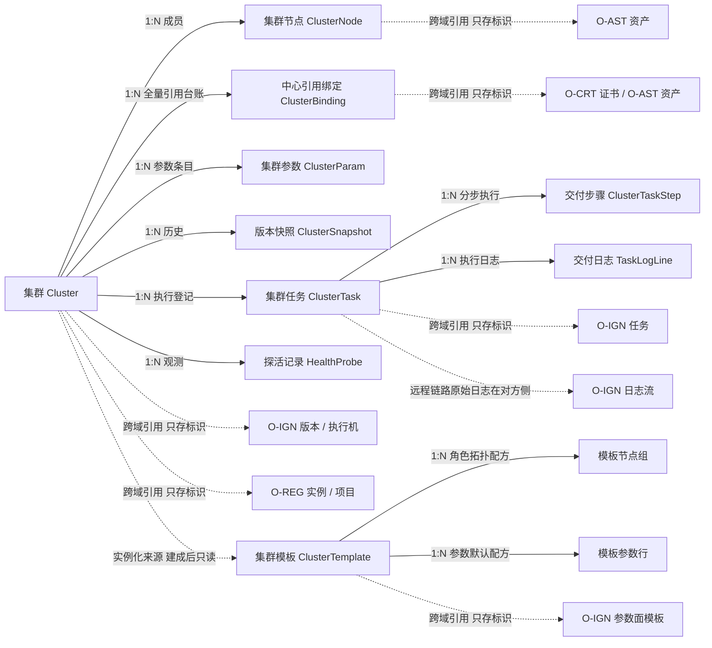
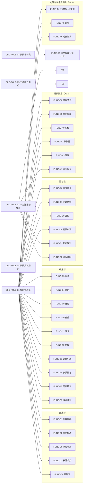
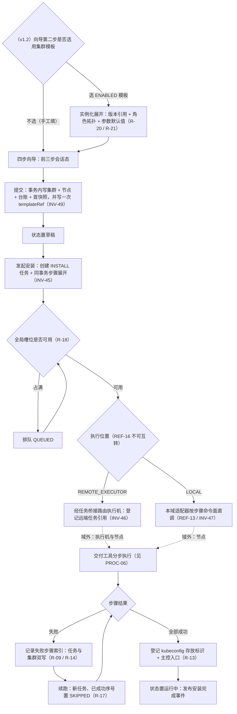
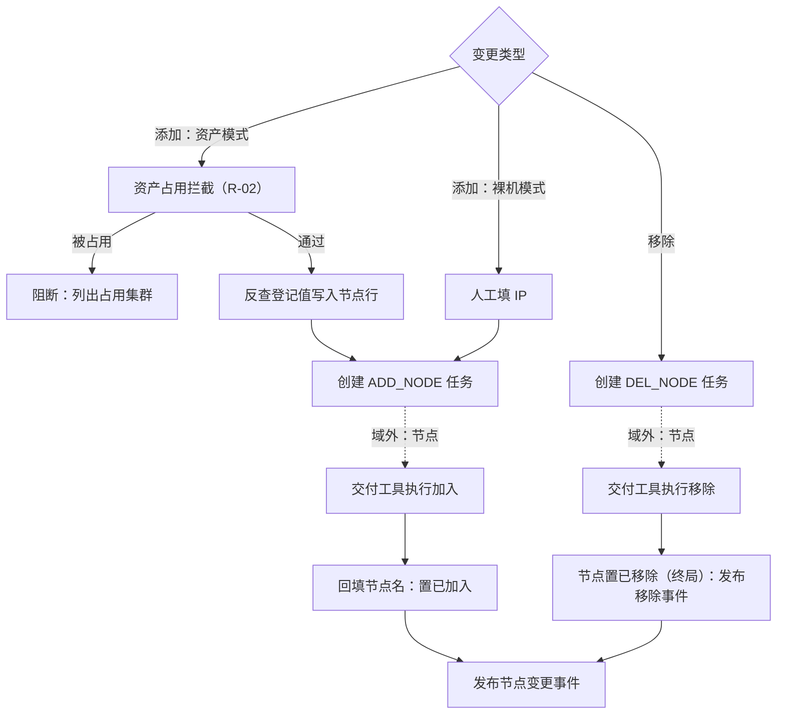
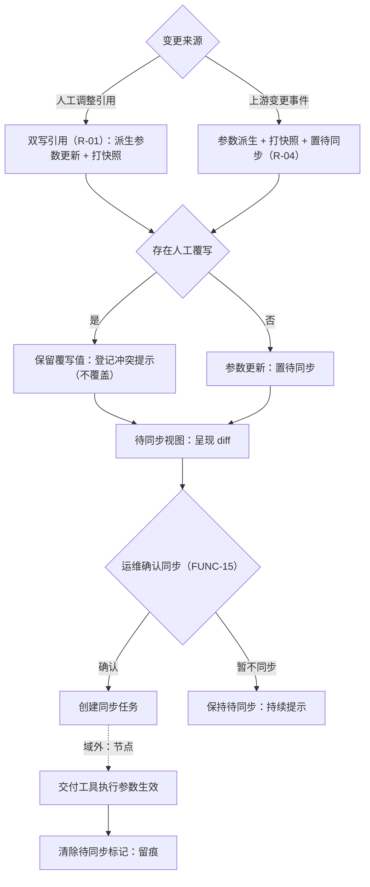
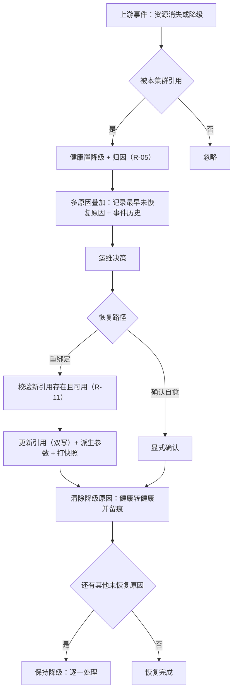
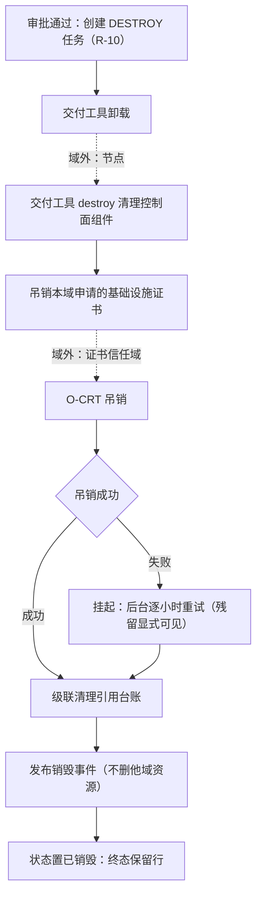
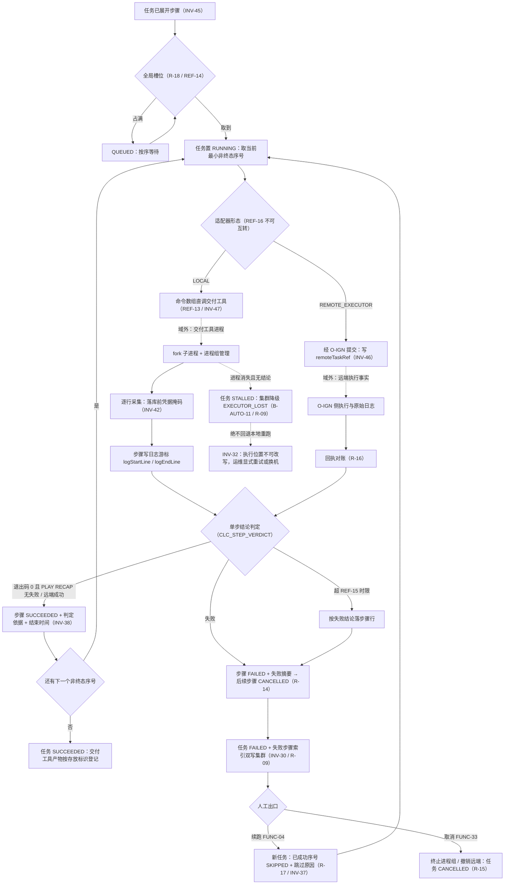
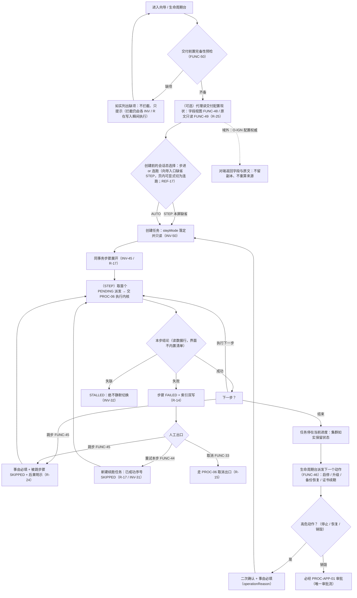
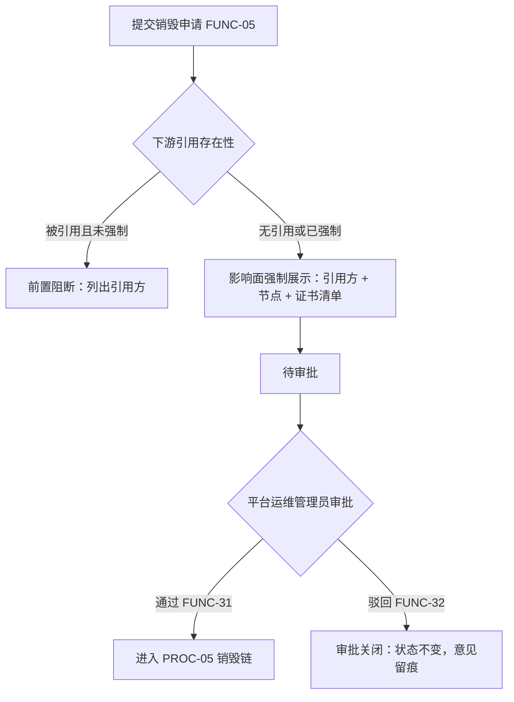

# OPIC-集群域 需求规格说明书

| 项目 | 内容 |
|---|---|
| 文档名称 | OPIC-集群域需求规格说明书 |
| 规范版本 | 软件需求编写规范 V10.0 |
| 编制日期 | 2026-09-24 |
| 文档状态 | **v1.2 完整（可进入本体建模阶段）**（v1.1.1 定稿结论保持，v1.2 易用性增补已入正文）｜九部分 + 附录 A 全部完成、本域 Q-1~Q-70 **全部确认**（待确认项 0；跨域引用的 `Q-71`~`Q-73` 属 `O-IGN` 序列，其中 **`Q-73` 已于 2026-10-07 真实例交付验收按 AI 建议裁定「不同源」** ⇒ `O-IGN` 侧 `FUNC-34` 请求体不扩 DNS 后缀列，本域侧牵连的 `R-19` 偏差注记联动项同批收口、**维持当前实现口径**，详见 `R-19` 下方注记）｜**阶段三（跨对象联动识别）为《编制说明》§D.5 的独立强制阶段**｜E.2 自检 **54 / 54**（v1.2 批**九组全部复跑**，见 E.2.3）、第九部分 13 项自检全过、独立审核无 FAIL｜**v1.1 = 交付执行落地批**：第 3 层交付工具（产品名见 1.6.4，C1 铁律）的真实执行链路进入正文，对象 7→9、功能点 32→35、自动行为 9→13、字典 20→24 类，含 **`REF-12`、正文 1.2.2、6.1 第 ⑤ 条与 8.6 第 16 条四处既有口径的需求变更**（详见《编制说明》A.2 / E.1 Q-63~Q-70 / **I 区**）｜**v1.1.1 = 远程受理的登记事实增补批**（对接 `O-IGN` v1.1.1 批）：仅 **R 18→19**（新增 `R-19`）+ `INV-14` 派生口径补写，其余规模指标全部不变｜**v1.2 = 管理员易用性增补批（2026-10-07）**：来源是**第九轮八阶段访谈 `Q-74`~`Q-114`**（逐条登记见《编制说明》E.1，**全部按 AI 建议确认、本批不新增待澄清项**），主题是把「集群怎么建、怎么改」从**能做得对**提升到**能做得顺** —— 新增 **1 个聚合根**（`ClusterTemplate` 集群模板，含「模板节点组」与「模板参数行」两个聚合内子实体）、**15 个功能点**（`FUNC-36`~`50`）、**6 条 R**（`R-20`~`25`）、**4 条 INV**（`INV-49`~`52`）、**2 条 REF**（`REF-17`~`18`）、**1 条协同流程**（`PROC-07` 向导式装机与生命周期动作）、**5 份报表**（`REP-14`~`18`）、**2 类字典 / 5 个值**、**2 个二级菜单 / 2 个屏幕**；**系统自动行为仍 13 条**（判据见 3.2.2(4) 末段）、**审批流仍 1 条**（生命周期高危动作走"二次确认 + 事由 + 留痕"、不进 M6 流程引擎，判据见 4.3 第 16 项）、**角色仍 5 个**；`2.11` 对象关系总览的「② 命令面模板表 刻意不建」**保持不撤销**，本批建的是**集群侧建群配方**、不是命令面模板（澄清见 6.1 与 2.11）｜两份交付件的自包含 HTML **当前为 v1.2**（2026-10-07 随本批重导，`--theme light --mermaid inline --version v1.2`；**Mermaid 10 / 10 渲染为 SVG**（受控浏览器**渲染后 DOM** 实测：Mermaid 容器节点 10、带处理完成标记的 10、角色描述为 flowchart-v2 的 `<svg>` 10，v1.2 批新增 `图 4-8`；无头 Chrome `--dump-dom` 路径在 4 MB 级内联库上挂起不返回，本批弃用并改此口径。**用于计数的类名 / 属性名 / 文案串一律不写出字面量**（写出即在本件自己的 DOM 里多算一次，判据口径与复算入口见《编制说明》E.4 + J.3 ⑬）、无渲染降级占位提示（四类降级判据串 —— Mermaid 报错标题两种、库内部异常文案一种、生成器降级占位文案一种 —— **一律不写出字面量**：串写进交付文档，就会在文档自己的渲染 DOM 里被计数命中，使"0 次"的断言自我矛盾；实测四类串在本文档件与编制说明件的渲染文本里各 **0** 次，判据口径记《编制说明》J.3 ⑬）、无双重转义（重叠实体形态 0 处；单层尖括号实体属正常转义，不计入残留）、库源码未泄漏进可见文本、**207 锚点 / 172 标题**；第九部分 **13 项自检 13 / 13**（`tools/check_section9.py` 本批重建并随仓提交，载体口径订正记《编制说明》J.3 ⑪⑫）；上一版 v1.1.1 重导于 2026-10-07（`Mermaid 9 / 9`、183 锚点 / 148 标题，唯一中文锚点仍是首个 H1 slug —— 生成器固有行为，v1.0 / v1.1 件同样如此）、v1.1 重导于 2026-10-05，校验记录与**本批两处计数订正**（3.1.4 用例连线、附录 A 分类口径）见《编制说明》E.4） |

> 状态标记口径：`[AI自动补全]` 系统按行业通用做法补全、用户未修改；`[已确认]` 经用户确认或修改；`[待确认]` 尚未得到用户回复，已登记入《编制说明》待澄清清单。
> 本文档按 V10.0 固定结构（九部分 + 附录 A）组织：**没有适用内容的章节不得删除**，写明「不适用」及经确认的理由，不编内容填空。
> **八阶段的问题（Q-1~Q-62，含定稿确认 Q-62）已全部按 AI 建议确认**，故全部九部分与附录 A 的状态标记统一为 `[已确认]`，本文**无待确认项**。
> **v1.1 批（交付执行落地）新增问题 Q-63~Q-70 同样按 AI 建议直接落定**；其中四项由用户在 2026-10-05 显式裁定（执行落点分层可插拔 / 步骤权威入模型 / 日志走游标回放 / 本期不做执行机代理），登记入《编制说明》E.1 留档。
> **v1.1.1 批（远程受理的登记事实增补，2026-10-06）**新增 `R-19` 并补写 `INV-14` 的节点名派生口径 —— 来源是**联调与实现暴露的边界事实回写**（非访谈产出），故本批**不新增任何 `[待确认]` 标记**：批内曾登记的唯一未决项 `Q-73`（集群内 DNS 后缀与上游访问端点域名是否同源）属 **`O-IGN` 侧编号序列**，**已于 2026-10-07 真实例交付验收裁定「不同源」**，其在本域的侧影只是 `R-19` 下方那条 `ADD_NODE` 节点名偏差注记的观察项（同批收口，见该注记），**全程不阻塞本域建模与构建**（详见《编制说明》A.2 v1.1.1 行与 E.2.2）。
> **v1.2 批（管理员易用性增补，2026-10-07）**由**第九轮八阶段访谈 `Q-74`~`Q-114`** 驱动（用户在七个阶段一律回复「全部按 AI 建议」⇒ 逐条按建议定案，登记见《编制说明》E.1），故本批同样**不新增任何 `[待确认]` 标记**、待澄清清单**无未决条目**。本批的定位要说清楚：**它不新增任何交付能力** —— 01~07 装机、`hosts` / `config.yaml` 生成、镜像清单、生命周期动作、节点增删、证书续期**在 v1.1 / v1.1.1 的可运行链路上已经成立**（并已在 192.168.3.200 真实例跑通）。本批新增的是**管理员看见与操作它们的形态**：把"一次派发整条跑完"补上"逐步确认、单步重试、跳步留痕"的入口，把"配置文件只在命令面里"补上"只读视图 + 字段级覆写 + 预检"，把"六个动作散在三个屏幕"补上"一屏生命周期台"，把"每次建集群都从头填拓扑"补上"集群模板"。**判据贯穿一条**：**凡是权威已在他处（步骤序列权威在本域数据行、拓扑硬校验与取值四层权威在 `O-IGN`），本域只补入口与视图，不补第二套判断**（详见 4.3 第 15~17 项）。

---

# 第一部分 项目概述与范围

> 本部分对应《AI 需求探索与确认提示词 V10.0》**阶段零：原始需求接收与总体理解确认**。
> **各阶段的问题（Q-1~Q-70，含 v1.1 批 Q-63~Q-70）已全部按 AI 建议确认**，故全部九部分与附录 A 的状态标记统一为 `[已确认]`，本文**无待确认项**。

## 1.1 系统定位

本域（集群域，`O-CLC`；原能力中心 `cluster-center`，前缀 `CLC`）是 23 个本体论域中的**集群编排者与状态记录者**：它把「把一套 K8s 集群建起来并让它持续可管」拆成可治理的四个问题 —— **用什么建**（交付工具版本与中心引用，消费 `O-IGN` / `O-REG`）、**在哪建**（节点引用 `O-AST` 资产或手填裸 IP，双模并存）、**怎么建与怎么改**（安装 / 续跑 / 扩缩 / 升级 / 备份恢复，全部经交付执行域的任务桥接）、**坏了怎么办**（版本快照回滚、跨中心引用降级与显式恢复、下架销毁），使集群成为**平台治理的最终交付物**：扩展组件、监控、OS 使能都挂在它身上，它的下架即是一次全平台连锁清理的起点。（v3.2 更正，109 号 F-70） [已确认]

本域管理的是**集群台账与创建向导、节点清单与动态增删、交付编排任务、跨中心引用与参数派生、版本快照与回滚、健康探活与降级恢复、下架销毁**；它**不运行集群**（控制面组件由交付工具装到节点上自己跑）、**不签发 K8s 控制面证书**（apiserver / kubelet / etcd 证书始终走交付工具原生流程，**不经过证书信任域** —— 这是本域与基础设施证书的关键分界）、**不持有 SSH 凭据**（节点凭据由资产域通道按需提供，本域零持久化）。一句话：本域回答的是「**这个集群是怎么建出来的、现在能不能用、怎么改、怎么拆**」，而不是「**集群里面跑得怎么样**」（后者归可观测域）。 [已确认]

本域与其余 22 个域的耦合形态有四点特殊之处：① 它是**引用密度最高的域** —— 交付执行机、交付版本、镜像仓库实例与项目、基础设施证书、节点资产五类引用并存，且全部**可留空**（legacy 兼容模式），引用关系有独立对象并支持反向查询（见定性二）；② 它是**唯一拥有「版本快照 + 回滚」机制的域** —— 集群配置是复杂可变状态、回滚是运维刚需，这与各域「不存可推导快照」的经验不冲突：判据是「它会不会变」（集群配置会变，所以历史要存）；③ 它是**下游域的宿主登记处** —— 集群销毁不是删行，而是一次连锁清理的起点（发布事件让扩展组件域、可观测域自行清理），**本域只吊销本域申请的基础设施证书、绝不删除他域资源**；④ 它是**「降级不自动恢复」纪律的诞生地** —— 引用资源恢复事件到达不自动翻回健康，必须显式确认，因为「事件说恢复了」不等于「真的恢复了」（见定性二）。 [已确认]

### 1.1.1 四条域级定性

> 以下四条是本域在阶段零确立的定性，后续所有阶段不得违背；若确需变更，须作为需求变更显式提出（与已完成九域的定性同级）。

**定性一：集群是平台治理的最终交付物 —— 本域是它的编排者与状态记录者，不是它的运行者。** 集群的控制面组件由交付工具装到节点上自行运行，本域记录「用了哪些版本、哪些机器、哪些引用」并编排它的生（创建 / 扩缩 / 升级 / 备份恢复）与死（销毁）。三条硬性含义：① **本域是下游域的宿主登记处** —— 扩展组件域、可观测域、节点使能域都以集群为部署目标；下架集群时本域只做三件事（执行交付工具的卸载、吊销本域申请的基础设施证书、清理本域引用），**其余连锁清理由各中心订阅事件自行决定**；② **本域不修复运行中组件** —— 节点上组件的故障归可观测域发现、集群域只保证「编排动作可执行、结果可追溯」；③ **健康是观测不是治理** —— 探活结论（含观测时间）与生命周期状态正交，降级必须可归因（`degraded_reason`）且只能被显式恢复清除。**后果与补偿**：本域无法直接触碰节点内部 ⇒ 补偿手段是**探活 + 降级显式化 + 显式恢复 + 快照回滚**，把「修不了」变成「看得见、退得回」。 [已确认]

**定性二：跨中心引用是本域的一等公民 —— 「绝不静默切换」与「降级不自动恢复」是两条铁的引用纪律。** 本域引用五类外部资源且全部可留空（legacy 模式是显式声明的兼容路径、不是缺陷）。四条硬性含义：① **绝不静默切换** —— 远程点火机失联时**不得自动回退本地执行**：静默切换会让运维误判「在哪执行」，执行位置必须始终显式；② **降级不自动恢复** —— 引用资源恢复事件到达时不得自动翻回健康（事件说恢复不等于真恢复），探活成功也不覆盖跨中心降级，**只有显式恢复（重选引用或确认）能清除降级**；③ **引用变更派生参数但不自动生效** —— 上游实例变更自动派生新参数并打快照，**是否执行同步由运维显式决定**（自动执行等于替运维重启服务）；④ **引用要能反查** —— 引用关系有独立对象，上游域下架前可通过反向查询知道「谁在引用我」（与「跨域引用要在对方域收口」互为两侧）。 [已确认]

**定性三：节点是资产的一次使用，不是资产的副本 —— 本域不复制机器事实、不持久化 SSH 凭据。** 节点可选引用资产（资产模式）或手填 IP（裸机模式），双模并存是**演进路径**而非过渡状态。四条硬性含义：① **机器事实归资产域** —— 节点的地址、连接参数随反查写入登记值，**SSH 凭据绝不落本域库**（凭据的使用方是资产域的执行通道，判据「使用方在谁手上」）；② **资产下架不删除节点行** —— 引用置空、地址保留（供人工接管），集群降级并显式归因；③ **单节点健康变更不降级集群** —— 一台机器不可达不一定影响集群整体，只发节点级健康事件（避免把节点抖动放大成集群告警）；④ **一台资产同时只服务一个活跃集群** —— 节点占用冲突前置拦截（复用同一台机器装两个集群是运维事故的常见来源）。 [已确认]

**定性四：集群生命周期是单向治理线，快照是回滚的唯一依据 —— 但回滚前必须校验引用仍然存在。** 生命周期状态单向推进（草稿 → 安装中 → 运行中；安装失败可从失败步骤续跑；销毁为终态且**保留行供审计**）。四条硬性含义：① **快照同步引用** —— 每次配置变更打快照时同步保存当前跨中心引用，回滚时一并恢复；② **回滚先校验引用** —— 快照引用的资源已被上游删除时拒绝回滚（除非显式选择「放弃引用回滚」，此时引用置空并留痕）；③ **安装失败可续跑** —— 失败步骤索引持久化，重试从失败处继续、不重跑已成功步骤（长流程多步骤的失败恢复与 `O-IGN` 任务级失败是两个层次）；④ **销毁保留行** —— `已销毁` 是终态、记录保留供审计（集群的历史不可伪造，与 `O-AST` / `O-IGN` 终态保留同判据）。 [已确认]

> **层位说明**：本域位于三层架构的**第 2 层（平台能力层）**，属 **Tier 1**（原能力中心清单为平台层第 8 顺位；本体论域登记为第 10 号，见 `O-SEC.SEC_DOMAIN_CODES`）。MVP 最短依赖路径为 `O-SEC → O-ARC → O-SYS → O-DBS → O-CRT → O-VPN → O-REG → O-AST → O-IGN → O-CLC …`。 [已确认]
> **本域为什么排在交付执行域之后**：集群的安装 / 扩缩 / 升级全部**消费交付执行域的任务桥接**（执行机路由）与**版本目录**（交付工具版本），镜像源**消费制品仓库域**，节点**引用资产域**，基础设施证书**消费证书信任域**。五条供给线齐备后，集群才能被编排。 [已确认]
> **本域落地的紧迫性**：本域是**扩展组件域（`O-ADD`）、可观测域（`O-MON`）、节点使能域（`O-OSC`）三个域的硬前置** —— 它们都以集群为部署目标；同时它是平台价值的兑现点（交付线的终点是「一个可用的集群」）。 [已确认]
>
> **域边界一句话（十域对照）**：`O-SEC` 管「**能不能过**」｜`O-ARC` 管「**错是什么**」｜`O-SYS` 管「**平台怎么运转**」｜`O-DBS` 管「**数据放在哪、谁能连、丢了怎么回来**」｜`O-CRT` 管「**谁可以被信任**」｜`O-VPN` 管「**节点之间能不能连上**」｜`O-REG` 管「**制品放在哪、谁能拉**」｜`O-AST` 管「**机器是谁、它准备好了吗**」｜`O-IGN` 管「**用哪个版本、在哪台机器、把动作安全送过去**」｜`O-CLC` 管「**集群怎么建、怎么改、怎么拆**」。 [已确认]

## 1.2 业务范围

### 1.2.1 范围内

- **集群台账与创建向导**：四步创建（基本信息 → 节点选择 → 中心引用 → 参数确认），**前一步只做会话态校验、写库延迟到最后一步**（不产生半成品集群）；节点双模（引用资产 / 手填裸 IP）；中心引用全可选（全部留空 = 显式声明的 legacy 模式，受平台配置约束）；集群状态机（草稿 / 安装中 / 运行中 / 安装失败 / 已销毁）。 [已确认]
- **节点管理**：动态增删节点（经交付工具动作）；**资产占用拦截**（一台资产同时只服务一个活跃集群）；资产下架的引用处置（引用置空、地址保留、集群降级归因）；节点重绑定（换绑新资产）；节点级健康事件（不放大为集群降级）。 [已确认]
- **交付编排**：安装（含 **失败步骤索引与续跑**）、升级、扩缩、备份恢复、启停、**（v1.1）执行中任务的取消**，全部经交付执行域任务桥接路由（远程执行机）或本地链路（**v1.1：本地链路是运维在向导显式选择的结果、不是失联兜底**）；**绝不静默切换执行位置**；**（v1.1）交付动作按有序步骤推进、每步结论落数据行（步骤状态 / 判定依据 / 失败摘要），日志按游标可回放**；交付工具原生流程负责的一切（K8s 控制面证书等）本域不重复做。 [已确认]（v1.1 增补）
- **跨中心引用与参数派生**：引用对象（五类资源、全量台账、支持反向查询）；参数派生（镜像源 / 交付工具镜像 / 访问凭据引用），**派生凭据只在内存流转、绝不落库**；上游变更派生新参数 + 打快照 + **提示显式同步**；**降级订阅**（引用资源消失或降级 ⇒ 集群降级并归因）；**显式恢复**（重选引用或确认后清除降级）。 [已确认]
- **版本快照与回滚**：每次配置变更打快照（hosts / 配置 / 引用一并保存）；回滚前校验快照引用仍然存在（不存在则拒绝或显式放弃引用回滚）；快照保留期受平台配置约束。 [已确认]
- **健康探活与降级**：周期探活（控制面可达性 + TLS 握手 + 节点就绪数）；连续失败转不可达；**探活与跨中心降级互不覆盖**；聚合健康接口（并行查询各中心、部分失败不整体失败、响应缓存防穿透）。 [已确认]
- **下架销毁**：卸载（交付工具原生流程）→ 吊销本域申请的基础设施证书 → 清理引用台账 → 发布销毁事件 → 终态保留行；**吊销失败挂起后台重试**（残留显式可见）；被下游引用时默认拒绝、强制须审批。 [已确认]
- **跨中心暴露与事件**：按用途的精简查询（监控目标 / 扩展目标 / 节点运行时反查）；全生命周期事件（创建、安装、参数变更、节点变更、健康、销毁）；与平台底座的对接（能力登记、审计、配置项、事件总线）。 [已确认]
- **（v1.2 新增）向导式装机过程**：01~07 安装步骤以**步骤器**形态呈现给管理员，每步可**执行 / 重试 / 继续**，缺省**逐步人工确认**、页内显式开关可切回既有的"一次派发连跑"（不剥夺 v1.1 已实测链路）；**允许跳步但必填原因并明示后果**；同集群在途互斥沿用（有在途任务 ⇒ 按钮置灰并说明排队，**不谎报失败**）；**步骤序列的权威仍是 2.8 的数据行，本屏不新建第二套步骤模型**。 [已确认]（v1.2 增补）
- **（v1.2 新增）装机与生命周期动作的实时日志跟随**：把既有 `REP-13` 游标回放的**流式形态（SSE）嵌入向导屏**，边执行边滚动；用户上滑即暂停自动跟随（不被新行拽回底部）；终态停止跟随并保留完整回放。 [已确认]（v1.2 增补）
- **（v1.2 新增）集群生命周期管理台**：启动 / 停止 / 升级 / 备份 / 恢复 / 销毁 + **控制面证书续期**聚到一屏，逐动作显示"当前可不可做、为什么"；**高危动作二次确认 + 事由 + 留痕**（销毁仍走审批不变）。 [已确认]（v1.2 增补）
- **（v1.2 新增）节点台的分组视图与登录标识**：节点清单按**角色分组**呈现（控制面 / 基础设施 / 工作负载），组内逐台给「复制 SSH 命令」—— 只出**登录标识**（用户 + 地址 + 端口），**凭据值零出口**、**不做浏览器内的终端**（判据见 1.2.2）。 [已确认]（v1.2 增补）
- **（v1.2 新增）集群模板**：把"每次建集群都要重填一遍拓扑与参数"固化成**可复用的建群配方**（模板节点组 = 角色 + 数量、模板参数行、可选引用 `O-IGN` 的**参数面模板标识**）；支持登记 / 整组编辑 / 启停 / 设为默认 / 从既有集群克隆 / 软删除；**按模板建群 = 创建向导的一次性实例化展开，建成后不回写、不跟随**。 [已确认]（v1.2 增补）
- **（v1.2 新增）集群交付配置的只读代理视图**：在本域「引用与参数」屏内嵌显示该集群在 `O-IGN` 侧的**当前生效配置（逐字段 + 生效来源）**与**清单原文只读视图**；读通道由**本域后端代理**对端门面（同一服务凭据、各加权限码），**写入口只在 `O-IGN`**，本域给"去改"的引导链接而不复制一套编辑界面。 [已确认]（v1.2 增补）

### 1.2.2 范围外

| 范围外内容 | 排除理由 |
|---|---|
| **集群内部的可观测**（指标采集、日志、告警规则） | 归可观测域（`O-MON`）；本域只做「控制面可达性」级别的探活（定性一 ③）。 [已确认] |
| **K8s 控制面证书的签发与轮换**（apiserver / kubelet / etcd / front-proxy） | **始终走交付工具原生流程**、不经过证书信任域 —— 这是交付工具自洽性的边界（C.1.2 第 5 条）；本域只管基础设施证书（镜像源客户端 / 监控 mTLS / ingress 泛域名）。 [已确认] |
| **节点的机器事实与 SSH 通道** | 归资产域；本域节点只存登记值，凭据零持久化（定性三）。 [已确认] |
| **交付动作的工具执行内部过程与远程链路的原始日志** | **v1.1 口径变更**：范围外的内容收敛为「**交付工具内部过程**（角色与剧本级重试、输入文件的具体格式）与 **`REMOTE_EXECUTOR` 链路的原始日志**」—— 二者仍归交付工具与 `O-IGN`；**`LOCAL` 链路的步骤结论与日志行进入本域**（因为续跑、对账、审计都要引用它们，判据见 6.1「结论归我、过程不归我」与 `REF-12`）。v1.0 原文「执行事实真相全在执行机侧、本域只消费状态」已按此收窄。 [已确认]（v1.1 修订） |
| **镜像仓库与制品内容** | 归制品仓库域；本域只做镜像源参数派生。 [已确认] |
| **扩展组件的目录与分发、监控目标的注册** | 归扩展组件域 / 可观测域；本域只提供「部署目标」的精简查询（1.2.3）。 [已确认] |
| **租户与成员管理** | 归租户门户域（`O-USR`）；本域的集群归属关系由其消费。 [已确认] |
| **任意节点的 shell 直连** | 一切节点动作经**交付工具动作**发起（`LOCAL` 链路由本域适配器以参数数组直调交付工具、`REMOTE` 链路经 `O-IGN` 桥接），**本域不提供命令输入、拼接或交互终端**（`INV-47` / 8.6 第 17 条；与 `O-IGN` 白名单口径一致 —— 白名单语义在 `O-IGN`，本域只执行步骤字典映射出的动作）。**（v1.2 具体化）"不做浏览器内的交互式终端（WebSSH）"是本条的显式适用，不是新功能**：参考实现里存在的那种形态（前端起一个 PTY 会话、后端用跳过主机密钥校验的 SSH 直连节点）把"凭据零持久化 + 白名单动作"两条纪律一次击穿 —— 一旦浏览器里能敲命令，`INV-47` 的"三类入参各命中格式白名单"就只是装饰。本域节点页只给**可复制的登录标识**（`FUNC-47`，用户 + 地址 + 端口，无凭据值）；**若将来确需平台内终端，必须走 `O-SEC` 的会话与凭据治理另立裁定**，不在本批顺手做。 [已确认]（v1.2 增述） |
| **（v1.2 新增）`hosts` / `config.yaml` 的整文件文本编辑态** | 两份文本是**交付工具命令面的派生产物**，其权威在 `O-IGN` 的落盘与对齐职责内（`O-IGN` 侧 `R-18` / `R-24`、`Q-69` 裁定 ②「清单与配置文本不入对象模型」）。本域**既不存文本、也不编辑文本**：管理员要看就用只读代理视图（`FUNC-48` / `FUNC-49`），要改就去 `O-IGN` 的**字段级覆写**（对端 `FUNC-47`）—— 本屏给"去改"的引导入口。**判据**：整文件编辑等于把"字段"降级成"字符串"，四层取值、来源标注、覆写回落、dry-run 预检全部失去落点，且会与本域已登记事实（节点清单、参数行）产生两处真相；参考实现把整段文本存成大字段并提供编辑框、保存动作实际不生效，是**要避开的路径而不是要抄的能力**。 [已确认]（v1.2 新增） |

### 1.2.3 外部边界

| 边界对象 | 交互方向 | 交互内容 | 边界口径 |
|---|---|---|---|
| 交付执行域（`O-IGN`） | 本域 → 调用 | 全部交付动作经任务桥接路由；引用执行机与交付版本；**v1.1 增补**：远程链路的执行事实与原始日志在 `O-IGN` 侧，本域按回执对账修正状态并留痕（`R-16`）；**v1.1.1 增补**：远程受理的请求体只携带登记标识与本域事实（节点清单 / 交付版本引用按 `R-19` 取用），命令面与参数由对端私有派生 | **绝不静默切换执行位置**（远程失联不回退本地）；**版本编目在 `O-IGN`**（本域是选版消费方，`O-REG`「托管 ≠ 编目」的下游）；执行位置、版本是集群的**出生事实**（入快照）。**（v1.1）本地链路是运维在创建向导显式选择「不使用执行机」的结果、不是失联兜底** —— 适配器形态由部署配置显式声明且运行期不得互转（`REF-16`），与 `INV-32` 同一条纪律的两侧。**（v1.2 增补）配置面新增一条只读通道**：本域后端代理 `O-IGN` 门面的交付配置只读端点（对端 `FUNC-46` / `FUNC-45` / `FUNC-50`），**沿用同一服务凭据（facade token）与同一执行权限档位、各加一个权限码**，不引第二套身份；口径三条 —— ① **不做前端直连**（跨中心双重鉴权与审计头透传只能在后端完成）；② **不提供写入口**（覆写、回落、dry-run 的写与判都在对端，本域给引导链接）；③ **不留副本**（代理显示的内容即对端事实，本域不落库、不缓存成第二处真相，与 `REF-12` 同源）。 [已确认]（v1.2 增补） |
| 资产域（`O-AST`） | 双向 | 节点引用资产；订阅资产下架与健康事件；**节点机密计算（TEE）能力标签透传**（**v3.1 增补，V3-31b / 107 号 F-49**：`capabilityFlags` 含 `TEE` 的节点信息随节点事实进入本域，供调度 / 部署约束消费） | **机器事实归 `O-AST`、节点是资产的一次使用**（定性三）；SSH 凭据零持久化；单节点健康变更不降级集群；**能力标签权威编目在 `O-AST`（`AST_CAPABILITY`），本域只透传不定义 TEE 语义**（attestation 证明归第 3 层）。 [已确认] |
| 制品仓库域（`O-REG`） | 双向 | 镜像源参数派生（实例 + 项目 + 机器人令牌引用）；订阅实例变更与移除 | **派生凭据只在内存流转、绝不落库**；实例移除 ⇒ 集群降级归因；本域是其消费方（「集群域是镜像源消费方」接口的承接）。 [已确认] |
| 证书信任域（`O-CRT`） | 双向 | 基础设施证书（镜像源客户端 / 监控 mTLS / ingress 泛域名）签发与吊销；订阅轮换事件推送节点 | **K8s 控制面证书不经过 `O-CRT`**（交付工具原生流程）；下架时只吊销本域申请的证书；轮换推送节点热加载。 [已确认] |
| 扩展组件域 / 可观测域 / 节点使能域（`O-ADD` / `O-MON` / `O-OSC`） | 对方 → 查询本域；本域 → 事件 | 按用途精简查询集群与节点；订阅销毁事件自行连锁清理 | **本域不删他域资源** —— 销毁只发布事件；引用声明（谁引用集群）由对方域维护、本域的反向查询接口供其收口（范围外声明，待探索时收口）。 [已确认] |
| 平台底座域（`O-SYS`） | 双向 | 能力登记、审计、配置项（legacy 开关、快照保留期、**v1.1：执行并发槽位上限 / 单步超时 / 日志保留期 / 适配器形态声明**）、事件总线 | RBAC 采用 `cluster:*` 资源命名空间（角色全局登记原则）；**（v1.1）执行日志不再借底座通道 —— 本地链路日志由本域自建对象存储（`REF-12` 变更），其保留期与并发上限仍是底座配置项**。 [已确认] |
| 零信任安全域（`O-SEC`） | 本域 → 遵从 | 统一认证授权；legacy 别名兼容（旧隐式权限映射到 `cluster:*` 并留痕双校验） | 本域不建主体、不做判定。 [已确认] |
| 数据服务域（`O-DBS`） | 本域 → 依赖 | 业务库供给（`clc` schema） | 禁 AutoMigrate；跨中心不建外键。 [已确认] |
| 网络连通域（`O-VPN`） | 本域 → 依赖 | 平台到节点、执行机到节点的可达性 | 可达性是运行前置；本域不建覆盖网。 [已确认] |

## 1.3 业务域划分

本域划分为 **8 个子域**（**v1.2 批由 7 扩至 8**；与第八部分菜单的对应关系见下表 —— v1.2 起不再是严格一一对应，理由见表后判据）：

| 子域编号 | 子域名称 | 职责概述 | 对应菜单 |
|---|---|---|---|
| 1 | 集群台账 | 创建向导、集群清单与详情、状态机 | 集群台账 |
| 2 | 节点管理 | 节点清单、增删、重绑定、占用拦截；**（v1.2）角色分组视图与登录标识复制** | 节点管理 |
| 3 | 交付编排 | 安装 / 续跑 / 升级 / 备份恢复 / 启停 / 销毁编排；**（v1.2）向导式步进装机与生命周期管理台（一域两屏）** | 交付编排、装机向导 |
| 4 | 引用与参数 | 中心引用台账、参数派生、降级订阅、显式恢复；**（v1.2）交付配置只读代理视图** | 引用与参数 |
| 5 | 快照与回滚 | 版本快照、回滚校验与执行 | 快照与回滚 |
| 6 | 健康探活 | 周期探活、降级归因、聚合健康 | 健康探活 |
| 7 | 运行观测 | 统计总览、跨中心暴露、运行参数 | 运行观测 |
| **8** | **集群模板（v1.2 新增）** | 建群配方的登记、整组编辑、启停 / 设默认 / 克隆 / 软删，以及"按模板建群"的实例化口径 | 集群模板 |

> **子域划分的判据**：按「**集群的一生**」划分 —— 建（1 / 2）、改（3）、连着谁（4）、退回去（5）、好不好（6）、汇总出口（7）、**照什么建（8，v1.2）**。**「引用与参数」独立成子域**因为引用密度是本域第一特征（定性二）；**「快照与回滚」独立成子域**因为它是本域独有的恢复机制（定性四）。**（v1.2）为什么「集群模板」独立成第 8 子域而不是并入子域 1**：模板是**跨集群复用的资产**、其生命周期与任何一个集群无关（草稿 → 启用 → 停用 → 软删，与集群的六态没有任何一次交接），而子域 1 的对象是"这一个集群的一生"；并入会让"改模板"与"改集群"落在同一个屏幕的同一个保存动作上 —— 前者影响后续所有选它的建群、后者只影响一个集群，**混淆影响面正是本批要消灭的体验缺陷**（与 `O-IGN` 侧「参数面模板独立成子域」同一判据、同批裁定）。**（v1.2）菜单与子域从"严格一一对应"变为"一域两屏一处"**：子域 3 因「任务台账（多集群横看）」与「单集群步进器 + 生命周期台（纵看一个集群的现在与下一步）」的过滤维度、动作主体与终态语义完全不同而分两屏两菜单；除此之外仍是**一子域一菜单**，与 8.1 一致。 [已确认]（v1.2 增补）

## 1.4 核心清单索引

> 编号在各部分内独立；跨域引用冠域码。预判以实际产出为准（偏差登记入《编制说明》C.2）。

| 清单 | 数量（预判） | 实际（v1.2） | 所在部分 | 说明 |
|---|---|---|---|---|
| 业务对象 | 7 | **10** | 第二部分 | 集群 / 节点 / 引用绑定 / 参数 / 快照 / 集群任务 / 探活记录（v1.0 七个）+ 交付步骤 / 交付日志（v1.1）+ **集群模板（v1.2，含「模板节点组」「模板参数行」两个聚合内子实体）**；属性 **120**、INV **52** |
| 功能点 | 待阶段二定 | **50** | 第三部分 | 人工 28 + 审批 3 + 查询 19（v1.0 为 32＝18+3+11、v1.1 为 35＝19+3+13；**v1.2 +15＝人工 9（模板六项 + 步进 / 跳步 / 动作派发）+ 查询 6（模板两项 + 登录标识 + 两条代理只读 + 预检）**） |
| 系统自动行为 | 待阶段二定 | **13** | 第三部分 | v1.0 为 9、v1.1 为 13；**v1.2 不新增**（判据见 3.2.2(4) 末段：向导步进由人工确认驱动、模板实例化在创建事务内完成、代理只读无副作用 —— 都不是"无人触发的系统动作"） |
| 业务规则 | 待阶段一、二定 | **INV 52 / R 25 / REF 18** | 第二、三部分 | 跨对象约束预分流累计 **19 条**（v1.0 十一条、v1.1 加至十五条、**v1.2 加至十九条**）→ **25 条 R**，逐条映射与"无预分流来源"条目见 3.3.4 四条对账；**v1.2 批 +4 INV / +6 R / +2 REF** |
| 协同流程 | 5 | **7** | 第四部分 | 创建安装、节点变更、参数派生与同步、恢复、销毁（v1.0 五条）+ 交付执行与续跑（v1.1）+ **向导式装机与生命周期动作（v1.2 `PROC-07`）** |
| 审批流程 | 1 | **1** | 第四部分 | 集群销毁（唯一审批流）—— **v1.2 不新增**：启动 / 停止 / 升级 / 备份 / 恢复 / 证书续期走"二次确认 + 事由 + 留痕"，判据见 4.3 第 16 项 |
| 报表 | 待阶段五定 | **18** | 第五部分 | v1.0 为 11、v1.1 为 13；**v1.2 +5：模板列表 / 模板详情 / 节点登录标识 / 交付配置代理视图 / 原文代理只读视图** —— 与查询功能点**一一对应但有 1 处显式例外**（`FUNC-50` 交付前置预检不建报表，判据见 5.1 表后与 5.16 绑定表末行），故 19 个查询对 18 份报表 |
| 数据字典 | 待阶段六定 | **26 类 / 107 项** | 第七部分 | v1.0 实为 20 类 83 项（计数勘误见 7.1）、v1.1 为 24 类 102 项；**v1.2 +2 类 / +5 项**（模板状态、任务步进模式） |

> **收敛说明**：v1.0 与阶段零预判一致（7 对象）；**v1.1 首次突破预判**（+2 对象 —— 判据是"续跑要成立，失败的那一步必须是数据行"）；**v1.2 再 +1 对象**（集群模板）。三批的偏差登记见《编制说明》C.2。**v1.2 增量的来源结构要说清**：v1.1 的增量是**执行链路的事实补齐**（新的被治理事实），v1.2 的增量是**管理员侧的形态与配方**（新的治理事实）—— 因此本批 15 个功能点里 **7 个是"把既有能力换个入口或视图给管理员"**（模板两条查询 `FUNC-36` / `37`、既有派发口的显式登记 `FUNC-46`、登录标识复制 `FUNC-47`、两条代理只读 `FUNC-48` / `49`、即时预检 `FUNC-50`）、**8 个带来新的事实**（模板六项维护 `FUNC-38`~`43` + 向导步进与跳步 `FUNC-44` / `45`，后者新落 `stepMode` 与 `operationReason` 两列）；**规模上功能点 +15、对象 +1，正是这个结构的比例**。 [已确认]（v1.2 增补）

## 1.5 角色总览

> 角色为局部编号（`CLC-ROLE-xx`），全局映射在 `O-SYS` 登记。

| 局部角色 | 角色名称 | 类型 | 职责概述 |
|---|---|---|---|
| `CLC-ROLE-01` | 集群管理员 | 人工 | 创建集群、节点增删、安装升级、快照回滚、销毁申请、显式恢复；**（v1.2 增补）装机向导的步进 / 重试 / 跳步、生命周期动作派发、交付前置预检、集群模板登记与编辑 / 启停 / 克隆 / 软删、节点登录标识复制** |
| `CLC-ROLE-02` | 平台运维管理员 | 人工 | 销毁审批、legacy 模式开关与运行参数、跨中心引用决策支持；**（v1.2 增补）新增一项且只有一项：「集群模板设为默认」（`FUNC-41`）—— 与既有"运行参数"同档，是平台级决定而非集群级动作，仍只有本角色可做** |
| `CLC-ROLE-03` | 集群审计员 | 人工 | 只读 + 审计台账（销毁留痕、引用变更留痕、探活异常）；**零写动作**；**（v1.2 增补）新增一项只读能力：交付配置原文代理视图（`FUNC-49`，独立权限码 + 逐次审计）—— 是读、不是写，零写动作结论不变** |
| `CLC-ROLE-04` | 集群只读用户 | 人工 | 集群清单、节点、健康、统计查询；**（v1.2 增补）节点登录标识复制（`FUNC-47`）对其开放（只出登录标识、无凭据值，与既有"kubeconfig 只出获取方式"同档）；「集群模板」「装机向导」两个菜单对其关闭** |
| `CLC-ROLE-05` | 下游能力中心 | 机器身份 | 扩展组件域 / 可观测域 / 节点使能域按用途反查集群与节点运行时信息；**只读、无界面**；**（v1.2）不新增入口** —— 交付配置的代理读是**本域后端**去读 `O-IGN`，与本域对下游暴露的读方向无关（见 1.2.3 与 `R-25`） |

> **角色说明**：`CLC-ROLE-05` 是**服务身份**（数据通路使用方，同 `O-REG.REG-ROLE-05` / `O-IGN` 的下游中心），不是机器身份（执行机代理）—— 两类第五身份在全项目中已形成清晰的分型。 [已确认]
> **（v1.2 增补）角色总数仍为 5 个、不新增第 6 角色**：本批六项易用性能力（向导步进、实时日志跟随、生命周期台、节点台增强、集群模板、配置只读代理）逐项检查后都能落在既有 5 角色边界内 —— **建群与改群的人**（`CLC-ROLE-01`）自然也是步进与覆写的操作者，**定平台缺省的人**（`CLC-ROLE-02`）自然也是"哪个模板是默认"的决定者，**看留痕的人**（`CLC-ROLE-03`）多一个取证面而已。**尤其不能新增的是"模板管理员"这类角色**：模板的编辑权若与建群权分家，就会出现"能改配方的人不为建出来的集群负责、负责建群的人改不动配方"，这是参考实现里已经观察到的运维摩擦来源，不是能力。上表职责概述列的增述即本批的角色侧全部改动（逐功能点分配见第八部分矩阵二）；**审计员零写动作**与**下游中心单一查询**两条既有结论在本批均未被削弱。 [已确认]（v1.2 增补）

## 1.6 技术底座与运行前置

### 1.6.1 情形一：技术底座已就绪

- **运行载体**：MCC 独立中心，`/api/v1/cluster/...`；跨中心调用走平台网关并透传审计头。 [已确认]
- **数据落点**：业务表落 `opicdb` 的 `clc` schema 前缀；禁 AutoMigrate；跨中心不建外键（引用靠标识 + 事件对账）。 [已确认]
- **认证与授权**：统一认证；RBAC 资源命名空间 `cluster:*`（集群 / 节点 / 参数 / 操作 / 版本 / 引用），**legacy 隐式权限通过别名映射兼容且双校验留痕**。 [已确认]
- **事件与日志**：全生命周期事件走平台事件总线；任务日志复用平台统一通道（交付动作的日志在 `O-IGN` 侧中继、本域回放）。 [已确认]
- **运行前置**：网络可达（`O-VPN`）、交付线可用（`O-IGN` / `O-REG`）、节点已收编（`O-AST`）—— 三者短时不可用时**不阻塞台账与查询**，只前置阻断对应编排动作（按能力降级，全部已完成域同一手法）。 [已确认]

### 1.6.2 情形二：未指定技术底座时的降级实现

> 平台底座已确定，本节**不适用**。保留本节并记录本域自身兜底口径：事件总线短时不可用时本地暂存重放；探活调度在数据库不可用时暂停并告警（探活依赖健康结论落库，无落库能力的探活会制造「看起来在巡检」的假象）。 [已确认]

### 1.6.3 与本文其余部分的关系

本节确立的四条定性、**8 个子域（v1.2 批由 7 扩至 8）**、5 类角色与范围边界是后续所有阶段的上位约束：第二部分**不建集群内部组件对象、不建凭据对象、不复制机器事实**；第三部分的规则不得违背「绝不静默切换」「降级不自动恢复」「派生不自动生效」三条引用纪律；第四部分的流程必须体现销毁的连锁清理边界；第五部分的报表**不含凭据与 kubeconfig 敏感内容**；第六部分以「**集群与引用归本域、机器事实归 `O-AST`、交付执行归 `O-IGN`**」为准；第八、九部分以 1.5 角色表为依据。突破须走需求变更并回改本节。 [已确认]
> **（v1.2）本节的上位约束追加两条**：① **权威不重复建模** —— 步骤序列的权威在 2.8 的数据行（`INV-37` / `INV-45` / `R-17` 不变）、拓扑硬校验与交付配置取值四层的权威在 `O-IGN`，本批新增的屏幕与功能点**只补入口与视图、不补第二套判断**（`R-23` / `R-25`）；② **易用性不破纪律** —— 向导、模板、只读代理三种形态都不得削弱「绝不静默切换」「凭据零出口」「无界面删除集群」三条既有红线（逐条落点见 8.6 第 18~20 项）。这两条是本批的**验收判据**：任何一处易用性改动若需要重开上面四条定性，就不是易用性而是需求变更。 [已确认]（v1.2 增补）

### 1.6.4 与第 3 层开源实现的对应关系（本域特有）

> 按 C1 铁律，本节是正文中唯一允许出现具体开源产品名的位置；产品名同时登记入《编制说明》C 区。本域与第 3 层的耦合形态是「**编排一个交付工具的命令面**」—— 本域不做任何 K8s 能力实现，交付工具是唯一的能力来源。

| 本域能力 | 对应的开源实现 / 协议 | 耦合形态 |
|---|---|---|
| 集群交付 | **kubeasz**（`ezctl` 命令族：setup / add-node / del-node / upgrade / backup / restore / destroy 等） | **命令面耦合**：本域的编排动作与 `O-IGN` 白名单按其命令面固定；交付工具可整体替换（命令面映射是本域与其的契约层，`REF-13`）。 [已确认] |
| 交付动作的分步执行 | kubeasz `ezctl setup <集群> <步骤号>`（01~07 分步） | **命令面耦合 + 序号契约**（v1.1）：本域把安装展开为 7 个步骤并逐步留痕（`ClusterTaskStep`），步骤序号是续跑指针的取值域；步骤清单变更随交付工具版本走、属契约层演进（`REF-13`）。 [已确认] |
| 执行结论判定 | 进程退出码 + Ansible **`PLAY RECAP` 的 `failed=0`** + 远端回执（v1.1） | **输出语义耦合**：退出码不足以判定成功（Ansible 的 `skipping / unreachable` 语义），本地链路以 `PLAY RECAP` 为准（`CLC_STEP_VERDICT`）；判定口径属交付工具族约定、不入业务规则。 [已确认] |
| 执行输入文件渲染 | kubeasz `hosts` 清单 + `config.yml` 参数模板 | **格式契约耦合**：本域渲染交付工具认识的输入文件，格式随交付工具版本走。 [已确认] |
| 控制面健康探活 | **K8s 健康端点**（`/healthz`）+ apiserver TLS 握手 | **协议级耦合**：只读探测、不做任何写操作。 [已确认] |
| 备份恢复 | kubeasz 原生 `backup / restore` 动作 | **命令面耦合**（同上）；备份产物归交付工具管理、本域只记录动作与结果。 [已确认] |
| 集群访问凭据（kubeconfig） | kubeasz 产出的 kubeconfig 文件 | **产物登记耦合**：本域登记其存放位置与访问方式，**敏感内容不入台账、不入报表、不入日志**（凭据口径与全部已完成域一致，`INV-40` / `INV-42`）。 [已确认] |
| 节点连接凭据（SSH） | 交付工具原生 `hosts` 清单约定的 SSH 参数 | **宿主环境耦合（v1.1）**：本地链路的 SSH 私钥属**执行宿主的运行环境**（部署前置、文件形态、本域零录入零存储零传输），不是本域数据；判据不变 —— **凭据的使用方在谁手上**（定性三 ①）。 [已确认] |

> **与 `O-IGN` 的对照**：`O-IGN` 是「动作怎么送过去」（白名单、路由、桥接），本域是「动作的编排序列与状态」（多步骤安装、续跑、快照）—— 两者共同构成交付线，**命令面契约**（哪些动作存在、参数是什么）是两域的接缝，由 `O-IGN` 的白名单字典承载。 [已确认]
>
> **v1.1 口径变更说明（分层可插拔，用户 2026-10-05 裁定）**：接缝两侧的执行落点改为**两个显式适配器**，由 `ClusterTask.executionPath` 一一对应、运行期不得互转 ——
> ① **本地链路适配器**：本域进程作为交付工具的**调用方**，按步骤 fork `ezctl`、采集日志与判定结论；
> ② **远程链路适配器**：经 `O-IGN` 任务桥接路由执行机，本域只消费回执与对账。
> 三条不变的边界：**(a) 本域仍不运行集群** —— fork 的是安装工具，控制面组件运行在节点上（定性一不破）；**(b) 本域仍不持有凭据** —— SSH 私钥属执行宿主环境、kubeconfig 只登记存放标识（定性三不破）；**(c) 命令面白名单语义仍以 `O-IGN` 字典为准** —— 本地适配器只允许执行由本域步骤字典（`CLC_INSTALL_STEP` / `CLC_TASK_KIND`）映射出的动作，不接受任意命令输入（`INV-47`，无 shell 直调）。 [已确认]

---

**第一部分（阶段零）小结**：四条域级定性（最终交付物的编排者与记录者、跨中心引用一等公民与两条铁纪律、节点是资产的一次使用且凭据零持久化、单向治理线与快照回滚）、7 个子域、5 类角色（服务身份第五分型）、8 条范围外边界（**K8s 控制面证书不经证书信任域**是最重要的技术边界）、9 条外部边界；登记上游九域既有约束 12 条与原 SPEC 口径矛盾 10 处（见《编制说明》C.1.1 / C.1.2）。唯一审批流预判 = **集群销毁**（判据：一次性使全部下游引用失效 + 交付工具卸载不可逆 + 修复必须重新创建）。 [已确认]
>
> **v1.1 批对本部分的唯一改动**：1.6.4 的耦合形态表由 5 行扩为 8 行（新增分步执行、执行结论判定、SSH 宿主环境三项），并补记「分层可插拔」口径变更说明 —— **四条域级定性一条未改**（本域仍不运行集群、仍不持有凭据、引用纪律与单向治理线原样），改动只落在「交付工具在哪一侧被调用」这一实现接缝上，属 1.6.4 允许出现的第 3 层对应关系范畴。 [已确认]
>
> **v1.2 批对本部分的改动（四项，全部是形态扩展、不动定性）**：① 范围内新增 6 项管理员易用性能力（1.2.1）；② 范围外由 8 条扩至 **9 条** —— 明确排除 `hosts` / `config.yaml` 的**整文件文本编辑态**与浏览器 WebSSH 终端，两条都有参考实现的反面教材支撑（见 1.2.2 第 8 行与新增第 9 行）；③ 子域由 7 个扩至 **8 个**（新增「集群模板」，判据见 1.3 表后）；④ 外部边界 `O-IGN` 一行增补「后端代理只读」的联动口径（1.2.3）。**四条域级定性一条未改、角色仍 5 个、审批流预判仍 1 条**；`2.11`（原 `2.10`）对象关系总览的「② 命令面模板表 刻意不建」一条**保持不撤销** —— 本批的"模板"是本域的建群配方，不是 `O-IGN` 的命令面。 [已确认]（v1.2）

---

# 第二部分 业务对象

> 本部分对应**阶段一：业务对象识别与数据建模确认**。全部条目已按 AI 建议确认，状态标记统一为 `[已确认]`。
> **v1.0 本域 7 个对象**：集群 `Cluster` / 集群节点 `ClusterNode` / 中心引用绑定 `ClusterBinding` / 集群参数 `ClusterParam` / 版本快照 `ClusterSnapshot` / 集群任务 `ClusterTask` / 探活记录 `HealthProbe`。
> **v1.1 增补 2 个对象 → 共 9 个**：交付步骤 `ClusterTaskStep`（2.8）/ 交付日志 `TaskLogLine`（2.9）—— 判据见 2.8 业务定义：**「安装失败可续跑」要成立，失败的那一步必须是数据行、不能只是一个整数**。
> **与阶段一预判一致（v1.0 为 7 对象）**；差异仅一处口径：快照的「是否可回滚」为**派生判定不落字段**（由引用存在性即时判定）。
> **v1.2 增补 1 个聚合根 → 共 10 个**：集群模板 `ClusterTemplate`（2.10，含「模板节点组」「模板参数行」两个聚合内子实体），并在集群与集群任务上各补业务属性（`templateRef` / `stepMode` / `operationReason`）—— 判据：**建群配方是可反复实例化的独立编目对象（有自己的状态机与默认位），不是集群的一个字段**；对象关系总览顺延为 `2.11`。

## 2.1 集群（Cluster）

**业务定义。** 一套由平台编排交付的 K8s 集群的**台账记录**：身份与入口、五类中心引用的**当前生效值**（内联快捷读取）、运行模式（MCC / legacy）、生命周期状态、健康结论与降级归因。它是下游域的宿主登记处。 [已确认]

**对象分类。** 主数据（本域权威源）。业务编号 `CLU` 前缀 + 4 位流水。

| 属性 | 属性英文名 | 类型 | 必填 | 唯一 | 说明 / 约束 |
|---|---|---|---|---|---|
| 集群编号 | clusterNo | 字符串 | 是 | 是 | 业务编号，创建时生成、不可修改 |
| 集群名称 | name | 字符串 | 是 | 是 | **未销毁范围内唯一**（已销毁保留行不阻塞复用） |
| 说明 | description | 字符串 | 否 | 否 | |
| 集群 DNS 域名 | clusterDnsDomain | 字符串 | 否 | 否 | |
| 交付版本引用 | versionRef | 引用 | 否 | 否 | **跨域引用** `O-IGN` 交付版本（只存标识）；空 = legacy 手填 |
| 交付执行机引用 | executorRef | 引用 | 否 | 否 | **跨域引用** `O-IGN` 执行机；空 = 本地执行链路 |
| 镜像仓库实例引用 | registryRef | 引用 | 否 | 否 | **跨域引用** `O-REG` 仓库实例；空 = external 手填镜像源 |
| 镜像仓库项目引用 | registryProjectRef | 引用 | 否 | 否 | 与实例引用**成对出现**（`INV-07`） |
| 运行模式 | runMode | 数据字典 | 是 | 否 | `CLC_RUN_MODE`：MCC / LEGACY；**与「全部引用为空」互为充要**（`INV-04`） |
| 生命周期状态 | status | 数据字典 | 是 | 否 | `CLC_CLUSTER_STATUS`：DRAFT / INSTALLING / RUNNING / INSTALL_FAILED / DESTROYING / DESTROYED |
| 失败步骤索引 | installStepIndex | 整数 | 条件 | 否 | INSTALL_FAILED 时必填（`INV-03`）；续跑从该索引继续 |
| 健康结论 | health | 数据字典 | 是 | 否 | `CLC_HEALTH`：UNKNOWN / HEALTHY / DEGRADED / UNREACHABLE；**双源写入口径**（`R-08`） |
| 降级原因 | degradedReason | 数据字典 | 条件 | 否 | `CLC_DEGRADED_REASON`：EXECUTOR_LOST / IGNITION_UNAVAILABLE / REGISTRY_REMOVED / ASSET_DECOMMISSIONED；**只能被显式恢复清除** |
| 最近探活时间 | lastProbeAt | 日期时间 | 条件 | 否 | 观测时间戳（结论与时效不可分） |
| 访问凭据存放标识 | kubeconfigRef | 字符串 | 条件 | 否 | RUNNING 及之后非空；**只存存放标识、内容绝不入库**（`INV-09`） |
| 主控入口 | masterEndpoints | JSON | 条件 | 否 | RUNNING 及之后非空（`INV-08`） |
| 来源模板引用 | templateRef | 引用 | 否 | 否 | **（v1.2 新增）** 引用本域集群模板（2.10）；**只在创建向导的实例化瞬间写入一次**，此后只读、不因模板变更而回写（`INV-49` / `R-20`）；空 = 未走模板 |
| 创建人 | createdBy | 字符串 | 是 | 否 | |
| 登记时间 | createdAt | 日期时间 | 是 | 否 | |
| 销毁时间 | destroyedAt | 日期时间 | 条件 | 否 | 进入终态时必填 |

**刻意不建的属性（四条）。** ① **健康历史不落本对象**（独立探活记录对象 2.7 承载）；② **集群内部组件不建对象**（控制面组件归交付工具与可观测域）；③ **凭据内容不建对象**（kubeconfig 与访问凭据只存存放标识，`INV-09`）；④ **「是否可回滚」不落快照**（派生判定，见 2.5）。 [已确认]

**对象级不变量**

| 不变量编号 | 业务条件 |
|---|---|
| INV-01 | 集群名称在未销毁范围内唯一（保存即校验） |
| INV-02 | 生命周期状态迁移固定单向；DESTROYED 为终态且行保留（仅提交时强制校验） |
| INV-03 | INSTALL_FAILED 必须携带失败步骤索引；续跑从该索引继续、不重跑已成功步骤（仅提交时强制校验） |
| INV-04 | 运行模式为 LEGACY ⇔ 四类中心引用全部为空；MCC 模式至少一项非空（平台配置可强制禁用 legacy；仅提交时强制校验） |
| INV-05 | 镜像仓库项目引用与实例引用成对出现或同时为空（保存即校验） |
| INV-06 | 健康写入口径：DEGRADED 只能被显式恢复清除；探活只写 UNKNOWN / UNREACHABLE / HEALTHY 的转换并刷新最近探活时间（**写权限由 `R-08` 承载**，此处声明口径；仅提交时强制校验） |
| INV-07 | 主控入口与访问凭据存放标识仅当状态进入 RUNNING 及之后非空（保存即校验） |
| INV-08 | 访问凭据存放标识只允许存放位置标识，**kubeconfig 内容与任何凭据值不得进入本对象、任何接口响应、事件、报表与导出**（输出面约束） |
| INV-09 | DESTROYED 冻结全部登记字段（终态；仅提交时强制校验） |
| INV-49 | **（v1.2）** 来源模板引用只在创建瞬间写入一次，此后**只读、不可改写、不可被模板变更回写**；模板侧的停用与软删除都不使该引用失效（引用的是编号事实，不是活动对象；仅提交时强制校验） |

**跨对象约束预分流（3 条，归属 R）**：① 「内联引用列与引用台账双写同步」—— 同集群的两处存储由写入动作同步维护，归属 R；② 「销毁编排：吊销基础设施证书 + 级联清理引用台账 + 事件通告（不删他域资源）」—— 归属 R；③ 「显式恢复的重绑定合法性校验」—— 归属 R。 [已确认]
>
> **（v1.2 增补）本对象不新增预分流来源** —— 「模板实例化后不回写」这条判断跨两个对象（模板 × 集群），已由 `R-20` 承载其**联动**，本处 `INV-49` 只登记**集群行自身**的只读结论，二者是同一纪律的两侧、不重复建模（归属判据见 3.3.4）。 [已确认]

## 2.2 集群节点（ClusterNode）

**业务定义。** 集群成员机器在本域的**使用登记**：可选引用资产（资产模式）或手填 IP（裸机模式），登记 IP 与节点名等随反查写入的登记值。**节点是资产的一次使用，不是资产的副本**（定性三）。 [已确认]

**对象分类。** 主数据（本域权威源 —— 集群成员关系；机器事实归 `O-AST`）。业务编号 `NOD` 前缀 + 4 位流水。

| 属性 | 属性英文名 | 类型 | 必填 | 唯一 | 说明 / 约束 |
|---|---|---|---|---|---|
| 节点编号 | nodeNo | 字符串 | 是 | 是 | 业务编号 |
| 所属集群 | clusterRef | 引用 | 是 | 否 | 引用本域集群 |
| 资产标识 | assetRef | 引用 | 否 | 否 | **跨域引用** `O-AST` 资产；空 = 裸 IP 模式 |
| 节点角色 | nodeRole | 数据字典 | 是 | 否 | `CLC_NODE_ROLE`：MASTER / WORKER / INFRA |
| IP 地址 | ipAddress | 字符串 | 是 | 否 | 资产模式随反查写入、裸机模式人工填写；**资产引用置空时保留不清洗**（`INV-13`） |
| K8s 节点名 | k8sNodename | 字符串 | 条件 | 否 | 加入集群后由交付工具回填；集群内唯一（`INV-15`） |
| 节点状态 | nodeStatus | 数据字典 | 是 | 否 | `CLC_NODE_STATUS`：PENDING / ADDED / REMOVING / REMOVED |
| 节点健康结论 | nodeHealth | 数据字典 | 是 | 否 | `CLC_NODE_HEALTH`：UNKNOWN / HEALTHY / UNREACHABLE；来自资产事件与节点级探测 |
| 最近健康时间 | nodeHealthAt | 日期时间 | 条件 | 否 | 观测时间戳 |
| 登记时间 | createdAt | 日期时间 | 是 | 否 | |
| 更新时间 | updatedAt | 日期时间 | 是 | 否 | |
| 备注 | remark | 字符串 | 否 | 否 | 人工接管等场景的注记 |

**刻意不建的属性（两条）。** ① **SSH 用户与凭据不建字段**（资产模式反查、裸机模式全局变量 —— 凭据零持久化）；② **机器规格与健康明细不落本对象**（机器事实归 `O-AST`，本域只保留节点级健康结论与观测时间）。 [已确认]

**对象级不变量**

| 不变量编号 | 业务条件 |
|---|---|
| INV-10 | 同一集群内 IP 地址唯一；K8s 节点名（非空时）集群内唯一（保存即校验） |
| INV-11 | 节点角色取值必须命中 `CLC_NODE_ROLE` 字典（保存即校验） |
| INV-12 | 裸机模式（无资产引用）必须可凭登记 IP 人工接管 —— **资产引用置空时 IP 地址与登记值保留不清洗**（仅提交时强制校验） |
| INV-13 | REMOVED 为该行终局；重新加入 = 登记新行（仅提交时强制校验） |
| INV-14 | ADDED 状态必须已有 K8s 节点名（加入成功的登记落点；仅提交时强制校验）。**（v1.1.1 批补写口径）** 节点名未回填时的派生口径唯一：集群编号小写 + 地址短横（`clu-YYYYMMDD-NNNN-192-168-3-21` 一类）；安装族下发对端的节点名与成功落点回填台账**必须同一条口径**（否则界面名单与 `kubectl get nodes` 两样，`R-19`） |
| INV-15 | PENDING 状态的节点不得作为交付动作的目标（未加入集群；仅提交时强制校验） |

**跨对象约束预分流（2 条，归属 R）**：④ 「一台资产同时只服务一个活跃集群」—— 占用拦截需读其他集群的节点占用，归属 R；⑤ 「资产下架 ⇒ 节点引用置空 + 地址保留 + 所属集群降级归因」—— 事件驱动的跨对象处置，归属 R。 [已确认]

## 2.3 中心引用绑定（ClusterBinding）

**业务定义。** 集群对五类外部资源使用关系的**全量台账**：目标能力、资源类型、资源标识、用途与登记来源。它是反向查询的权威（上游域下架前反查「谁在引用我」），内联引用列是它的快捷读取视图（`Q-7` 双写分工）。 [已确认]

**对象分类。** 主数据（本域权威源）。业务编号 4 位流水（对外呈现以组合定位为主）。

| 属性 | 属性英文名 | 类型 | 必填 | 唯一 | 说明 / 约束 |
|---|---|---|---|---|---|
| 绑定编号 | bindingNo | 字符串 | 是 | 是 | 业务编号 |
| 所属集群 | clusterRef | 引用 | 是 | 否 | 引用本域集群 |
| 目标能力 | targetCapability | 数据字典 | 是 | 否 | `CLC_TARGET_CAPABILITY`：IGNITION / REGISTRY / CERT / ASSET |
| 资源类型 | targetKind | 数据字典 | 是 | 否 | `CLC_TARGET_KIND`：EXECUTOR / VERSION / INSTANCE / PROJECT / CERTIFICATE / ASSET |
| 资源标识 | targetRef | 字符串 | 是 | 否 | **跨域引用**（只存标识；冠域码） |
| 用途 | purpose | 数据字典 | 是 | 否 | `CLC_BINDING_PURPOSE`：EXECUTOR_RUNTIME / VERSION_BASE / IMAGE_MIRROR / HARBOR_CLIENT / MONITORING_MTLS / INGRESS_WILDCARD / NODE_ASSET |
| 登记来源 | bindingSource | 数据字典 | 是 | 否 | `CLC_BINDING_SOURCE`：MANUAL / AUTO_DERIVED / EVENT_SYNC（对账维护） |
| 登记时间 | createdAt | 日期时间 | 是 | 否 | |
| 更新时间 | updatedAt | 日期时间 | 是 | 否 | |

**对象级不变量**

| 不变量编号 | 业务条件 |
|---|---|
| INV-16 | 同一集群内「目标能力 + 资源类型 + 用途 + 资源标识」组合唯一（保存即校验） |
| INV-17 | 目标能力与资源类型的组合必须合法（枚举映射：IGNITION→EXECUTOR/VERSION；REGISTRY→INSTANCE/PROJECT；CERT→CERTIFICATE；ASSET→ASSET；保存即校验） |
| INV-18 | EVENT_SYNC 行的变更必须携带对账注记（哪些事件维护了它；仅提交时强制校验） |
| INV-19 | 引用台账行在集群销毁时**级联清理**、但**不触发他域资源删除**（`R-07` 承载；此处声明范围） |

**跨对象约束预分流（1 条，归属 R）**：⑥ 「内联引用列与台账双写同步、不一致以台账为准」—— 与 2.1 预分流 ① 同一规则两侧。 [已确认]

## 2.4 集群参数（ClusterParam）

**业务定义。** 集群的渲染参数条目（交付工具输入的一部分）：键、值、**来源**（派生 / 模板 / 人工覆写）与待同步标记。**来源三级优先**是本对象的灵魂（`Q-8`）：人工覆写优先且留痕，上游再派生不覆盖覆写、改为提示冲突。 [已确认]

**对象分类。** 主数据（本域权威源）。集群内以参数键定位、不独立对外编号。

| 属性 | 属性英文名 | 类型 | 必填 | 唯一 | 说明 / 约束 |
|---|---|---|---|---|---|
| 所属集群 | clusterRef | 引用 | 是 | 是 | 引用本域集群 |
| 参数键 | paramKey | 字符串 | 是 | 是 | 集群内唯一 |
| 参数值 | paramValue | 字符串 | 是 | 否 | |
| 参数来源 | paramSource | 数据字典 | 是 | 否 | `CLC_PARAM_SOURCE`：DERIVED / TEMPLATE / MANUAL_OVERRIDE |
| 派生来源 | derivedFrom | 数据字典 | 条件 | 否 | `CLC_PARAM_DERIVED_FROM`：REGISTRY / VERSION / CERT；DERIVED 时必填 |
| 待同步标记 | syncPending | 布尔 | 是 | 否 | 上游变更派生新值后置位；**是否执行同步由运维显式决定**（定性二 ③） |
| 更新人 | updatedBy | 字符串 | 是 | 否 | |
| 更新时间 | updatedAt | 日期时间 | 是 | 否 | |

**对象级不变量**

| 不变量编号 | 业务条件 |
|---|---|
| INV-20 | 参数键在同一集群内唯一（保存即校验） |
| INV-21 | 参数来源为 DERIVED 时派生来源必填；MANUAL_OVERRIDE 的每次修改必须留痕（保存即校验） |
| INV-22 | 待同步标记为真时必须存在对应的派生注记（哪个上游、什么变更；仅提交时强制校验） |
| INV-23 | **派生写入不得覆盖 MANUAL_OVERRIDE 行** —— 冲突时保留覆写值、登记冲突提示（由 `R-04` 承载，此处声明口径） |

**跨对象约束预分流（1 条，归属 R）**：⑦ 「上游变更 ⇒ 参数派生 + 打快照 + 置待同步（不自动执行同步）」—— 事件驱动的跨对象写入，归属 R（与 `R-04` / `R-05` 同族）。 [已确认]

## 2.5 版本快照（ClusterSnapshot）

**业务定义。** 集群配置在某时刻的**不可改写历史**：内容（hosts / 配置渲染输入）、引用（五类中心引用）与变更摘要。本域是全项目唯一拥有快照回滚机制的域（定性四）—— 判据「它会不会变」：集群配置会变，故历史要存。 [已确认]

**对象分类。** 记录型数据（只增不改；清理仅按保留期）。业务编号 `SNP` 前缀 + 4 位流水。

| 属性 | 属性英文名 | 类型 | 必填 | 唯一 | 说明 / 约束 |
|---|---|---|---|---|---|
| 快照编号 | snapshotNo | 字符串 | 是 | 是 | 业务编号 |
| 所属集群 | clusterRef | 引用 | 是 | 否 | 引用本域集群 |
| 快照序号 | revisionNo | 整数 | 是 | 否 | 集群内单调递增 |
| 变更摘要 | changeSummary | 字符串 | 是 | 否 | 含触发来源（人工修改 / 上游派生 / 回滚动作） |
| 内容快照 | contentSnapshot | JSON | 是 | 否 | hosts 清单与配置渲染输入的完整快照 |
| 引用快照 | bindingSnapshot | JSON | 是 | 否 | 五类中心引用的当前值（回滚时一并恢复） |
| 快照类型 | snapshotType | 数据字典 | 是 | 否 | `CLC_SNAPSHOT_TYPE`：CHANGE / AUTO_DERIVED / ROLLBACK |
| 创建人 | createdBy | 字符串 | 是 | 否 | AUTO_DERIVED 记「system」 |
| 创建时间 | createdAt | 日期时间 | 是 | 否 | 保留期计算基准 |

**刻意不建的属性（一条）。** **「是否可回滚」不落字段** —— 它由快照引用的资源现存性**即时判定**（落字段会引入「上游刚删、标记没跑」的错）。 [已确认]

**对象级不变量**

| 不变量编号 | 业务条件 |
|---|---|
| INV-24 | 快照序号在同一集群内单调递增、不可复用（保存即校验） |
| INV-25 | 快照创建后不可修改（终态记录；回滚产生**新**快照、不覆盖旧快照；仅提交时强制校验） |
| INV-26 | 回滚动作的前置 = 目标快照引用的资源仍然存在；不存在时拒绝或显式「放弃引用回滚」（引用置空、留痕）—— 由 `R-06` 承载，此处声明口径 |
| INV-27 | 快照清理仅按平台保留期执行、清理动作留痕（`B-AUTO` 承载；仅提交时强制校验） |

**跨对象约束预分流（1 条，归属 R）**：⑧ 「回滚校验快照引用的现存性」—— 归属 R（见 `INV-26`）。 [已确认]

## 2.6 集群任务（ClusterTask）

**业务定义。** 一次集群编排动作的**执行登记**：安装 / 续跑 / 升级 / 扩缩 / 备份恢复 / 启停 / 证书推送 / 销毁。**执行位置必须显式登记**（本地链路或远程执行机 —— 绝不静默切换的落点，`Q-3`）；执行事实真相在 `O-IGN` 侧，本域消费其状态与对账结论。 [已确认]

**对象分类。** 记录型数据（只增不改；对账修正除外且留痕）。业务编号 `CTK` 前缀 + 4 位流水。

| 属性 | 属性英文名 | 类型 | 必填 | 唯一 | 说明 / 约束 |
|---|---|---|---|---|---|
| 任务编号 | taskNo | 字符串 | 是 | 是 | 业务编号 |
| 所属集群 | clusterRef | 引用 | 是 | 否 | 引用本域集群 |
| 任务类别 | taskKind | 数据字典 | 是 | 否 | `CLC_TASK_KIND`：INSTALL / RETRY_INSTALL / UPGRADE / ADD_NODE / DEL_NODE / BACKUP / RESTORE / START / STOP / CERT_RENEW / DESTROY |
| 任务状态 | taskStatus | 数据字典 | 是 | 否 | `CLC_TASK_STATUS`：QUEUED / RUNNING / SUCCEEDED / FAILED / CANCELLED / **STALLED** |
| 执行位置 | executionPath | 数据字典 | 是 | 否 | `CLC_EXEC_PATH`：LOCAL / REMOTE_EXECUTOR；**登记值即真实执行位置**（`INV-32`） |
| 远端任务引用 | remoteTaskRef | 字符串 | 条件 | 否 | `O-IGN` 任务标识（远程执行时） |
| 失败步骤索引 | failStepIndex | 整数 | 条件 | 否 | INSTALL / RETRY_INSTALL 失败时必填（`INV-30`） |
| 失败原因 | failReason | 数据字典 | 条件 | 否 | `CLC_TASK_FAIL_REASON`：STEP_FAILED / EXECUTOR_LOST / IGNITION_UNAVAILABLE / ACTION_DENIED / EXECUTOR_ERROR |
| 结果摘要 | resultSummary | 字符串 | 条件 | 否 | 失败时必含失败阶段与原因 |
| 步进模式 | stepMode | 数据字典 | 是 | 否 | **（v1.2 新增）** `CLC_STEP_MODE`：STEP（向导逐步派发）/ AUTO（步骤展开后连跑）；**缺省按创建入口而定**（向导入口 STEP，编排屏 / 审批回调 / 定时看护等无人逐步确认的入口 AUTO = v1.1 既有行为），取值在创建瞬间由「入口缺省或页内显式切换」落定并**创建后只读**（`INV-50` / `REF-17`） |
| 操作事由 | operationReason | 字符串 | 条件 | 否 | **（v1.2 新增）** 人工派发事由；**向导跳步（越过尚未执行的步骤）与高危生命周期动作派发时必填**，随任务行与操作记录留痕（`R-24`） |
| 开始时间 | startedAt | 日期时间 | 条件 | 否 | |
| 结束时间 | endedAt | 日期时间 | 条件 | 否 | |
| 提交人 | submittedBy | 字符串 | 是 | 否 | |
| 创建时间 | createdAt | 日期时间 | 是 | 否 | |

**对象级不变量**

| 不变量编号 | 业务条件 |
|---|---|
| INV-28 | STALLED 与 FAILED 分列 —— 失联挂起（可重试或换执行机）与确定失败（需排查）恢复路径不同（仅提交时强制校验） |
| INV-29 | 终态必须有结束时间与结果摘要；FAILED 必填失败原因（仅提交时强制校验） |
| INV-30 | INSTALL / RETRY_INSTALL 失败必须携带失败步骤索引，且同步写回所属集群（`R-09` 承载写回；仅提交时强制校验） |
| INV-31 | 任务记录创建后不可改写（对账修正除外、必须留痕）；重试 = 新任务或续跑登记（仅提交时强制校验） |
| INV-32 | 执行位置的登记值必须与真实执行位置一致 —— **远程执行机失联不得改写为 LOCAL 继续**（绝不静默切换；仅提交时强制校验） |
| INV-33 | DESTROY 类任务的创建前置 = 审批通过结论（`R-10` 承载；仅提交时强制校验） |
| INV-45 | 任务进入 RUNNING 前必须已完成**步骤展开**（2.8 步骤行齐备、序号自 1 连续）；无步骤行的任务不得执行（`R-17` 承载展开；仅提交时强制校验）**（v1.1 新增）** |
| INV-46 | 执行位置为 `REMOTE_EXECUTOR` 的任务**必须有远端任务引用**（`remoteTaskRef` 非空）—— 登记为远程却无远端引用即「登记值与真实位置不符」，是 `INV-32` 的可验证形态（仅提交时强制校验）**（v1.1 新增）** |
| INV-47 | 交付动作的命令参数**不得含 shell 元字符**，且集群标识 / 步骤序号 / 节点地址三类入参必须各自命中格式白名单后以**参数数组**直调交付工具（无 shell 直调；设计约束的落库形态：`commandSummary` 由参数数组渲染，不得由用户输入拼接）**（v1.1 新增）** |
| INV-48 | **同一集群在任一时刻至多一个处于 RUNNING 的交付任务**（步骤级并发由交付工具自身承担，本域不表达；与节点 IP 同集群唯一 `INV-10` 同族；仅提交时强制校验）**（v1.1 新增）** |
| INV-50 | **（v1.2 新增）** 步进模式在任务创建瞬间落定并**只读**（此后不得在运行中互转 —— 与 `INV-32` 执行位置只读、`REF-16` 适配器形态不互转同族）；`STEP` 模式下**只有队列中首个未执行步骤（PENDING）可被派发**，派发其余步骤即拒绝 —— 已 SUCCEEDED / SKIPPED 的步骤不得再次派发（`INV-37` 的步进侧同源；仅提交时强制校验） |

**跨对象约束预分流（2 条，归属 R）**：⑨ 「任务失败步骤索引写回集群、STALLED ⇒ 集群降级归因」—— 归属 R；⑩ 「`O-IGN` 执行机销毁 / 失联事件 ⇒ 引用集群降级」—— 与 2.1 预分流 ③ 同族，归属 R。 [已确认]

## 2.7 探活记录（HealthProbe）

**业务定义。** 一次集群控制面健康探测的结论记录：可达性、TLS 握手、节点就绪数与结论。**高频时序数据、不是台账**（与 `O-AST` 巡检记录同定位），保留期由平台配置约束。 [已确认]

**对象分类。** 记录型数据（只增不改）。业务编号 `PRB` 前缀 + 4 位流水。

| 属性 | 属性英文名 | 类型 | 必填 | 唯一 | 说明 / 约束 |
|---|---|---|---|---|---|
| 记录编号 | probeNo | 字符串 | 是 | 是 | 业务编号 |
| 所属集群 | clusterRef | 引用 | 是 | 否 | 引用本域集群 |
| 探活时间 | probedAt | 日期时间 | 是 | 否 | |
| 触发方式 | triggerSource | 数据字典 | 是 | 否 | `CLC_TRIGGER_SOURCE`：SCHEDULED / MANUAL |
| 控制面可达 | apiserverReachable | 布尔 | 是 | 否 | 健康端点探测 |
| TLS 握手通过 | tlsHandshakeOk | 布尔 | 是 | 否 | |
| 就绪节点数 | readyNodes | 整数 | 是 | 否 | |
| 总节点数 | totalNodes | 整数 | 是 | 否 | |
| 探活结论 | probeResult | 数据字典 | 是 | 否 | `CLC_PROBE_RESULT`：HEALTHY / FAILED |
| 失败原因 | failReason | 字符串 | 条件 | 否 | 结论为 FAILED 时必填 |

**对象级不变量**

| 不变量编号 | 业务条件 |
|---|---|
| INV-34 | 探活结论为 FAILED 时失败原因必填；就绪节点数不得大于总节点数（保存即校验） |
| INV-35 | 探活记录创建后不可修改（健康结论的后续由新记录与规则表达；保存即校验） |
| INV-36 | 探活记录只读探测、**探测过程不得向集群写入任何内容**（与 `O-AST` 巡检同纪律；设计约束） |

**跨对象约束预分流（1 条，归属 R）**：⑪ 「连续探活失败 ⇒ 集群置不可达；探活成功不覆盖 DEGRADED」—— 由探活结论驱动的健康写入（`R-08`），归属 R。 [已确认]

## 2.8 交付步骤（ClusterTaskStep）

**业务定义。** 一次集群任务在**交付工具命令面上的分步执行登记**：安装类任务按 `01~07` 展开为七个步骤，其余动作（升级 / 扩缩 / 备份恢复 / 启停 / 证书推送 / 销毁）展开为单步。它是定性四 ③「安装失败可续跑」**从口号变成数据的载体** —— 失败步骤索引之所以可续跑，前提是每一步的结论被逐条记录；只有一个整数（`install_step_index`）时，「已成功步骤」是断言不是事实。**步骤行是任务的内嵌明细，不是独立台账对象**：随任务一次性展开、生命周期完全从属任务。 [已确认]（v1.1 新增）

**对象分类。** 记录型数据（任务内从属明细；状态可推进，终局受保护）。**不独立编号**（任务内步骤序号唯一，与集群参数不编号同判据 —— 从属明细不是独立主数据实体）。

| 属性 | 属性英文名 | 类型 | 必填 | 唯一 | 说明 / 约束 |
|---|---|---|---|---|---|
| 所属任务 | taskRef | 引用 | 是 | 否 | 引用本域集群任务（2.6） |
| 步骤序号 | stepIndex | 整数 | 是 | 任务内唯一 | 自 1 连续；续跑任务沿用上次任务的序号语义（`INV-03` 的取值域） |
| 步骤编码 | stepCode | 数据字典 | 是 | 否 | `CLC_INSTALL_STEP`：PREPARE / ETCD / RUNTIME / MASTER / WORKER / NETWORK / ADDONS；非安装类任务取与 `CLC_TASK_KIND` 同名的单步编码 |
| 步骤名称 | stepName | 字符串 | 是 | 否 | 展示名取字典显示文本（可附工具侧原文） |
| 步骤状态 | stepStatus | 数据字典 | 是 | 否 | `CLC_STEP_STATUS`：PENDING / RUNNING / SUCCEEDED / FAILED / CANCELLED / **SKIPPED** |
| 命令摘要 | commandSummary | 字符串 | 否 | 否 | 由参数数组渲染的**脱敏命令面呈现**（动作 + 参数骨架）；**绝不含凭据、私钥与 kubeconfig 内容**（`INV-40`），不接受用户输入拼接（`INV-47`） |
| 判定依据 | verdictSource | 数据字典 | 条件 | 否 | `CLC_STEP_VERDICT`：EXIT_CODE / PLAY_RECAP / REMOTE_RECEIPT；**终态必填**（`INV-38`） |
| 退出码 | exitCode | 整数 | 条件 | 否 | 本地链路终态必填；远程链路以回执结论为准、可空 |
| 起始时间 | startedAt | 日期时间 | 条件 | 否 | 进入 RUNNING 时写入 |
| 结束时间 | endedAt | 日期时间 | 条件 | 否 | 终态必填（`INV-38`） |
| 日志游标起点 | logStartLine | 整数 | 否 | 否 | 本步骤日志在任务日志（2.9）中的行区间起点；**回放定位用，不另建日志副本** |
| 日志游标终点 | logEndLine | 整数 | 否 | 否 | 同上，区间终点（随执行推进右移） |
| 失败摘要 | failDetail | 字符串 | 条件 | 否 | FAILED 必填；含交付工具侧的错误定位（脱敏后） |
| 跳过原因 | skipReason | 字符串 | 条件 | 否 | SKIPPED 必填；续跑场景固定为「上次任务该步已成功（`INV-03` 不重跑）」 |

**对象级不变量**

| 不变量编号 | 业务条件 |
|---|---|
| INV-37 | 步骤序号在任务内唯一且自 1 连续；**SUCCEEDED / SKIPPED 步骤不得再次进入 RUNNING**（续跑不重跑已成功步骤的数据形态；仅提交时强制校验） |
| INV-38 | 步骤进入终态必须有结束时间与判定依据；FAILED 必填失败摘要；SKIPPED 必填跳过原因（保存即校验） |
| INV-39 | 一个任务在任一时刻**至多一个步骤处于 RUNNING**（单步推进；并发多步属交付工具内部行为、不由本域表达；保存即校验） |
| INV-40 | 命令摘要与失败摘要**不得含 SSH 私钥、kubeconfig 内容或任何凭据明文**（定性三「凭据零持久化」在步骤层的延伸；设计约束 + 落库前掩码） |
| INV-41 | 步骤终态（SUCCEEDED / FAILED / CANCELLED / SKIPPED）不可回退为其他状态；终局保护与节点移除终局（`INV-13`）同族（保存即校验） |

**跨对象约束预分流（3 条，归属 R）**：⑫ 「步骤失败 ⇒ 任务失败 + 失败步骤索引双写集群」—— 归属 R（`R-14`，是 `R-09` 的步骤层细化）；⑬ 「任务取消 ⇒ 未执行步骤置 CANCELLED、运行中步骤终止」—— 归属 R（`R-15`）；⑭ 「续跑任务的步骤展开：已成功步骤置 SKIPPED、从失败步骤起真实执行」—— 归属 R（`R-17`）。 [已确认]

## 2.9 交付日志（TaskLogLine）

**业务定义。** 一条交付执行的日志行。**高频时序数据、不是台账**（与探活记录 2.7 同定位）：**本地链路由本域采集落库并按游标增量回放；远程链路不在本域留存** —— 其原始流在 `O-IGN` 侧，本域界面跳转查看，避免同一份日志在两处各存一份真相（`REF-12` v1.1 改写口径）。 [已确认]（v1.1 新增）

**对象分类。** 记录型数据（只增不改；保留期约束）。**不独立编号**（任务内日志序号唯一）。

| 属性 | 属性英文名 | 类型 | 必填 | 唯一 | 说明 / 约束 |
|---|---|---|---|---|---|
| 日志序号 | lineNo | 整数 | 是 | 任务内唯一 | **单调游标**，断线回放的续传起点（`FUNC-35`） |
| 所属任务 | taskRef | 引用 | 是 | 否 | 引用本域集群任务（2.6） |
| 所属步骤 | stepIndex | 整数 | 否 | 否 | 空 = 任务级输出（展开、收尾、取消、失联判定） |
| 记录时间 | loggedAt | 日期时间 | 是 | 否 | |
| 日志级别 | logLevel | 数据字典 | 是 | 否 | `CLC_LOG_LEVEL`：INFO / WARN / ERROR |
| 日志内容 | content | 字符串 | 是 | 否 | **落库前完成凭据掩码**（`INV-42`）；单行长度受平台配置约束、超长截断并标注 |

**对象级不变量**

| 不变量编号 | 业务条件 |
|---|---|
| INV-42 | 日志内容落库前必须完成凭据掩码 —— SSH 私钥、kubeconfig 内容、令牌与密码形态一律替换为掩码；**掩码不可逆、原文不留存**（保存即校验；定性三的日志层落点） |
| INV-43 | 日志序号在任务内单调递增、只增不改（与探活记录 `INV-35` 同族；保存即校验） |
| INV-44 | 日志与探活记录同受保留期约束（`REF-15`）、到期清理留痕；**清理不影响任务与步骤台账**（终态任务的失败摘要已独立成字段，不依赖日志存活；仅提交时强制校验） |

**跨对象约束预分流（1 条，归属 R）**：⑮ 「远端回执对账 ⇒ 任务与步骤状态修正并留痕」—— 归属 R（`R-16`；日志本身不跨域回写，故日志对象无联动）。 [已确认]

## 2.10 集群模板（ClusterTemplate）（v1.2 新增）

**业务定义。** 一套**建群配方**的登记：在哪个交付版本上、按什么角色拓扑、带哪组参数默认值，可以反复实例化出集群。它是**管理员的输入形态资产**，不是集群的副本、也不是交付配置的第二套真相 —— 模板回答"这个集群该长什么样"，`O-IGN` 的参数面回答"这一步该执行什么命令"（后者不入本域模型，见 `2.11` 的「② 命令面模板表 刻意不建」）。 [已确认]

**对象分类。** 主数据（本域权威源）。业务编号 `TPL` 前缀 + 4 位流水。聚合内含两个子实体：**模板节点组**与**模板参数行**（均不独立编号，判据见 3.5.1 注 5）。

| 属性 | 属性英文名 | 类型 | 必填 | 唯一 | 说明 / 约束 |
|---|---|---|---|---|---|
| 模板编号 | templateNo | 字符串 | 是 | 是 | 业务编号，登记时生成、只读 |
| 模板名称 | name | 字符串 | 是 | 是 | **未删除范围内唯一**（已软删不阻塞复用，与 `INV-01` 同口径） |
| 说明 | description | 字符串 | 否 | 否 | 配方用途与适用场景（列表页直接可见） |
| 交付版本引用 | versionRef | 引用 | 否 | 否 | **跨域引用** `O-IGN` 交付版本（**只存标识**）；空 = 实例化时由向导选定的语义见 `R-20` |
| 参数面模板引用 | paramTemplateRef | 引用 | 否 | 否 | **跨域引用** `O-IGN` 参数面模板（v1.3 `FUNC-38`~`42` 那一族，**只存标识**）；**只透传标识、不校验内容、不复制字段行**（`R-21`） |
| 模板状态 | templateStatus | 数据字典 | 是 | 否 | `CLC_TEMPLATE_STATE`：DRAFT / ENABLED / DISABLED；**仅 ENABLED 可被向导实例化** |
| 是否默认 | isDefault | 布尔 | 是 | 否 | **全局至多一行为真**且该行须为 ENABLED（`INV-51`）；设为默认是管理角色动作（`FUNC-41`） |
| 来源集群引用 | sourceClusterRef | 引用 | 否 | 否 | 「从既有集群克隆为模板」的留痕（`FUNC-43`）；空 = 人工登记；**建成后只读** |
| 创建人 | createdBy | 字符串 | 是 | 否 | 登记时间 / 更新时间由平台默认字段承载，不作业务属性列出（模板无业务时点不变量） |

**模板节点组（聚合内子实体）。** 描述"这套集群的角色拓扑配方"，**不承载 IP / 主机名 / 凭据** —— 那是实例事实（`2.2`），模板携带即等于制造一份过期的现场快照。 [已确认]

| 属性 | 属性英文名 | 类型 | 必填 | 唯一 | 说明 / 约束 |
|---|---|---|---|---|---|
| 分组名称 | groupName | 字符串 | 是 | 否 | 组内唯一（`INV-52`）；如「主控三节点」「计算池 A」 |
| 节点角色 | nodeRole | 数据字典 | 是 | 是 | `CLC_NODE_ROLE`：MASTER / WORKER / INFRA；**同角色至多一行**（`INV-52`，配方不是清单） |
| 期望数量 | expectedCount | 整数 | 是 | 否 | ≥1；实例化时按该数量生成待登记节点位（真实地址由向导后续填入） |
| 排序号 | sortNo | 整数 | 是 | 否 | 组内展示次序；整组替换语义（见 `INV-52`） |

**模板参数行（聚合内子实体）。** 建群时的参数**默认值配方**，与 `2.4` 的集群参数是"配方 ⇄ 实例"关系，不是同一张表。 [已确认]

| 属性 | 属性英文名 | 类型 | 必填 | 唯一 | 说明 / 约束 |
|---|---|---|---|---|---|
| 参数键 | paramKey | 字符串 | 是 | 是 | **模板内唯一**（`INV-52`）；键域沿用 `2.4` 既有口径，**不建字典**（与参数键不建字典同判据） |
| 参数默认值 | paramValue | 字符串 | 是 | 否 | 可为空串（表示"该项必须现场填"）；**不得含凭据类值**（`INV-08` / `R-19` 同纪律，凭据零持久化） |
| 说明 | description | 字符串 | 否 | 否 | |
| 排序号 | sortNo | 整数 | 是 | 否 | 展示次序；整组替换语义 |

**对象级不变量**

| 不变量编号 | 业务条件 |
|---|---|
| INV-51 | **（v1.2 新增）** 模板状态迁移固定：DRAFT → ENABLED → DISABLED → ENABLED，**软删除为终态且行保留**；`isDefault` 为真者**全局至多一行**且该行必须处于 ENABLED（默认项停用 / 删除时须先撤销默认，保存即校验；沿用 `INV-01` 的"未删除范围内唯一"口径） |
| INV-52 | **（v1.2 新增）** 子实体行约束（保存即校验）：节点组 `groupName` 组内唯一、**同角色至多一行**、`expectedCount` ≥1；参数行 `paramKey` 模板内唯一；两类子实体**一律整组替换**（编辑即提交新的一组行，不做行级增量改写 —— 与 `2.4` 参数覆写按行维护不同，配方的整体一致性优先） |

**跨对象约束预分流（4 条，归属 R）**：⑯ 「模板实例化 ⇒ 一次性展开为集群的引用、拓扑与参数默认值，建成后不回写、不跟随」—— 归属 `R-20`；⑰ 「模板引用 `O-IGN` 参数面模板时只透传标识、不校验内容」—— 归属 `R-21`；⑱ 「模板删除 / 停用与既有集群的关系处置（活跃集群命中即拒删、停用不回收引用）」—— 归属 `R-22`；⑲ 「向导步进派发对 `O-IGN` 仍是一步一受理、请求体口径不改」—— 归属 `R-23`（本对象只提供派发所需配方事实）。 [已确认]

## 2.11 对象关系总览



<p class="fig-cap">图 2-1　集群域对象关系总览（实线 = 域内归属；虚线 = 跨域引用，只存标识）</p>

- **集群是唯一归属根**：六个子对象全部归属集群；**销毁时任务、步骤、日志与探活记录保留**（历史不可伪造）、引用台账级联清理（`R-07`）。 [已确认]
- **（v1.2）集群模板是第二个独立聚合根**：它不归属任何集群 —— 归属边是**反向且只读**的（集群记 `templateRef`，模板不知道自己被哪些集群用过，被引用情况由 `R-22` 删除保护即时反查）。两个聚合根之间**没有级联**：销毁集群不动模板、删除模板不动集群。 [已确认]
- **（v1.2）模板的两个子实体是聚合内子实体**：随模板整组读写、不独立编号、不跨模板共享（判据见 3.5.1 注 5）。 [已确认]
- **任务是从属明细的归属根（v1.1）**：交付步骤与交付日志挂在任务之下、不直接挂集群 —— 步骤序号的唯一性域是「任务内」，续跑是新任务、沿用序号语义而非改写旧行（`INV-31` / `INV-37`）。 [已确认]
- **跨域引用六组**（全部只存标识）：版本 / 执行机（`O-IGN`）、实例 / 项目（`O-REG`）、证书（`O-CRT`）、资产 ×2（集群节点与引用台账各按用途登记 `O-AST` 资产）、任务（`O-IGN` 远端任务号）、**参数面模板（`O-IGN`，v1.2 新增 —— 模板对参数面只透传标识，`R-21`）**。 [已确认]
- **刻意不入图：降级历史** —— 多原因降级的完整历史由降级原因字段（最早未恢复）+ 健康事件历史承载，不建独立历史对象（事件已留痕、再建对象是第二处真相）。 [已确认]
- **（v1.1）刻意不建三类对象**：① **执行进程句柄 / PID** —— 属运行态、进程重启即失效，其结论已由 `STALLED` 状态与 `R-05` 降级承载，落库是第二处真相；② **命令面模板表** —— 步骤 → 交付工具命令的映射是代码内的契约层（`REF-13`），字典化会把工具版本固化为平台分类学（与参数键不建字典同判据）；③ **远程日志副本** —— 远程链路的原始流只在 `O-IGN` 侧（`REF-12`），本域跳转。 [已确认]
- **（v1.2）刻意不建两类对象**：④ **模板与集群的使用关系表** —— "谁用过这个模板"已由集群行的 `templateRef` 单向承载，反查用一次查询即可；建关系表等于在两侧各存一份同源事实，且必然与 `INV-49`（不回写）打架。⑤ **模板内的节点地址 / 主机名 / 凭据** —— 模板是配方不是现场快照，携带地址即制造过期真相，携带凭据即破定性三；实例化后由向导逐项填入真实值（`2.2`）。**同时明确：`2.11` 的「② 命令面模板表 刻意不建」一条在本批不撤销** —— 本批新建的 `ClusterTemplate` 是**建群配方**（角色拓扑 + 参数默认值 + 版本引用），与被判定"不建"的**命令面模板**（步骤 → 工具命令的映射）是两个不同的东西，同名不同义已登记入附录 A。 [已确认]（v1.2）

**第二部分（阶段一）小结**：**10 个对象 / 120 个属性 / 52 条对象级不变量**（集群 **20+10** / 节点 12+6 / 引用绑定 9+4 / 参数 8+4 / 快照 9+4 / 任务 **15+11** / 探活 10+3 / 交付步骤 14+5 / 交付日志 6+3 / **集群模板 9+2（另含两个子实体 4+4，属性计入合计）**；属性求和 20+12+9+8+9+15+10+14+6+**17** = **120**、INV 求和 10+6+4+4+4+11+3+5+3+2 = **52**）；跨对象约束**预分流 19 条**（v1.0 的 11 条 + v1.1 的 ⑫⑬⑭⑮ + **v1.2 的 ⑯⑰⑱⑲**，全部归 R）；**十二处刻意不建**（v1.0 七处：健康历史 / 集群组件 / 凭据内容 / 可回滚标记 / SSH 用户与凭据 / 机器规格 / 降级历史对象；v1.1 三处：进程句柄 / 命令面模板表 / 远程日志副本；**v1.2 两处：模板-集群使用关系表 / 模板内地址与凭据**）；**六组跨域引用**（全部只存标识）。**v1.0 与阶段零预判一致（7 对象）；v1.1 增补 2 对象的判据：续跑要成立，失败的那一步必须是数据行；v1.2 增补 1 个聚合根的判据：建群配方是"人工治理事实"、不是集群的一个字段**（它是可反复实例化的独立编目对象，有自己的状态机与默认位，与 `O-IGN` v1.3 新增两聚合根同判据 —— 见其 §1.6.3）。
>
> **（v1.2 属性计数说明）** v1.1 标称的 100 已含逐行清点订正（见下方勘误）；本批 +20 的构成为：**集群模板聚合 17**（主表 9 + 节点组 4 + 参数行 4）+ `Cluster.templateRef` 1 + `ClusterTask.stepMode` 1 + `ClusterTask.operationReason` 1。**两处既有行的口径变化不计入增量**：`Cluster.installStepIndex` 与 `ClusterTask.failStepIndex` 的语义未变，向导只是给它们补了入口。 [已确认]

> **属性计数勘误（v1.1）**：v1.0 本行标称「7 个对象 / 82 个属性」，但按其自列的逐对象求和 19+12+9+8+9+13+10 实为 **80** —— 系求和笔误（与 7.1 字典计数勘误同源）。v1.1 按 2.1~2.9 属性表**逐行清点**重定为 **100**（= 80 + 交付步骤 14 + 交付日志 6），不涉及属性增删与语义变更；订正记录见《编制说明》I 区。 [已确认]

---

# 第三部分 业务功能与规则

> 本部分对应**阶段二：功能与规则识别**。全部条目已按 AI 建议确认，状态标记统一为 `[已确认]`。

## 3.1 功能点清单

### 3.1.1 功能点清单

| 编号 | 功能点名称 | 类别 | 所属菜单 | 角色摘要 | 触发联动 |
|---|---|---|---|---|---|
| FUNC-01 | 创建集群（四步向导提交） | 人工维护 | 集群台账 | 集群管理员 | 无 |
| FUNC-02 | 集群信息修改 | 人工维护 | 集群台账 | 集群管理员 | 无 |
| FUNC-03 | 发起安装 | 人工维护 | 交付编排 | 集群管理员 | 无 |
| FUNC-04 | 安装续跑 | 人工维护 | 交付编排 | 集群管理员 | 无 |
| FUNC-05 | 集群销毁 · 提交申请 | 审批 | 交付编排 | 集群管理员 | 无 |
| FUNC-06 | 添加节点 | 人工维护 | 节点管理 | 集群管理员 | 无 |
| FUNC-07 | 移除节点 | 人工维护 | 节点管理 | 集群管理员 | 无 |
| FUNC-08 | 节点重绑定 | 人工维护 | 节点管理 | 集群管理员 | 无 |
| FUNC-09 | 发起升级 | 人工维护 | 交付编排 | 集群管理员 | 无 |
| FUNC-10 | 发起备份 | 人工维护 | 交付编排 | 集群管理员 | 无 |
| FUNC-11 | 发起恢复 | 人工维护 | 交付编排 | 集群管理员 | 无 |
| FUNC-12 | 集群启停 | 人工维护 | 交付编排 | 集群管理员 | 无 |
| FUNC-13 | 调整中心引用 | 人工维护 | 引用与参数 | 集群管理员 | 无 |
| FUNC-14 | 参数人工覆写 | 人工维护 | 引用与参数 | 集群管理员 | 无 |
| FUNC-15 | 触发参数同步（确认执行） | 人工维护 | 引用与参数 | 集群管理员 | 无 |
| FUNC-16 | 显式恢复（重绑定 / 确认） | 人工维护 | 健康探活 | 集群管理员 | 无 |
| FUNC-17 | 创建版本快照 | 人工维护 | 快照与回滚 | 集群管理员 | 无 |
| FUNC-18 | 版本回滚 | 人工维护 | 快照与回滚 | 集群管理员 | 无 |
| FUNC-19 | 集群列表查询 | 查询 | 集群台账 | 全部角色（按权限） | 无 |
| FUNC-20 | 集群详情查询 | 查询 | 集群台账 | 全部角色（按权限） | 无 |
| FUNC-21 | 节点清单查询 | 查询 | 节点管理 | 全部角色（按权限） | 无 |
| FUNC-22 | 引用台账查询 | 查询 | 引用与参数 | 全部角色（按权限） | 无 |
| FUNC-23 | 参数清单查询 | 查询 | 引用与参数 | 全部角色（按权限） | 无 |
| FUNC-24 | 快照清单查询 | 查询 | 快照与回滚 | 全部角色（按权限） | 无 |
| FUNC-25 | 任务台账查询 | 查询 | 交付编排 | 全部角色（按权限） | 无 |
| FUNC-26 | 探活历史查询 | 查询 | 健康探活 | 全部角色（按权限） | 无 |
| FUNC-27 | 聚合健康查询 | 查询 | 健康探活 | 全部角色（按权限） | 无 |
| FUNC-28 | 跨中心集群查询（多用途） | 查询 | —（服务接口） | 下游能力中心 | 无 |
| FUNC-29 | 统计总览查询 | 查询 | 运行观测 | 全部角色（按权限） | 无 |
| FUNC-30 | 运行参数维护 | 人工维护 | 运行观测 | 平台运维管理员 | 无 |
| FUNC-31 | 集群销毁 · 通过 | 审批 | 交付编排 | 平台运维管理员 | 无 |
| FUNC-32 | 集群销毁 · 驳回 | 审批 | 交付编排 | 平台运维管理员 | 无 |
| FUNC-33 | 取消执行中任务 | 人工维护 | 交付编排 | 集群管理员 | 无 |
| FUNC-34 | 交付步骤查询 | 查询 | 交付编排 | 全部角色（按权限） | 无 |
| FUNC-35 | 任务日志回放查询 | 查询 | 交付编排 | 全部角色（按权限） | 无 |
| FUNC-36 | 集群模板列表查询 | 查询 | 集群模板 | 全部角色（按权限） | 无 |
| FUNC-37 | 集群模板详情查询 | 查询 | 集群模板 | 全部角色（按权限） | 无 |
| FUNC-38 | 集群模板登记 | 人工维护 | 集群模板 | 集群管理员 | 无 |
| FUNC-39 | 模板整组编辑（节点组 + 参数行） | 人工维护 | 集群模板 | 集群管理员 | 无 |
| FUNC-40 | 模板启用 / 停用 | 人工维护 | 集群模板 | 集群管理员 | 无 |
| FUNC-41 | 模板设为默认（取消原默认） | 人工维护 | 集群模板 | 平台运维管理员 | 无 |
| FUNC-42 | 模板软删除 | 人工维护 | 集群模板 | 集群管理员 | 无 |
| FUNC-43 | 模板克隆（含从既有集群克隆为模板） | 人工维护 | 集群模板 | 集群管理员 | 无 |
| FUNC-44 | 向导步进执行与单步重试 | 人工维护 | 装机向导 | 集群管理员 | 无 |
| FUNC-45 | 向导跳步（跳过未执行步骤） | 人工维护 | 装机向导 | 集群管理员 | 无 |
| FUNC-46 | 集群交付动作派发（生命周期台；当前唯一项 = 控制面证书续期） | 人工维护 | 装机向导 | 集群管理员 | 无 |
| FUNC-47 | 节点 SSH 登录标识复制 | 查询 | 节点管理 | 全部角色（含只读用户） | 无 |
| FUNC-48 | 集群交付配置代理查看（字段级视图） | 查询 | 装机向导 | 集群管理员 / 审计员 | 无 |
| FUNC-49 | 交付配置原文代理只读视图 | 查询 | 装机向导 | 集群审计员（默认发牌）；集群管理员**需另行授权**（独立权限码，不随 `FUNC-48` 附带） | 无 |
| FUNC-50 | 交付前置完备性预检 | 查询 | 装机向导 | 集群管理员 | 无 |

**功能点结构**：**50 个功能点 = 人工维护 28 + 审批 3（唯一审批流的三个环节）+ 查询 19**（v1.0 为 18 + 3 + 11；v1.1 增补 `FUNC-33` 人工 + `FUNC-34` / `35` 查询；**v1.2 增补人工 9（`FUNC-38`~`46`）+ 查询 6（`FUNC-36` / `37` / `47`~`50`）**）。**「触发联动」列全为「无」** —— 跨对象写入全部由规则承载（`R-01`~`R-25`）与事件驱动（`B-AUTO`），**不存在「A 的变更直接驱动写 B」的因果链**（阶段三逐条核对，见 §D.5；v1.1 新增的 4 条联动候选同样按此判据归 R 与 B-AUTO，见 §D.5 复核；**v1.2 的 4 条候选 ⑯~⑲ 亦同判据归 R，见 §D.5 v1.2 复核与 3.3.4**）。 [已确认]
>
> **（v1.2）三条归类判据要说清**：① **`FUNC-46` 不是新能力** —— 证书续期的派发口在 v1.1 的交付编排里已经存在（`CLC_TASK_KIND` 有 `CERT_RENEW`、生命周期动作族齐全），本条是**把一个已存在的通用派发口显式登记进模型**并给它一个界面位置（生命周期台），类别记人工维护、不新增任何对象或规则；② **`FUNC-44` / `45` 是同一任务头的两种推进姿态**，之所以仍分列两条：步进执行是"按序取首个 PENDING 派发"、跳步是"越过未执行步骤并强制事由"，后者的**权限档位与留痕要求都不同**（`R-24`）；③ **`FUNC-48` / `49` 分列两条**是**发牌口径**决定的 —— 原文视图单独发一张权限码、且逐次留痕（`R-25` 的读侧结论 + 8.6 第 20 项），与结构化字段视图不是同一张牌，合写就必然出现"给了字段视图就默认给了原文"的越权路径。 [已确认]

### 3.1.2 功能点编号口径

- 编号按子域次序混排；**跨中心集群查询（`FUNC-28`）无菜单归属**（服务接口，覆盖监控目标 / 扩展目标 / 节点运行时三类用途）。 [已确认]
- **四步向导的前三步不占功能点** —— 它们是 `FUNC-01` 提交前的会话态（`Q-2`）。 [已确认]
- **（v1.2）向导页内的「连跑 / 单步」切换开关不占功能点** —— 与上一条同判据：它是 `FUNC-44` 执行前的**会话态选择**，其结论在任务创建瞬间落为 `stepMode` 只读值（`REF-17`），切换本身不产生业务写入。**同理不占功能点的还有**：实时日志的流式跟随（是 `FUNC-35` 游标回放的展示形态，不是新的读操作）、生命周期台上每个动作的"二次确认"弹层（是各动作功能点的前置交互）。**判据统一**：只有带来**新的权限档位、新的落库事实或新的对外调用面**的入口才新增功能点。 [已确认]
- 系统自动行为单列 `B-AUTO-nn`（见 3.2.2(4)）。 [已确认]

### 3.1.3 角色-功能业务用例图



<p class="fig-cap">图 3-1　角色-功能业务用例图（查询类为公共交集不逐一连线；完整授权见第八部分矩阵二）</p>

### 3.1.4 用例图覆盖说明

- **用例图覆盖 50 / 50**：显式连线 **33 条**（v1.0 为 21、v1.1 加 `FUNC-33`、**v1.2 加 10 条：`FUNC-38` / `39` / `40` / `42` / `43` / `44` / `45` / `46` 由 `CLC-ROLE-01` 发起，`FUNC-41` 由 `CLC-ROLE-02` 发起，`FUNC-49` 由 `CLC-ROLE-03` 发起**）+ 未逐一连线的查询 **17 个**（19 个查询减去已连线的 `FUNC-28` 服务接口读与 `FUNC-49` 发牌读）＝ 50，与 3.1.1 表闭合。 [已确认]
- **计数订正（v1.2 逐条清点）**：v1.1 本行标称「显式连线 22 条 + 查询公共交集 13 个」，但按图 3-1 逐条清点**实为 23 条连线**（`R5 --> F28` 是一条连线，标称把它算进了"查询交集 13 个"里造成口径重叠），扣除后未连线查询为 **12 个**（23 + 12 = 35 仍闭合）。**属计数口径订正，不改图、不改语义**；订正记录见《编制说明》E.4。 [已确认]
- **角色差异化**：`CLC-ROLE-02` 只出现在审批与运行参数，**v1.2 增加一项"设为默认"**（同为平台级决定，档位一致）；`CLC-ROLE-03` **零写动作**（v1.2 新增的 `FUNC-49` 是只读、且是唯一一条由审计员发起的连线）；`CLC-ROLE-05` 只出现在跨中心查询。 [已确认]

## 3.2 功能点详述

### 3.2.1 业务单据类功能点（一个功能点一张表）

**FUNC-01　创建集群（四步向导提交）**

| 步骤 | 规则 |
|---|---|
| 第一步 基本信息 | name 唯一性**即时探测**（不建行）；DNS 域名、说明 |
| 第二步 节点选择 | **双模 tab**：资产选择（调 `O-AST` 精简视图，选中即占位校验 `R-02`）/ 手填裸 IP（沿用全局 SSH 变量口径）；可分批、可混用 |
| 第三步 中心引用 | 执行机 / 交付版本 / 镜像实例与项目三个下拉，**每个都有「不使用」**；全部留空时显式警告将进入 legacy 模式（平台配置可禁用 legacy，`REF-01`） |
| 第四步 参数确认 | 引用对应的默认参数预填（版本默认值、镜像源派生值），可逐项覆写（覆写即 MANUAL_OVERRIDE 并留痕）；**提交才落库**（`Q-2`） |

> 提交后集群置「草稿」、引用写台账（双写 `R-01`）、首个快照自动创建。 [已确认]

**FUNC-03 / FUNC-04　发起安装 / 安装续跑**

| 规则 | 说明 |
|---|---|
| 前置校验 | 版本引用可用（`REF-05` 禁用拦截）、执行机就绪、节点清单非空且校验通过；**（v1.1）同集群同步骤的互斥守卫**：同一集群存在运行中任务时拒绝新交付动作（`INV-48` / `R-18`） |
| 执行登记 | 创建集群任务（`INSTALL`），执行位置显式登记（`INV-32`）；**（v1.1）任务创建的同事务内完成步骤展开**：安装按 `CLC_INSTALL_STEP` 生成 01~07 七行、其余动作生成单行（`INV-45` / `R-17`） |
| 执行分派 | **（v1.1 新增）** 按 `executionPath` 选适配器（`REF-16`，运行期不互转）：`LOCAL` → 本域进程按步骤 fork 交付工具命令、逐行采集日志（`B-AUTO-10`）；`REMOTE_EXECUTOR` → 经 `O-IGN` 任务桥接提交并登记远端任务引用（`INV-46`；**受理请求携带哪些登记事实按 `R-19` 取用** —— 安装族带全量在册拓扑与交付版本引用、节点增删带地址清单、其余不带，且永不下发动作码 / 参数数组 / 工作目录） |
| 单步推进 | **（v1.1 新增）** 一步一个结论：进入 RUNNING 写起始时间与日志游标起点，结束写判定依据（退出码 / `PLAY RECAP` / 远端回执）与结束时间（`INV-38` / `INV-39`） |
| 失败处理 | 失败步骤索引持久化（任务与集群双写 `R-09`，v1.1 细化为 `R-14` 步骤层）；集群置「安装失败」；**（v1.1）失败摘要落步骤行、后续步骤置 CANCELLED（`R-15`）** |
| 续跑 | 从失败步骤索引继续、**不重跑已成功步骤**（`INV-03`）；**（v1.1）续跑是新任务（`INV-31`），其步骤行把上次已成功的序号置 SKIPPED 并填跳过原因、从失败序号起真实执行（`R-17` / `INV-37`）** |
| 成功落点 | kubeconfig 存放标识登记（内容不入库）+ 主控入口登记 + 置「运行中」（`R-13`）；**（v1.1）交付工具产物按「存放标识」登记，本域不读取其内容** |

**FUNC-33　取消执行中任务**

| 规则 | 说明 |
|---|---|
| 前置校验 | 仅 `QUEUED` / `RUNNING` 可取消；终态任务不渲染入口（`INV-29`）；`DESTROY` 类任务不可取消（审批通过后即进入不可逆编排，`R-07`） |
| 执行 | 本地链路：终止交付工具**进程组**（连同其派生的全部子进程，不残留）；远程链路：经 `O-IGN` 撤销远端任务 |
| 状态落点 | 运行中步骤置 FAILED（失败摘要「人工取消」）、未执行步骤置 CANCELLED、任务置 `CANCELLED`（`R-15`） |
| 集群回退 | 安装 / 续跑类取消 ⇒ 集群置「安装失败」并保留失败步骤索引（可续跑）；其余类别 ⇒ 集群状态不变（启停 / 备份的取消不改变集群生命周期） |
| 审计 | 取消人 / 原因入审计留痕；**取消不是回滚** —— 已执行步骤的效果由交付工具自身幂等性承担 |

**FUNC-34 / FUNC-35　交付步骤查询 / 任务日志回放查询**（查询类，详表见 3.2.2(1) 与第五部分 REP-12 / REP-13）

**FUNC-06 / FUNC-07　添加节点 / 移除节点**

| 规则 | 说明 |
|---|---|
| 添加（资产模式） | 资产占用拦截（`R-02`：一台资产同时只服务一个活跃集群）；反查登记值写入 |
| 添加（裸机模式） | 人工填 IP；SSH 走全局变量口径 |
| 执行 | 创建 `ADD_NODE` / `DEL_NODE` 任务经桥接执行 |
| 移除后 | 节点行置已移除（终局）；发布节点移除事件供下游清理采集 |
| 重绑定 | `FUNC-08`：新资产占用校验（`R-12`）后换绑，登记值随新资产反查刷新 |

**FUNC-14 / FUNC-15　参数人工覆写 / 触发参数同步**

| 规则 | 说明 |
|---|---|
| 人工覆写 | 参数来源置 MANUAL_OVERRIDE、留痕（`INV-21`）；此后派生不覆盖（`R-04` 冲突提示） |
| 待同步视图 | 待同步参数集中呈现（哪个上游、什么变更、新旧值 diff） |
| 同步确认 | `FUNC-15` 是**唯一**让派生参数生效的入口 —— 确认后创建升级 / 更新任务；**不做任何自动同步**（定性二 ③） |

**FUNC-16　显式恢复（重绑定 / 确认）**

| 规则 | 说明 |
|---|---|
| 入口条件 | 仅 DEGRADED 状态可调用（健康集群调用直接不渲染，`R-11`） |
| 重绑定 | 提交新引用（执行机 / 镜像实例等），平台校验新引用存在且可用；通过后更新引用（双写）、派生新参数、打快照 |
| 确认恢复 | 资源已自愈场景的显式确认；通过后清除降级原因、健康转健康并留痕 |
| 多原因叠加 | 逐一处理；全部原因清除后健康才回归（`Q-15`） |

**FUNC-18　版本回滚**

| 规则 | 说明 |
|---|---|
| 前置校验 | 目标快照引用的资源现存性校验（`R-06`）：任一已删除 ⇒ 拒绝并列出缺失项 |
| 放弃引用回滚 | 显式选择 `放弃引用` 时引用全部置空（回 legacy）、留痕 |
| 执行 | 恢复内容与引用（同事务）、创建新快照（类型 ROLLBACK、摘要指向目标版本） |

**FUNC-05 / FUNC-31 / FUNC-32　集群销毁（审批）**

| 规则 | 说明 |
|---|---|
| 影响面强制展示 | 下游引用方（扩展 / 监控等的引用声明聚合）、节点清单、基础设施证书清单 |
| 被引用拒绝 | 有下游引用时默认阻断；显式强制进入审批（**强制不免审批**） |
| 审批通过 | 创建 `DESTROY` 任务（`INV-33` / `R-10`）：交付工具卸载 → 吊销本域申请的基础设施证书（失败挂起重试 `B-AUTO-06`）→ 清理引用台账 → 发布销毁事件 → 置终态 |
| 驳回 | 审批关闭、状态不变、意见留痕 |
| 角色互斥 | 提交 = `01`；裁决 = `02` |

**FUNC-38 / FUNC-39 / FUNC-40 / FUNC-42 / FUNC-43　集群模板登记 / 整组编辑 / 启停 / 软删除 / 克隆**（v1.2 新增）

| 规则 | 说明 |
|---|---|
| 登记 | 填模板头（名称唯一、说明、交付版本引用、`O-IGN` 参数面标识）+ 节点组（角色 + 期望数量 + 分组名）+ 参数默认行；**保存即置 DRAFT**，不校验对端可用性（`R-21`：参数面只透传标识） |
| 整组编辑 | 节点组与参数行**整组替换**（`INV-52`）—— 编辑提交的是"新的一组行"，不做行级增量；DRAFT / ENABLED / DISABLED 三态均可编辑（停用态编辑后仍是停用态，不自动回到 DRAFT） |
| 启用 / 停用 | `DRAFT → ENABLED` 需节点组非空且至少一个 MASTER（配方至少要能描述"谁是主控"）；`ENABLED ⇄ DISABLED` 自由切换、**停用不回收任何集群引用**（`R-22`）；停用项不可被向导实例化 |
| 软删除 | 反查未销毁集群的 `templateRef`，命中即**拒绝并列出引用它的集群清单**（`R-22`）；未命中则软删（行保留、默认位须先撤销 —— `INV-51`）；**无物理删除**（与 8.6 无界面物理删除同口径） |
| 克隆 | 两个来源：① 从既有模板克隆（改名 + 复制两组子实体）；② **从既有集群克隆为模板**（读集群的版本引用 + 节点角色分布聚合 + 参数当前值，生成一份新配方，`sourceClusterRef` 留痕）—— **反向动作只有这一个方向**：集群 → 模板可读，模板 → 集群不回写（`R-20`） |
| 不做的形态 | **不接收外部文本上传**（ksk8s 式"导入模板文件"）—— 上传文本绕过全部行校验、且把配方变成不透明大字段；要带外部配方进来就走"从既有集群克隆"或直接登记 |

**FUNC-41　模板设为默认**（v1.2 新增，仅 `CLC-ROLE-02`）

| 规则 | 说明 |
|---|---|
| 动作 | 单选目标模板 ⇒ 原子地「撤销原默认 + 置新默认」；目标须为 ENABLED（`INV-51`） |
| 档位 | 与既有"运行参数维护"（`FUNC-30`）同档 —— 是**平台级决定**而非集群级动作，故不给集群管理员 |
| 生效面 | 默认项只影响创建向导第二步的**预选**（`REF-04` 既有口径的模板化延伸）：不改变任何既有集群、不改变实例化结果本身 |

**FUNC-44 / FUNC-45　向导步进执行与单步重试 / 向导跳步**（v1.2 新增）

| 规则 | 说明 |
|---|---|
| 步进执行 | 任务以 `stepMode = STEP` 创建（**向导入口的缺省**，`REF-17`；页内显式切为连跑则落 AUTO）⇒ `B-AUTO-10` **只推进队列中首个 PENDING 步骤**后停下等人工；按钮文案 = 「执行 03 / 网络与证书准备」，**步骤名与序次全部读 2.8 数据行**（`FUNC-34` 同一权威视图，界面不内置清单） |
| 单步重试 | 该步 FAILED ⇒ 集群置「安装失败」并记失败步骤索引（既有 `R-14`）。**定案：「重试本步」= 新建续跑任务**（`INV-31` 任务不可改写 ⇒ 不在旧任务行上开改写口子；`R-17` 续跑展开把已成功序号置 SKIPPED），续跑任务的 `stepMode` **按其自身创建入口取缺省**（向导上的「重试本步」= 向导入口 ⇒ STEP，`REF-17`；从编排屏发起的续跑仍为 v1.1 连跑）—— 于是"重试"在本地与远程两条链路上只有一种语义，向导的进度条是"同一集群上任务序列"的拼接视图（数据权威仍是各任务自己的步骤行） |
| 跳步 | 越过尚未执行的步骤 ⇒ **事由必填**（写任务头 `operationReason`）+ 被跳步骤置 SKIPPED 填跳过原因（`INV-37`）+ **后果明示**（界面列明"跳过 05 意味着镜像仓库配置未做，运行后可能缺件"）；健康态仍由 `R-08` 双源写入，**不为好看预置健康**（`R-24`） |
| 连跑切换 | 页内「连跑」开关只在**任务创建前**可选（会话态，`3.1.2`）；创建后 `stepMode` 只读（`INV-50`），运行中不可从连跑切回单步 —— 与执行位置不可互转同一纪律 |
| 互斥与置灰 | 同集群已有运行中步骤 ⇒ 其余按钮**置灰不可点**（不给"排队中"误导态，`R-23`）；全局槽位占满仍按 `REF-14` 置 QUEUED（这是任务级既有口径，不矛盾：置灰针对**同集群**、QUEUED 针对**全局槽位**） |
| 实时日志 | 每步执行期间以 `FUNC-35` 的游标回放做**流式跟随**（本地链路增量、远程链路跳 `O-IGN`，`REF-12`）；不新增功能点、不新增通道（复用既有 SSE 形态，见 9.9） |

**FUNC-46　集群交付动作派发（生命周期台）**（v1.2 新增；**是既有派发口的显式登记**）

| 规则 | 说明 |
|---|---|
| 动作集 | 启 / 停 / 升级 / 备份 / 恢复 / **控制面证书续期**（当前唯一经交付工具执行的动作）—— 全部取 `CLC_TASK_KIND` 既有着陆，本条不新增类别值 |
| 派发形态 | 单步动作 ⇒ 任务创建即步骤展开为**一行**（`R-17` 既有口径）；`stepMode` 对单步任务无差异（STEP / AUTO 都只有一步） |
| 高危动作 | 停止 / 销毁 / 恢复 ⇒ **二次确认 + 事由必填**（`operationReason`）；销毁仍走唯一审批流（`PROC-APP-01`），**其余高危动作不进流程引擎**（判据见 4.3 第 16 项） |
| 前置校验 | 生命周期状态合法性（`INV-02`）、同集群在途互斥（`INV-48`）、执行链路可用性（`REF-16`）；**不新增跨中心同步探测**（见 `FUNC-50` 判据） |

**FUNC-47　节点 SSH 登录标识复制**（v1.2 新增，查询类）

| 规则 | 说明 |
|---|---|
| 展示内容 | 「登录用户 + 节点地址」拼接串（`REF-18` 固定口径），**不含任何凭据值**：私钥、口令、指纹、`sshpass` 式参数一律不出现 |
| 权限 | 对全部只读角色开放（含 `CLC-ROLE-04`）—— 与既有"kubeconfig 只出存放标识与获取方式"同档，登录标识本就是运维常识、不是秘密 |
| 复制动作 | 纯前端剪贴板写入，**不产生业务写入、不产生事件**；复制行为不留痕（区别于 `FUNC-49` 原文视图的逐次留痕） |

**FUNC-48 / FUNC-49 / FUNC-50　集群交付配置代理查看 / 原文代理只读视图 / 交付前置完备性预检**（v1.2 新增，查询类）

| 规则 | 说明 |
|---|---|
| 代理查看 | 本域**后端**经既有交付门面读 `O-IGN` 的集群交付配置（结构化字段视图：字段键、生效值、取值来源档），**同一令牌、不前端直连、不留副本**（`R-25`）；只给读，覆写与校验的写口在 `O-IGN` 侧（其 `FUNC-40` / `44`） |
| 原文只读 | `hosts` / `config.yaml` 的**原文只读视图**：独立权限码、逐次留痕（谁在何时看了哪个集群的原文）；**不提供编辑态**（1.2.2 范围外第 9 条）—— 要改字段走 `O-IGN` 的字段级覆写 |
| 完备性预检 | 装机 / 派发前的即时判定：节点清单非空且含 MASTER、引用齐备或显式 legacy、执行链路已登记且可用、`stepMode` 已定、无与派生冲突的覆写；**只读本域事实与既有降级结论，不新增跨中心同步探活**（`FUNC-27` / `B-AUTO-02` 已承载"引用是否还在"）；结论是**即时提示、不拦截提交**（拦截仍由各 INV / R 在写入瞬间执行） |
| 三者共同边界 | 都不写本域对象、都不产生事件；`FUNC-48` / `49` 的读失败 ⇒ 显式呈现"对端不可达"并保留跳转入口，**不缓存旧内容冒充现状**（与 `REF-12` 同源） |

### 3.2.2 主数据 · 字典 · 查询 · 审批 · 自动行为（矩阵化详述）

**(1) 查询类功能点（19 个）**

| 编号 | 名称 | 核心过滤 / 展示 | 关键口径 |
|---|---|---|---|
| FUNC-19 | 集群列表查询 | 状态 / 运行模式 / 健康 / 关键字 | 健康列带观测时间；已销毁默认可见 |
| FUNC-20 | 集群详情查询 | 登记 + 引用摘要 + 健康归因 + 最近任务 | kubeconfig 只出存放标识与获取方式 |
| FUNC-21 | 节点清单查询 | 集群 / 角色 / 状态 / 健康 | 资产引用跳 `O-AST`；单节点健康不放大 |
| FUNC-22 | 引用台账查询 | 集群 / 目标能力 / 用途 / 来源 | 反向查询视角可用（按资源标识反查引用集群） |
| FUNC-23 | 参数清单查询 | 集群 / 来源 / 待同步 | 覆写与派生冲突显式呈现 |
| FUNC-24 | 快照清单查询 | 集群 / 类型 / 时间 | 「可回滚」为即时判定列（不落库） |
| FUNC-25 | 任务台账查询 | 集群 / 类别 / 状态 / 时间 | STALLED 与 FAILED 分列；执行位置显式 |
| FUNC-26 | 探活历史查询 | 集群 / 时间 / 结论 | 时序窗口受保留期约束 |
| FUNC-27 | 聚合健康查询 | 单集群聚合视图 | 并行查各中心、**部分失败不整体失败**（unknown + 原因）；响应缓存（`REF-07`） |
| FUNC-28 | 跨中心集群查询 | 按用途（监控 / 扩展 / 节点运行时） | 精简字段集；**绝不含凭据与 kubeconfig 内容** |
| FUNC-29 | 统计总览查询 | 状态 / 模式 / 健康 / 任务成败分布 | 计数与观测视觉可分 |
| FUNC-34 | 交付步骤查询（v1.1） | 任务 / 序号 / 步骤状态 / 判定依据 | 步骤序次的**唯一权威视图**：序号、状态、判定依据、失败摘要、跳过原因全部读数据行，**界面不内置步骤清单**（`REF-13` 的报表层落点） |
| FUNC-35 | 任务日志回放查询（v1.1） | 任务 / 步骤序号 / 级别 / 游标 | **游标增量回放**（`lineNo` 单调只增，`INV-43`）；禁整表拉取；本地链路内容已在落库前脱敏（`INV-42`），远程链路跳 `O-IGN`（`REF-12`） |
| FUNC-36 | 集群模板列表查询（v1.2） | 状态 / 是否默认 / 关键字 | 只出配方头（名称、版本引用、状态、默认位、节点组角色分布摘要）；**参数行不进列表页**（默认值可能含敏感项，列表不展开） |
| FUNC-37 | 集群模板详情查询（v1.2） | 模板编号 | 节点组 + 参数行全量 + `sourceClusterRef` 来源；**被哪些集群用过**按需反查（`R-22` 的删除保护同一条查询，不作常显字段） |
| FUNC-47 | 节点 SSH 登录标识复制（v1.2） | 集群 / 节点行 | 固定「用户@地址」口径（`REF-18`）；**只出标识、零凭据出口**；对只读角色开放、复制不留痕 |
| FUNC-48 | 集群交付配置代理查看（v1.2） | 集群 | 后端经既有交付门面代理读 `O-IGN`（`R-25`）：字段键 + 生效值 + **取值来源档**（默认 / 模板 / 覆写 / 派生，展示对端结论、本域不重算）；**不留副本、不可达时不缓存冒充** |
| FUNC-49 | 交付配置原文代理只读视图（v1.2） | 集群 + 文件面 | `hosts` / `config.yaml` 原文只读；**独立权限码 + 逐次留痕**；无编辑态（1.2.2 范围外第 9 条）；原文中的凭据类字段由对端在流出前完成掩码，本域不二次解析 |
| FUNC-50 | 交付前置完备性预检（v1.2） | 集群 / 动作类别 | 即时判定（节点、MASTER、引用、链路、步进、覆写冲突）；**只读本域事实与既有降级结论、不做跨中心同步探活**；结论是提示不拦截（拦截由各 INV / R 在写入瞬间执行） |

**(2) 审批类（已详述，见 3.2.1）**

`FUNC-05` / `FUNC-31` / `FUNC-32` 构成本域唯一审批流（单级）—— **集群销毁**。 [已确认]

**(3) 跨对象规则承载（25 条 `R-01`~`R-25`）**

见 3.3.3。v1.1 新增 `R-14`~`R-18` 五条，全部落在「任务 → 交付步骤 → 集群」这条执行事实回写链上。v1.1.1 再增 `R-19` 一条，落在「任务步骤 → 对外门面请求」这条**跨域边界**上 —— 它的结论不写本域任何数据行，只约束送出去的消息体形态。**v1.2 新增 `R-20`~`R-25` 六条，分三条链**：`R-20` / `R-21` / `R-22` 在「模板 → 集群 / 参数面标识」这条**配方实例化链**上（展开、透传、删除保护）；`R-23` / `R-24` 在「向导 → 步骤派发」这条**发起节奏链**上（一步一受理口径不变、跳步代价留痕）；`R-25` 在「代理读 → `O-IGN` 配置」这条**只读跨域链**上。 [已确认]

**(4) 系统自动行为（13 条）**

| 编号 | 名称 | 触发 | 说明 |
|---|---|---|---|
| B-AUTO-01 | 健康探活调度 | 定时（`REF-03`） | 对运行中集群周期探活并落探活记录；连续失败转不可达（`R-08`） |
| B-AUTO-02 | 降级事件订阅处置 | 事件 | 执行机销毁 / 交付域降级 / 实例移除 / 资产下架 ⇒ 引用集群降级归因（`R-03` / `R-05`） |
| B-AUTO-03 | 节点健康事件发布 | 事件 | 单节点资产健康变更只发节点级事件、不降级集群（`Q-11`） |
| B-AUTO-04 | 上游变更参数派生 | 事件 | 实例升级 / 版本切换 ⇒ 派生新参数 + 打快照 + 置待同步（`R-04`；**不自动执行**） |
| B-AUTO-05 | 证书轮换推送 | 事件（`O-CRT`） | 基础设施证书轮换 ⇒ 创建推送任务经桥接覆盖节点侧并热加载 |
| B-AUTO-06 | 挂起吊销重试 | 定时 | 销毁时吊销失败的证书逐小时重试直至成功（残留显式可见，`R-07`） |
| B-AUTO-07 | 探活记录清理 | 定时 | 按保留期（`REF-08`）清理探活记录并留痕 |
| B-AUTO-08 | 快照保留期清理 | 定时 | 按保留期（`REF-02`）清理快照并留痕 |
| B-AUTO-09 | 安装成功收尾 | 任务事件 | 安装成功后登记 kubeconfig 存放标识、置运行中、发布安装完成事件（`R-13`） |
| B-AUTO-10 | **交付步骤驱动（v1.1）** | 任务进入 RUNNING | 按 `CLC_INSTALL_STEP` / 单步映射取当前序号 → 命令面直调（`REF-13` / `INV-47`）**或按 `R-19` 组装登记事实经门面受理**→ 采集结论与日志游标 → 推进一步；**并发受全局槽位约束**（`R-18` / `REF-14`），无槽位置 QUEUED；**（v1.2 增述）推进节奏由 `stepMode` 决定：AUTO 连续推进至终态、STEP 在每一步落结论后暂停等人工派发（`R-23` / `INV-50`）—— 动作序列本身不变** |
| B-AUTO-11 | **执行失联判定（v1.1）** | 定时巡检 | 运行中任务的执行痕迹不可存活（进程不存在）⇒ 任务置 STALLED、集群降级归因 EXECUTOR_LOST（`R-09`）；**绝不回退本地重跑**（`INV-32`） |
| B-AUTO-12 | **远端回执对账（v1.1）** | 事件 / 定时 | 按 `remoteTaskRef` 拉取 `O-IGN` 侧执行事实，与本地步骤结论比对；不一致**以远端为准修正本地并留痕**（`R-16`） |
| B-AUTO-13 | **日志保留期清理（v1.1）** | 定时 | 按保留期（`REF-15`）清理交付日志行并留痕；**任务与步骤行不动**（`INV-44`） |

> **（v1.2）自动行为不新增的判据（三条，逐条给理由）**：① **向导步进不是新的自动行为** —— 它复用 `B-AUTO-10` 的"单步下发循环"，只是把"循环何时停"的决定权交回人工（`stepMode` 只读值 + `INV-50` 的派发窗口），系统侧的动作序列（取序号 → 直调或经门面受理 → 采结论与日志 → 落步骤行）**一字未改**（`R-23`）；② **模板实例化不是自动行为** —— 它发生在 `FUNC-01` 的创建事务内、由人工提交触发（`R-20`），"无人触发的系统动作"这一 `B-AUTO` 定义不适用；同理模板的"停用不回收""删除反查"都在人工动作的写入瞬间执行，是 `R` 不是 `B-AUTO`；③ **代理只读没有副作用** —— `FUNC-48` / `49` 是同步读，不写、不排队、不重试（失败就如实呈现，`R-25`），给它配自动行为反而制造"后台缓存配置内容"的第二处真相。**结论：13 条不变**；`B-AUTO-10` 的说明补记"按 `stepMode` 决定推进节奏"一句（在上表同一行，不新增行）。 [已确认]

## 3.3 业务规则

### 3.3.1 属性级规则（REF）

| 编号 | 规则内容 | 关联属性 |
|---|---|---|
| REF-01 | legacy 模式开关取平台配置（禁用时创建必须至少一项中心引用） | `Cluster.runMode` |
| REF-02 | 快照保留期取平台配置（缺省 365 天） | `ClusterSnapshot.createdAt` |
| REF-03 | 探活周期与连续失败阈值取平台配置（缺省 60 秒 / 3 次） | `B-AUTO-01` 调度基准 |
| REF-04 | 创建向导默认引用取平台配置（默认执行机 / 版本 / 仓库实例） | `FUNC-01` 第三步 |
| REF-05 | 交付版本引用必须命中 `O-IGN` 未归档且就绪及之后的版本（禁用版本拦截） | `Cluster.versionRef` |
| REF-06 | 镜像源派生规则为固定映射模板（实例 + 项目 → 镜像源地址与工具镜像引用） | `ClusterParam` 派生 |
| REF-07 | 聚合健康响应缓存时长取平台配置（缺省 60 秒，防下游穿透） | `FUNC-27` |
| REF-08 | 探活记录保留期取平台配置 | `HealthProbe.probedAt` |
| REF-09 | 降级原因与订阅事件的映射为固定枚举映射 | `Cluster.degradedReason` |
| REF-10 | 待同步参数的提示口径固定（banner + diff 呈现 + 显式确认入口） | `FUNC-15` |
| REF-11 | 探活恢复健康需连续成功达到阈值（平台配置，防抖动） | `Cluster.health` 转换 |
| REF-12 | **（v1.1 口径变更）** 交付执行日志**按链路分治**：本地链路由本域逐行采集落 `clc_task_log` 并按游标回放；远程链路的原始流只在 `O-IGN` 侧，本域按 `remoteTaskRef` 跳转回放、**不建副本**（避免两处真相）。v1.0 原文「复用平台统一任务通道回放、不在本域另建日志存储」作废 | `FUNC-35` / `TaskLogLine` |
| REF-13 | **（v1.1）** 步骤 → 交付工具命令的映射为**代码内固定契约**（`CLC_INSTALL_STEP` 的序号即命令面 `setup <cluster> <序号>`；其余动作为固定命令字），不入字典也不可配置；命令面与入参一律以参数数组直调、**不经过 shell** | `FUNC-03` / `ClusterTaskStep` |
| REF-14 | **（v1.1）** 交付执行的**全局并发槽位上限**取平台配置（缺省 2），槽位占满时新任务排队置 `QUEUED` 而不是失败 | `B-AUTO-10` / `ClusterTask.status` |
| REF-15 | **（v1.1）** 单步骤超时时长与日志保留期取平台配置（缺省 45 分钟 / 14 天）；超时按失败结论落步骤行 | `ClusterTaskStep` / `TaskLogLine` |
| REF-16 | **（v1.1）** 执行适配器形态（`local` / `ignition`）由部署配置**显式声明且运行期不得互转**；集群的 `executionPath` 一旦登记即只读（`INV-32` 的配置侧同源）；登记前该链路须在本部署**实际可用**（远程须已配置 `O-IGN` 地址、本地须已配置交付工具路径，否则任务创建即拒绝且不留排队行）；请求未显式选链路时 `executionPath` 由集群登记事实（`executorRef` 非空即远程）推导，**全生命周期动作一律据此经 `O-IGN` 交付门面单步下发（`O-IGN` 侧裁定 `Q-71`）** | `ClusterTask.executionPath` |
| REF-17 | **（v1.2）** 交付任务的**步进模式缺省按"创建入口"而定**：向导屏（`frmClcWizard`）发起的任务缺省 STEP（逐步确认）、其余入口（编排屏发起 / 审批回调派发 / 定时看护、以及一切无人逐步确认的创建口）缺省 AUTO —— **后者即 v1.1 的既有连跑行为，本批一字不改**（"完整保留现有交付编排"的落地口径）；页内「连跑 / 单步」切换是**创建前的显式覆盖**（会话态，只覆盖本入口缺省），其取值在任务创建瞬间落为任务头只读值、此后不可互转（与 `REF-16` 适配器形态、`INV-32` 执行位置同为"登记即定形"的一族）；STEP 模式下**每次只推进一个步骤**、AUTO 模式沿用 v1.1 的"展开后由 `B-AUTO-10` 连续推进" | `ClusterTask.stepMode` |
| REF-18 | **（v1.2）** 节点 SSH **登录标识的展示口径固定**为「登录用户 + 节点地址」的拼接串（登录用户取平台配置的 SSH 全局变量口径，与 `FUNC-01` 第二步裸机模式同源），**只出标识、不出任何凭据值**（私钥 / 口令 / 口令指纹一律不在接口、界面、日志、报表与导出中出现 —— 定性三与 `INV-08` 的输出面延伸）；复制动作不产生业务写入 | `ClusterNode.ipAddress` / `FUNC-47` |

### 3.3.2 对象级不变量（INV）

第二部分已逐对象登记 **52 条（`INV-01`~`INV-52`）**（v1.0 为 36 条；v1.1 在集群任务上增 `INV-45`~`INV-48` 4 条、交付步骤上增 `INV-37`~`INV-41` 5 条、交付日志上增 `INV-42`~`INV-44` 3 条；**v1.2 增 4 条 —— 集群上 `INV-49`（来源模板只读）、集群任务上 `INV-50`（步进模式只读 + STEP 模式仅首个 PENDING 可派发）、集群模板上 `INV-51` / `INV-52`（状态机与默认位全局唯一 / 子实体行约束）**），此处不重复；**校验时机分组**见 3.4。 [已确认]
>
> **（v1.2）编号按对象出现次序分配**：新对象的既有 INV 不重排（`INV-49` 起），落点在集群（2.1）、集群任务（2.6）、集群模板（2.10）三处 —— 与 `O-IGN` v1.3 批同一手法，保证任何一版的 INV 编号不因新批插入而位移。 [已确认]

### 3.3.3 跨对象规则（R）

| 编号 | 规则内容 | 读 / 写对象 | 校验时机 |
|---|---|---|---|
| R-01 | 内联引用列与引用台账**双写同步**：创建与调整引用时两处同时写；不一致以台账为准（全量权威、支持反查） | 写 `Cluster` 引用列 + `ClusterBinding` | 仅提交时强制 |
| R-02 | **资产占用拦截**：一台资产同时只服务一个活跃集群 —— 添加 / 重绑定时读其他集群的节点占用（含 `O-AST` 引用声明），被占用阻断并列出占用集群 | 读节点占用；写 `ClusterNode` | 仅提交时强制 |
| R-03 | 资产下架处置：节点引用置空、IP 与登记值保留（人工接管）、所属集群降级归因（ASSET_DECOMMISSIONED） | 写 `ClusterNode.assetRef` / `Cluster.health` | 事件触发 |
| R-04 | 参数派生与覆写保护：上游变更派生新参数 + 打快照 + 置待同步；**不覆盖 MANUAL_OVERRIDE 行**（冲突提示）；**不自动执行同步** | 写 `ClusterParam` / `ClusterSnapshot` | 事件触发 |
| R-05 | 引用资源消失 ⇒ 集群降级归因（EXECUTOR_LOST / IGNITION_UNAVAILABLE / REGISTRY_REMOVED）；**恢复事件不自动清除降级** | 写 `Cluster.health` / `degradedReason` | 事件触发 |
| R-06 | 快照回滚校验：目标快照引用的资源现存性校验，缺失即拒绝并列出；显式放弃引用回滚时引用置空并留痕 | 读引用现存性；写 `Cluster` / `ClusterSnapshot` | 仅提交时强制 |
| R-07 | 销毁编排：交付工具卸载 → 吊销本域申请的基础设施证书（失败挂起重试、残留可见）→ 级联清理引用台账 → 发布销毁事件 → 终态；**不删他域资源** | 写 `Cluster` / `ClusterBinding`；调 `O-CRT` | 仅提交时强制 |
| R-08 | **健康双源写入口径**：探活连续失败 ⇒ UNREACHABLE；探活连续成功 ⇒ HEALTHY（防抖阈值 `REF-11`）；**探活不覆盖 DEGRADED**；DEGRADED 只能被显式恢复清除 | 写 `Cluster.health` | 事件 / 定时触发 |
| R-09 | 任务失败写回集群：失败步骤索引同步、STALLED ⇒ 降级归因（EXECUTOR_LOST）；**执行位置不得改写**（绝不静默切换） | 写 `Cluster` / `ClusterTask` | 事件触发 |
| R-10 | 销毁任务的前置 = 审批通过结论；影响面 = 下游引用方聚合（强制不免审批） | 读审批对象；写 `ClusterTask` | 仅提交时强制 |
| R-11 | 显式恢复校验：仅 DEGRADED 可调用；新引用必须存在且可用；通过后更新引用（双写）+ 派生参数 + 清除降级 | 读引用可用性；写 `Cluster` / `ClusterParam` | 仅提交时强制 |
| R-12 | 节点重绑定校验：新资产未被占用（`R-02` 同口径）且登记值可反查；通过后换绑并刷新登记值 | 写 `ClusterNode` | 仅提交时强制 |
| R-13 | 安装成功落点：kubeconfig 存放标识登记（内容不入库）+ 主控入口登记 + 状态置运行中 + 发布安装完成事件 | 写 `Cluster` | 事件触发 |
| R-14 | **（v1.1，R-09 的步骤层细化）** 步骤失败 ⇒ 该步骤置 FAILED 并写失败摘要与判定依据、后续未执行步骤置 CANCELLED、任务置 FAILED、**失败步骤索引在任务与集群双写**（`INV-30` 同源）；安装类失败 ⇒ 集群置「安装失败」 | 写 `ClusterTaskStep` / `ClusterTask` / `Cluster` | 事件触发 |
| R-15 | **（v1.1）** 取消 ⇒ 终止执行（本地进程组 / 远端撤销）→ 运行中步骤置 FAILED（摘要「人工取消」）→ 未执行步骤置 CANCELLED → 任务置 CANCELLED；**已终态步骤不回改**（`INV-41`），**取消不是回滚** | 写 `ClusterTaskStep` / `ClusterTask` | 仅提交时强制 |
| R-16 | **（v1.1）** 远端回执对账：本地步骤结论与 `O-IGN` 侧执行事实不一致 ⇒ **以远端为准**修正本地步骤与任务状态并写对账留痕（触发原因、双侧结论）；**不静默覆盖**、修正记录可在日志与对账台账查得 | 读 `O-IGN`；写 `ClusterTaskStep` / `ClusterTask` | 事件 / 定时触发 |
| R-17 | **（v1.1）** 续跑的步骤展开：新任务按失败步骤索引生成步骤行 —— 索引之前置 SKIPPED（填跳过原因、不执行）、索引起按序真实执行；**已成功序号不得重新执行**（`INV-03` 的步骤层形态） | 写 `ClusterTaskStep` | 仅提交时强制 |
| R-18 | **（v1.1）** 并发与互斥：全局执行槽位（`REF-14`）占满 ⇒ 任务排队 `QUEUED`；同一集群至多一个运行中交付任务（`INV-48`）；槽位释放按排队次序推进 | 读 `ClusterTask`；写 `ClusterTask.status` | 事件 / 定时触发 |
| R-19 | **（v1.1.1）** 远程交付受理的登记事实携带：`REMOTE_EXECUTOR` 链路每一步受理时，请求**只携带登记标识与本域事实** —— 来源任务 + 来源步骤序号 + 集群标识 + 步骤编码 + 节点清单 + 交付版本引用。**节点清单按任务类别取用**：安装族（`INSTALL` / `RETRY_INSTALL`）携带**全量在册拓扑**（`PENDING` + `ADDED` 节点的地址 + 角色原文 + 节点名；节点名未回填时按 `INV-14` 口径派生后下发 —— 对端写进集群的节点名才与成功落点回填的台账值同源）、节点增删类（`ADD_NODE` / `DEL_NODE`）**只携带地址条目**（角色与节点名省略：命令面只用地址，且新节点的 Kubernetes 节点名由对端 OS 侧决定，见本条下方偏差登记）、**其余类别不携带清单**。交付版本引用**仅安装族下发**（`UPGRADE` 的目标版本不经该字段代答 —— 改写交付配置里的版本面归 `O-IGN` 的对齐职责）。**永不下发动作码 / 参数数组 / 工作目录 / 参数模板**（`INV-47` 的远程侧同源；命令面归 `O-IGN` 私有，`O-IGN` 侧 `Q-69` 裁定②）。对端按族别再校验一次（`O-IGN` 侧 `Q-72`：两侧各校验一次） | 读 `Cluster` / `ClusterTask` / `ClusterNode`；写门面请求（**不落本域对象**） | 事件触发 |
| R-20 | **（v1.2）** 模板实例化是**一次性展开**：向导在创建事务内把模板的版本引用、节点组（按角色与期望数量生成待登记节点位）与参数默认值展开为集群侧事实，并写一次 `templateRef`；**建成后不回写、不跟随** —— 模板此后的一切变更（编辑、停用、软删）都不改动已建成的集群、节点与参数（`INV-49` 的同源联动面）。**判据**：模板是"输入配方"不是"运行依赖"，跟随会把一次建群动作变成永久耦合，与 `B-AUTO-04` 那条"上游变更只置待同步、不自动执行"是同一纪律的更严形态 | 读 `ClusterTemplate` 及其子实体；写 `Cluster` / `ClusterNode` / `ClusterParam` | 仅提交时强制 |
| R-21 | **（v1.2）** 模板对 `O-IGN` 参数面**只透传标识、不触碰内容**：`paramTemplateRef` 只存跨域标识；登记与编辑时**不解析、不复制、不校验其字段行的内容合法性**（那是 `O-IGN` 侧 `FUNC-38`~`42` 的权威），实例化时也只是把该标识随集群交付配置诉求一并递交。**跨域引用只存标识的既有纪律在模板上不打折**（`INV-08` / 定性二 ①）；本域不出现"参数的参数面"这种第二处真相 | 写 `ClusterTemplate.paramTemplateRef`（只存标识）；读 `O-IGN` 面标识 | 仅提交时强制 |
| R-22 | **（v1.2）** 模板删除保护与停用不回收：软删除前反查**未销毁集群**的 `templateRef`，命中即**拒绝并列清单**（哪些集群引用过）；停用不回收、不改动任何集群引用（`INV-49` 只读语义的自然结论）。**判据**：与 `R-06` 快照回滚的"引用现存性校验"同族，但方向相反 —— 快照被引用可回滚，模板被引用不可删，因为模板不是历史事实而是配方 | 读 `Cluster.templateRef`；写 `ClusterTemplate` 状态 / 删除标记 | 仅提交时强制 |
| R-23 | **（v1.2）** 步进派发不改变对外口径：向导的"执行本步 / 重试本步"与 v1.1 的连续推进**走同一个 `B-AUTO-10` 单步下发循环**，对 `O-IGN` 仍是**一步一受理**、`R-19` 的请求体口径**一字不改**（步进只是把"何时发起下一步"的决定权交回人工）；同集群在途互斥沿用 `INV-48` / `R-18` —— **置灰不谎报**（有运行中步骤时其余按钮不可点，不给"排队中"的误导态） | 读 `ClusterTaskStep` / `ClusterTask`；写步骤行 / 任务行 / 门面请求 | 事件触发 |
| R-24 | **（v1.2）** 跳步的事由与后果明示：越过尚未执行的步骤 ⇒ **事由必填**（`operationReason`）+ 该步骤置 SKIPPED 并填跳过原因（`INV-37` 既有口径）、后续若失败**归因不得写成"执行失败于该步"**（如实写明跳过情况）；**健康态如实**：跳步可能使集群"运行但缺件"，不得为让界面好看而预先置健康（结论仍由 `R-08` 双源写入）。**判据**：与 `R-07` 强制销毁"强制不免审批"同族 —— 允许做，但必须把代价留在数据上 | 写 `ClusterTaskStep` / `ClusterTask`；读集群健康 | 仅提交时强制 |
| R-25 | **（v1.2）** 交付配置只读代理：本域**后端**代理读 `O-IGN` 的集群交付配置（结构化字段视图 + 原文只读视图），**不前端直连**（跨中心凭据不落浏览器）、**用同一门面令牌**（不新开一条跨中心通道、不新增服务身份）、**各加一张权限码**（原文视图单独发牌、逐次留痕）、**不留副本**（不在本域缓存配置内容、不落对象）、**不写**（覆写 / 校验一律在 `O-IGN` 侧做，本域只给入口，见 `O-IGN` `FUNC-44` / `46`）。与 `REF-12` 远程日志"跳转不建副本"同源 | 读 `O-IGN`；**不落本域对象** | 事件触发（每次代理读即校验发牌） |

> **v1.1.1 一条的归属判据**：R-19 读写跨三个对象（集群 × 任务 × 节点）且结论是**对外请求体的形态**，按「跨对象 → `R`」归 `R` 而非 `REF`；它与 `INV-47` 是同一纪律的两侧 —— `INV-47` 管**本地链路**不得把用户输入拼进命令，R-19 管**远程链路**不得把命令面本身送出去。
>
> **（v1.1.1 登记）`ADD_NODE` 的节点名偏差**：加节点动作的命令面（`ezctl add-node`）会**拒绝预写在册的新地址**，故本域不能在受理前把派生节点名写进对端清单 —— 新节点的 Kubernetes 节点名由其 OS hostname 决定，可能与 `INV-14` 的台账派生名不同（安装族没有这个偏差：全量拓扑随首步下发，名字由对端按本域给的值落）。**处置（当前实现口径）**：登记节点时**声明了** K8s 节点名的，加入成功就以声明值回填台账；**未声明**的按 `INV-14` 派生口径回填（此时台账值只是"本域的叫法"，与对端 OS hostname 决定的实际节点名可能不同）。本域**不回读集群节点名** —— 派生名是否与实际集群一致，以真实例交付验收（`O-IGN` 侧 `kubectl get nodes`）为观察项。**同批联动项收口（2026-10-07）**：`O-IGN` 侧 `Q-73` 已裁定「DNS 后缀不同源、`FUNC-34` 请求体不扩该列」，本条曾挂起的「是否改为『加节点也先重写清单、按全量拓扑重派』」**随之裁定为不改** —— ① 全量重派会推翻 `Q-72` / `R-19` 已定的节点清单**三档取用**（节点增删族地址-only），把「地址预写在册即被命令面拒绝」这条对端事实变成每次加节点都要重写清单的新链路；② 对派生名偏差**无帮助**：新节点的 K8s 节点名由其对端 OS hostname 决定，与清单怎么写无关，重写清单并不能让实际名字追上台账派生名。**如实登记观察项状态**：本期真实例走的是全新安装链路（01~07 全步 + 成功落点回填，见 `O-IGN` 侧 `docs/P3真实例验收报告-2026-10-07.html`），**未经 `ADD_NODE`** ⇒ 派生名与集群实际节点名的一致性**仍未在真实例上单独验证**，该观察项留档不销。 [已确认]（v1.1.1 · `Q-73` 收口批）

> **v1.1 五条的归属判据复核**：R-14 / R-15 / R-17 均**读写跨对象**（步骤 × 任务 × 集群）故归 `R` 而非 `INV`；R-16 读外部域（`O-IGN`）执行事实，与本域 `R-05` / `R-09` 同族（对账而非同步）；R-18 的槽位计数读的是同对象多行，但结论必须与 `INV-48`（同集群互斥）**分层**——`INV` 管单集群、`R` 管全局调度，两者不重复建模。 [已确认]
>
> **v1.2 六条的归属判据复核**：R-20 / R-22 读写**跨聚合根**（模板 × 集群 / 节点 / 参数）→ `R`，其单侧结论已在 `INV-49` 登记（"模板侧变更不改集群行"），不重复建模；R-21 是**跨域边界**规则（模板 → `O-IGN` 标识），与本域 `INV-08` 同族，判据同 `R-19`；R-23 / R-24 读写跨**任务 × 步骤 × 对外请求**（且 R-24 还要读健康）→ `R`，其中"仅首个 PENDING 可派发"是**同对象内部**判定、已落 `INV-50`；R-25 读外部域、**不写本域任何对象**，其结论是"对外形态 + 发牌口径"，与本域 `REF-12`（远程日志跳转）同族 —— 之所以归 `R` 而非 `REF`：**它约束的是一整条代理读链路的形态**（前端 / 令牌 / 副本 / 写口四项都不许），不是某一个属性的取值来源。**一条要说清**：R-23 与 R-19 不是同一条 —— R-19 管"请求体里放什么"，R-23 管"什么时候发起这一次受理"；向导把发起节奏交回人工，请求体口径不动，两条互不覆盖。 [已确认]（v1.2）

### 3.3.4 规则归属口径

- **归属判据**（与上游九域一致）：读另一个对象 → `R`；单属性（含配置单值）→ `REF`；同对象内部 → `INV`；同一判断不跨层重复建模。 [已确认]
- **预分流对账**：阶段一预分流 11 条 → `R-01`（①+⑥ 同侧）、`R-02`（④）、`R-03`（⑤）、`R-04`（⑦）、`R-05`（③）、`R-06`（⑧）、`R-07`（②）、`R-08`（⑪）、`R-09`（⑨）、`R-10`（⑨ 前置）+ 新增 `R-11`（恢复校验）、`R-12`（重绑定校验）、`R-13`（安装落点）；**合并 2 组**，无遗漏无重复。 [已确认]
- **v1.1 增补对账**：阶段一新增预分流 4 条 —— ⑫「步骤失败 ⇒ 任务失败 + 失败步骤索引双写集群」归 `R-14`、⑬「任务取消 ⇒ 未执行步骤置 CANCELLED、运行中步骤终止」归 `R-15`、⑭「续跑任务的步骤展开」归 `R-17`、⑮「远端回执对账 ⇒ 状态修正并留痕」归 `R-16`；**⑮ 之外无第四条联动**（日志保留期清理的结论是"不影响台账"，已作对象级不变量 `INV-44` 登记、不再升 `R`）；`R-18`（全局槽位与同集群互斥）为 v1.1 新识别、无预分流来源。合计 **18 条 R**（v1.1 定稿时点；v1.1.1 起为 19 条，见下条），与 3.2.2(3) 及第二部分 15 条预分流对账闭合、无遗漏无重复。 [已确认]
- **v1.1.1 增补对账**：本批**无新增预分流来源** —— `R-19` 由 `O-IGN` 侧裁定 `Q-72`（节点清单进请求体、两侧各校验一次）与本域 `INV-47`（命令面不得由用户输入拼接、数组直调）的**远程侧同源**直接派生，与 `R-18` 并列为"无预分流来源、由边界事实识别"的两条；它之所以仍归 `R` 而非 `REF`，判据是**读写跨三个对象**（`Cluster` × `ClusterTask` × `ClusterNode`）。合计 **19 条 R**，与 3.2.2(3) 对账闭合。 [已确认]
- **v1.2 增补对账**：阶段一（`2.1`~`2.11`）新增预分流 **4 条**（模板对象 `2.10` 上登记）—— ⑯「模板实例化一次性展开、建成后不回写不跟随」归 `R-20`、⑰「模板对 `O-IGN` 参数面只透传标识」归 `R-21`、⑱「模板删除保护与停用不回收」由 `R-22` 承载（**其预分流原文写在 2.10 的第 ⑱ 项，与 ⑯ 同对象不同判断**：⑯ 说的是"建成后的集群"、⑱ 说的是"能不能删模板"，两条各自成立、不合并）、⑲「步进派发对 `O-IGN` 仍是一步一受理」归 `R-23`；**`R-24`（跳步事由与后果）与 `R-25`（只读代理）无预分流来源** —— 前者由阶段二功能点 `FUNC-45` 的"允许做但必须留代价"识别、后者由 1.2.3 的跨中心边界事实识别。**「无预分流来源」规则的本域累计口径**：`R-11`~`R-13`（v1.0 阶段二新识别的三条治理规则）+ `R-18` / `R-19`（由边界事实识别的两条）+ `R-24` / `R-25`（本批两条）= **7 条**，本批两条为其中第 6、7 条 —— 这一档规则的存在是健康的：**它们都是"跨对象读取后才能成立"的纪律**，预分流（写在对象上）天然覆盖不到。**合并 0 组**（四条新预分流各自独立、与既有 19 条无重叠判断）。合计 **25 条 R** = 19 + 6，与 3.2.2(3) 及第二部分 19 条预分流对账闭合、无遗漏无重复。 [已确认]
- **本批"不升 R"的四条候选（显式登记，防漏判）**：① 「默认模板全局唯一」—— 同对象多行 + 单属性结论，已落 `INV-51`；② 「子实体整组替换」—— 聚合内部，已落 `INV-52`；③ 「步进模式创建后只读」—— 同对象内部，已落 `INV-50`；④ 「向导不内置步骤清单」—— 是 `REF-13` 既有规则在新屏幕上的复用，**不重述、不新建**（重复建模即两处真相，见 8.6 第 18 项）。四条都不升 `R`，与"同一判断不跨层重复建模"的判据一致。 [已确认]
- **本域特有声明**：**「绝不静默切换」与「降级不自动恢复」不是校验规则而是治理纪律** —— 它们由 `INV-32`（执行位置不可改写）+ `INV-46`（远程必须有远端引用，v1.1 的可验证形态）+ `REF-16`（适配器形态运行期不互转，v1.1 的配置侧同源）与 `R-08` / `R-11`（健康写入与恢复路径）在机制层强制，界面层只呈现结论。 [已确认]

## 3.4 校验时机：保存松、提交严

- **保存即校验**：格式与字典类（`INV-01` / `05` / `10` / `11` / `14` / `16` / `17` / `20` / `21` / `24` / `34` / `38` / `39` / `41` / `43`）与唯一性（`INV-15`）。v1.1 归入的 5 条均为**同对象内部的即时形态**（步骤终态必填项、单步 RUNNING、终局不可回退、日志序号只增）。**（v1.2 归入 2 条）** `INV-51`（默认项全局唯一 + 状态迁移合法性 —— 唯一性即时探测、状态迁移在保存草稿时也拦）与 `INV-52`（子实体行约束：同角色单行、`groupName` / `paramKey` 组内唯一、数量 ≥1），两者都是"填错当场就该说"的形态。合计 **18 条**。 [已确认]
- **仅提交时强制**：状态机与终态（`INV-02` / `03` / `09` / `12` / `13` / `25` / `31` / `37` / `44`）、聚合判定（`INV-04` / `06` / `07` / `18` / `19` / `22` / `23` / `26` / `29` / `30` / `32` / `33` / `35` / `45` / `46` / `48`）与全部 `R-01`~`R-25`（v1.1 中 `R-14` / `R-16` 标"事件触发"者、v1.1.1 的 `R-19`、**v1.2 的 `R-23` / `R-25` 同为事件触发**（前者在 `B-AUTO-10` 单步派发时判定发起时机、后者在每次代理读时校验发牌，都无表单提交路径），其**校验**发生在写入瞬间，归本组的判据是"严格拦截而非提示"）。**（v1.2 归入 2 条）** `INV-49`（`templateRef` 建成后只读，改写即拒）与 `INV-50`（`stepMode` 只读 + STEP 模式仅首个 PENDING 可派发 —— 派发其余步骤即拒绝），两者都要读**跨行 / 跨对象现状**才能判定，保存瞬间无从校验。合计 **27 条**。 [已确认]
- **设计约束（非校验）**：机器人令牌等派生凭据只在内存流转（`O-REG` 边界）；探活只读不写集群；向导前三步不落库；**（v1.1）凭据零持久化的执行层延伸 —— `INV-40` / `INV-42` 的掩码在写入前不可逆完成、`INV-47` 的无 shell 直调是调用形态约束**（三者都不产生"提交被拒"的用户可见路径，故不入上两组）；**（v1.2）`REF-18` 的登录标识展示口径与 `R-25` 的"不留副本 / 不写"同属输出面与调用形态约束** —— 它们约束"什么可以流出、以什么形态发起调用"，同样不产生提交被拒路径。**条数不变（7 条）**，本批的两条是 `REF` / `R` 层的形态约束、不新增 INV 归组条目。 [已确认]
- **两处刻意放宽**：① 集群允许长期停留在「草稿」（创建是重决策，编目先行）；② 引用允许全部留空（legacy 是显式模式、受配置约束而非一刀切禁止）。 [已确认]
- **两类刻意不校验**：① 「下游是否真的在用这个集群」—— 使用强度不可观测（引用声明由下游域负责，`R-07` 事件通告边界）；② 「集群内部组件是否配置正确」—— 归交付工具与可观测域（定性一 ②）。 [已确认]
- **52 条归组对账**：保存即校验 **18** 条 + 仅提交时强制 **27** 条（含 `INV-18`）+ 设计约束 / 输出面 **7** 条（`INV-36` / `40` / `42` / `47` 与 `INV-08` / `27` / `28` 一族的**面约束**：它们约束"什么可以流出 / 什么不可以写入"，不产生提交被拒的用户可见路径）= **52**，与 3.3.2 计数闭合。v1.1 未改判任何既有 INV 的归组；**v1.2 也未改判**（4 条新增按上列落两组：`INV-51` / `52` → 保存，`INV-49` / `50` → 提交），且本批两条新的输出面约束（`REF-18` / `R-25`）按既有做法留在"设计约束"段说明、不进 INV 计数。 [已确认]（v1.2 计数更新）

## 3.5 统一编号生成规则

### 3.5.1 规则明细

| 对象 | 属性（英文名） | 对象英文名 | 三位缩写 | 编号格式 | 示例 |
|---|---|---|---|---|---|
| 集群 | `Cluster.clusterNo` | Cluster | `CLU` | `CLU-YYYYMMDD-NNNN` | `CLU-20260924-0001` |
| 集群节点 | `ClusterNode.nodeNo` | ClusterNode | `NOD` | `NOD-YYYYMMDD-NNNN` | `NOD-20260924-0001` |
| 中心引用绑定 | `ClusterBinding.bindingNo` | ClusterBinding | `RFB` | `RFB-YYYYMMDD-NNNN` | `RFB-20260924-0001` |
| 版本快照 | `ClusterSnapshot.snapshotNo` | ClusterSnapshot | `SNP` | `SNP-YYYYMMDD-NNNN` | `SNP-20260924-0001` |
| 集群任务 | `ClusterTask.taskNo` | ClusterTask | `CTK` | `CTK-YYYYMMDD-NNNN` | `CTK-20260924-0001` |
| 探活记录 | `HealthProbe.probeNo` | HealthProbe | `PRB` | `PRB-YYYYMMDD-NNNN` | `PRB-20260924-0001` |
| 集群模板 | `ClusterTemplate.templateNo` | ClusterTemplate | `TPL` | `TPL-YYYYMMDD-NNNN` | `TPL-20261007-0001` |

1. 流水号按日重置、保存时分配、生成后只读；统一取号不并发冲突。 [已确认]
2. **集群参数不独立编号**（集群内键唯一，从属配置不是独立主数据实体）。 [已确认]
3. **（v1.1）交付步骤与交付日志不独立编号** —— 与参数同判据：步骤以 `(taskRef, stepIndex)`、日志以 `(taskRef, lineNo)` 在任务内唯一即可，二者是任务的从属执行事实、不是可独立对外的主数据实体；跨域定位一律冠所属任务编号（`O-CLC.CTK-20260924-0001#step-04`）。 [已确认]
4. 跨域引用冠域码（`O-CLC.CLU-20260924-0001`）。 [已确认]
5. **（v1.2）模板节点组与模板参数行不独立编号** —— 与注 2 / 注 3 同判据：二者是**聚合内子实体**，节点组以 `(templateRef, groupName)`、参数行以 `(templateRef, paramKey)` 在模板内唯一即可；它们不是可独立对外的主数据实体（配方的一半不构成对外的身份），跨域定位一律冠模板编号（`O-CLC.TPL-20261007-0001#param-cluster-dns-domain`）。**模板本身要编号**：它是可被集群引用、被删除保护反查的独立编目对象。 [已确认]

**第三部分（阶段二）小结**：**50 个功能点**（人工 28 + 审批 3 + 查询 19）+ **13 条系统自动行为** + **18 条 REF** + **52 条 INV** + **25 条 R**（v1.0 为 32 / 9 / 12 / 36 / 13；v1.1 增 3 / 4 / 4 / 12 / 5；v1.1.1 批仅 +1 条 R；**v1.2 增 15 / 0 / 2 / 4 / 6**）；**「触发联动」列 50 行全为「无」**（新增 15 行同样无因果直写，四条新预分流候选按判据归 `R`，见 3.3.4）；菜单骨架 **2 一级 / 9 二级**（v1.0~v1.1 的 7 二级 —— 集群台账 / 节点管理 / 交付编排 / 引用与参数 / 快照与回滚 / 健康探活 / 运行观测，与 7 子域一一对应；**v1.2 加「集群模板」「装机向导」两个二级**，与新增的第 8 子域对应、向导二级是"一域两屏"例外，判据见 8.1.1）；**「绝不静默切换」与「降级不自动恢复」在机制层强制**（INV-32 / INV-46 / REF-16 / R-08 / R-11）；**两处刻意放宽 + 两类刻意不校验显式登记**（v1.2 未新增第三处放宽 —— 模板允许停留在 DRAFT 是既有"允许长期草稿"的同一条，不是新放宽）；**52 条 INV 的校验时机归组对账闭合**（18 + 27 + 7）。 [已确认]（v1.2）

---

# 第四部分 流程定义

> 本部分对应**阶段四：流程与审批识别**。全部条目已按 AI 建议确认，状态标记统一为 `[已确认]`。
> **流程清单**：**7 条协同流程**（`PROC-01` 集群创建与安装 / `PROC-02` 节点变更 / `PROC-03` 引用变更与参数同步 / `PROC-04` 降级与显式恢复 / `PROC-05` 集群销毁 / **`PROC-06` 交付执行与续跑（v1.1 新增）** / **`PROC-07` 向导式装机与生命周期动作（v1.2 新增）**）+ 1 条审批流程（`PROC-APP-01` 集群销毁审批，单级）。**域外环节以虚线标注** —— 7 条协同流程**全部含域外环节**（执行机与节点侧、证书信任域、上游域事件、交付工具进程、**v1.2 起再加 `O-IGN` 配置权威与 `O-AST` 地址事实**）。
> **（v1.2）新增流程的唯一一条**：`PROC-07` 是"发起节奏与入口型"流程，与 `PROC-06`（执行内核）分工；**模板分支并入 `PROC-01`、模板治理不立流程**，判据见 4.3 第 14 项。审批流仍 1 条（判据见 4.3 第 16 项）。

## 4.1 端到端协同流程定义

### 4.1.1 PROC-01 集群创建与安装

| 项 | 内容 |
|---|---|
| 流程目标 | 从四步向导到一个运行中的集群 |
| 触发 | 集群管理员 |
| 涉及对象 | `Cluster` / `ClusterNode` / `ClusterBinding` / `ClusterParam` / `ClusterSnapshot` / `ClusterTask`；**（v1.1）步骤级细节见 `PROC-06`，本流只到「任务已进入执行」**；**（v1.2）选用模板时读 `ClusterTemplate` 及其子实体（只读展开，见 `R-20`）** |
| 参与角色 | `CLC-ROLE-01`；域外 = 交付执行域（执行机）、节点侧、交付工具进程 |



<p class="fig-cap">图 4-1　PROC-01 集群创建与安装（虚线 = 域外环节；v1.2 起含模板实例化分支）</p>

> **结束触发规则：`[]`** —— 状态与登记写入由 `R-09` / `R-13` 承载。 [已确认]
>
> **（v1.2）模板分支不单立流程** —— 实例化是**本流第二步内的一个分支**（`R-20` 在提交事务内完成展开），没有新的角色参与、没有新的域外环节、没有新的等待点；为它开一条 `PROC` 会把"同一件事的两种输入方式"表达成两条流程，违反"不重复建模"。**模板自身的治理流**（登记 → 启用 → 设默认 → 停用 / 删除）也并进本流所在的生命周期线，其规则全部是 `INV` / `R` 级、无跨角色等待，故同样不单立 —— 本批唯一新立的流程是 `PROC-07`（它有新角色参与与新的域外环节，判据见 4.1.7）。 [已确认]

### 4.1.2 PROC-02 节点变更

| 项 | 内容 |
|---|---|
| 流程目标 | 安全地增删集群成员 |
| 触发 | 集群管理员 |
| 涉及对象 | `ClusterNode` / `ClusterTask` |
| 参与角色 | `CLC-ROLE-01`；域外 = 节点侧 |



<p class="fig-cap">图 4-2　PROC-02 节点变更（虚线 = 域外环节）</p>

> **结束触发规则：`[]`** —— 占用拦截由 `R-02`、事件由 `B-AUTO-03` 家族承载。 [已确认]

### 4.1.3 PROC-03 引用变更与参数同步

| 项 | 内容 |
|---|---|
| 流程目标 | 引用与参数的受控变更 —— 派生归派生、生效归运维 |
| 触发 | 管理员调整引用（`FUNC-13`）或上游变更事件（`B-AUTO-04`） |
| 涉及对象 | `ClusterBinding` / `ClusterParam` / `ClusterSnapshot` / `ClusterTask` |
| 参与角色 | `CLC-ROLE-01`；域外 = 上游域事件、节点侧（同步执行） |



<p class="fig-cap">图 4-3　PROC-03 引用变更与参数同步（虚线 = 域外环节；派生与生效分离）</p>

> **结束触发规则：`[]`** —— 派生与覆写保护由 `R-04` 承载；**唯一生效入口是显式确认**（定性二 ③）。 [已确认]

### 4.1.4 PROC-04 降级与显式恢复

| 项 | 内容 |
|---|---|
| 流程目标 | 引用受损可见、可归因、只能显式恢复 |
| 触发 | 降级事件（`B-AUTO-02`）或运维发起恢复（`FUNC-16`） |
| 涉及对象 | `Cluster` / `ClusterBinding` / `ClusterParam` |
| 参与角色 | `CLC-ROLE-01` / `02`；域外 = 上游域 |



<p class="fig-cap">图 4-4　PROC-04 降级与显式恢复（恢复事件不自动清除降级 —— 铁纪律）</p>

> **结束触发规则：`[]`** —— 降级写入由 `R-05`、恢复由 `R-11` 承载。 [已确认]

### 4.1.5 PROC-05 集群销毁

| 项 | 内容 |
|---|---|
| 流程目标 | 不可逆地把集群退出治理，并启动全平台连锁清理 |
| 触发 | 销毁审批通过（`R-10`） |
| 涉及对象 | `Cluster` / `ClusterBinding` / `ClusterTask` |
| 参与角色 | `CLC-ROLE-01` / `02`；域外 = 节点侧（交付工具卸载）、证书信任域 |



<p class="fig-cap">图 4-5　PROC-05 集群销毁（虚线 = 域外环节；卸载不可逆不回滚）</p>

> **结束触发规则：`[]`** —— 拆除链由 `R-07` 承载；下游连锁清理由各中心订阅事件自行决定（C.1.1 第 11 条）。 [已确认]

### 4.1.6 PROC-06 交付执行与续跑（v1.1 新增）

| 项 | 内容 |
|---|---|
| 流程目标 | 把一个已登记的交付任务推进到**有数据依据的终态**：每一步的结论必须是可查的数据行，而不是界面的推测 |
| 触发 | 任务进入执行（`PROC-01` / `02` / `05` 及 `FUNC-09`~`12` 的任务创建） |
| 涉及对象 | `ClusterTask` / `ClusterTaskStep` / `TaskLogLine` / `Cluster` |
| 参与角色 | 无新增人工角色（`CLC-ROLE-01` 只在取消与续跑入口出现）；域外 = 交付工具进程、`O-IGN` 远端执行事实 |
| 与 `PROC-01` 的分工 | `PROC-01` 是「建集群 + 装集群」的业务流；本流是**任意交付任务的执行内核**，被 `PROC-01` / `02` / `05` 复用，因此独立成流（判据：它有自己的失败/取消/失联三条出口，不依附创建动作） |



<p class="fig-cap">图 4-6　PROC-06 交付执行与续跑（虚线 = 域外环节；步骤级状态机与三条出口）</p>

> **结束触发规则：`[]`** —— 步骤 → 任务 → 集群的三段回写全部由 `R-14`（失败）/ `R-15`（取消）/ `R-16`（对账）/ `R-17`（续跑展开）/ `R-18`（并发）承载。 [已确认]
>
> **本流的三条硬纪律**：① **单步推进**（`INV-39`）—— 一个任务同时只有一个 RUNNING 步骤，多步并行属交付工具内部行为、本域不表达；② **终局保护**（`INV-41`）—— 已终态步骤不因后续对账而回改状态，对账只能修正**未终态**行并留痕（`R-16`）；③ **失联不是失败也不是兜底**（`INV-28` / `INV-32`）—— 执行痕迹不可存活只置 STALLED 并降级，恢复路径唯一是人工显式重试或换机。 [已确认]

### 4.1.7 PROC-07 向导式装机与生命周期动作（v1.2 新增）

| 项 | 内容 |
|---|---|
| 流程目标 | 让管理员在**一个屏幕内**把一次装机按步确认跑完、把生命周期动作就地派发，并能在动手前看清前置与交付配置现状 |
| 触发 | 集群管理员在向导页发起（步骤派发 / 跳步 / 单步重试）或在生命周期台派发（启停 / 升级 / 备份恢复 / 证书续期） |
| 涉及对象 | `Cluster` / `ClusterTask` / `ClusterTaskStep` / `TaskLogLine` / `ClusterNode`（登录标识）/ `ClusterTemplate`（只读预选）；**代理读的交付配置不落本域对象**（`R-25`） |
| 参与角色 | `CLC-ROLE-01`（派发与跳步）、`CLC-ROLE-03`（原文代理只读，独立发牌）、`CLC-ROLE-02`（默认模板）；域外 = 交付工具进程、`O-IGN` 执行事实与配置权威、`O-AST`（登录标识里的地址事实） |
| 与 `PROC-06` 的分工 | **`PROC-06` 是执行内核**（步骤 → 任务 → 集群的三段回写，v1.1 已定、本批一字未改）；**`PROC-07` 是发起节奏与入口**（何时发起下一步、跳过谁、派发哪个动作、动手前看到什么）。两者的关系与 `PROC-01` / `PROC-06` 同构：前者被后者复用，不重复描述回写 |
| 为何独立成流 | 三条 `PROC-01`~`06` 都没有的**新形态**：① 有**人工等待点**（STEP 模式下每一步都停在"等管理员确认"，这是流程的等待态而非函数返回）；② 有**新的域外环节**（后端代理读 `O-IGN` 配置、原文视图逐次留痕）；③ 有**新的角色参与**（审计员在本域第一次拥有"由他发起的连线"，`FUNC-49`） |



<p class="fig-cap">图 4-8　PROC-07 向导式装机与生命周期动作（虚线 = 域外环节；等待点在每一步的"人工确认"上）</p>

> **结束触发规则：`[]`** —— 回写全部经 `PROC-06` 的规则承载；本流的结束态是"**停在某个 PENDING 上**"（STEP 模式的自然终态），这与 v1.1 的"任务必须有终态"不矛盾：任务终态仍由 `INV-29` 判定，未跑完的安装任务保持 RUNNING 或由取消 / 失败落终态，**不存在"半途无人认领的僵尸任务"** —— 它在槽位上仍占位（`R-18`），失联由 `B-AUTO-11` 落 STALLED。 [已确认]
>
> **本流三条纪律**：① **节奏改变、口径不变** —— 步进只是把"何时发起下一步"交回人工，对 `O-IGN` 仍一步一受理、`R-19` 请求体一字不改（`R-23`）；② **允许跳，但代价必须留在数据上** —— 事由 + SKIPPED + 归因如实（`R-24`），与"强制销毁不免审批"同族；③ **看配置不等于改配置** —— 代理读只有视图、没有写口，覆写与校验一律在 `O-IGN` 侧（`R-25`）。 [已确认]

## 4.2 审批流程定义

### 4.2.1 PROC-APP-01 集群销毁审批（单级）

| 项 | 内容 |
|---|---|
| 审批对象 | 集群销毁申请（`FUNC-05` 提交） |
| 审批角色 | 平台运维管理员（`CLC-ROLE-02`），与提交角色互斥 |
| 判据 | **一次性使全部下游引用失效 + 交付工具卸载不可逆 + 修复必须重新创建** |
| 情形 | ① 无下游引用：正常审批；② 有下游引用：默认阻断在提交前，显式强制进入审批（**强制不免审批**），影响面 = 引用方聚合 |



<p class="fig-cap">图 4-7　PROC-APP-01 集群销毁审批（单级）（v1.1 编号顺延：原图 4-6）</p>

> **结束触发规则：`[]`** —— 销毁链由 `R-07` / `R-10` 承载。 [已确认]

## 4.3 流程一致性核对（十七项）

1. **七条流程覆盖全部写类动作**：建（`PROC-01` / `02`）、改（`PROC-03`）、救（`PROC-04`）、拆（`PROC-05`）、**执行内核（`PROC-06`，v1.1）**、**发起节奏与入口（`PROC-07`，v1.2）**；探活是自动行为、不独立成流程。 [已确认]
2. **状态机与流程一致**：集群六态迁移全部有流程承载（`R-09` / `R-13` / `R-07`）；`DESTROYED` 终态只经 `PROC-05`；**（v1.1）任务六态（含 `QUEUED` / `CANCELLED`）与步骤五态的迁移全部由 `PROC-06` 承载**，无状态只存在于字典而不被流程到达；**（v1.2）模板三态（DRAFT / ENABLED / DISABLED + 软删终态）由 `FUNC-40` / `42` 的治理动作承载（`INV-51`）—— 它是编目状态机、不需要一条端到端流程**（无跨角色等待、无域外环节，判据见第 14 项）。 [已确认]
3. **`R-02` 占用拦截在 `PROC-02` 落点**：添加与重绑定的入口分支。 [已确认]
4. **`R-04` 派生与覆写保护在 `PROC-03` 落点**：冲突分支显式呈现（保留覆写 + 提示，不覆盖）。 [已确认]
5. **审批与 `R-10`**：销毁任务唯一入口是审批通过；强制不免审批。 [已确认]
6. **域外环节标注完整**：**7 条流程共 14 处域外环节**（节点侧 4 + 执行机 1 + 证书信任域 1 + 上游域事件 2 + v1.1 新增：交付工具进程 2 + 远端执行事实 2 + **v1.2 新增：`O-IGN` 交付配置权威 1（代理读，`R-25`）+ `O-AST` 资产地址事实 1（登录标识里的地址，`REF-18`）**），全部虚线标注。 [已确认]
7. **结束触发规则全为 `[]`**：**8 处**（7 条协同 + 1 条审批）；后果由 `R-01`~`R-25` 与 `B-AUTO` 承载。 [已确认]
8. **绝不静默切换的流程落点**：`PROC-01` 执行位置分支显式、失败不改写执行位置（`INV-32`）；**（v1.1）`PROC-06` 的失联出口只置 STALLED、绝不回退本地重跑**；续跑不换道；适配器形态运行期不互转（`REF-16`）。 [已确认]
9. **派生与生效分离的流程落点**：`PROC-03` 的「确认」是唯一生效入口；暂不同步是合法停留态。 [已确认]
10. **销毁不可逆的补偿链**：影响面强制展示 → 审批 → 吊销挂起重试可见 → 事件通告下游 → 终态保留行；无静默失败。 [已确认]
11. **敏感内容出口核对**：kubeconfig 与访问凭据内容不出现在任何流程产物（登记、事件、日志、报表）（`INV-08` / `INV-09`）；**（v1.1）延伸到执行链路两处新出口 —— 步骤的命令摘要与失败摘要（`INV-40`）、日志行落库前掩码且不可逆（`INV-42`）；`PROC-06` 的日志采集环节是凭据流出风险最高的面，故掩码置于「落库之前」而非「展示之时」**；**（v1.2）再延伸到三处新出口 —— ① 节点登录标识（`REF-18` 只出"用户@地址"、私钥与口令一律不出，这是本域第一次把 SSH 相关字符串主动呈到界面上，边界因此必须写死）；② 交付配置原文只读视图（凭据类字段的掩码由 `O-IGN` 在流出前完成，本域不二次解析也不缓存，`R-25`）；③ 模板参数默认值（`2.10` 明确"不得含凭据类值"，配方里存的就是可以让只读角色看见的东西）**。 [已确认]
12. **对后续阶段规模预判**：报表预判 **13 张、与查询功能点一一对应**（v1.0 为 11）；主数据预判 **3~4 权威源**（集群 / 节点 / 绑定 / 参数）+ 记录型 **5**（快照 / 任务 / 探活 / **步骤** / **日志**）；字典预判 **24 类**（v1.0 为 12~15）。**（v1.2 复核）实际落为报表 18 张 / 查询功能点 19 个**（唯一 1 处显式例外：`FUNC-50` 预检不建报表，判据见 5.1 与 5.16）；主数据权威源 +1（**集群模板**）、记录型仍 5；字典 **26 类**（+模板状态、+步进模式）。 [已确认]
13. **（v1.1）执行内核的复用与不重复**：`PROC-06` 被 `PROC-01` / `02` / `05` 引用而不复制其步骤细节（三处各自只保留业务分支）；`INV-39`（单步 RUNNING）与 `INV-48`（同集群单任务）**分层不重叠** —— 前者约束一个任务内部、后者约束一个集群同时有多少任务。 [已确认]
14. **（v1.2）流程不重复建模**：`PROC-07` 与 `PROC-06` 是**发起节奏 / 执行内核**的分工（前者决定"何时发起下一步、跳过谁、派发什么"，后者决定"这一步怎么落结论、怎么回写三段"），`PROC-07` 的执行段直接交回 `PROC-06`、不复述步骤状态机；**模板分支并进 `PROC-01` 第二步**（无新角色、无新域外、无新等待点）；**模板治理不立流程**（编目状态机由 `INV-51` 承载）。三条判据同源：**只有出现新的等待点、新的角色参与或新的域外环节，才值得新增一条 `PROC`**。 [已确认]
15. **（v1.2）权威不重复 —— 本批新增的屏幕与功能点只补入口与视图，不补第二套判断**：① **步骤序列的权威**在 `2.8` 的数据行（`INV-37` / `INV-45` / `R-17`）⇒ 向导的进度条、按钮文案、跳步可选范围**全部读数据行**，界面不内置清单（`REF-13` 的界面层落点）；② **拓扑硬校验的权威**在 `O-IGN` ⇒ 本域向导只做"齐不齐"的完备性判定（`FUNC-50`），不重算"合不合法"；③ **交付配置取值四层的权威**在 `O-IGN` ⇒ 代理视图把"来源档"原样展示（默认 / 模板 / 覆写 / 派生），本域不重算来源、不合并四层；④ **命令面的权威**在 `O-IGN` 私有（`R-19` / `Q-69` 裁定②）⇒ 向导连"动作码"都不下发。**这一条是本批的验收线**：任何一处易用性改动若要求上述四项权威在本域重算一遍，就不是易用性而是需求变更（回 1.6.3 上位约束①）。 [已确认]
16. **（v1.2）高危动作不进审批的判据（审批流仍 1 条）**：停止 / 升级 / 备份 / 恢复 / **证书续期**都是**可恢复或可重做**的运维动作 —— 后果局限在该集群本身、失败有明确重试路径、且**现场等不起一次审批**（装机窗口、续期窗口都是分钟级）。**销毁独独进审批**的三条判据（一次性使全部下游引用失效 + 卸载不可逆 + 修复必须重新创建）对它们一条都不成立。取而代之的治理是**"二次确认 + 事由必填 + 留痕"**（`operationReason` + `R-24` 同族的代价留数据）；**证书续期不升级为审批**的补充理由：它只覆盖既有凭据、不吊销也不使任何引用失效，是**幂等的加固动作**。**审计员不参与派发**（零写动作不变），其唯一新能力是原文只读视图。 [已确认]
17. **（v1.2）只读代理无写口（`R-25` 的流程落点）**：`PROC-07` 的"看配置"分支**只有读边、没有写边** —— 覆写与校验的写路径全在 `O-IGN` 侧（其 `PROC-07` 集群交付配置流），本域至多给一个"去对端改"的跳转；四项不许逐条登记：**不前端直连**（跨中心令牌不落浏览器）、**不新开跨中心通道**（复用同一交付门面令牌）、**不留副本**（不缓存配置内容、不落对象、不可达时不拿旧值冒充现状）、**不发第二套判断**（来源档原样展示）。**与 `REF-12` 远程日志"跳转不建副本"同族** —— 本域第三次面对"要不要在本地存一份对端事实"的问题，三次答案都是不要。 [已确认]

**第四部分（阶段四）小结**：**7 条协同流程 + 1 条审批流程（单级）**，**8 张 Mermaid 图**（`图 4-1`~`4-8`）；**7 条协同流程全部含域外环节**（14 处）；`PROC-05` 属**后果型**（卸载不可逆 + 连锁清理由下游决定 ⇒ 义务边界显式）；`PROC-06` 属**执行内核型**（v1.1，唯一被其他流程复用的流程，其出口全部落在数据行上）；**`PROC-07` 属发起节奏与入口型（v1.2）—— 唯一有"人工等待点"的流程（STEP 模式每步停在管理员确认上），且是唯一让审计员发起连线的流程**；结束触发规则全为 `[]`（**8 处**）；4.3 核对**十七项**全一致；**派生与生效分离、绝不静默切换的流程落点显式**（v1.2 追加"权威不重复"与"只读代理无写口"两条落点）。 [已确认]
>
> **（v1.2）图号分配规则（先登记，避免读作乱号）**：`图 4-1`~`4-5` = `PROC-01`~`05`、`图 4-6` = `PROC-06`、**`图 4-7` = 唯一的审批流 `PROC-APP-01`（编号自 v1.1 固定，本批不重排）**、`图 4-8` = `PROC-07`。**因此 `图 4-8` 在正文里出现在 `图 4-7` 之前**（`PROC-07` 属 4.1 协同流程、排在 4.2 审批之前）—— **不是漏号也不是错号**：图号按"流程编号序 + 审批流固定占位"分配，与章节出现次序刻意解耦，以保证既有图号不因新增流程而位移（史实不回改）。`O-IGN` 侧 v1.3 批采用同一分配规则（其审批流占 `图 4-6`，故同样是新流程图号先于审批图号出现）。 [已确认]

---

# 第五部分 查询统计与报表

> 本部分对应**阶段五：查询统计与报表**。全部条目已按 AI 建议确认，状态标记统一为 `[已确认]`。

## 5.1 总览

| 报表 | 名称 | 类型 | 绑定查询功能点 |
|---|---|---|---|
| REP-01 | 集群列表 | 列表 | `FUNC-19` |
| REP-02 | 集群详情 | 明细 | `FUNC-20` |
| REP-03 | 节点清单 | 列表 | `FUNC-21` |
| REP-04 | 引用台账 | 列表 | `FUNC-22` |
| REP-05 | 参数清单 | 列表 | `FUNC-23` |
| REP-06 | 快照清单 | 列表 | `FUNC-24` |
| REP-07 | 任务台账 | 列表 | `FUNC-25` |
| REP-08 | 探活历史 | 列表 | `FUNC-26` |
| REP-09 | 聚合健康 | 明细（聚合） | `FUNC-27` |
| REP-10 | 跨中心集群视图 | 精简列表（服务接口） | `FUNC-28` |
| REP-11 | 统计总览 | 固定统计 | `FUNC-29` |
| REP-12 | 交付步骤流水线（v1.1） | 明细（时序） | `FUNC-34` |
| REP-13 | 任务日志回放（v1.1） | 明细（游标增量） | `FUNC-35` |
| REP-14 | 集群模板列表（v1.2） | 列表 | `FUNC-36` |
| REP-15 | 集群模板详情（v1.2） | 明细（主从） | `FUNC-37` |
| REP-16 | 节点登录标识（v1.2） | 精简列表 | `FUNC-47` |
| REP-17 | 交付配置代理视图（v1.2） | 明细（跨中心只读） | `FUNC-48` |
| REP-18 | 交付配置原文只读视图（v1.2） | 明细（原文只读 + 留痕） | `FUNC-49` |

**18 张报表与 19 个查询功能点对应、有 1 处显式例外**（v1.0 为 11 / 11、v1.1 为 13 / 13；**v1.2 查询 +6、报表 +5**）：**例外是 `FUNC-50` 交付前置完备性预检不建报表** —— 判据：预检**不落库、每次即时计算**，没有任何留存数据可供列表 / 明细 / 统计呈现，为它造一张"报表"只能是一张空壳（同 `O-IGN` 对无展示面服务接口读的显式登记手法，但方向相反：那里是"有报表无界面"，这里是"有查询无报表"）。除此之外**一一对应、无共用**。**九条报表级口径**（第七、八、九条本域特有）：

1. **任何报表与导出不含 kubeconfig 内容与任何凭据** —— 访问凭据只出存放标识与获取方式；派生凭据从未落库（天然豁免）；节点 / 引用 / 参数对象无凭据字段（结构性豁免）。**（v1.1 延伸）执行链路的两个新出口同受本条约束：步骤的命令摘要与失败摘要（`INV-40`）、日志行内容（`INV-42` 落库前不可逆掩码）—— 报表层不再做二次脱敏，因为掩码已在写入前完成，界面上看到的就是唯一允许存在的形态**。**（v1.2 延伸）三处新出口同受本条约束：登录标识只出"用户@地址"（`REF-18`）、原文视图的凭据类字段由对端在流出前掩码且本域不缓存（`R-25`）、模板参数默认值不含凭据类值（`2.10` 属性约束）**。 [已确认]
2. **观测失败显示「不可用」并给原因** —— 聚合健康各中心部分失败返回 unknown + 原因，不整体失败（`Q-23`）。 [已确认]
3. **默认不排除终态对象** —— 已销毁集群、已移除节点默认可见（可筛除）。 [已确认]
4. **「可回滚」为即时计算列**（快照引用现存性判定，不落库，`Q-10`）。 [已确认]
5. **导出 = 查询权限子集**、按角色分权、留痕；**快照内容导出须二次确认**（含基础设施拓扑信息）。 [已确认]
6. **不设趋势类报表**（探活时序的长期趋势归可观测域）。 [已确认]
7. **（本域特有）凡展示健康结论的列，必须同时展示「结论来源与时间」** —— 探活 / 事件降级 / 显式恢复三选一 + 观测时间（多源汇聚写入点的报表层落点：**健康字段有多个写入者，来源标注是可信度的唯一载体**；与 `O-IGN`「状态可信来源」同判据家族）。 [已确认]
8. **（v1.1 本域特有）长输出内容一律游标增量回放、禁整表拉取** —— 任务日志按 `lineNo` 游标只取增量（`INV-43`），界面不得一次拉全量、接口不得提供无游标的整表出口；步骤行则以「序号 + 判定依据 + 时间」的**结构化小行**呈现，**绝不在报表里内嵌原始日志正文**（两者是不同对象、不同保留期，`INV-44`）。远程链路的日志面板位置只给跳转与「原始日志在 `O-IGN` 侧」的显式说明（`REF-12`），**不留副本、不留占位假数据**。 [已确认]
9. **（v1.2 本域特有）代理显示即对端事实 —— 不留副本、不重算、不可达不冒充**：`REP-17` / `REP-18` 两张贴着 `O-IGN` 交付配置的视图，其内容**只能是本次代理读的返回**：不在本域缓存、不把"来源档"（默认 / 模板 / 覆写 / 派生）在本域重算、对端不可达时**显式呈现不可达 + 跳转入口，绝不拿旧值冒充现状**；原文视图每次读**逐次留痕**（谁、何时、哪个集群、哪个文件面）。**这是本域第三次面对"要不要在本地存一份对端事实"**（前两次：`REF-12` 远程日志、`INV-08` kubeconfig 内容），三次答案一致 —— 不要。 [已确认]

## 5.2 REP-01 集群列表（绑定 `FUNC-19`）

| 项 | 内容 |
|---|---|
| 类型 / 角色 | 列表；全部角色按权限 |
| 过滤 | 状态 / 运行模式 / 健康 / 关键字 |
| 列结构 | 集群编号、名称、运行模式、生命周期状态、健康（含来源与时间）、节点数、最近任务 |
| 口径注记 | 已销毁默认可见（口径 3）；健康列口径 7 |

## 5.3 REP-02 集群详情（绑定 `FUNC-20`）

| 项 | 内容 |
|---|---|
| 类型 / 角色 | 明细；全部角色按权限 |
| 分区结构 | 登记信息 ｜ 引用摘要（内联列 + 台账计数）｜ 健康归因 ｜ 最近任务 ｜ kubeconfig 获取方式（只出标识） |
| 口径注记 | **降级原因与恢复入口同屏**（DEGRADED 时渲染显式恢复按钮，健康集群不渲染）；kubeconfig 内容绝不出现在任何位置（口径 1） |

## 5.4 REP-03 节点清单（绑定 `FUNC-21`）

| 项 | 内容 |
|---|---|
| 类型 / 角色 | 列表；全部角色按权限 |
| 过滤 | 集群 / 角色 / 状态 / 健康 |
| 列结构 | 节点编号、角色、IP、K8s 节点名、资产引用（跳 `O-AST`）、状态、健康（含时间）；**（v1.2）行内「登录标识」入口（`REP-16` 的入口，只出"用户@地址"）与「分组视图」呈现档**（按角色分组折叠，是同一张报表的呈现形态、不构成第二张报表） |
| 口径注记 | 资产引用置空的行显示「人工接管」注记（`Q-11`）；单节点健康不放大为集群告警的口径在页脚声明；**（v1.2）登录标识列永不含私钥 / 口令 / 口令指纹（`REF-18`），且节点地址与资产登记值不一致时以台账登记值为准并显示"人工接管"（`R-03` 的报表层落点）** |

## 5.5 REP-04 引用台账（绑定 `FUNC-22`）

| 项 | 内容 |
|---|---|
| 类型 / 角色 | 列表；全部角色按权限 |
| 过滤 | 集群 / 目标能力 / 用途 / 来源 |
| 列结构 | 绑定编号、集群、目标能力、资源类型、资源标识（跨域跳转）、用途、来源 |
| 口径注记 | **支持按资源标识反查引用集群**（上游域收口依赖的接口形态） |

## 5.6 REP-05 参数清单（绑定 `FUNC-23`）

| 项 | 内容 |
|---|---|
| 类型 / 角色 | 列表；全部角色按权限 |
| 过滤 | 集群 / 来源 / 待同步 |
| 列结构 | 参数键、值、来源、派生来源、待同步标记、覆写与派生冲突提示 |
| 口径注记 | 覆写与派生冲突显式呈现（`R-04`）；待同步行显示变更来源与 diff 入口 |

## 5.7 REP-06 快照清单（绑定 `FUNC-24`）

| 项 | 内容 |
|---|---|
| 类型 / 角色 | 列表；全部角色按权限 |
| 过滤 | 集群 / 类型 / 时间 |
| 列结构 | 快照编号、序号、类型、变更摘要、创建人、时间、**可回滚（即时判定）** |
| 口径注记 | 不可回滚时显示缺失引用清单（口径 4）；内容导出须二次确认（口径 5） |

## 5.8 REP-07 任务台账（绑定 `FUNC-25`）

| 项 | 内容 |
|---|---|
| 类型 / 角色 | 列表；全部角色按权限 |
| 过滤 | 集群 / 类别 / 状态 / 时间 |
| 列结构 | 任务编号、类别、执行位置（显式）、状态、失败原因、失败步骤索引、**（v1.1）步骤进度（`已成功 / 总数`，由步骤行即时聚合、不落库字段）**、**（v1.2）步进模式（STEP / AUTO，只读展示）与操作事由摘要（`operationReason` 有值时以角标提示、点开看全文）**、起止时间 |
| 口径注记 | STALLED 与 FAILED 分列；执行位置列**绝不显示与登记值不符的语义**（绝不静默切换的报表层呈现）；**（v1.1）行内「步骤」入口下钻 `REP-12`，本表不内嵌日志正文（口径 8）**；**（v1.2）步进模式列不显示"当前进行到第几步"以外的推测语义（进度仍取步骤行聚合）；操作事由是人工留痕字段，导出与列表页默认截断、全文只在详情可见** |

## 5.9 REP-08 探活历史（绑定 `FUNC-26`）

| 项 | 内容 |
|---|---|
| 类型 / 角色 | 列表；全部角色按权限 |
| 过滤 | 集群 / 时间 / 结论 |
| 列结构 | 记录编号、探活时间、触发方式、控制面可达、TLS 握手、就绪 / 总节点数、结论 |
| 口径注记 | 时序窗口受保留期约束（口径 5 家族）；失败行显示原因 |

## 5.10 REP-09 聚合健康（绑定 `FUNC-27`）

| 项 | 内容 |
|---|---|
| 类型 / 角色 | 明细（聚合）；全部角色按权限 |
| 分区结构 | 集群自身健康 ｜ 交付执行机状态 ｜ 基础设施证书剩余天数 ｜ 镜像仓库状态 ｜ 节点资产健康 |
| 口径注记 | 各中心并行查询、**部分失败返回 unknown + 原因**（口径 2）；响应缓存（`REF-07`） |

## 5.11 REP-10 跨中心集群视图（绑定 `FUNC-28`）

| 项 | 内容 |
|---|---|
| 类型 / 角色 | 精简列表；下游能力中心服务身份 |
| 用途形态 | 监控目标（运行中 + 健康 / 降级）｜ 扩展目标（运行中 + 健康）｜ 节点运行时反查（节点与资产标识清单） |
| 口径注记 | 按用途返回精简字段集；**绝不含凭据与 kubeconfig 内容**（口径 1） |

## 5.12 REP-11 统计总览（绑定 `FUNC-29`）

| 项 | 内容 |
|---|---|
| 类型 / 角色 | 固定统计报表；全部角色按权限 |
| 统计块 | 生命周期分布 ｜ 运行模式分布 ｜ 健康分布（含降级原因分布）｜ 任务成败计数 ｜ 待同步参数数 ｜ 挂起吊销数 ｜ **（v1.2 增补，并入本表、不新开报表）模板使用度**（每个模板被建过多少群 + **零引用模板数**）｜ **（v1.2）步骤成败计数** ｜ **（v1.2）交付前置预检的发起与不通过计数** ｜ **（v1.2）步进动作计数**（执行 / 重试 / 跳步 / 生命周期台派发，均含事由者单列） |
| 口径注记 | 计数与观测视觉可分；降级原因分布是「多源汇聚」健康度的直接呈现；**（v1.2）步骤成败一律双口径分列 —— 「按派发次数」（重试会把它推得远大于集群数）与「按集群」（该步最终成功过的集群数），两个数各标口径名、不合成一个"成功率"**（合并成一个数必然被误读）；**（v1.2）本表一律本域口径，不并入任何跨中心指标**（对端覆写数、三态命中分布等只在 `FUNC-48` 的页签内随读一次，不在本域建第二套账 —— 两处口径一旦不同源，界面上的两个数字就会互相打架）；**（v1.2）零引用模板数与"模板使用度"同块呈现**：前者是本域特有的治理信号（建了没人用的配方） |

## 5.13 REP-12 交付步骤流水线（绑定 `FUNC-34`，v1.1 新增）

| 项 | 内容 |
|---|---|
| 类型 / 角色 | 明细（时序）；全部角色按权限 |
| 入口 | 任务台账行内「步骤」入口 + 集群详情「最近任务」下钻（**同一张报表、两个入口**，不构成第二张报表）；**（v1.2）第三入口 = 装机向导的进度条 —— 向导复用本表数据加步进按钮，不新建"向导专用步骤报表"（判据同两入口那条：行集合与列结构完全一致，只是宿主屏幕不同）** |
| 过滤 | 任务 / 步骤状态 / 判定依据 / 时间区间 |
| 列结构 | 步骤序号、步骤编码与名称（读 `CLC_INSTALL_STEP` 字典）、步骤状态、判定依据（退出码 / `PLAY RECAP` / 远端回执）、命令摘要、起止时间、日志区间（`logStartLine`~`logEndLine`，点击进 REP-13）、失败摘要 / 跳过原因 |
| 口径注记 | **界面不内置步骤清单** —— 行集合完全来自数据行，缺行即缺陷（`REF-13` 的报表层落点）；SKIPPED 与 CANCELLED 分列呈现（语义可分：上次已成功 vs 本次未执行）；命令摘要已脱敏（口径 1 / `INV-40`）；不提供任何整表原始日志正文（口径 8）；**（v1.2）向导上被跳过的步骤显示"跳步事由"角标并可点开全文（`R-24` 的界面落点）；SKIPPED 行分两种来源显示：续跑展开的历史已成功 vs 本次人工跳步，二者语义不同不可混标** |

## 5.14 REP-13 任务日志回放（绑定 `FUNC-35`，v1.1 新增）

| 项 | 内容 |
|---|---|
| 类型 / 角色 | 明细（游标增量）；全部角色按权限 |
| 过滤 | 任务（必填）/ 步骤序号 / 日志级别 / 游标起点 |
| 列结构 | 日志序号、时间、级别、所属步骤序号、内容（已掩码） |
| 交付形态 | 游标增量接口（`offset` = 已读最大 `lineNo`）；运行中任务以流式追加、终态任务一次性回放至末尾后停止 |
| 口径注记 | **禁整表拉取**（口径 8）；本地链路内容来自本域 `clc_task_log`；**远程链路本区显示「原始日志在 `O-IGN` 侧」+ 跳转标识、不留副本不留占位**（`REF-12`）；保留期外显式提示「已按 `REF-15` 清理」而不是空结果（`INV-44`）；级别为 `CLC_LOG_LEVEL` 三类 |

## 5.15 v1.2 新增报表（`REP-14`~`REP-18`）

### 5.15.1 REP-14 集群模板列表（绑定 `FUNC-36`）

| 项 | 内容 |
|---|---|
| 类型 / 角色 | 列表；`CLC-ROLE-01` / `02` 可维护，`03` / `04` 按权限只读 |
| 过滤 | 状态（三态）/ 是否默认 / 关键字（名称、说明） |
| 列结构 | 模板编号、名称、说明、交付版本引用、**角色分布摘要（如 `MASTER×3 + WORKER×5`，由节点组即时聚合、不落库字段）**、状态、默认标记、创建人、时间 |
| 口径注记 | **参数默认值不进列表页**（默认值可能含敏感项，列表不展开 —— 口径 1 的编目侧落点）；「已软删」默认可见可筛（口径 3 家族）；默认标记全局唯一，至多一行有值（`INV-51`） |

### 5.15.2 REP-15 集群模板详情（绑定 `FUNC-37`）

| 项 | 内容 |
|---|---|
| 类型 / 角色 | 明细（主从）；同上 |
| 分区结构 | 模板头 ｜ 节点组表（分组名 / 角色 / 期望数量 / 排序）｜ 参数默认行表（键 / 默认值 / 说明）｜ 来源集群（`sourceClusterRef` 跳转） |
| 口径注记 | **`O-IGN` 参数面引用只出标识与跳转、不出字段行**（`R-21` 的报表落点：本域没有那份内容）；「被哪些集群引用」**不作常显列**，删除保护触发时按需反查并整屏列出（`R-22`）—— 常显即等于把关系表读成第二处真相；**模板内容导出不设二次确认**（它不含现场事实与凭据，与快照导出不同档；口径 5 家族） |

### 5.15.3 REP-16 节点登录标识（绑定 `FUNC-47`）

| 项 | 内容 |
|---|---|
| 类型 / 角色 | 精简列表；全部角色（含 `CLC-ROLE-04`） |
| 列结构 | 节点编号 / 地址 / 登录标识（`用户@地址`）/ 复制入口 |
| 口径注记 | **零凭据出口**（`REF-18` / 口径 1）；**复制不留痕**（与 `REP-18` 原文视图的逐次留痕刻意不同档 —— 登录标识本就是运维常识，逐次留痕会把审计面淹没有效信息）；地址为人工接管值时同屏显示接管注记（`R-03`） |

### 5.15.4 REP-17 交付配置代理视图（绑定 `FUNC-48`）

| 项 | 内容 |
|---|---|
| 类型 / 角色 | 明细（跨中心只读）；`CLC-ROLE-01` / `03` |
| 列结构 | 字段键 ｜ 生效值 ｜ **取值来源档（默认 / 模板 / 覆写 / 派生）** ｜ 是否待同步 ｜ 对端更新时间 |
| 口径注记 | **本域不重算来源、不合并四层**（权威在 `O-IGN`，`R-25` + 口径 9）；**不留副本、不缓存**；对端不可达 ⇒ 显式呈现不可达 + 跳转入口，**不拿旧值冒充现状**；只读，**覆写与校验一律跳 `O-IGN` 侧完成**（其 `FUNC-44` / `46`） |

### 5.15.5 REP-18 交付配置原文只读视图（绑定 `FUNC-49`）

| 项 | 内容 |
|---|---|
| 类型 / 角色 | 明细（原文只读）；`CLC-ROLE-03`（**独立权限码 + 逐次留痕**），`CLC-ROLE-01` 需另行授权 |
| 列结构 | 文件面（`hosts` / `config.yaml`）｜ 原文（对端流出前已完成掩码）｜ 对端版本标识 ｜ 读取时间 |
| 口径注记 | **无编辑态**（1.2.2 范围外第 9 条）；**本域不二次解析掩码串、不据原文做判定**（口径 9）；每次读留痕（谁、何时、哪个集群、哪个文件面）；不可达时不显示历史原文（口径 9 的原文侧） |

## 5.16 查询行为绑定总览

| 查询功能点 | 报表 | 绑定关系 |
|---|---|---|
| `FUNC-19` / `20` / `21` / `22` / `23` | `REP-01` ~ `REP-05` | 一一对应 |
| `FUNC-24` / `25` / `26` / `27` / `28` / `29` | `REP-06` ~ `REP-11` | 一一对应 |
| `FUNC-34` / `35`（v1.1） | `REP-12` / `REP-13` | 一一对应 |
| `FUNC-36` / `37`（v1.2） | `REP-14` / `REP-15` | 一一对应 |
| `FUNC-47` / `48` / `49`（v1.2） | `REP-16` / `REP-17` / `REP-18` | 一一对应 |
| `FUNC-50`（v1.2） | **不建报表** | **唯一显式例外**：交付前置预检是「一次判定 + 一份结果集」的即时校验动作，其结果不落库、不进保留期清理，把它做成报表等于给一份**每次都不同的临时快照**编号；口径与 `FUNC-33`（取消）同源 —— 查询动作与报表分层，**但本条是查询类功能点，例外必须在此登记**（判据见 5.1 表后） |

**5.16 绑定核对（十七项全一致）**：① **18 报表 ↔ 19 查询**，除 `FUNC-50` 那 1 处已显式登记的例外外**一一对应、无共用**；② 无游离查询与游离报表（`FUNC-50` 是"有查询无报表"、不是"有报表无查询"，方向唯一）；③ 数据来源全部可在第二部分对象定位；④ 口径 1~**9** 逐报表可追溯；⑤ 服务接口视图登记在案（`FUNC-28` 无菜单归属、三类用途）；⑥ 健康来源标注全覆盖健康类列；⑦ 可回滚即时判定列；⑧ 快照导出二次确认；⑨ 覆写冲突显式；⑩ kubeconfig 内容零出口；⑪ 导出分权与角色表一致；**⑫（v1.1）步骤行与日志行的归属根都是任务 —— 两张报表均不独立编号、不跨任务聚合（`Q-16` 同判据家族）**；**⑬（v1.1）`FUNC-33`（取消）是写类动作、不绑定报表，其结果通过 `REP-07` / `REP-12` 的状态列即时可见 —— 查询与写动作仍严格分层**；**⑭（v1.2）模板与其两个子实体只有 1 张列表 + 1 张详情 —— 子实体不独立编号、不建第三张报表（`Q-16` / ⑫ 同判据家族）**；**⑮（v1.2）代理视图（`REP-17` / `REP-18`）的内容权威在 `O-IGN`，本域只有"读取行为"与"留痕"两处事实 —— 与 `REF-12` 远程日志同档**；**⑯（v1.2）登录标识（`REP-16`）零凭据出口、复制不留痕，与 `REP-18` 的逐次留痕刻意分档**；**⑰（v1.2）分组视图与向导进度条都是既有报表的呈现形态、不是新报表 —— 呈现形态切换不改报表计数**。 [已确认]

**第五部分（阶段五）小结**：**18 张报表与 19 个查询功能点绑定、除 `FUNC-50` 1 处显式例外外一一对应、无共用**（v1.0 为 11、v1.1 为 13）；**九条报表级口径**（第七条：凡展示健康结论的列必须同时展示「结论来源与时间」；第八条（v1.1）：长输出一律游标增量回放、禁整表拉取，且报表不内嵌原始日志正文；**第九条（v1.2）：代理显示即对端事实 —— 不留副本、不重算来源、不可达不冒充，原文读取逐次留痕**）；5.16 绑定核对十七项全一致；**回填 D.6**。 [已确认]

---

# 第六部分 主数据维护

> 本部分对应**阶段六（上）：主数据维护**。全部条目已按 AI 建议确认，状态标记统一为 `[已确认]`。

## 6.1 主数据清单与统一维护规则

### 6.1.1 统一维护规则

| 主数据 | 对象 | 权威源 | 维护入口 | 维护规则要点 |
|---|---|---|---|---|
| 集群 | `Cluster` | 本域 | `FUNC-01` / `02` / `13` / `16` | 状态只随流程推进；健康双源写入（`R-08`）；终态冻结 |
| 集群节点 | `ClusterNode` | 本域 | `FUNC-06` / `07` / `08` | 成员关系权威源；登记值随反查刷新；占用拦截（`R-02`） |
| 中心引用绑定 | `ClusterBinding` | 本域 | `FUNC-01` / `13` + 事件对账 | **全量引用权威**（反查依据）；内联列是快捷读取（`R-01` 双写） |
| 集群参数 | `ClusterParam` | 本域 | `FUNC-14` / `15` + 派生 | **来源三级优先**（人工覆写 > 派生 / 模板）；覆写留痕、冲突提示 |
| **集群模板（v1.2）** | `ClusterTemplate`（含 `TemplateNodeGroup` / `TemplateParamLine` 两个聚合内子实体） | 本域 | `FUNC-38` ~ `43` | **建群配方、不是命令面模板**（澄清见下方与 `2.11`）；三态迁移 + 软删除（`INV-51`）；默认全局唯一且须 ENABLED；子实体**整组替换**、不逐行增删（`INV-52`）；被集群引用期间**不可删除只可停用**（`R-22`）；实例化**一次性展开、不回写不跟随**（`R-20`）；参数面模板只透传标识（`R-21`） |

> **记录型数据（只增不改，非主数据）**：版本快照（回滚产生新快照）、集群任务（对账修正留痕）、探活记录（保留期清理）、**（v1.1）交付步骤（终态不可回退 `INV-41`、仅对账可修正未终态行 `R-16`）、交付日志（只增 `INV-43`、保留期清理 `INV-44`）**。 [已确认]

**八个「不建」清单（各有上位归属）**：① **集群内部组件**（apiserver / etcd 等）→ 交付工具与可观测域；② **K8s 控制面证书** → 交付工具原生流程（`Q-5`）；③ **凭据对象**（kubeconfig / 机器人令牌）→ kubeconfig 只存存放标识、令牌只在内存流转；④ **机器事实**（规格 / 巡检）→ `O-AST`；⑤ ~~交付动作执行细节 → `O-IGN` 任务~~ **（v1.1 口径变更）**：改为「**交付工具的内部执行过程**（角色、剧本、任务级重试）与 **远程链路的原始日志** → 交付工具与 `O-IGN`；**本域持有的是「编排序列 + 每步结论」**（`ClusterTaskStep`）—— 判据从「执行细节不归我」细化为「**结论归我、过程不归我**」：只要一个中间态需要被续跑 / 对账 / 审计引用，它就必须是本域的数据行」；⑥ **镜像与制品** → `O-REG`；⑦ **降级历史对象** → 健康事件历史承载（多原因叠加不建第二处真相）；⑧ **扩展组件与监控目标** → 下游域（本域只提供部署目标查询）。 [已确认]（v1.1 修订 ⑤）

> **（v1.2 澄清）本清单与 `2.11` 的「十二处刻意不建」是两个口径面**：前者按**上位归属**回答"这件事归谁"，后者按**建模现场**逐条回答"为什么这里不建一个对象/一张表"，v1.1 / v1.2 新增的不建项只追加进 `2.11`、**本清单的八条归属一条不改**。
>
> 有一处必须显式说清，否则 v1.2 新建 `ClusterTemplate` 看起来像是撤销了某条不建：**`2.11` 第 ② 条「交付工具的命令面模板表 刻意不建」保持不撤销**。两者同名不同物 ——
> - **命令面模板**（不建）：把 `hosts` / `config.yaml` 的**渲染配方**存成表，权威在 `O-IGN`（对端 `R-18` / `R-24`、`Q-69` 裁定 ②「清单与配置文本不入对象模型」），本域若建即成两处真相；
> - **集群模板**（本批建）：**集群侧的建群配方** —— 角色拓扑（几个 master / 几个 node / 分组名）+ 参数默认值 + 交付版本引用，回答的是"**建一个什么样的集群**"，不回答"**渲染出什么命令行**"。
>
> 判据落点：`ClusterTemplate` 的字段行里**没有任何命令文本**，参数面模板列（`paramTemplateRef`）**只存 `O-IGN` 侧标识**（`R-21`）；实例化即展开为集群自己的节点行与参数行，之后模板改动**不回写已建集群**（`R-20`）。跨域同形不同义已在附录 A 登记。 [已确认]（v1.2 新增）

## 6.2 各主数据的权威定义位置

| 概念 | 权威源 | 说明 |
|---|---|---|
| 集群台账与生命周期 | **本域** | 全平台唯一；下游以集群为部署目标 |
| 集群成员关系（节点） | **本域** | 机器事实归 `O-AST`（节点是资产的一次使用） |
| 引用关系 | **本域**（全量台账）/ 上游域（资源本体） | 反向查询接口供上游域收口（引用是双方的事） |
| 渲染参数 | **本域** | 来源三级优先；派生凭据不落库 |
| **建群配方（角色拓扑 + 参数默认 + 版本引用）（v1.2）** | **本域**（`ClusterTemplate`） | 与"命令面配方在 `O-IGN`"**分档共存**：本域权威的是"该建什么样的集群"，对端权威的是"这一步执行什么命令"；`paramTemplateRef` 列是**跨域标识的透传**、不是本域的权威（`R-21`） |
| **交付配置的真值（字段级 / 原文）（v1.2）** | `O-IGN` | 本域两次读取（`FUNC-48` / `FUNC-49`）都是**代理读对端**、不留副本；本域参数行的"来源档"标注不等于持有对端真值（口径 9） |
| 版本编目 | `O-IGN` | 本域是选版消费方（托管 ≠ 编目的下游） |
| 交付执行事实 | **分链路**（v1.1 口径变更）：`LOCAL` = 本域步骤行与日志行；`REMOTE_EXECUTOR` = `O-IGN` 执行机侧（本域持有步骤结论 + 远端引用，原始日志只跳转） | v1.0 原文「`O-IGN` 执行机侧、本域只消费状态」仅对远程链路成立；**同一份事实不得两处各存一份**（`REF-12`） |
| 集群内部运行状态 | 可观测域 | 本域只做控制面可达性探活 |

## 6.3 引用失效与删除策略总表

| 被引用对象 | 引用方 | 引用失效 / 删除策略 |
|---|---|---|
| 集群 | 下游域（扩展 / 监控 / 使能，声明式） | **不物理删除**：销毁为终态保留行；销毁只发事件、下游自行清理（`R-07`） |
| 集群节点 | 交付工具 hosts 渲染 | 移除为终局、行保留；资产下架引用置空、IP 保留（`Q-11`） |
| 中心引用绑定 | 反向查询接口 | 集群销毁级联清理；上游资源删除 ⇒ 降级归因而非删行（`R-05`） |
| 版本快照 | 回滚 | 保留期清理（`B-AUTO-08`）；清理动作留痕 |
| 集群任务 / 探活记录 | 台账与排障 | 永不删除（探活按保留期）；对账修正留痕 |
| **交付步骤行（v1.1）** | 续跑判定与失败归因 | **随任务保留、不单独清理**（终态任务的失败摘要是续跑的输入，删行即断链）；集群销毁后台账行保留（`Q-14` 同判据） |
| **交付日志行（v1.1）** | 排障回放 | 按保留期清理（`REF-15` / `B-AUTO-13`）、清理留痕；**清理不影响任务与步骤台账**（`INV-44`）；到期后界面显式提示已清理而非空结果 |
| **集群模板（v1.2）** | 建群向导的实例化来源 | **软删除**（`FUNC-42`，逻辑删除、行保留）；**被集群引用期间不可删除** —— 命中活跃集群（非终态）即拒删，须先停用（`R-22`）；**停用不回收既有集群的 `templateRef`**（建成后只读，`INV-49`），台账上"当初按哪个配方建"的事实不随模板下架而消失；默认位随删除/停用一并释放，**不自动转移给下一个模板**（避免"没人要求的默认"） |
| **模板节点组 / 参数行（v1.2）** | 模板实例化的展开依据 | **聚合内子实体、随模板整组替换**（`INV-52`）—— 不逐行增删、不独立编号、不单独软删（`Q-16` / ⑫ 同判据家族）；模板停用/删除时子实体随主行同档，不留"主行已停、行仍可被引用"的中间态 |

# 第七部分 数据字典定义

> 本部分对应**阶段六（下）：数据字典**。全部条目已按 AI 建议确认，状态标记统一为 `[已确认]`。

## 7.1 字典清单

| 序号 | 字典编码 | 字典名称 | 取值数 | 引用字段 |
|---|---|---|---|---|
| 1 | `CLC_CLUSTER_STATUS` | 集群生命周期状态 | 6 | `Cluster.status` |
| 2 | `CLC_HEALTH` | 集群健康结论 | 4 | `Cluster.health` |
| 3 | `CLC_DEGRADED_REASON` | 降级原因 | 4 | `Cluster.degradedReason` |
| 4 | `CLC_NODE_STATUS` | 节点状态 | 4 | `ClusterNode.nodeStatus` |
| 5 | `CLC_NODE_HEALTH` | 节点健康结论 | 3 | `ClusterNode.nodeHealth` |
| 6 | `CLC_TASK_STATUS` | 集群任务状态 | 6 | `ClusterTask.taskStatus` |
| 7 | `CLC_TASK_FAIL_REASON` | 任务失败原因 | 5 | `ClusterTask.failReason` |
| 8 | `CLC_PROBE_RESULT` | 探活结论 | 2 | `HealthProbe.probeResult` |
| 9 | `CLC_RUN_MODE` | 运行模式 | 2 | `Cluster.runMode` |
| 10 | `CLC_NODE_ROLE` | 节点角色 | 3 | `ClusterNode.nodeRole` |
| 11 | `CLC_TARGET_CAPABILITY` | 引用目标能力 | 4 | `ClusterBinding.targetCapability` |
| 12 | `CLC_TARGET_KIND` | 引用资源类型 | 6 | `ClusterBinding.targetKind` |
| 13 | `CLC_BINDING_PURPOSE` | 引用用途 | 7 | `ClusterBinding.purpose` |
| 14 | `CLC_BINDING_SOURCE` | 引用登记来源 | 3 | `ClusterBinding.bindingSource` |
| 15 | `CLC_PARAM_SOURCE` | 参数来源 | 3 | `ClusterParam.paramSource` |
| 16 | `CLC_PARAM_DERIVED_FROM` | 参数派生来源 | 3 | `ClusterParam.derivedFrom` |
| 17 | `CLC_SNAPSHOT_TYPE` | 快照类型 | 3 | `ClusterSnapshot.snapshotType` |
| 18 | `CLC_TASK_KIND` | 集群任务类别 | 11 | `ClusterTask.taskKind` |
| 19 | `CLC_EXEC_PATH` | 任务执行位置 | 2 | `ClusterTask.executionPath` |
| 20 | `CLC_TRIGGER_SOURCE` | 触发方式 | 2 | `HealthProbe.triggerSource` |
| 21 | `CLC_STEP_STATUS`（v1.1） | 交付步骤状态 | 6 | `ClusterTaskStep.stepStatus` |
| 22 | `CLC_INSTALL_STEP`（v1.1） | 安装步骤序典 | 7 | `ClusterTaskStep.stepCode` |
| 23 | `CLC_STEP_VERDICT`（v1.1） | 步骤结论判定依据 | 3 | `ClusterTaskStep.verdictSource` |
| 24 | `CLC_LOG_LEVEL`（v1.1） | 交付日志级别 | 3 | `TaskLogLine.logLevel` |
| 25 | `CLC_TEMPLATE_STATE`（v1.2） | 集群模板状态 | 3 | `ClusterTemplate.templateStatus` |
| 26 | `CLC_STEP_MODE`（v1.2） | 交付步进模式 | 2 | `ClusterTask.stepMode` |

**26 类 / 107 项**（状态类 **10** 类 **43** 取值、枚举类 **16** 类 **64** 取值）；v1.1 为 24 类 / 102 项（v1.0 订正后为 20 类 / 83 项）。

> **计数勘误（v1.1）**：v1.0 本行写「20 类 / 80 项（状态类 8 类 34 取值、枚举类 12 类 46 取值）」，其中**枚举类取值实为 49**（2+3+4+6+7+3+3+3+3+11+2+2），故 v1.0 实际是 **20 类 / 83 项** —— 属求和笔误，不涉及字典增删与语义变更；v1.1 一并订正。`CLC_INSTALL_STEP` 的 7 项是**字典化步骤序典**（2.10 刻意不建清单里"命令面模板表"不在此列 —— 建的是**序号与名称的枚举**，不建的是**命令模板的可配置表**，判据见 `REF-13`）。（**v1.2 注**：该条现顺延至 `2.11`，本行按 v1.1 时的编号保留、不改写史实） [已确认]

**与阶段四预判（12~15 类）的偏差已登记**（偏差原因：引用台账的四个维度枚举与参数来源体系是引用一等公民定性（定性二）的结构性产物，不是冗余 —— 每一类都落在字段上；**v1.1 新增 4 类同样每一类都落在字段上，无「为流程造字典」的空类**；**v1.2 新增 2 类亦各落在一个字段上：`CLC_TEMPLATE_STATE` 落在模板状态列、`CLC_STEP_MODE` 落在任务头 `stepMode` 列，同样不造空类**）。 [已确认]

## 7.2 字典类别明细

| 字典编码 | 取值（编码 → 显示文本） |
|---|---|
| `CLC_CLUSTER_STATUS` | DRAFT → 草稿｜INSTALLING → 安装中｜RUNNING → 运行中｜INSTALL_FAILED → 安装失败｜DESTROYING → 销毁中｜DESTROYED → 已销毁（终态） |
| `CLC_HEALTH` | UNKNOWN → 未知｜HEALTHY → 健康｜DEGRADED → 已降级（须显式恢复）｜UNREACHABLE → 不可达 |
| `CLC_DEGRADED_REASON` | EXECUTOR_LOST → 执行机失联｜IGNITION_UNAVAILABLE → 交付域不可用｜REGISTRY_REMOVED → 镜像源移除｜ASSET_DECOMMISSIONED → 节点资产下架 |
| `CLC_NODE_STATUS` | PENDING → 待加入｜ADDED → 已加入｜REMOVING → 移除中｜REMOVED → 已移除（终局） |
| `CLC_NODE_HEALTH` | UNKNOWN → 未知｜HEALTHY → 健康｜UNREACHABLE → 不可达 |
| `CLC_TASK_STATUS` | QUEUED → 排队中｜RUNNING → 执行中｜SUCCEEDED → 成功｜FAILED → 失败｜CANCELLED → 已取消｜STALLED → 失联挂起 |
| `CLC_TASK_FAIL_REASON` | STEP_FAILED → 步骤失败｜EXECUTOR_LOST → 执行机失联｜IGNITION_UNAVAILABLE → 交付域不可用｜ACTION_DENIED → 动作被拒绝｜EXECUTOR_ERROR → 执行机执行错误 |
| `CLC_PROBE_RESULT` | HEALTHY → 通过｜FAILED → 失败 |
| `CLC_RUN_MODE` | MCC → 中心引用模式｜LEGACY → 兼容模式（显式声明） |
| `CLC_NODE_ROLE` | MASTER → 控制面｜WORKER → 工作负载｜INFRA → 基础设施 |
| `CLC_TARGET_CAPABILITY` | IGNITION → 交付执行｜REGISTRY → 制品仓库｜CERT → 证书信任｜ASSET → 资产 |
| `CLC_TARGET_KIND` | EXECUTOR → 执行机｜VERSION → 交付版本｜INSTANCE → 仓库实例｜PROJECT → 仓库项目｜CERTIFICATE → 证书｜ASSET → 资产 |
| `CLC_BINDING_PURPOSE` | EXECUTOR_RUNTIME → 交付运行时｜VERSION_BASE → 版本基座｜IMAGE_MIRROR → 镜像源｜HARBOR_CLIENT → 镜像源客户端凭据｜MONITORING_MTLS → 监控 mTLS｜INGRESS_WILDCARD → 入口泛域名｜NODE_ASSET → 节点资产 |
| `CLC_BINDING_SOURCE` | MANUAL → 人工｜AUTO_DERIVED → 派生｜EVENT_SYNC → 事件对账 |
| `CLC_PARAM_SOURCE` | DERIVED → 派生｜TEMPLATE → 模板｜MANUAL_OVERRIDE → 人工覆写 |
| `CLC_PARAM_DERIVED_FROM` | REGISTRY → 镜像仓库｜VERSION → 交付版本｜CERT → 证书 |
| `CLC_SNAPSHOT_TYPE` | CHANGE → 变更快照｜AUTO_DERIVED → 派生快照｜ROLLBACK → 回滚快照 |
| `CLC_TASK_KIND` | INSTALL → 安装｜RETRY_INSTALL → 续跑安装｜UPGRADE → 升级｜ADD_NODE → 加节点｜DEL_NODE → 减节点｜BACKUP → 备份｜RESTORE → 恢复｜START → 启动｜STOP → 停止｜CERT_RENEW → 证书推送｜DESTROY → 销毁 |
| `CLC_EXEC_PATH` | LOCAL → 本地链路｜REMOTE_EXECUTOR → 远程执行机 |
| `CLC_TRIGGER_SOURCE` | SCHEDULED → 定时｜MANUAL → 人工 |
| `CLC_STEP_STATUS`（v1.1） | PENDING → 待执行｜RUNNING → 执行中｜SUCCEEDED → 已成功｜FAILED → 已失败｜CANCELLED → 未执行即取消｜SKIPPED → 本次跳过（上次已成功） |
| `CLC_INSTALL_STEP`（v1.1） | 01 → 环境准备（prepare）｜02 → 部署 etcd 集群｜03 → 部署容器运行时（runtime）｜04 → 部署 K8s 控制面（master）｜05 → 加入工作节点（worker）｜06 → 部署网络插件（network）｜07 → 部署扩展组件（addons） |
| `CLC_STEP_VERDICT`（v1.1） | EXIT_CODE → 退出码｜PLAY_RECAP → 剧本汇总判定｜REMOTE_RECEIPT → 远端回执 |
| `CLC_LOG_LEVEL`（v1.1） | INFO → 信息｜WARN → 告警｜ERROR → 错误 |
| `CLC_TEMPLATE_STATE`（v1.2） | DRAFT → 草稿（可整组编辑，不可被实例化）｜ENABLED → 已启用（**唯一可被向导实例化的状态**）｜DISABLED → 已停用（保留行、不再可选，既有集群的 `templateRef` 不回收） |
| `CLC_STEP_MODE`（v1.2） | STEP → 单步确认（向导逐步派发，每步落结论后暂停等人工）｜AUTO → 连跑（步骤展开后由 `B-AUTO-10` 连续推进至终态）；**缺省按创建入口而定**（向导入口 STEP、无人逐步确认的入口 AUTO = v1.1 既有连跑，`REF-17`）**、任务创建瞬间落定且只读**（`INV-50`） |

## 7.3 字典使用与引用约束

- **状态字典的职责是「让下一个人知道该做什么」**：`STALLED` 与 `FAILED` 分列（挂起重试 / 换执行机 vs 排查重跑）；`DEGRADED` 与 `UNREACHABLE` 分列（**恢复路径由谁承担**：显式恢复 vs 探活自愈）；`INSTALL_FAILED` 独立（续跑路径）。 [已确认]
- **`CLC_DEGRADED_REASON` 与订阅事件的映射为固定枚举映射**（`REF-09`）—— 新增降级来源须需求变更（多源汇聚写入点的取值治理）。 [已确认]
- **`CLC_EXEC_PATH` 是纪律字典**：其取值与 `O-IGN` 的执行范式对应，**绝不静默切换**由 `INV-32` 强制（登记值即真实位置）；**（v1.1）新增同源纪律 —— `REF-16` 使「适配器形态」成为部署期声明、运行期只读的配置，因此该字典的取值与本机实际可用链路必须一致**（配置为 `local` 却登记为 `REMOTE_EXECUTOR` 即 `INV-46` 拒绝；校验落点在任务创建事务之前，未配置即提交拒绝、不留排队行）。 [已确认]
- **（v1.1 承接 `O-IGN` 侧裁定 `Q-71`）执行位置的默认值 = 集群的登记事实**：请求未显式选链路时，绑定了 `O-IGN` 执行机（`executorRef` 非空）即 `REMOTE_EXECUTOR`、否则 `LOCAL`（「不使用执行机」的同源登记，不是失联兜底）。**全生命周期动作（安装 / 续跑 / 升级 / 扩缩节点 / 销毁）一律按此推导后经 `O-IGN` 交付门面单步下发** —— 含审批回调、定时看护等**无人在场选链路**的入口（销毁审批通过创建的 `DESTROY` 任务即继承集群登记值）。 [已确认]
- **（v1.1）`CLC_STEP_STATUS` 的 SKIPPED 与 CANCELLED 必须分列**：二者都是"本次没执行"，但语义相反 —— SKIPPED 是**上次已成功、本次刻意不重跑**（`R-17`），CANCELLED 是**本次因前序失败 / 取消而未触及**（`R-14` / `R-15`）；合并成一值即丢掉续跑的正确性依据（与 `INV-28` STALLED/FAILED 分列同判据家族）。 [已确认]
- **（v1.1）`CLC_INSTALL_STEP` 只登记「序号 + 名称」，不登记命令**：命令面映射是代码内契约（`REF-13`），字典里放命令等于把工具版本固化为平台配置项；序号取值与交付工具的步骤名约定一致，**新增/调整步骤序典属需求变更**（因为 `INV-45` 的步骤展开以它为基准）。 [已确认]
- **（v1.1）`CLC_STEP_VERDICT` 是「结论可信来源」字典**：与第七部分口径 7（健康结论必须标来源）同族 —— 一个步骤为什么算成功，必须三选一地写清楚，运维看结果时不需要去猜是本地退出码还是远端回执。 [已确认]
- **（v1.2）`CLC_TEMPLATE_STATE` 的 DRAFT 与 DISABLED 必须分列**：二者都"不可被向导实例化"，但**下一步动作相反** —— DRAFT 是"还没编辑完、等着启用"，DISABLED 是"曾经启用过、现在下架"（其 `templateRef` 仍留在既有集群台账上作出生依据）。合成一值就丢掉"这条配方到底上架过没有"的判据，与 `INV-28` STALLED/FAILED、`SKIPPED`/`CANCELLED` 分列同判据家族。**另有一条字典外约束挂在此处**：`isDefault` 为真者须为 ENABLED 且全局至多一行（`INV-51`）—— 默认位不是第四个状态值，否则"停用但仍为默认"无法表达（答案是它必须随停用一起释放）。 [已确认]
- **（v1.2）`CLC_STEP_MODE` 是纪律字典、不是显示偏好**：它与 `CLC_EXEC_PATH` 同族 —— 取值在**任务创建瞬间落定、此后只读、运行期不可互转**（`REF-17` / `INV-50`）。之所以进字典而不是布尔列：STEP/AUTO 之差决定 `B-AUTO-10` 的推进节奏与派发窗口（`R-23`），是**行为口径**而非开关；布尔列无法承载"缺省是哪一个"与"第三态不许出现"。**缺省按创建入口而定**：向导屏取 STEP（面向管理员的默认姿态是"看得见每一步"），编排屏 / 审批回调 / 定时看护等无人逐步确认的入口取 AUTO —— 后者与 v1.1 的连跑行为**完全一致，本批不改变既有交付编排**。 [已确认]
- **与阶段四预判的偏差**：**26 类** > 预判 12~15 类（v1.0 为 20 类）—— 偏差原因是引用台账四维枚举与参数来源体系（定性二的结构性产物）+ **v1.1 执行链路 4 类（步骤状态 / 安装序典 / 判定依据 / 日志级别）** + **v1.2 易用性 2 类（模板状态 / 步进模式）**；已在 C.2 登记，不构成设计变更。 [已确认]
- **三处刻意不建字典**：① 集群参数的参数键（`paramKey`）—— 键集由交付工具的输入约定决定、随版本演进，字典化会把「工具契约」固化为「平台分类学」（与 `O-IGN` 组件版本组同判据）；**②（v1.1）步骤 → 命令的映射表** —— 同判据的第二处应用：字典化命令面等于把交付工具的版本行为固化为平台可配置项，且会让「步骤权威在数据行」退化为「步骤权威在配置表可被现场改写」，与本域排障口径冲突（`REF-13`）；**③（v1.2）高危动作清单** —— 生命周期台的"哪些动作需要二次确认 + 事由"（`START` / `STOP` / `UPGRADE` / `BACKUP` / `RESTORE` / `DESTROY` / `CERT_RENEW`）**取 `CLC_TASK_KIND` 的子集**、不建第二张字典：同一批动作在两个字典里各有一份取值，改一处漏一处，且"是不是高危"会变成可配置项（高危与否是本域定性四与 `INV-` 系列的结论，不该由现场调）。**判据统一：字典只登记"字段取值"，不登记"由取值推导出的纪律"。** [已确认]
- **字典不可变约束**：只停用不删除、编码不可修改；状态取值与 3.2.2 状态机逐行对应。 [已确认]

**第六 / 七部分（阶段六）小结**：主数据 **5 对象全权威源**（v1.2 +集群模板）+ 记录型 **5** 单列（快照 / 任务 / 探活 / **步骤** / **日志**）；**八个「不建」**（v1.1 修订第 ⑤ 条：判据由「执行细节不归我」细化为「**结论归我、过程不归我**」；**v1.2 八条归属一条不改，新增的不建项只追加进 `2.11`** —— 并显式澄清「命令面模板表不建」与「集群模板要建」是同名不同物）；**交付执行事实真相按链路分治**（本地 = 本域步骤与日志、远程 = `O-IGN` 侧 + 本域结论与引用，绝不两处各存一份）；**（v1.2）建群配方在本域、配置真值在对端**（代理读不留副本，口径 9）；字典 **26 类 / 107 项**（状态类 **10** 类 **43** 值 + 枚举类 **16** 类 **64** 值；v1.0 计数勘误已订正为 20 类 / 83 项；与预判偏差 = 引用与参数体系的结构性枚举 + 执行链路 + 易用性形态，已登记）；**`CLC_EXEC_PATH` 与 `REF-16` 共同构成执行链路的纪律字典，`CLC_STEP_MODE` 与之同族**（登记即定形）；**三处刻意不建字典**：参数键（工具契约非分类学）+ 命令面模板（`REF-13`，工具版本不入平台配置）+ **高危动作清单（取 `CLC_TASK_KIND` 子集，纪律不由现场调）**。 [已确认]

---

# 第八部分 UI 菜单规划与权限

> 本部分对应**阶段七（上）：菜单规划与权限矩阵**。全部条目已按 AI 建议确认，状态标记统一为 `[已确认]`。

## 8.1 菜单规划

### 8.1.1 菜单树

```
集群管理（一级）
├── 集群台账（menu-clc-cluster）      ── 子域 1
├── 节点管理（menu-clc-node）         ── 子域 2
├── 集群模板（menu-clc-template）     ── 子域 8（v1.2 新增）
├── 交付编排（menu-clc-orch）         ── 子域 3（任务台账横看 + 销毁审批弹窗 + v1.1 步骤流水线 / 日志回放从表）
├── 装机向导（menu-clc-wizard）       ── 子域 3（v1.2 新增：单集群步进器 + 生命周期台 + 配置只读代理页签）
├── 引用与参数（menu-clc-ref）        ── 子域 4
├── 快照与回滚（menu-clc-snap）       ── 子域 5
└── 健康探活（menu-clc-health）       ── 子域 6
运行观测（一级）
└── 运行观测（menu-clc-ops）          ── 子域 7
```

**2 个一级菜单 / 9 个二级菜单**（v1.0 / v1.1 为 7；**v1.2 +2**）；与 8 个子域的对应关系是 **"一子域一菜单" + 一处"一子域两菜单"**（子域 3）—— 判据见 `1.3` 表后，本处补两条落地口径：

- **为什么模板菜单排在节点管理之后、交付编排之前**：菜单顺序按「**集群的一生**」走 —— 「建的一族」（集群台账、节点、建群配方）在前，「交付的一族」（编排、装机向导）在后。模板的**使用时机在派发之前**（选它才能建群），放在交付之后会让人误以为它是装机过程中的一个步骤；放在最前面（早于集群台账）又会让菜单第一眼落在一个"没有实例的空编目"上。**子域编号是归属关系、菜单顺序是使用顺序，两者可以不同**（子域 8 排第九行菜单，与子域 3 拆两屏一样，都不改「一子域一职责」的定性）。 [已确认]（v1.2）
- **为什么「交付编排」与「装机向导」不合并成一个菜单**：二者主对象同为 `ClusterTask`，但**过滤维度、动作主体与终态语义完全不同** —— 前者是"多集群横看（今天哪些任务在跑、谁失败了）"、只读 + 取消；后者是"纵看一个集群的现在与下一步"、逐步派发。合并的结果是任务台账里塞进一个只能对单集群生效的按钮列，正是 `REP-07` / `REP-12` 已刻意避免的共用。 [已确认]（v1.2）

### 8.1.2 菜单-屏幕定义表

| 二级菜单 | 屏幕 | 屏幕代码 | 形态 | 主对象 |
|---|---|---|---|---|
| 集群台账 | 集群列表维护 | `frmClcCluster` | 列表维护形态 | `Cluster` |
| 节点管理 | 节点清单维护 | `frmClcNode` | 列表维护形态 | `ClusterNode` |
| **集群模板（v1.2）** | 模板与配方维护 | `frmClcTemplate` | **主从表维护形态**（主表 = 模板清单，从表 = 节点组 + 参数行两个页签） | `ClusterTemplate` + `TemplateNodeGroup` / `TemplateParamLine` |
| 交付编排 | 编排操作台 | `frmClcOrch` | **主从表维护形态**（v1.1：主表 = 任务台账、从表 = 交付步骤流水线 + 日志回放面板）**+ 审核界面形态**（销毁审批弹窗） | `ClusterTask` + `ClusterTaskStep` / `TaskLogLine` |
| **装机向导（v1.2）** | 装机向导与生命周期台 | `frmClcWizard` | **主从表维护形态**（主区 = 步进器 + 实时日志面板，页签 = 配置只读代理 / 生命周期台；**不是向导专用报表**，见 `REP-12` / `REP-13` 入口口径） | `Cluster` + `ClusterTask` / `ClusterTaskStep` / `TaskLogLine`（+ 只读代理的对端内容） |
| 引用与参数 | 引用与参数台 | `frmClcRef` | 列表维护形态 | `ClusterBinding` / `ClusterParam` |
| 快照与回滚 | 快照与回滚台 | `frmClcSnap` | 查询列表形态 | `ClusterSnapshot` |
| 健康探活 | 健康与恢复台 | `frmClcHealth` | 主从表维护形态 | `HealthProbe` + `Cluster` |
| 运行观测 | 统计与参数 | `frmClcOps` | 查询列表形态 | 聚合视图 + 配置项 |

**形态分布（9 屏）**：**列表维护 3 + 主从表维护 4 + 查询列表 2**（v1.0 / v1.1 为 3 + 2 + 2 = 7；本批**主从表维护由 2 升 4**、其余两类一档不动）。**没有第四种形态** —— 向导屏虽是分步交互，其数据主体仍是"一个集群 + 它的任务与步骤行"，落在主从表维护形态内（与 `O-IGN` 侧「向导类屏不新造形态」同批裁定）。**另需登记一处跨屏关系**：`frmClcWizard` 的"按模板实例化"入口把 `templateRef` 带进 `frmClcCluster` 的创建表单 —— **写入只发生在 `FUNC-01` 一个行为上，不构成第二处创建入口**（模板屏自身也没有创建集群的能力，见 `R-20`）。 [已确认]（v1.2 增补）

## 8.2 菜单-屏幕-对象依赖与 CUD 操作总览

| 屏幕 | 对象 | C（创建） | U（更新） | D（删除 / 终局） |
|---|---|---|---|---|
| `frmClcCluster` | `Cluster` | `FUNC-01` | `FUNC-02` | 无（销毁走编排屏幕） |
| `frmClcNode` | `ClusterNode` | `FUNC-06` | `FUNC-08` | `FUNC-07`（移除终局） |
| `frmClcOrch` | `ClusterTask` / `Cluster` / **`ClusterTaskStep` / `TaskLogLine`（v1.1，从表只读）** | `FUNC-03` / `04` / `09`~`12` | 任务状态推进（系统）；**（v1.1）取消 = `FUNC-33`（写任务与步骤终态）** | `FUNC-05` / `31`（销毁终局） |
| `frmClcRef` | `ClusterBinding` / `ClusterParam` | `FUNC-13`（引用调整） | `FUNC-14` / `15` | 无（引用随集群生命周期） |
| `frmClcSnap` | `ClusterSnapshot` | `FUNC-17` | — | 无（保留期清理为系统行为） |
| `frmClcHealth` | `HealthProbe` / `Cluster` | 探活写入（系统） | `FUNC-16`（显式恢复） | 无 |
| `frmClcOps` | 聚合 + 配置项 | — | `FUNC-30` | — |
| **`frmClcTemplate`（v1.2）** | `ClusterTemplate`（+ 节点组 / 参数行子实体） | `FUNC-38`（登记）、`FUNC-43`（克隆 / 从既有集群存为模板 ⇒ 新行） | `FUNC-39`（整组编辑）、`FUNC-40`（启用 / 停用）、`FUNC-41`（设为默认，含取消原默认） | `FUNC-42`（软删除，行保留；被活跃集群引用即拒删 `R-22`） |
| **`frmClcWizard`（v1.2）** | `Cluster` / `ClusterTask` / `ClusterTaskStep` | `FUNC-44`（**单步重试 = 新建续跑任务**，`INV-31`）、`FUNC-46`（生命周期动作派发 = 新建单步任务）；**生命周期台页签同时渲染 `FUNC-09`~`12` 与 `FUNC-05` 的既有入口**（跨屏复用、登记在编排屏名下，见 `8.4` 表后）；**本屏不创建集群**（实例化只把 `templateRef` 带进 `frmClcCluster` 的创建表单，写入仍是 `FUNC-01`） | `FUNC-44`（步进派发：推进首个 PENDING 步骤）、`FUNC-45`（跳步：写步骤行状态 + `operationReason`） | 无（任务与步骤行只增不改终态，`INV-41` / `INV-43`） |

> **本域没有「界面删除集群」** —— 集群的终局是销毁（审批编排）；节点移除是成员关系终局、行保留。**（v1.2 追加）本域也没有「界面删除模板硬删」与「界面删除任务」** —— 模板走软删除（`FUNC-42`）、任务与步骤行永不出行（`INV-41` / `INV-43`），与"无界面物理删除"的既有纪律同档（`R-22` 的删除保护是**拒删**、不是**级联删**）。 [已确认]（v1.2 增补）
>
> **（v1.2）本表只列 CUD，查询类功能点不入表** —— `FUNC-47`（登录标识）、`FUNC-48` / `49`（代理只读）、`FUNC-50`（即时预检）在 `frmClcWizard` / `frmClcNode` 上呈现，但**不产生任何写入**（预检是读、不是写；它的拦截仍由各 INV / R 在写入瞬间执行），逐功能点的菜单归属见 8.4。 [已确认]

## 8.3 菜单可见性权限矩阵（矩阵一）

| 二级菜单 | `CLC-ROLE-01` 集群管理员 | `CLC-ROLE-02` 平台运维管理员 | `CLC-ROLE-03` 集群审计员 | `CLC-ROLE-04` 集群只读用户 | `CLC-ROLE-05` 下游能力中心 |
|---|---|---|---|---|---|
| 集群台账 | ✓ | ✓ | ✓ | ✓ | — |
| 节点管理 | ✓ | ✓ | ✓ | ✓ | — |
| **集群模板（v1.2）** | ✓ | ✓ | ✓ | — | — |
| 交付编排 | ✓ | ✓ | ✓ | — | — |
| **装机向导（v1.2）** | ✓ | — | ✓ | — | — |
| 引用与参数 | ✓ | ✓ | ✓ | — | — |
| 快照与回滚 | ✓ | ✓ | ✓ | — | — |
| 健康探活 | ✓ | ✓ | ✓ | ✓ | — |
| 运行观测 | ✓ | ✓ | ✓ | ✓ | — |

> **最小可见**：**v1.0 / v1.1 为三处**（「交付编排」「引用与参数」「快照与回滚」对只读用户关闭 —— 编排操作与引用拓扑属高敏；集群与健康仍可查）。**v1.2 扩至五处**（+「集群模板」+「装机向导」）。**两条追加的关闭理由不同档，要说清**：
> - **「装机向导」关闭是"动作面"关闭** —— 向导屏的主体是步进派发与生命周期动作（写），只读用户本就不该有；但它承载的 `FUNC-48` / `49`（配置只读代理）**不是写**，只读用户若需要看交付配置，**走 `frmClcNode` / `frmClcCluster` 的既有只读视图，不给向导菜单**。判据：**菜单可见性按该屏的主体动作定档，个别读点不为迁就角色而放宽整屏**（否则"给了读就默认给了派发"，与 8.6 第 20 项的发牌口径相悖）。
> - **「集群模板」关闭是"影响面"关闭** —— 模板改动影响**后续所有选它的建群**，只读用户看到模板清单没有任何收益（既不能改也不能用），而"默认模板是谁"属平台配置口径、与「引用与参数」同档。
> - **两屏对 `CLC-ROLE-05` 下游中心一律不可见** —— 下游只有单一查询接口（`FUNC-28`），新增两屏不改变该结论。
> - **（v1.2 需说明的一处非对称）「装机向导」对 `CLC-ROLE-02` 平台运维管理员关闭** —— 本批对该角色的增补只有一项「模板设为默认」（`1.5` 表已如此登记），角色不新增第 02 项。关闭的理由：**同一运维视角不需要第二个入口** —— 他要看"今天哪些任务在跑、哪一步卡住"，「交付编排」的任务台账 + 步骤流水线 + 日志回放（`FUNC-25` / `34` / `35`，对其全开）已经承载；向导屏是"对单集群采取下一步动作"的**操作面**，而 02 的职责边界（审批、平台缺省、跨中心决策）里没有任何一个动作需要他亲自派发步骤。**审计员反而可见**是唯一刻意的例外 —— 他需要 `FUNC-49` 的原文取证面，这是读、不是动作（零写动作结论不变）。 [已确认]（v1.2 增补）

## 8.4 菜单-业务功能点对应表

| 二级菜单 | 功能点 |
|---|---|
| 集群台账 | `FUNC-01` / `02` / `19` / `20` |
| 节点管理 | `FUNC-06` ~ `08` / `21` / **`47`（v1.2，登录标识复制）** |
| **集群模板（v1.2）** | **`FUNC-36` / `37` / `38` / `39` / `40` / `41` / `42` / `43`** |
| 交付编排 | `FUNC-03` ~ `05` / `09` ~ `12` / `25` / `31` / `32` / **`33` / `34` / `35`（v1.1）** |
| **装机向导（v1.2）** | **`FUNC-44` / `45` / `46` / `48` / `49` / `50`** |
| 引用与参数 | `FUNC-13` ~ `15` / `22` / `23` |
| 快照与回滚 | `FUNC-17` / `18` / `24` |
| 健康探活 | `FUNC-16` / `26` / `27` |
| 运行观测 | `FUNC-29` / `30` |
| —（服务接口，无菜单） | `FUNC-28` |

**核对**：50 个功能点逐条入表，**无遗漏、无重复** —— 原 35 个功能点的归属一字未动（v1.2 不迁移既有功能点的菜单归属），新增 15 个的分配为：模板屏 8（`36`~`43`）+ 向导屏 6（`44` / `45` / `46` / `48` / `49` / `50`）+ 节点屏 1（`47`）= **15** ✓。**两处刻意不在向导屏**：① `FUNC-47` 登录标识归**节点管理**（它是节点行的一个读取动作，与"装机的下一步"无关，且必须对只读用户开放 —— 放在向导屏就把它锁进了关闭的菜单）；② 模板的两条查询（`FUNC-36` / `37`）归**模板屏**而不是向导屏（向导只出"选一个 ENABLED 模板"的下拉，其数据源是 `REP-14` 同一视图、**不构成第二张报表**）。 [已确认]（v1.2）

> **（v1.2）跨屏复用登记一次、不重复发牌** —— 生命周期台（在 `frmClcWizard` 内）**渲染的启 / 停 / 升级 / 备份 / 恢复按钮与销毁申请位，其功能点仍是编排屏名下的 `FUNC-09` ~ `12` 与 `FUNC-05`**：同一功能点、同一权限档、同一入参与校验，本表按**主菜单**登记一次（否则矩阵二会出现同点两行、发牌可各自漂移）。**判据与 `REP-12` 的"同一张报表两个入口"完全一致**：**呈现入口可以增加，功能点与权限码不复制**。`FUNC-46` 之所以仍要新立一条，是因为它承载的**证书续期在此前没有可挂的既有功能点**（`CLC_TASK_KIND` 有 `CERT_RENEW`，但派发口此前未被显式登记为一个 USER_ACTION）。 [已确认]

## 8.5 功能点可操作性权限矩阵（矩阵二）

> **63 行** = 50 功能点 + 13 系统自动行为（v1.0 为 41 = 32 + 9、v1.1 为 48 = 35 + 13）；**无权限真空**（**50 / 50** 功能点至少一个可用角色；v1.2 新增 15 条逐条核查：`FUNC-41` 唯一由 02 可做、`FUNC-47` 唯一开放到 04、`FUNC-49` 是唯一"默认不随上一档附带"的读点）。

| 编号 | 名称 | 类别 | 01 | 02 | 03 | 04 | 05 | 备注 |
|---|---|---|---|---|---|---|---|---|
| FUNC-01 | 创建集群 | 人工维护 | ✓ | — | — | — | — | 四步向导 |
| FUNC-02 | 集群信息修改 | 人工维护 | ✓ | — | — | — | — | |
| FUNC-03 | 发起安装 | 人工维护 | ✓ | — | — | — | — | |
| FUNC-04 | 安装续跑 | 人工维护 | ✓ | — | — | — | — | 从失败步骤继续 |
| FUNC-05 | 销毁 · 提交申请 | 审批 | ✓ | — | — | — | — | 提交角色 |
| FUNC-06 | 添加节点 | 人工维护 | ✓ | — | — | — | — | 占用拦截（`R-02`） |
| FUNC-07 | 移除节点 | 人工维护 | ✓ | — | — | — | — | |
| FUNC-08 | 节点重绑定 | 人工维护 | ✓ | — | — | — | — | |
| FUNC-09 | 发起升级 | 人工维护 | ✓ | — | — | — | — | |
| FUNC-10 | 发起备份 | 人工维护 | ✓ | — | — | — | — | |
| FUNC-11 | 发起恢复 | 人工维护 | ✓ | — | — | — | — | |
| FUNC-12 | 集群启停 | 人工维护 | ✓ | — | — | — | — | |
| FUNC-13 | 调整中心引用 | 人工维护 | ✓ | — | — | — | — | 双写（`R-01`） |
| FUNC-14 | 参数人工覆写 | 人工维护 | ✓ | — | — | — | — | 覆写留痕 |
| FUNC-15 | 触发参数同步 | 人工维护 | ✓ | — | — | — | — | 唯一生效入口 |
| FUNC-16 | 显式恢复 | 人工维护 | ✓ | — | — | — | — | 仅降级态渲染 |
| FUNC-17 | 创建版本快照 | 人工维护 | ✓ | — | — | — | — | |
| FUNC-18 | 版本回滚 | 人工维护 | ✓ | — | — | — | — | 引用校验（`R-06`） |
| FUNC-19 | 集群列表查询 | 查询 | ✓ | ✓ | ✓ | ✓ | — | 健康带来源与时间 |
| FUNC-20 | 集群详情查询 | 查询 | ✓ | ✓ | ✓ | ✓ | — | kubeconfig 只出标识 |
| FUNC-21 | 节点清单查询 | 查询 | ✓ | ✓ | ✓ | ✓ | — | |
| FUNC-22 | 引用台账查询 | 查询 | ✓ | ✓ | ✓ | — | — | 反查视角 |
| FUNC-23 | 参数清单查询 | 查询 | ✓ | ✓ | ✓ | — | — | 冲突显式 |
| FUNC-24 | 快照清单查询 | 查询 | ✓ | ✓ | ✓ | — | — | 可回滚即时判定 |
| FUNC-25 | 任务台账查询 | 查询 | ✓ | ✓ | ✓ | — | — | 执行位置显式 |
| FUNC-26 | 探活历史查询 | 查询 | ✓ | ✓ | ✓ | ✓ | — | |
| FUNC-27 | 聚合健康查询 | 查询 | ✓ | ✓ | ✓ | ✓ | — | 部分失败不整体失败 |
| FUNC-28 | 跨中心集群查询 | 查询 | — | — | — | — | ✓ | 服务身份 |
| FUNC-29 | 统计总览查询 | 查询 | ✓ | ✓ | ✓ | ✓ | — | |
| FUNC-30 | 运行参数维护 | 人工维护 | — | ✓ | — | — | — | 配置项治理 |
| FUNC-31 | 销毁 · 通过 | 审批 | — | ✓ | — | — | — | 与提交互斥 |
| FUNC-32 | 销毁 · 驳回 | 审批 | — | ✓ | — | — | — | 与提交互斥 |
| FUNC-33 | 取消执行中任务（v1.1） | 人工维护 | ✓ | — | — | — | — | 仅 `QUEUED` / `RUNNING`；`DESTROY` 不可取消 |
| FUNC-34 | 交付步骤查询（v1.1） | 查询 | ✓ | ✓ | ✓ | — | — | 与 `FUNC-25` 同边界（高敏菜单对只读关闭） |
| FUNC-35 | 任务日志回放查询（v1.1） | 查询 | ✓ | ✓ | ✓ | — | — | 游标增量；内容已落库前脱敏（`INV-42`） |
| **FUNC-36** | 集群模板列表查询（v1.2） | 查询 | ✓ | ✓ | ✓ | — | — | 菜单对只读关闭（`8.3`）；默认行唯一 |
| **FUNC-37** | 集群模板详情查询（v1.2） | 查询 | ✓ | ✓ | ✓ | — | — | 含节点组 + 参数行两个从表 |
| **FUNC-38** | 集群模板登记（v1.2） | 人工维护 | ✓ | — | — | — | — | 初始 DRAFT |
| **FUNC-39** | 模板整组编辑（v1.2） | 人工维护 | ✓ | — | — | — | — | 节点组 + 参数行整组替换（`INV-52`）；三态皆可编辑、编辑不改状态（`3.2.1`） |
| **FUNC-40** | 模板启用 / 停用（v1.2） | 人工维护 | ✓ | — | — | — | — | 三态迁移（`INV-51`）；停用释放默认位不转移 |
| **FUNC-41** | 模板设为默认（v1.2） | 人工维护 | — | ✓ | — | — | — | **02 本批唯一新增项**；须 ENABLED 且取消原默认（`INV-51`） |
| **FUNC-42** | 模板软删除（v1.2） | 人工维护 | ✓ | — | — | — | — | 被活跃集群引用即拒删（`R-22`） |
| **FUNC-43** | 模板克隆 / 从既有集群存为模板（v1.2） | 人工维护 | ✓ | — | — | — | — | 新行、初始 DRAFT；`sourceClusterRef` 建成后只读 |
| **FUNC-44** | 向导步进执行与单步重试（v1.2） | 人工维护 | ✓ | — | — | — | — | 一步一受理（`R-23`）；重试 = 新建续跑任务（`INV-31`） |
| **FUNC-45** | 向导跳步（v1.2） | 人工维护 | ✓ | — | — | — | — | **强制事由**（`operationReason`）+ 后果明示（`R-24`） |
| **FUNC-46** | 集群交付动作派发 · 生命周期台（v1.2） | 人工维护 | ✓ | — | — | — | — | 既有派发口的显式登记；当前唯一项 = 证书续期 |
| **FUNC-47** | 节点 SSH 登录标识复制（v1.2） | 查询 | ✓ | ✓ | ✓ | **✓** | — | **唯一开放到只读用户的新增读点**；零凭据出口（`REF-18`）、复制不留痕 |
| **FUNC-48** | 交付配置代理查看 · 字段级（v1.2） | 查询 | ✓ | — | ✓ | — | — | 同一令牌、不前端直连、不留副本（`R-25`） |
| **FUNC-49** | 交付配置原文代理只读（v1.2） | 查询 | ✓ | — | ✓ | — | — | **独立权限码**（默认不随 `FUNC-48` 附带，01 需另行授权）；逐次留痕 |
| **FUNC-50** | 交付前置完备性预检（v1.2） | 查询 | ✓ | — | — | — | — | 即时提示不拦截；不建报表（`5.16` 唯一例外） |
| B-AUTO-01 | 健康探活调度 | 自动 | — | — | — | — | — | 系统行为，无人工入口 |
| B-AUTO-02 | 降级事件订阅处置 | 自动 | — | — | — | — | — | |
| B-AUTO-03 | 节点健康事件发布 | 自动 | — | — | — | — | — | |
| B-AUTO-04 | 上游变更参数派生 | 自动 | — | — | — | — | — | |
| B-AUTO-05 | 证书轮换推送 | 自动 | — | — | — | — | — | |
| B-AUTO-06 | 挂起吊销重试 | 自动 | — | — | — | — | — | |
| B-AUTO-07 | 探活记录清理 | 自动 | — | — | — | — | — | |
| B-AUTO-08 | 快照保留期清理 | 自动 | — | — | — | — | — | |
| B-AUTO-09 | 安装成功收尾 | 自动 | — | — | — | — | — | |
| B-AUTO-10 | 交付步骤驱动（v1.1） | 自动 | — | — | — | — | — | 系统行为，无人工入口 |
| B-AUTO-11 | 执行失联判定（v1.1） | 自动 | — | — | — | — | — | 只置 STALLED + 降级，不自动重试 |
| B-AUTO-12 | 远端回执对账（v1.1） | 自动 | — | — | — | — | — | 修正留痕，不静默覆盖（`R-16`） |
| B-AUTO-13 | 日志保留期清理（v1.1） | 自动 | — | — | — | — | — | 不影响任务与步骤台账（`INV-44`） |

## 8.6 权限一致性核对与范围外声明（二十项）

1. **矩阵二 63 行** = 50 功能点 + 13 自动行为（v1.0 为 41 / 32 / 9、v1.1 为 48 / 35 / 13）；**无权限真空（50 / 50）**。 [已确认]（v1.2 计数更新）
2. **审批提交与审批角色互斥**（`FUNC-05` vs `31` / `32`）。 [已确认]
3. **破坏性动作集中**：销毁提交仅 `01`；裁决仅 `02`；节点移除仅 `01`；**（v1.1）取消执行中任务仅 `01`**（与发起同类 —— 谁发起谁取消，审批角色不越权干预执行中链路）。 [已确认]
4. **审计员零写动作**。 [已确认]
5. **只读用户全查询、不可导出**；**五个高敏菜单对其关闭**（矩阵一；v1.0 / v1.1 为三个，v1.2 +「集群模板」+「装机向导」）—— 但其**唯一新增的读能力 `FUNC-47`（登录标识）仍对其开放**，因为它落在未关闭的「节点管理」屏上（发牌按屏、不按能力名）。 [已确认]（v1.2 计数更新）
6. **下游中心单一查询**（`FUNC-28`，服务身份；无写入口 —— 与 `O-IGN` 的下游写入口不同，集群变更一律人工）。 [已确认]
7. **kubeconfig 与凭据内容不出现在任何角色界面**（`FUNC-20` 只出存放标识）；**（v1.1）延伸覆盖两个新界面出口：步骤的「命令摘要 / 失败摘要」（`INV-40`）与日志回放面板（`INV-42` 落库前不可逆掩码）—— 即只读用户与审计员能看到的日志，就是掩码后的唯一形态，权限层不再叠加二次脱敏**。 [已确认]
8. **显式恢复仅降级态渲染**（健康集群不渲染，可操作性在界面可见）。 [已确认]
9. **参数同步确认是唯一生效入口**（`FUNC-15`；不存在「自动生效」入口）。 [已确认]
10. **终态不渲染**：已销毁集群、已移除节点的操作位冻结并给出原因。 [已确认]
11. **菜单与子域对应（v1.2 起为一处"一域两屏"）**：**9 个二级菜单 ↔ 8 个子域**；除子域 3「交付编排 + 装机向导」外仍严格一一对应，分屏判据见 `1.3` 表后与 `8.1.1`（过滤维度 / 动作主体 / 终态语义三者不同才分屏；**不因"都是任务"就合并、也不因"分步交互"就新造形态**）。 [已确认]（v1.2 修订）
12. **矩阵一与矩阵二口径一致**（逐行核对通过；v1.2 需专门核对的三处：① 装机向导对 `02` 关闭 ⇒ 矩阵二里 **02 在向导屏的六个功能点上全为 `—`**（`FUNC-44`~`46` / `48`~`50`），一致；② 审计员可见向导屏 ⇒ 其在矩阵二该屏上**只有 `FUNC-48` / `49` 两个 ✓、无任何写 ✓**，与第 4 项"零写动作"一致；③ 只读用户不可见模板与向导两屏 ⇒ 其在矩阵二上对 `FUNC-36` / `37` / `44`~`46` / `48`~`50` 全为 `—`、**唯独 `FUNC-47` 为 ✓**，而 `FUNC-47` 的载体屏是未关闭的「节点管理」，一致）。 [已确认]（v1.2 增补）
13. **查询公共交集显式标注**。 [已确认]
14. **强制销毁不免审批在权限层成立**（无旁路）。 [已确认]
15. **运行参数仅 `02`**。 [已确认]
16. **范围外声明（v1.1 口径变更）**：本域界面不含集群内部视图（Dashboard 归可观测域）、节点 SSH 终端（归资产域通道）；**执行日志原始流改为按链路分治** —— `LOCAL` 链路的原始流**在本域界面内**（`REP-13` 游标回放，因为日志由本域采集落库）；`REMOTE_EXECUTOR` 链路的原始流仍跳 `O-IGN`（`REF-12`）。v1.0 原文「交付执行日志原始流一律跳 `O-IGN`」只对远程链路成立，已订正。判据不变：**跨域内容一律跳转、不复制**；本域内容一律就地呈现、不留假占位。 [已确认]
17. **（v1.1 新增）命令面与凭据的界面零入口**：界面上**不提供**任何自定义命令输入、参数拼接或 shell 入口 —— 交付动作的可选项完全来自 `CLC_TASK_KIND` 与 `CLC_INSTALL_STEP`，实际命令由后端按 `REF-13` 契约渲染（`INV-47`）；**SSH 私钥 / kubeconfig 在本域既不是字段、也不是配置项、更不是界面元素**，其宿主环境属执行宿主运行环境（1.6.4 耦合表第 3 行），故本域无「录入凭据」的权限项可授予。 [已确认]

18. **（v1.2 新增）步进派发不破坏既有权限与审批链**：向导屏的三个写动作（`FUNC-44` 步进与重试 / `FUNC-45` 跳步 / `FUNC-46` 生命周期派发）**全部只发 `01`** —— 「谁发起谁执行」的既有边界不因"拆成七步"而细化出第二档角色；`STEP` 模式只是**把同一次授权的使用节奏交回人工**，不产生新的权限档位（否则会出现"能派发某一步、不能派发下一步"这种无法治理的碎片权限）。**四条派生结论**：① **`FUNC-46` 的动作集里没有 `DESTROY`** —— 生命周期台上销毁位呈现的仍是既有的「提交销毁申请」（`FUNC-05` → `PROC-APP-01`），**该屏不存在"直接派发销毁"这条路径**（与第 14 项"强制销毁不免审批"同档：换个位置呈现 ≠ 换一条产生任务的链路）；② 启停 / 升级 / 备份 / 恢复在生命周期台上的按钮**复用 `FUNC-09`~`12`**（同一功能点、同一权限档位、同一入参与校验），`FUNC-46` 只承载"当前唯一无既有功能点可挂"的证书续期 —— **跨屏复用不重复发牌**（见 `8.4` 表后核对）；③ 跳步（`FUNC-45`）**不获得新的状态迁移能力** —— 它只把未执行的 PENDING 行置为 `SKIPPED` 并强制事由，终态判定权仍在 `B-AUTO-10` / `R-14`；④ 单步重试新建续跑任务复用 `FUNC-04` 的既有口径（`R-17` 展开 + `INV-31` 不可改写），**不出现"向导专属的第二种续跑"**。 [已确认]
19. **（v1.2 新增）模板的影响面在权限层被限定为"后续建群"**：① 模板的任何编辑**不产生对既有集群的写**（`R-20` 不回写不跟随 ⇒ 矩阵二里模板功能点（`FUNC-38`~`43`）**在 `Cluster` 上零 ✓**）；② 创建集群的入口全域**只有 `FUNC-01` 一个**，模板屏与向导屏都没有第二个创建口（`8.2` 已登记）；③ "设为默认"是全域**唯一由 `02` 做的模板动作**（`FUNC-41`），它与 `FUNC-30`（运行参数）同档 —— 都是"平台级缺省由平台角色定"；④ 默认位的**全局唯一性在权限层不可分割**：`FUNC-41` 是原子的"撤销原默认 + 置新默认"，不存在"只授予置默认、不授予撤销默认"的发牌形态。 [已确认]
20. **（v1.2 新增）原文视图与代理读是独立发牌面，且不构成第二套凭据**：① `FUNC-48`（字段级）与 `FUNC-49`（原文）**是两张权限码**，默认不互相附带 —— 合并发牌等于"给了结构化读就默认给了原文读"，而原文是唯一可能把整份交付配置一次性摊开的出口；② `FUNC-49` **逐次留痕**（谁、何时、哪个集群、哪个文件面），而 `FUNC-47`（登录标识）**刻意不留痕** —— 同一族"读运维常识"的动作分两档是判据差异不是疏漏（见 `REP-16` / `REP-18` 口径注记）；③ 代理读**沿用既有 facade token 与本域服务身份**、不新增任何凭据录入位（与第 17 项"无录入凭据的权限项可授予"同源）；④ **不前端直连** ⇒ 跨中心鉴权与审计头只可能在后端产生，前端拿不到对端身份，权限层因此不存在"绕过本域直取对端"的路径；⑤ 只读代理**不给 `04`**、其载体屏（向导）对 `04` 关闭，与第 5 项一致。 [已确认]

**第八部分（阶段七上）小结**：**2 一级 / 9 二级菜单、9 屏幕**（列表维护 3 + **主从表维护 4** + 查询列表 2；v1.1：交付编排由审核界面升为「主从表维护 + 审核界面」复合形态，编排屏幕的下钻结构与步骤/日志的主从关系一致；**v1.2：+「集群模板」`frmClcTemplate` +「装机向导」`frmClcWizard`，两屏均为主从表维护形态，菜单与子域由严格一一对应改为一处"一域两屏"**）；**矩阵二 63 行**（**50** 功能点 + 13 自动行为，v1.0 为 41 / 32 / 9、v1.1 为 48 / 35 / 13）—— **无权限真空（50 / 50）**、审批互斥、审计员零写动作、下游中心单一查询；**无「界面删除集群」**（终局 = 销毁编排）、**（v1.2）无「界面硬删模板」与「界面删任务」**；8.6 核对**二十项**全一致（第 16 条为 v1.1 需求变更、第 17 条为 v1.1 新增、**第 18~20 条为 v1.2 新增**）。 [已确认]（v1.2 计数更新）

---

# 第九部分 UI 原型

## 9.0 UI 原型交付说明与联动边界

- 低保真结构原型；badge 五色语义遵循《UI-UE 界面设计规范》。 [已确认]
- **联动边界**：跨域内容（资产、镜像仓库、证书详情、集群内部 Dashboard、**远程链路的原始日志流**）一律跳转、不复制；kubeconfig 只呈现「获取方式」入口；**（v1.1）本地链路的原始日志就地回放（`REP-13`）—— 判据是「数据在谁手上」，不是「日志听起来像跨域内容」**；**（v1.2）`hosts` / `config.yaml` 的真值在对端：只读代理就地显示本次返回、并给「去 `O-IGN` 改字段」的跳转入口，本域屏不给编辑态**（1.2.2 范围外第 9 条）。 [已确认]（v1.2 增补）
- 形态分布：**列表维护 3、主从表维护 4（节点健康台 + 交付编排 + **集群模板** + **装机向导**）、查询列表 2**（v1.1：交付编排由「审核界面」升为「主从表维护 + 审核界面」复合形态；v1.2 两屏均为**主从表维护**，如实、不凑数 —— 向导屏虽是分步交互，其数据主体仍是"一个集群 + 它的任务与步骤行"）。 [已确认]（v1.2 计数更新）
- **（v1.2）三条界面级形态纪律**：① **步进器不内置步骤清单** —— 进度条的节点数、名称、序次全部来自 `REP-12` 的数据行（`REF-13` / 口径 8 在屏上的落点），缺行即界面显示缺陷而非"还没到那一步"；② **一个写动作一次受理** —— 步进 / 跳步 / 派发各自成一次请求，界面不做"批量推进三步"的合并按钮（合并即绕过 `R-23` 的一步一受理）；③ **置灰不谎报** —— 不可派发（无全局槽位 / 非首个 PENDING / 前置未终态）的按钮置灰并给原因，**绝不用"执行中"徽章掩盖"没被受理"**（与 `R-19` 的"拒绝要说清为什么"同源）。 [已确认]

## 9.1 集群台账（菜单 `menu-clc-cluster` ｜ 屏幕 `frmClcCluster`）

### 9.1.1 UI 界面说明

界面原型（列表维护形态）以集群清单为主体，支持按生命周期状态、运行模式与健康筛选并从工具栏发起四步创建向导（FUNC-01 / 02 / 19）；健康列同时呈现结论来源与观测时间、降级行直接给归因与恢复入口；已销毁行默认展示且操作位冻结；设计意图是把「健康是多源汇聚的结论」在第一屏就交代清楚。**（v1.2 增述，两处入口扩展、零新口径）** ① **创建向导第一步给「按模板起步」**：下拉只列 ENABLED 模板（`REP-14` 同一视图）、默认位预选，选中后拓扑与参数默认值一次展开进第二 / 三步（`R-20` 一次性实例化），**未选模板 = 既有手填形态原样保留**（新增是加法式，不把老路径收走）；② **行内「装机向导」入口**：非终态行给跨屏到 `frmClcWizard` 的链接（同一集群、同一任务序列，**是入口不是第二张报表**）；③ 详情的「来源模板」行是**只读徽章**、无改绑入口（`INV-49`）。 [已确认]（v1.2 增补）

```html
<div class="mock">
  <div class="mock-head">集群台账 ｜ 屏幕 frmClcCluster</div>
  <div class="mock-toolbar">
    <label class="field-label">生命周期状态</label><select class="mock-select"><option>全部（含已销毁）</option></select>
    <label class="field-label">运行模式</label><select class="mock-select"><option>全部</option></select>
    <label class="field-label">健康</label><select class="mock-select"><option>全部</option></select>
    <button class="mock-btn">查询</button>
    <button class="mock-btn mock-primary">创建集群</button>
  </div>
  <table class="mock-grid">
    <thead><tr><th>集群编号</th><th>集群名称</th><th>运行模式</th><th>状态</th><th>健康（来源 ｜ 时间）</th><th>节点数</th><th>操作</th></tr></thead>
    <tbody>
      <tr><td>CLU-20260924-0001</td><td>prod-bj-01</td><td>中心引用</td><td><span class="badge b-succ">运行中</span></td><td><span class="badge b-succ">健康</span> 探活 ｜ 09-24 08:30</td><td>6</td><td>查看详情 ｜ 装机向导（v1.2 入口）｜ 发起升级</td></tr>
      <tr><td>CLU-20260924-0002</td><td>staging-sh-01</td><td>中心引用</td><td><span class="badge b-succ">运行中</span></td><td><span class="badge b-warn">已降级 · 镜像源移除</span> 事件 ｜ 09-24 07:55</td><td>3</td><td>显式恢复 ｜ 查看详情</td></tr>
      <tr><td>CLU-20260801-0009</td><td>lab-legacy-01</td><td>兼容模式</td><td><span class="badge b-neutral">已销毁</span></td><td>—</td><td>—</td><td>终态：操作已冻结（历史可查）</td></tr>
    </tbody>
  </table>
</div>
<p class="fig-cap">图 9-1　集群台账列表维护原型（健康列同现来源与时间；降级行带归因与恢复入口）</p>
```

### 9.1.2 界面元素表

| 字段项 | 控件 | 必填 | 校验 / 规则 | 数据来源 |
|---|---|---|---|---|
| 生命周期状态 | 下拉框 | — | 字典 `CLC_CLUSTER_STATUS`；默认含终态 | `Cluster.status` |
| 运行模式 | 下拉框 | — | 字典 `CLC_RUN_MODE` | 同左 |
| 健康 | 下拉框 | — | 字典 `CLC_HEALTH` | 同左 |
| 创建集群（按钮） | 按钮 | — | 打开四步向导（`FUNC-01`） | — |
| 集群编号 / 名称 / 节点数 | 只读列 | — | — | `Cluster` / 节点聚合 |
| 健康（来源 ｜ 时间） | 只读列 | — | 来源与时间同现（口径 7） | 探活 / 事件 / 恢复 |
| 显式恢复（按钮） | 行内按钮 | — | 仅降级行渲染（`FUNC-16` / `R-11`） | — |
| 发起升级（按钮） | 行内按钮 | — | 仅运行中行渲染 | — |
| **按模板起步（下拉，v1.2）** | 下拉框 | 否 | 只列 ENABLED 模板（`REP-14` 同一视图）、默认位预选；选中即一次性展开（`R-20`）；**空值 = 既有手填形态** | `ClusterTemplate`（经 `REP-14`） |
| **来源模板（只读徽章，v1.2）** | 只读 | — | **建成后只读、无改绑入口**（`INV-49`）；模板已停用 / 软删仍显示原引用标识 | `Cluster.templateRef` |
| **装机向导（按钮，v1.2）** | 行内按钮 | — | 仅非终态行渲染；跨屏到 `frmClcWizard`（**入口、不是第二张报表**） | — |

### 9.1.3 依赖对象与 CUD 操作

`Cluster`（C / U；终局 = 销毁，走编排屏幕）。 [已确认]

### 9.1.4 授权角色

`CLC-ROLE-01` / `02` / `03` / `04`；写动作仅 `01`。 [已确认]

### 9.1.5 流程说明

创建属 `PROC-01`；销毁属 `PROC-05`（编排屏幕）。 [已确认]

### 9.1.6 界面初始化说明

默认全部状态、登记时间倒序；降级行置顶。 [已确认]

### 9.1.7 界面事件联动规则

健康事件即时刷新徽章与来源标注；销毁完成后冻结操作位并保留历史入口。 [已确认]

## 9.2 节点管理（菜单 `menu-clc-node` ｜ 屏幕 `frmClcNode`）

### 9.2.1 UI 界面说明

界面原型（列表维护形态）以节点清单为主体，支持添加（资产 / 裸机双模）、移除与重绑定（FUNC-06 / 07 / 08 / 21）；资产被占用时添加入口直接给占用集群提示；资产下架的行显示「人工接管」注记并保留 IP；设计意图是把「节点是资产的一次使用」呈现在每一行上。**（v1.2 增述，两处形态扩展、不新增功能点以外的能力）** ① **角色分组视图**：默认按 `CLC_NODE_ROLE` 分组折叠（ masters / workers / infra 三组，组头给台数与异常数），**是 `REP-03`（节点清单）的呈现形态、不构成第二张报表**（`REP-16` 登录标识是它的行内入口、不是第二张表），切回平铺不改变筛选语义；② **行内「复制登录标识」入口**（`FUNC-47`）：只出「用户@地址」拼接串（`REF-18` 固定口径）、**不含任何凭据值**，复制为纯前端动作、不留痕；**本屏没有"打开终端 / WebSSH"这一位** —— 参考实现的形态会把凭据零持久化与白名单动作两条纪律一次击穿（`1.2.2` 第 8 行、`INV-47`），本域只做"给你一个可以在自己的运维终端里用的标识"。 [已确认]（v1.2 增补）

```html
<div class="mock">
  <div class="mock-head">节点管理 ｜ 屏幕 frmClcNode</div>
  <div class="mock-toolbar">
    <label class="field-label">集群</label><select class="mock-select"><option>prod-bj-01</option></select>
    <label class="field-label">节点角色</label><select class="mock-select"><option>全部</option></select>
    <label class="field-label">呈现档</label><select class="mock-select"><option>按角色分组（默认）</option><option>平铺</option></select>
    <button class="mock-btn">查询</button>
    <button class="mock-btn mock-primary">添加节点</button>
  </div>
  <div class="mock-detail-title">分组：masters ｜ 3 台（健康 3）</div>
  <table class="mock-grid">
    <thead><tr><th>节点编号</th><th>角色</th><th>IP</th><th>K8s 节点名</th><th>资产引用（跳转资产域）</th><th>状态</th><th>健康（时间）</th><th>操作</th></tr></thead>
    <tbody>
      <tr><td>NOD-20260924-0001</td><td>控制面</td><td>10.8.12.1</td><td>prod-bj-01-master-1</td><td>AST 资产跳转</td><td><span class="badge b-succ">已加入</span></td><td><span class="badge b-succ">健康</span> 09-24 08:00</td><td>复制登录标识（root@10.8.12.1）｜ 移除</td></tr>
    </tbody>
  </table>
  <div class="mock-detail-title">分组：workers ｜ 3 台（健康 2 · 不可达 1）</div>
  <table class="mock-grid">
    <thead><tr><th>节点编号</th><th>角色</th><th>IP</th><th>K8s 节点名</th><th>资产引用（跳转资产域）</th><th>状态</th><th>健康（时间）</th><th>操作</th></tr></thead>
    <tbody>
      <tr><td>NOD-20260924-0004</td><td>工作负载</td><td>10.8.12.6</td><td>prod-bj-01-worker-3</td><td>—（已下架，人工接管）</td><td><span class="badge b-succ">已加入</span></td><td><span class="badge b-warn">不可达</span> 09-24 08:00</td><td>复制登录标识（接管地址，旁注人工接管）｜ 重绑定 ｜ 移除</td></tr>
    </tbody>
  </table>
</div>
<p class="fig-cap">图 9-2　节点管理列表维护原型（资产下架行保留 IP 并注明人工接管；健康带观测时间；v1.2 默认按角色分组、行内只出登录标识不出凭据、无终端入口）</p>
```

### 9.2.2 界面元素表

| 字段项 | 控件 | 必填 | 校验 / 规则 | 数据来源 |
|---|---|---|---|---|
| 集群 | 下拉框 | — | 上下文选择 | `ClusterNode.clusterRef` |
| 节点角色 | 下拉框 | — | 字典 `CLC_NODE_ROLE` | 同左 |
| 添加节点（按钮） | 按钮 | — | `FUNC-06`；双模 tab；占用拦截（`R-02`） | — |
| 节点编号 / 角色 / IP / K8s 节点名 | 只读列 | — | — | `ClusterNode` |
| 资产引用（跳转资产域） | 跳转链接文本 | — | 只存引用；置空显示人工接管注记（`Q-11`） | `assetRef` |
| 健康（时间） | 只读列 | — | 节点级结论不放大（`B-AUTO-03`） | `nodeHealth` |
| 移除（按钮） | 行内按钮 | — | `FUNC-07`；终局行不渲染 | — |
| 重绑定（按钮） | 行内按钮 | — | `FUNC-08`；新资产占用校验（`R-12`） | — |
| **分组视图（呈现档，v1.2）** | 工具栏切换 | — | 按 `CLC_NODE_ROLE` 折叠、组头给台数与异常数；**是 `REP-03` 的呈现形态、不是第二张报表**（口径 17 之判据） | 同左 |
| **复制登录标识（按钮，v1.2）** | 行内按钮 | — | `FUNC-47` / `REF-18`：只出「用户@地址」、**无凭据值**、复制不留痕；**本屏无终端 / WebSSH 位**（`INV-47`） | 平台配置的 SSH 全局登录用户 + `ClusterNode.ipAddress`（**即时拼接、不落库**；节点对象没有"SSH 用户"字段，见 `2.11` 刻意不建） |

### 9.2.3 依赖对象与 CUD 操作

`ClusterNode`（C / U；终局 = 移除）；`ClusterTask`（C：增删任务）。 [已确认]

### 9.2.4 授权角色

`CLC-ROLE-01` / `02` / `03` / `04`；写动作仅 `01`。**（v1.2）`FUNC-47` 登录标识复制对四个角色全开（含只读用户）—— 它是本批唯一向 `CLC-ROLE-04` 开放的新增读点，判据是"登录标识本就是运维常识、秘密是凭据不是地址与用户名"（`REF-18`）**。 [已确认]（v1.2 增补）

### 9.2.5 流程说明

属 `PROC-02`。**（v1.2）加节点成功后若装机走 `PROC-07` 的步进形态，节点屏只显示成员关系与登记值、不显示步骤进度**（步骤权威在 `REP-12`，两屏不重复呈现同一结论）。 [已确认]（v1.2 增补）

### 9.2.6 界面初始化说明

按集群上下文加载；异常健康行置顶。**（v1.2）默认以「分组视图」打开**（运维第一问是"控制面齐不齐"，分组比平铺少一次心算），组头给"3 / 3 健康"与"1 台不可达"两数；平铺档保留且筛选语义不变。 [已确认]（v1.2 增补）

### 9.2.7 界面事件联动规则

加入 / 移除事件刷新状态列；资产健康事件只刷新节点健康列（不产生集群告警横幅）。**（v1.2）三条追加**：① 复制登录标识 ⇒ **只在前端剪贴板完成，界面不出现"已留痕"类提示、也不发请求**（无业务写入，`REF-18`）；② 节点地址为人工接管值 ⇒ 登录标识旁同现接管注记，**避免运维拿一个已下架的地址去连**（`R-03`）；③ 分组头的异常数变化即时刷新，但**组内行序不因健康事件重排**（重排会让正在读某一行的运维视线跳走，与"异常行置顶"的初筛不矛盾——初筛在加载时做一次）。 [已确认]（v1.2 增补）

## 9.3 交付编排（菜单 `menu-clc-orch` ｜ 屏幕 `frmClcOrch`）

### 9.3.1 UI 界面说明

界面原型（主从表维护形态 + 审核界面形态）以编排操作台为主体，按安装 / 续跑 / 升级 / 备份恢复 / 启停 / 取消 / 销毁组织动作，任务台账（主表）显式呈现执行位置、步骤进度与失败步骤索引；**（v1.1）选中任务行即下钻从表：交付步骤流水线（序号 / 状态 / 判定依据 / 日志区间 / 失败或跳过原因）+ 日志回放面板（游标增量、运行中自动追加）**；销毁申请弹窗强制展示影响面（FUNC-03 / 04 / 09~12 / 25 / 31 / 32 / **33 / 34 / 35**）；设计意图是让「执行位置绝不静默」「销毁不可逆」与**「每一步的结论都是一行可查的数据」**在这一个屏幕上被看见。**（v1.2 增述：与装机向导屏的分工要说死）** 本屏是**横看（多集群 · 任务台账 · 只读 + 取消）**，`frmClcWizard` 是**纵看（单集群 · 下一步动作）** —— 三点落地口径：① `REP-12` / `REP-13` 的**数据权威只有一份**，两屏只是两个入口，**向导屏不新建步骤或日志报表**（`8.4` 表后"呈现入口可以增加、功能点与权限码不复制"同判据）；② 本屏的「发起安装 / 续跑」按钮**不因向导屏存在而移除**，自动化与批量入口仍在此（本屏创建的任务 `stepMode` 缺省 AUTO，与 v1.1 连跑行为一字未改，`REF-17`）；③ 生命周期动作按钮在本屏与向导屏**都渲染同一批功能点**（`FUNC-09`~`12` / `FUNC-05`），**不复制权限码**（`8.6` 第 18 项）。 [已确认]（v1.2 增补）

```html
<div class="mock">
  <div class="mock-head">交付编排 ｜ 屏幕 frmClcOrch</div>
  <div class="mock-toolbar">
    <label class="field-label">集群</label><select class="mock-select"><option>prod-bj-01</option></select>
    <label class="field-label">任务类别</label><select class="mock-select"><option>全部</option></select>
    <button class="mock-btn">查询</button>
    <button class="mock-btn">发起安装</button>
    <button class="mock-btn">发起升级</button>
    <button class="mock-btn">发起备份</button>
  </div>
  <table class="mock-grid">
    <thead><tr><th>任务编号</th><th>类别</th><th>执行位置</th><th>状态</th><th>步骤进度</th><th>失败步骤 / 原因</th><th>操作</th></tr></thead>
    <tbody>
      <tr><td>CTK-20260924-0003</td><td>安装</td><td>远程执行机 exec-bj-01</td><td><span class="badge b-succ">成功</span></td><td>7 / 7</td><td>—</td><td>查看步骤</td></tr>
      <tr><td>CTK-20260924-0007</td><td>安装</td><td>本地链路</td><td><span class="badge b-info">执行中</span></td><td>2 / 7</td><td>—</td><td>取消 ｜ 查看步骤</td></tr>
      <tr><td>CTK-20260924-0006</td><td>升级</td><td>远程执行机 exec-bj-01</td><td><span class="badge b-danger">失败</span></td><td>1 / 1</td><td>步骤 05 / 节点 SSH 不通</td><td>续跑（从步骤 05）｜ 查看步骤</td></tr>
      <tr><td>CTK-20260923-0018</td><td>备份</td><td>本地链路</td><td><span class="badge b-warn">失联挂起</span></td><td>—</td><td>执行机失联（可重试或换机）</td><td>重试 ｜ 显式换机</td></tr>
    </tbody>
  </table>
  <div class="mock-detail">
    <div class="mock-detail-title">步骤流水线 ｜ CTK-20260924-0007（本地链路，数据行即视图，界面不内置步骤清单）</div>
    <table class="mock-grid">
      <thead><tr><th>序号</th><th>步骤</th><th>状态</th><th>判定依据</th><th>命令摘要</th><th>日志</th><th>失败 / 跳过原因</th></tr></thead>
      <tbody>
        <tr><td>01</td><td>环境准备</td><td><span class="badge b-succ">已成功</span></td><td>剧本汇总</td><td>setup prod-bj-01 01</td><td>1–214</td><td>—</td></tr>
        <tr><td>02</td><td>部署 etcd 集群</td><td><span class="badge b-info">执行中</span></td><td>—</td><td>setup prod-bj-01 02</td><td>215–…</td><td>—</td></tr>
        <tr><td>03</td><td>部署容器运行时</td><td><span class="badge b-neutral">待执行</span></td><td>—</td><td>—</td><td>—</td><td>—</td></tr>
        <tr><td>…</td><td>…</td><td><span class="badge b-neutral">待执行</span></td><td>—</td><td>—</td><td>—</td><td>—</td></tr>
      </tbody>
    </table>
    <div class="mock-detail-title">日志回放 ｜ 游标 offset=214 · 本地链路就地追加（远程链路此处显示「原始日志在执行交付域」+ 跳转）</div>
    <pre class="mock-log">[09-24 09:12:03][INFO ] 02 部署 etcd 集群：3 台成员
[09-24 09:12:41][WARN ] 02 节点 10.20.30.11 证书剩余 29 天
[09-24 09:13:02][INFO ] 02 PLAY RECAP 10.20.30.10 ok=12 changed=3 failed=0</pre>
  </div>
  <div class="mock-modal">
    <div class="mock-modal-title">集群销毁申请 ｜ 影响面清单（提交前必读）</div>
    <label class="field-label">集群</label><span class="mock-text">staging-sh-01（CLU-20260924-0002）</span>
    <label class="field-label">下游引用方</label><span class="mock-text">扩展组件 2 项 ｜ 监控目标 1 项（引用方声明聚合）</span>
    <label class="field-label">节点清单</label><span class="mock-text">3 台（控制面 1 / 工作负载 2）</span>
    <label class="field-label">基础设施证书</label><span class="mock-text">2 张（镜像源客户端 / 监控 mTLS）</span>
    <label class="field-label">强制原因</label><input class="mock-input" placeholder="显式声明（被引用时必填，不免除审批）">
    <button class="mock-btn mock-primary">提交申请</button><button class="mock-btn">取消</button>
  </div>
</div>
<p class="fig-cap">图 9-3　交付编排主从表原型（执行位置显式；步骤行与游标日志就地呈现；销毁影响面强制展示）</p>
```

### 9.3.2 界面元素表

| 字段项 | 控件 | 必填 | 校验 / 规则 | 数据来源 |
|---|---|---|---|---|
| 集群 / 任务类别 | 下拉框 | — | 上下文与字典 `CLC_TASK_KIND` | `ClusterTask` |
| 发起安装（按钮） / 升级 / 备份 | 按钮 | — | 前置校验通过才渲染（版本可用 `REF-05`、同集群无运行中任务 `INV-48` / `R-18`） | — |
| 任务编号 / 类别 | 只读列 | — | — | `ClusterTask` |
| 执行位置 | 只读列 | — | **登记值即真实位置**（`INV-32`）；适配器形态运行期不可切换（`REF-16`） | 同左 |
| 步骤进度（v1.1） | 只读列 | — | 「已成功 / 总数」**即时聚合、不落库字段**（与"可回滚"同判据 `Q-10`） | `ClusterTaskStep` |
| 失败步骤 / 原因 | 只读列 | — | 失败必填（`INV-29` / `INV-30`） | 同左 |
| 续跑（按钮） | 行内按钮 | — | `FUNC-04`；从失败步骤继续、上次已成功序号在新生成步骤行中置 SKIPPED（`R-17`） | — |
| 取消（按钮） | 行内按钮 | — | **（v1.1）`FUNC-33`；仅 `QUEUED` / `RUNNING` 渲染；`DESTROY` 类不渲染（`R-15`）；点击需二次确认并填原因** | — |
| 查看步骤（入口） | 行内链接 | — | **（v1.1）`FUNC-34` → 从表步骤流水线（`REP-12`）** | `ClusterTaskStep` |
| 步骤序号 / 步骤名称 | 从表只读列 | — | 名称读字典 `CLC_INSTALL_STEP`；**界面不内置清单**（`REF-13`） | `ClusterTaskStep` |
| 步骤状态 / 判定依据 | 从表只读列 | — | 字典 `CLC_STEP_STATUS` / `CLC_STEP_VERDICT`；SKIPPED 与 CANCELLED 分列 | 同左 |
| 命令摘要 | 从表只读列 | — | 由参数数组渲染、**已脱敏**（`INV-40` / `INV-47`）；不可编辑、不可复制为命令 | 同左 |
| 日志区间（游标） | 从表链接 | — | 点击进日志面板并把游标起点置为该行 `logStartLine`（`INV-43`） | `ClusterTaskStep` → `TaskLogLine` |
| 失败 / 跳过原因 | 从表只读列 | — | FAILED 必填摘要、SKIPPED 必填跳过原因（`INV-38`） | `ClusterTaskStep` |
| 日志回放面板 | 只读滚动区 | — | **（v1.1）`FUNC-35` 游标增量（`offset` = 已读最大 `lineNo`）；运行中自动追加、终态停止；级别 `CLC_LOG_LEVEL` 可筛；内容已落库前掩码（`INV-42`）；禁整表拉取（口径 8）** | `TaskLogLine`（本地）/ 跳转 `O-IGN`（远程） |
| 重试 ｜ 显式换机（按钮） | 行内按钮 | — | STALLED 专用；换机走 `FUNC-13`（显式）；**绝不出现"自动改本地执行"的按钮**（`INV-32`） | — |
| 集群 / 下游引用方 / 节点清单 / 基础设施证书 | 弹窗只读 | — | 影响面强制展示 | 聚合 |
| 强制原因 | 输入框 | 条件 | 被引用时必填、入审计 | — |
| 提交申请（按钮） | 按钮 | — | `FUNC-05`；进入审批 | — |

### 9.3.3 依赖对象与 CUD 操作

`ClusterTask`（C：编排发起；U：状态推进、取消）；`Cluster`（U：状态与失败索引）；**（v1.1）`ClusterTaskStep` / `TaskLogLine`（R：只读下钻；二者的 C/U 由 `B-AUTO-10`~`12` 系统行为完成，界面不提供写入控件）**。 [已确认]

### 9.3.4 授权角色

`CLC-ROLE-01`（编排、取消与提交）/ `02`（审批）/ `03`（台账、步骤与日志只读）。**（v1.1）步骤与日志的可见性与 `FUNC-25` 同边界 —— 审计员可读、只读用户不可读（高敏菜单）。** [已确认]

### 9.3.5 流程说明

属 `PROC-01` / `PROC-05` / `PROC-APP-01`；**（v1.1）步骤流水线与日志面板的语义来源是 `PROC-06`（执行内核），取消动作的落点亦在 `PROC-06`（`R-15`）**。 [已确认]

### 9.3.6 界面初始化说明

任务台账默认最近 7 天、运行中与失联置顶；影响面在弹窗打开时实时取数；**（v1.1）从表默认展开当前选中任务的全部步骤行（一次事务内齐备，`INV-45`）；日志面板初始化即取游标末尾一段（缺省 500 行）而非全量，运行中任务随后走增量追加**。 [已确认]

### 9.3.7 界面事件联动规则

任务状态事件刷新台账；**（v1.1）步骤状态事件只刷新从表对应行（不整表重查）；日志以游标订阅追加、断线后按最后 `lineNo` 续传（`INV-43`）；任务进入终态即关闭日志订阅**；销毁完成事件冻结集群操作位并跳转历史视图。 [已确认]

## 9.4 引用与参数（菜单 `menu-clc-ref` ｜ 屏幕 `frmClcRef`）

### 9.4.1 UI 界面说明

界面原型（列表维护形态）以引用台账与参数清单双区为主体（FUNC-13 / 14 / 15 / 22 / 23）；跨域资源标识一律跳转原域；覆写与派生冲突显式呈现；待同步区给出 diff 与唯一生效入口；设计意图是让「引用是台账、参数有来源、生效靠确认」三件事一眼可见。 [已确认]

```html
<div class="mock">
  <div class="mock-head">引用与参数 ｜ 屏幕 frmClcRef</div>
  <div class="mock-tabs"><span class="mock-tab mock-active">引用台账</span><span class="mock-tab">参数清单</span><span class="mock-tab">待同步</span></div>
  <div class="mock-toolbar">
    <label class="field-label">目标能力</label><select class="mock-select"><option>全部</option></select>
    <label class="field-label">用途</label><select class="mock-select"><option>全部</option></select>
    <button class="mock-btn">查询</button>
    <button class="mock-btn mock-primary">调整引用</button>
  </div>
  <table class="mock-grid">
    <thead><tr><th>目标能力</th><th>资源类型</th><th>资源标识（跳转原域）</th><th>用途</th><th>来源</th></tr></thead>
    <tbody>
      <tr><td>交付执行</td><td>执行机</td><td>O-IGN 执行机跳转</td><td>交付运行时</td><td><span class="badge b-info">人工</span></td></tr>
      <tr><td>制品仓库</td><td>仓库实例</td><td>O-REG 实例跳转</td><td>镜像源</td><td><span class="badge b-info">人工</span></td></tr>
      <tr><td>证书信任</td><td>证书</td><td>O-CRT 证书跳转</td><td>镜像源客户端凭据</td><td><span class="badge b-neutral">事件对账</span></td></tr>
    </tbody>
  </table>
</div>
<p class="fig-cap">图 9-4　引用与参数列表维护原型（资源标识跳转原域；来源三态显式）</p>
```

### 9.4.2 界面元素表

| 字段项 | 控件 | 必填 | 校验 / 规则 | 数据来源 |
|---|---|---|---|---|
| 目标能力 / 用途 | 下拉框 | — | 字典 `CLC_TARGET_CAPABILITY` / `CLC_BINDING_PURPOSE` | `ClusterBinding` |
| 调整引用（按钮） | 按钮 | — | `FUNC-13`；双写（`R-01`） | — |
| 资源标识（跳转原域） | 跳转链接文本 | — | 只存引用不复制 | `targetRef` |
| 来源 | 徽章 | — | 字典 `CLC_BINDING_SOURCE`；事件对账行带对账注记（`INV-18`） | 同左 |
| 参数清单（页签） | 页签 | — | 来源三级优先呈现（`Q-8`）；冲突显式（`R-04`） | `ClusterParam` |
| 待同步（页签） | 页签 | — | diff 呈现 + `FUNC-15` 唯一生效入口（`Q-18`） | 同左 |

### 9.4.3 依赖对象与 CUD 操作

`ClusterBinding`（C / U：调整与事件对账；无 D —— 随集群生命周期）；`ClusterParam`（U：覆写与同步确认）。 [已确认]

### 9.4.4 授权角色

`CLC-ROLE-01` / `02` / `03`；`04` 关闭（矩阵一）。 [已确认]

### 9.4.5 流程说明

属 `PROC-03`。 [已确认]

### 9.4.6 界面初始化说明

待同步计数在页签上常显；冲突行置顶。 [已确认]

### 9.4.7 界面事件联动规则

上游变更事件即时刷新待同步计数；确认同步后清除标记并记录快照摘要。 [已确认]

## 9.5 快照与回滚（菜单 `menu-clc-snap` ｜ 屏幕 `frmClcSnap`）

### 9.5.1 UI 界面说明

界面原型（查询列表形态）以快照清单为主体，可回滚列为即时判定列且不可回滚时给出缺失引用清单（FUNC-17 / 18 / 24）；回滚前强制展示目标快照与当前差异；放弃引用回滚是显式选项且留痕；设计意图是把「快照是唯一退路、退路要先验」呈现在操作路径上。 [已确认]

```html
<div class="mock">
  <div class="mock-head">快照与回滚 ｜ 屏幕 frmClcSnap</div>
  <div class="mock-toolbar">
    <label class="field-label">集群</label><select class="mock-select"><option>prod-bj-01</option></select>
    <label class="field-label">快照类型</label><select class="mock-select"><option>全部</option></select>
    <button class="mock-btn">查询</button>
    <button class="mock-btn">创建快照</button>
  </div>
  <table class="mock-grid">
    <thead><tr><th>快照编号</th><th>序号</th><th>类型</th><th>变更摘要</th><th>创建时间</th><th>可回滚（即时判定）</th><th>操作</th></tr></thead>
    <tbody>
      <tr><td>SNP-20260924-0005</td><td>5</td><td>派生快照</td><td>镜像源实例升级派生（镜像源地址变更）</td><td>09-24 07:56</td><td><span class="badge b-succ">可回滚</span></td><td>回滚到此版</td></tr>
      <tr><td>SNP-20260920-0003</td><td>3</td><td>变更快照</td><td>扩容工作负载节点 +2</td><td>09-20 15:40</td><td><span class="badge b-danger">不可回滚（引用的仓库项目已删除）</span></td><td>放弃引用回滚（显式）</td></tr>
    </tbody>
  </table>
</div>
<p class="fig-cap">图 9-5　快照与回滚查询列表原型（可回滚即时判定并给缺失原因；放弃引用是显式选项）</p>
```

### 9.5.2 界面元素表

| 字段项 | 控件 | 必填 | 校验 / 规则 | 数据来源 |
|---|---|---|---|---|
| 集群 / 快照类型 | 下拉框 | — | 字典 `CLC_SNAPSHOT_TYPE` | `ClusterSnapshot` |
| 创建快照（按钮） | 按钮 | — | `FUNC-17` | — |
| 快照编号 / 序号 / 类型 / 变更摘要 / 创建时间 | 只读列 | — | 只增不改（`INV-25`） | 同左 |
| 可回滚（即时判定） | 即时判定列 | — | 引用现存性即时判定（`Q-10`）；不可回滚给缺失清单（`R-06`） | 派生 |
| 回滚到此版（按钮） | 行内按钮 | — | `FUNC-18`；强制展示目标与当前差异 | — |
| 放弃引用回滚（按钮） | 行内按钮 | — | 仅不可回滚行渲染；显式选项 + 留痕（`Q-24`） | — |

### 9.5.3 依赖对象与 CUD 操作

`ClusterSnapshot`（C：创建与回滚产生；无 U / D —— 界面）；`Cluster`（U：回滚恢复）。 [已确认]

### 9.5.4 授权角色

`CLC-ROLE-01` / `02` / `03`；`04` 关闭；写动作仅 `01`。 [已确认]

### 9.5.5 流程说明

属 `PROC-03`（引用调整）与 `R-06`。 [已确认]

### 9.5.6 界面初始化说明

按序号倒序；保留期临近的快照显示清理预告。 [已确认]

### 9.5.7 界面事件联动规则

上游资源删除事件即时刷新可回滚判定列；回滚完成产生新快照行。 [已确认]

## 9.6 健康探活（菜单 `menu-clc-health` ｜ 屏幕 `frmClcHealth`）

### 9.6.1 UI 界面说明

界面原型（主从表维护形态）以集群为主表、探活记录与聚合健康为从表（FUNC-16 / 26 / 27）；聚合健康各中心分区呈现且部分失败返回 unknown + 原因；显式恢复入口只在降级态渲染并区分重绑定与确认自愈；设计意图是把「健康是汇聚结论、恢复必须显式」做成操作主路径。 [已确认]

```html
<div class="mock">
  <div class="mock-head">健康探活 ｜ 屏幕 frmClcHealth</div>
  <div class="mock-master">
    <div class="mock-master-item mock-active">staging-sh-01 ｜ <span class="badge b-warn">已降级 · 镜像源移除</span></div>
    <div class="mock-master-item">prod-bj-01 ｜ <span class="badge b-succ">健康</span></div>
  </div>
  <div class="mock-detail">
    <table class="mock-grid">
      <thead><tr><th>探活时间</th><th>触发方式</th><th>控制面</th><th>TLS</th><th>就绪 / 总节点</th><th>结论</th></tr></thead>
      <tbody>
        <tr><td>09-24 08:30</td><td>定时</td><td>可达</td><td>通过</td><td>3/3</td><td><span class="badge b-succ">通过</span></td></tr>
        <tr><td>09-24 08:29</td><td>定时</td><td>可达</td><td>通过</td><td>2/3</td><td><span class="badge b-succ">通过</span></td></tr>
      </tbody>
    </table>
    <div class="mock-modal">
      <div class="mock-modal-title">显式恢复（降级归因：镜像源移除）</div>
      <label class="field-label">恢复方式</label><select class="mock-select"><option>重绑定新镜像源实例</option><option>确认自愈</option></select>
      <label class="field-label">新镜像源实例</label><input class="mock-input" placeholder="选择仓库实例（校验存在且可用）">
      <button class="mock-btn mock-primary">执行恢复</button><button class="mock-btn">取消</button>
    </div>
  </div>
</div>
<p class="fig-cap">图 9-6　健康探活主从表维护原型（探活时序与聚合分区呈现；恢复方式显式二选一）</p>
```

### 9.6.2 界面元素表

| 字段项 | 控件 | 必填 | 校验 / 规则 | 数据来源 |
|---|---|---|---|---|
| 探活时间 / 触发方式 | 只读列 | — | 字典 `CLC_TRIGGER_SOURCE` | `HealthProbe` |
| 控制面 / TLS / 就绪节点 | 只读列 | — | 就绪 ≤ 总数（`INV-34`） | 同左 |
| 结论 | 徽章 | — | 字典 `CLC_PROBE_RESULT`；失败显原因（口径 2） | 同左 |
| 显式恢复（弹窗） | 弹窗 | — | `FUNC-16`；仅降级态渲染（`R-11`） | — |
| 恢复方式 | 下拉框 | 是 | 重绑定 / 确认自愈二选一 | — |
| 新镜像源实例 | 输入 | 条件 | 重绑定时必填；校验存在且可用（`R-11`） | 上游校验 |

### 9.6.3 依赖对象与 CUD 操作

`HealthProbe`（C：探活写入，系统）；`Cluster`（U：显式恢复）。 [已确认]

### 9.6.4 授权角色

`CLC-ROLE-01` / `02` / `03` / `04`；恢复动作仅 `01`。 [已确认]

### 9.6.5 流程说明

属 `PROC-04`。 [已确认]

### 9.6.6 界面初始化说明

探活默认最近 50 次；聚合分区在数据不可用时显示 unknown + 原因（口径 2）。 [已确认]

### 9.6.7 界面事件联动规则

探活完成刷新从表；降级 / 恢复事件刷新主表徽章；恢复完成后弹窗关闭并留痕。 [已确认]

## 9.7 运行观测（菜单 `menu-clc-ops` ｜ 屏幕 `frmClcOps`）

### 9.7.1 UI 界面说明

界面原型（查询列表形态）以统计总览与运行参数为主体（FUNC-29 / 30）；计数、观测、审计三类数字视觉可分；降级原因分布单独成块（多源汇聚健康度的直接呈现）；设计意图是让交付线的终点状态一屏可判。 [已确认]

```html
<div class="mock">
  <div class="mock-head">运行观测 ｜ 屏幕 frmClcOps</div>
  <div class="mock-cards">
    <div class="mock-card"><div class="mock-card-title">集群总数（台账事实）</div><div class="mock-card-num">18</div></div>
    <div class="mock-card"><div class="mock-card-title">运行中（台账事实）</div><div class="mock-card-num">14</div></div>
    <div class="mock-card"><div class="mock-card-title">降级（台账事实 ｜ 按归因分布）</div><div class="mock-card-num">2</div></div>
    <div class="mock-card"><div class="mock-card-title">待同步参数（台账事实）</div><div class="mock-card-num">5</div></div>
    <div class="mock-card"><div class="mock-card-title">挂起吊销证书（审计事实）</div><div class="mock-card-num">1</div></div>
    <div class="mock-card"><div class="mock-card-title">探活 24h 失败率（观测 ｜ 最近窗口）</div><div class="mock-card-num">3%</div></div>
  </div>
  <div class="mock-toolbar">
    <label class="field-label">legacy 模式开关</label><select class="mock-select"><option>允许（显式声明）</option></select>
    <label class="field-label">快照保留期（天）</label><input class="mock-input" value="365">
    <button class="mock-btn mock-primary">保存运行参数</button>
  </div>
</div>
<p class="fig-cap">图 9-7　运行观测查询列表原型（台账 / 审计 / 观测三类数字视觉可分；降级归因分布单独成块）</p>
```

### 9.7.2 界面元素表

| 字段项 | 控件 | 必填 | 校验 / 规则 | 数据来源 |
|---|---|---|---|---|
| 集群总数 / 运行中 / 降级 / 待同步 | 计数卡 | — | 台账事实块 | `Cluster` / `ClusterParam` 聚合 |
| 挂起吊销证书 | 审计卡 | — | 例外路径计数（`R-07` / `B-AUTO-06`） | 吊销记录 |
| 探活失败率 | 观测卡 | — | 观测块带窗口时间（口径 7） | `HealthProbe` 聚合 |
| legacy 模式开关 | 参数选择 | — | `REF-01` | `O-SYS` 配置 |
| 快照保留期（天） | 参数输入 | — | `REF-02` | 同左 |
| 保存运行参数（按钮） | 按钮 | — | `FUNC-30`；仅 `CLC-ROLE-02` 渲染 | — |

### 9.7.3 依赖对象与 CUD 操作

聚合视图（无对象写入）；`O-SYS` 配置项（U：`FUNC-30`）。 [已确认]

### 9.7.4 授权角色

全部人工角色可见；参数维护仅 `CLC-ROLE-02`。 [已确认]

### 9.7.5 流程说明

统计为读时聚合。 [已确认]

### 9.7.6 界面初始化说明

观测卡数据不可用显示「不可用」与原因；参数区加载当前生效值。 [已确认]

### 9.7.7 界面事件联动规则

降级 / 恢复 / 销毁事件刷新对应卡片；参数保存提示热生效范围。 [已确认]

## 9.8 集群模板（菜单 `menu-clc-template` ｜ 屏幕 `frmClcTemplate`，v1.2 新增）

### 9.8.1 UI 界面说明

界面原型（主从表维护形态）以模板清单为主表，支持按状态 / 是否默认 / 关键字筛选，从工具栏发起登记（FUNC-38）与克隆（FUNC-43，含"从既有集群存为模板"）；选中行后在从表两个页签内做**整组编辑**（FUNC-39：节点组页签 + 参数行页签，提交的是"新的一组行"、不做行级增量）；行内操作为启用 / 停用（FUNC-40）、设为默认（FUNC-41，仅平台运维管理员渲染）、软删除（FUNC-42）；设计意图是把"**配方改动的影响面**"在第一屏就交代清楚 —— 默认位全局只有一行有值、参数默认值不在列表页展开、软删前必反查引用。 [已确认]

```html
<div class="mock">
  <div class="mock-head">集群模板 ｜ 屏幕 frmClcTemplate</div>
  <div class="mock-toolbar">
    <label class="field-label">模板状态</label><select class="mock-select"><option>草稿 / 已启用 / 已停用（默认不含已软删）</option></select>
    <label class="field-label">是否默认</label><select class="mock-select"><option>全部</option></select>
    <label class="field-label">关键字</label><input class="mock-input" placeholder="模板名称">
    <button class="mock-btn">查询</button>
    <button class="mock-btn mock-primary">登记模板</button>
    <button class="mock-btn">从既有集群存为模板</button>
  </div>
  <table class="mock-grid">
    <thead><tr><th>模板编号</th><th>模板名称</th><th>交付版本引用</th><th>节点组</th><th>状态</th><th>默认</th><th>操作</th></tr></thead>
    <tbody>
      <tr><td>TPL-20261007-0001</td><td>生产 3+5 标准拓扑</td><td>VER-20260920-0004（标识，不含内容）</td><td>控制面 3 ｜ 工作负载 5</td><td><span class="badge b-succ">已启用</span></td><td><span class="badge b-info">默认</span></td><td>整组编辑 ｜ 停用</td></tr>
      <tr><td>TPL-20261007-0002</td><td>试验 1+2 精简拓扑</td><td>VER-20260920-0004</td><td>控制面 1 ｜ 工作负载 2</td><td><span class="badge b-succ">已启用</span></td><td>—</td><td>整组编辑 ｜ 设为默认 ｜ 停用 ｜ 软删除</td></tr>
      <tr><td>TPL-20261005-0009</td><td>老旧内核兼容拓扑</td><td>—</td><td>控制面 1 ｜ 工作负载 3</td><td><span class="badge b-neutral">已停用</span></td><td>—</td><td>整组编辑 ｜ 启用 ｜ 软删除（<span class="badge b-warn">被 2 个集群引用，拒删</span>）</td></tr>
      <tr><td>TPL-20260928-0003</td><td>半成品（未编辑完）</td><td>—</td><td>控制面 1</td><td><span class="badge b-neutral">草稿</span></td><td>—</td><td>整组编辑 ｜ 启用 ｜ 软删除</td></tr>
    </tbody>
  </table>
  <div class="mock-detail">
    <div class="mock-tabs"><span class="mock-tab mock-active">节点组（整组替换）</span><span class="mock-tab">参数行（整组替换）</span></div>
    <div class="mock-detail-title">节点组页签 ｜ 同角色至多一行、组名组内唯一、数量 ≥1（INV-52）；模板内不含地址与凭据（刻意不建，见 2.11）</div>
    <table class="mock-grid">
      <thead><tr><th>分组名</th><th>角色</th><th>数量</th><th>实例化时的填法</th></tr></thead>
      <tbody>
        <tr><td>masters</td><td>控制面</td><td>3</td><td>向导逐台填地址（模板只给数量）</td></tr>
        <tr><td>workers</td><td>工作负载</td><td>5</td><td>向导逐台填地址</td></tr>
      </tbody>
    </table>
    <div class="mock-modal">
      <div class="mock-modal-title">软删除反查结果 ｜ TPL-20261005-0009</div>
      <label class="field-label">命中引用</label><span class="mock-text">CLU-20260924-0002（运行中）｜ CLU-20260801-0009（已销毁）—— 活跃集群命中即拒删（R-22）</span>
      <label class="field-label">给出处置</label><span class="mock-text">「改为停用」是可执行选项；「解除集群引用」不提供（templateRef 建成后只读，INV-49）</span>
      <button class="mock-btn mock-primary">改为停用</button><button class="mock-btn">关闭</button>
    </div>
  </div>
</div>
<p class="fig-cap">图 9-8　集群模板主从表原型（默认位全局唯一一行；参数默认值不进列表页；软删前反查并给出"改为停用"的处置）</p>
```

### 9.8.2 界面元素表

| 字段项 | 控件 | 必填 | 校验 / 规则 | 数据来源 |
|---|---|---|---|---|
| 模板状态（筛选） | 下拉框 | — | 字典 `CLC_TEMPLATE_STATE`；「已软删」需显式勾选才出（口径 3 家族） | `ClusterTemplate.templateStatus` |
| 是否默认（筛选） | 下拉框 | — | 至多一行有值（`INV-51`） | `ClusterTemplate.isDefault` |
| 关键字（筛选） | 输入 | — | 只匹配 `templateName`，**不匹配参数值内容**（避免把模板当检索库） | `ClusterTemplate.templateName` |
| 模板编号 / 名称 | 只读列 / 输入 | 名称必填 | 编号 `TPL-YYYYMMDD-NNNN` 自动生成（`3.5.1`） | `ClusterTemplate` |
| 交付版本引用 | 下拉框 | 否 | **只出 `O-IGN` 侧标识**、不校验内容（`R-21`）；模板内不含命令与配置文本 | `ClusterTemplate.versionRef` |
| 参数面模板引用 | 下拉框 | 否 | 同上 —— **只透传标识**，本域不复制字段行（`R-21`） | `ClusterTemplate.paramTemplateRef` |
| 节点组行（分组名 / 角色 / 数量） | 可编辑从表 | 是 | 同角色至多一行、`groupName` 组内唯一、数量 ≥1（`INV-52`）；**无地址 / 无凭据列** | `TemplateNodeGroup` |
| 参数行（键 / 默认值） | 可编辑从表 | 是 | `paramKey` 组内唯一；**键不建字典**（7.3 第 ① 处）；敏感值不整页展开（口径 1 编目侧） | `TemplateParamLine` |
| 整组保存（按钮） | 按钮 | — | 提交"新的一组行"、整组替换（`INV-52`）；**保存前弹层给出替换前后行数差异** | — |
| 启用 / 停用（按钮） | 行内按钮 | — | 迁移合法性（`INV-51`）；停用须先撤销默认 | — |
| 设为默认（按钮） | 行内按钮 | — | 仅 `CLC-ROLE-02` 渲染；目标须 ENABLED；原子"撤销原默认 + 置新默认"（`FUNC-41`） | — |
| 软删除（按钮） | 行内按钮 | — | 反查未销毁集群引用，命中即拒并列清单（`R-22`）；**无物理删除入口** | — |
| 命中引用 / 给出处置（反查弹层） | 只读列表 / 单选 | — | 弹层列出命中集群与其状态；处置只两选：**改为停用**（`FUNC-40`）或**取消操作**，不提供"解除集群引用"（`INV-49`） | `Cluster.templateRef` 反查（`REP-05` 手法） |
| 从既有集群存为模板（按钮） | 工具栏按钮 | — | `FUNC-43`；读集群当前节点组与参数行做初值，**不带地址 / 凭据**（`2.11` ⑤） | — |

### 9.8.3 依赖对象与 CUD 操作

`ClusterTemplate`（C：`FUNC-38` / `43`；U：`FUNC-39` / `40` / `41`；D：`FUNC-42` 软删除）+ 聚合内子实体 `TemplateNodeGroup` / `TemplateParamLine`（随主行整组替换，不独立 CUD）。**本屏不写 `Cluster` / `ClusterNode` / `ClusterParam`** —— 实例化发生在集群创建事务内（`FUNC-01` / `R-20`），模板屏自身没有建群按钮。 [已确认]

### 9.8.4 授权角色

`CLC-ROLE-01`（登记 / 编辑 / 启停 / 克隆 / 软删）、`CLC-ROLE-02`（**仅设为默认** + 查询）、`CLC-ROLE-03`（只读）；`CLC-ROLE-04` / `05` 菜单不可见（`8.3`）。**模板编辑权与建群权同属 `01`、不分家**（判据见 `1.5` 表后 v1.2 增补）。 [已确认]

### 9.8.5 流程说明

**无独立流程** —— 模板治理是编目状态机（`INV-51`），无跨角色等待、无域外环节（`4.3` 第 14 项判据）；「按模板建群」落在 `PROC-01` 创建第二步（`FUNC-01` 内的一次性实例化展开，`R-20`）。 [已确认]

### 9.8.6 界面初始化说明

默认状态 = 草稿 + 已启用（不含已停用与已软删）、登记时间倒序；**默认行置顶并高亮**（全局唯一，一屏即可确认"现在缺省是谁"）；从表默认打开「节点组」页签，未选中主行时从表区显示"请先选择模板"而非空表。 [已确认]

### 9.8.7 界面事件联动规则

① 启用 ⇒ 该模板即时出现在装机向导的实例化下拉（**同一视图 `REP-14`、不为向导另开一份数据**）；② 停用 ⇒ 若原为默认则默认位即时释放并显式提示"**不自动转移给下一个**"（`INV-51`）；③ 软删反查命中 ⇒ 弹层列引用集群清单并只给「改为停用」处置（`R-22` / `INV-49`）；④ 整组替换保存成功 ⇒ 从表按新行集重绘，主表「节点组」摘要列同步；⑤ **既有集群不因模板改动刷新任何列**（`R-20` 不回写不跟随 —— 界面上不存在"同步模板到已建集群"的按钮）。 [已确认]

## 9.9 装机向导与生命周期台（菜单 `menu-clc-wizard` ｜ 屏幕 `frmClcWizard`，v1.2 新增）

### 9.9.1 UI 界面说明

界面原型（主从表维护形态）以"一个集群的现在与下一步"为主体：顶部是集群选择与完备性预检条（FUNC-50，即时提示不拦截），主区是**七段步进器**（节点与名称全部读 `REP-12` 数据行，界面不内置清单）与**实时日志面板**（FUNC-35 游标回放的流式形态，SSE 追加、上滑即暂停跟随），右侧页签依次为「配置」（FUNC-48 字段级代理视图 + FUNC-49 原文只读入口 + 去 `O-IGN` 改字段的跳转）、「生命周期台」（FUNC-46 证书续期派发，并复用 FUNC-09~12 与 FUNC-05 的既有入口）、以及「连跑 / 单步」切换（任务创建前的会话态，创建后 `stepMode` 只读、不可回改）；步进器下方给「执行本步」「重试本步」「跳过此步（事由必填）」三个动作，置灰必须给原因、不谎报状态；设计意图是把"**长流程的每一步都看得见、可执行、可解释**"做成默认体验，同时不引入任何第二套判断（步骤权威在数据行、配置权威在 `O-IGN`）。 [已确认]

```html
<div class="mock">
  <div class="mock-head">装机向导 ｜ 屏幕 frmClcWizard</div>
  <div class="mock-toolbar">
    <label class="field-label">集群</label><select class="mock-select"><option>prod-bj-01（CLU-20261007-0003）</option></select>
    <label class="field-label">来源模板</label><span class="mock-text">TPL-20261007-0001（建成后只读）</span>
    <label class="field-label">推进模式</label><select class="mock-select"><option>单步确认（STEP，缺省）</option><option>连跑（AUTO）</option></select>
    <button class="mock-btn">完备性预检</button>
  </div>
  <div class="mock-detail">
    <div class="mock-detail-title">预检结论 ｜ 即时提示、不拦截提交（拦截由各 INV / R 在写入瞬间执行）</div>
    <span class="mock-text">节点清单 8 台（含控制面 3）✓ ｜ 引用齐备 ✓ ｜ 执行链路：远程执行机 exec-bj-01 ✓ ｜ stepMode 已定 ✓ ｜ <span class="badge b-warn">1 项人工覆写与派生冲突</span></span>
  </div>
  <div class="mock-detail">
    <div class="mock-detail-title">步进器 ｜ 任务 CTK-20261007-0011 · 进度 2 / 7（行集合完全来自数据行，缺行即界面缺陷）</div>
    <table class="mock-grid">
      <thead><tr><th>序号</th><th>步骤</th><th>状态</th><th>判定依据</th><th>动作</th></tr></thead>
      <tbody>
        <tr><td>01</td><td>环境准备</td><td><span class="badge b-succ">已成功</span></td><td>剧本汇总</td><td>重试本步（= 新建续跑任务）｜ 查看日志 1–214</td></tr>
        <tr><td>02</td><td>部署 etcd 集群</td><td><span class="badge b-danger">已失败</span></td><td>远端回执</td><td>重试本步 ｜ 跳过此步（事由必填）｜ 查看日志 215–860</td></tr>
        <tr><td>03</td><td>部署容器运行时</td><td><span class="badge b-neutral">待执行</span></td><td>—</td><td><span class="badge b-neutral">置灰：非首个待执行步骤</span></td></tr>
        <tr><td>…</td><td>…</td><td><span class="badge b-neutral">待执行</span></td><td>—</td><td><span class="badge b-neutral">置灰：无全局槽位（排队中）</span></td></tr>
      </tbody>
    </table>
    <div class="mock-detail-title">实时日志 ｜ 游标 offset=860 · 本地链路流式追加（上滑暂停跟随）；远程链路此处显示「原始日志在执行交付域」+ 跳转，不留副本不留占位</div>
    <pre class="mock-log">[10-07 14:02:11][INFO ] 02 部署 etcd 集群：3 台成员
[10-07 14:03:47][ERROR] 02 节点 10.20.30.11 成员加入超时（90s）
[10-07 14:03:48][ERROR] 02 PLAY RECAP 10.20.30.11 ok=8 changed=2 failed=1</pre>
  </div>
  <div class="mock-tabs"><span class="mock-tab">配置（字段级代理）</span><span class="mock-tab mock-active">生命周期台</span><span class="mock-tab">原文只读（独立权限码）</span></div>
  <div class="mock-detail">
    <div class="mock-detail-title">生命周期台 ｜ 动作集取 `CLC_TASK_KIND` 既有着陆，不新增类别值；高危动作二次确认 + 事由必填</div>
    <div class="mock-actions">
      <button class="mock-btn">启动</button><button class="mock-btn">停止</button><button class="mock-btn">升级</button>
      <button class="mock-btn">备份</button><button class="mock-btn">恢复</button><button class="mock-btn mock-primary">证书续期（FUNC-46）</button>
      <button class="mock-btn">提交销毁申请（FUNC-05，仍走审批）</button>
    </div>
    <div class="mock-modal">
      <div class="mock-modal-title">高危动作二次确认 ｜ 恢复至备份 BK-20261006-0002</div>
      <label class="field-label">影响面</label><span class="mock-text">控制面 3 台将重启 ｜ 在途任务 0 ｜ 运行工作负载将迁移</span>
      <label class="field-label">事由</label><input class="mock-input" placeholder="必填，落 ClusterTask.operationReason（INV-50 / R-24）">
      <button class="mock-btn">确认派发</button><button class="mock-btn">取消</button>
    </div>
  </div>
</div>
<p class="fig-cap">图 9-9　装机向导与生命周期台主从表原型（步进器行集来自数据行、置灰给原因；日志流式跟随、远程链路只跳转；高危动作二次确认 + 事由）</p>
```

### 9.9.2 界面元素表

| 字段项 | 控件 | 必填 | 校验 / 规则 | 数据来源 |
|---|---|---|---|---|
| 集群 | 下拉框 | 是 | 非终态集群；进入即锁链路徽章（执行位置只读，`INV-32`） | `Cluster` |
| 来源模板 | 只读 | — | **建成后只读**、不给改（`INV-49`）；空 = 未用模板 | `Cluster.templateRef` |
| 推进模式 | 下拉框 | 是 | **仅任务创建前可选**；创建后落 `stepMode` 只读（`INV-50` / `REF-17`），运行中不可切回 | `ClusterTask.stepMode` |
| 完备性预检（按钮） | 按钮 | — | `FUNC-50`；即时提示不拦截；只读本域事实与既有降级结论 | 聚合读 |
| 步进器（序号 / 步骤 / 状态 / 判定依据） | 只读列 | — | **行集合完全来自数据行**、界面不内置清单（`REF-13`）；SKIPPED 与 CANCELLED 分列 | `REP-12` |
| 执行本步（按钮） | 行内按钮 | — | `FUNC-44`：仅**首个 PENDING** 可派发（`INV-50`）；一步一受理（`R-23`）；无槽位则置灰并显式排队 | — |
| 重试本步（按钮） | 行内按钮 | — | `FUNC-44`：**新建续跑任务**（`INV-31`），已成功序号置 SKIPPED（`R-17`） | — |
| 跳过此步（按钮） | 行内按钮 | — | `FUNC-45`：**事由必填** + 后果明示弹层（`R-24`）；仅未执行行可跳 | `ClusterTaskStep` |
| 实时日志面板 | 只读区 | — | `FUNC-35` 游标增量、流式追加；**禁整表拉取**（口径 8）；上滑暂停跟随；远程链路显示跳转 | `TaskLogLine` / `O-IGN` |
| 配置页签（字段级） | 只读表 | — | `FUNC-48`；来源档由对端给出、本域不重算（口径 9）；给"去 `O-IGN` 改字段"跳转、**无编辑态** | 代理读 |
| 原文页签 | 只读区 | — | `FUNC-49`；**独立权限码** + 逐次留痕；不可达不显示历史原文 | 代理读 |
| 生命周期动作按钮组 | 按钮组 | — | `FUNC-46` / 复用 `FUNC-09`~`12`；高危动作二次确认 + 事由；**销毁位只产生审批申请** | `CLC_TASK_KIND` |
| 影响面 / 事由（二次确认弹层） | 只读列表 / 输入 | 事由必填 | 弹层先列**影响面**（重启台数 / 在途任务 / 负载迁移），事由落 `ClusterTask.operationReason`（`R-24`）；不填不放行 | 即时读本域集群与任务行 |

### 9.9.3 依赖对象与 CUD 操作

读：`Cluster` / `ClusterTask` / `ClusterTaskStep` / `TaskLogLine` + 代理读的对端返回（不落库）。写：`ClusterTask`（C：`FUNC-44` 重试新建、`FUNC-46` 派发新建）、`ClusterTaskStep`（U：派发推进、`FUNC-45` 跳步置 SKIPPED + `operationReason`）；**本屏不创建 / 不修改 `Cluster`**（建群写入仍只在 `FUNC-01`）。 [已确认]

### 9.9.4 授权角色

`CLC-ROLE-01`（步进 / 跳步 / 派发 / 预检 / 字段级代理）、`CLC-ROLE-03`（配置字段级 + **原文只读**，均为读）；`CLC-ROLE-02` 与 `CLC-ROLE-04` 菜单不可见（理由与三处专项核对见 `8.3` / `8.6` 第 12 项）；`CLC-ROLE-05` 不可见。 [已确认]

### 9.9.5 流程说明

`PROC-07`（v1.2 新增，图 4-8）—— 预检 → 任务创建（`stepMode` 落定）→ 单步派发 → 结论落行 → 停下等人工或连跑至终态；**执行段直接交回 `PROC-06`、不复述步骤状态机**（`4.3` 第 14 项）；销毁仍走唯一审批流 `PROC-APP-01`，其余高危动作**不进流程引擎**（`4.3` 第 16 项）。 [已确认]

### 9.9.6 界面初始化说明

进入即以集群当前进度定位：有在途任务则附着该任务、无在途则显示"下一步将创建的任务"预览；**页面初始化不内置任何步骤名**，首屏数据即 `REP-12` 首页；日志游标取任务头（`offset` = 已读最大 `lineNo`，新进入时为该步骤 `logStartLine`）；预检在后台读、结论条不遮挡步进器；`stepMode` 默认 STEP 并在创建后转为只读徽章。 [已确认]

### 9.9.7 界面事件联动规则

① 步骤状态事件 ⇒ 步进器行徽章与进度分母即时刷新（分母仍是数据行数，不写死 7）；② 任务进入终态 ⇒ 停止流式跟随、面板转为完整回放并显示保留期注记（`INV-44`，到期显式提示"已按 `REF-15` 清理"而非空结果）；③ 置灰原因变化（槽位释放 / 前序终态）⇒ 按钮即时解禁，**解禁不需要刷新整屏**；④ 代理读失败 ⇒ 该页签显式呈现"对端不可达"并保留跳转入口，**不清空成空白**（口径 9）；⑤ 跳步成功 ⇒ 该行显示 SKIPPED + 事由摘要，同屏给"这是本次跳过、上次已成功是另一档"的语义注记（`REP-12` 口径）；⑥ **失联（STALLED）与失败（FAILED）分列渲染**，挂起行给「重试 / 显式换机」两个不同处置（`INV-28` / `Q-12`）。 [已确认]

---

# 附录 A 术语表

> 术语表收录本域特有的概念与口径（**49 条**，v1.1 增 6 条、v1.2 增 8 条）；**同形不同义**条目显式标注。构成：**域级定性类 14 + 本域特有 23 + 同形不同义 4 + 全局 2 + v1.1 执行链路 6 = 49**（v1.0 为前四项 = 35；v1.0 曾标称「32 条 / 定性 7 + 特有 22」，两处均与逐行清点不符，本次按实际行数订正 —— 定性类实为 14 条〔四条定性逐条成项〕、特有类实为 16 条；**v1.2 的 8 条新增里，`模板` 一条归入「同形不同义」类〔跨域同名，3→4〕、其余 7 条归入本域特有类〔16→23〕**）。 [已确认]

| 序号 | 术语 | 释义 |
|---|---|---|
| 1 | 最终交付物 | 定性一：集群是平台治理的终点产物；本域编排其生与死、不运行其内部。 |
| 2 | 宿主登记处 | 定性一：扩展组件、监控、OS 使能都以集群为宿主；销毁是连锁清理的起点而非终点。 |
| 3 | 不删他域资源 | 定性一：销毁只做卸载、吊销本域证书、清本域引用；其余由各中心订阅事件自行决定。 |
| 4 | 健康是观测不是治理 | 定性一：探活结论带时间；降级可归因、只能显式恢复清除。 |
| 5 | 引用一等公民 | 定性二：五类引用全可留空（legacy 显式兼容）；引用有独立台账、支持反向查询。 |
| 6 | 绝不静默切换 | 定性二：远程执行机失联不回退本地；执行位置必须始终显式（`INV-32`）。 |
| 7 | 降级不自动恢复 | 定性二：恢复事件不自动翻回健康；显式恢复是唯一清除降级的路径（`R-11`）。 |
| 8 | 派生与生效分离 | 定性二：上游变更派生参数 + 打快照 + 置待同步；是否生效由运维显式确认。 |
| 9 | 节点是资产的一次使用 | 定性三：成员关系不是机器副本；机器事实归 `O-AST`。 |
| 10 | 凭据零持久化 | 定性三：SSH 凭据由资产通道按需提供；kubeconfig 只存存放标识；机器人令牌只在内存流转。 |
| 11 | 单节点不放大 | 定性三：单节点健康变更只发节点级事件，不降级集群。 |
| 12 | 占用拦截 | 定性三：一台资产同时只服务一个活跃集群（`R-02`）。 |
| 13 | 人工接管 | 资产下架后节点引用置空、IP 保留，可凭登记值人工接管或重绑定（`Q-11`）。 |
| 14 | 单向治理线 | 定性四：生命周期状态单向推进；销毁为终态保留行。 |
| 15 | 快照是唯一退路 | 定性四：回滚只能回到快照；回滚前必须校验引用仍然存在（`R-06`）。 |
| 16 | 放弃引用回滚 | 快照引用已消失时的显式选项：引用全部置空（回 legacy）并留痕，不是静默降级。 |
| 17 | 安装失败可续跑 | 长流程多步骤：失败步骤索引持久化、续跑不重跑已成功步骤（`INV-03`）。 |
| 18 | 多源汇聚写入点 | 健康字段被五类上游事件与探活共同写入，靠双源写入口径表（`R-08`）维持一致（全项目唯一）。 |
| 19 | 双写分工 | 内联引用列是快捷读取、引用台账是全量权威（含反查）；不一致以台账为准（`R-01`）。 |
| 20 | 来源三级优先 | 参数来源：人工覆写 > 派生 / 模板；覆写留痕、再派生不覆盖、冲突提示（`R-04`）。 |
| 21 | 失联挂起（STALLED） | 与失败分列：可重试或显式换机；恢复路径不同（`Q-12`）。 |
| 22 | 健康来源标注 | 报表口径 7：健康列必须同现「探活 / 事件降级 / 显式恢复」来源与时间。 |
| 23 | 探活不写集群 | 探活是只读观测、探测过程不得向集群写入任何内容（与 `O-AST` 巡检同纪律）。 |
| 24 | 防抖恢复 | 探活连续成功达阈值才转健康（`REF-11`），且不覆盖降级。 |
| 25 | 挂起吊销 | 销毁时证书吊销失败不回滚卸载、后台逐小时重试、残留显式可见（`R-07`）。 |
| 26 | 控制面证书边界 | K8s 控制面证书始终走交付工具原生流程、不经证书信任域（判据：验证方是否在平台信任域内）。 |
| 27 | legacy 显式兼容 | 全部引用留空的兼容模式：配置开关 + 显式警告；是演进路径而非缺陷（`Q-3`）。 |
| 28 | 服务身份第五分型 | `CLC-ROLE-05` 是下游中心的数据通路身份（只读查询），区别于机器身份（执行机代理）。 |
| 29 | 双重校验留痕 | legacy 权限别名映射到 `cluster:*` 命名空间时双套校验结果都进审计（RBAC 演进口径）。 |
| 30 | 可回滚即时判定 | 快照「能否回滚」由引用现存性即时算出、不落字段（`Q-10`）。 |
| 31 | **同形不同义：集群** | 本域的「集群」指**平台编排的 K8s 集群台账**；口语的「集群」可指运行中的组件集合；本域集群有生命周期与健康双维度。 |
| 32 | **同形不同义：节点** | 本域的「节点」指**集群成员登记**（使用关系）；`O-AST` 的「资产」指**机器事实**；`O-VPN` 的「节点」是覆盖网成员 —— 三者以引用相接、不是同一对象。 |
| 33 | **同形不同义：任务** | 本域的「任务」指**集群编排动作的登记**（安装 / 升级 / 销毁等）；`O-IGN` 的「任务」是桥接执行的远端事实 —— 本域任务引用远端任务号，两层不得混写。 |
| 34 | 全局：审计头透传 | `X-Trace-Id` / `X-User-Id` 全链路透传（平台全局规则）。 |
| 35 | 全局：禁共享表 | 中心间不共享数据库表，跨中心只走 API 与事件（平台全局规则）。 |
| 36 | **交付步骤（结论归我）** | v1.1：一次交付动作中的一个有序执行单元，落 `clc_task_step` 数据行；「安装失败可续跑」要成立，失败的那一步必须是数据行而不是一个整数（`REF-13` / `R-14`）。 |
| 37 | **无 shell 直调** | v1.1：命令与入参以**参数数组**直接交给交付工具可执行文件，不经 `sh -c` 拼接；三类入参各命中格式白名单后成数组（`INV-47`）—— 治理层免注入，报表层命令摘要才可安全展示。 |
| 38 | **剧本汇总判定** | v1.1：步骤成功不只看退出码 —— 退出码 0 且工具输出的 `PLAY RECAP` 无 `failed=`（>0）才算成功；判定依据三选一并必须落字段（`CLC_STEP_VERDICT`：退出码 / 剧本汇总 / 远端回执）。 |
| 39 | **执行适配器（分层可插拔）** | v1.1：本域定义交付执行接口、两个实现（本地进程 / 经 `O-IGN` 远程）；形态由部署配置显式声明且**运行期不互转**（`REF-16`），与「绝不静默切换」是同一条纪律的两侧。 |
| 40 | **游标回放** | v1.1：日志按行落库且序号单调只增（`INV-43`），读取以「已读最大行号」为游标增量取；断线按游标续传；**禁整表拉取**（报表口径 8）。 |
| 41 | **失联判定（进程不可存活）** | v1.1：本期不建执行机代理，执行宿主即本域后端；运行中任务的执行痕迹不可存活（进程不存在）⇒ 任务置 STALLED + 集群降级归因，**恢复路径唯一是人工显式重试或换机**（`B-AUTO-11` / `INV-28` / `INV-32`）。 |
| 42 | **建群配方** | v1.2：`ClusterTemplate` 承载的东西 —— 角色拓扑（节点组：角色 × 数量 × 规格档）+ 参数默认值 + 版本引用；**不含地址、不含凭据、不含命令**（`2.10` / `R-21`）。它是可反复实例化的独立编目对象（有自己的状态机与默认位），不是集群的一个字段。 |
| 43 | **实例化一次性展开** | v1.2：选模板建群 ⇒ 在 `FUNC-01` 的创建事务内把模板展开为集群自己的节点行与参数行，此后**模板改动不回写已建集群、已建集群也不跟随模板变化**（`R-20` / `INV-49`）；集群行只留一个来源标识用于反查与统计。 |
| 44 | **停用作删除的反面** | v1.2：模板只有软删除（`FUNC-42`，行保留、置停用），被活跃集群引用即**拒删**而非级联删（`R-22`）；"不想再被选到"的正解是停用（`DISABLED`），不是删除 —— 与本域「无界面物理删除集群」同档纪律。 |
| 45 | **步进派发（STEP）** | v1.2：`stepMode = STEP` 时 `B-AUTO-10` 每落一步结论即暂停等人工，**只有队列首个 PENDING 可派发**（`INV-50` / `R-23`）；与 v1.1 连跑共用同一个单步下发循环，变的只是"循环何时停"，**对外请求体口径一字不改**。 |
| 46 | **入口定缺省** | v1.2：步进模式的缺省**按创建入口而定** —— 向导屏 STEP，编排屏 / 审批回调 / 定时看护等无人逐步确认的入口 AUTO（= v1.1 既有连跑，本批不改变）；页内切换是创建前的显式覆盖，创建瞬间落为只读值（`REF-17`）。 |
| 47 | **置灰不谎报** | v1.2 界面纪律：不可派发（无全局槽位 / 非首个 PENDING / 前置未终态）的按钮置灰并**给出原因徽章**，绝不用"执行中"掩盖"没被受理"（`9.0` 形态纪律③，与 `R-19` 的"拒绝要说清为什么"同源）。 |
| 48 | **登录标识（非凭据）** | v1.2：「SSH 全局登录用户 @ 节点地址」的**即时拼接串**（`FUNC-47` / `REF-18`），不落库、不含私钥或口令、复制动作不产生写入；与 `INV-08` 的"凭据只存标识"是同一条纪律的界面侧。 |
| 49 | **同形不同义：模板** | v1.2：本域「集群模板」= **建群配方**；`O-IGN` 的「参数模板」= **命令面参数集**（本域只存其标识 `paramTemplateRef`）；`2.11` 判定"刻意不建"的「命令面模板」= **步骤 → 工具命令的映射**（属工具私有，`R-13`）。三者同名不同物，以引用相接。 |

**第九部分与附录 A（阶段七下）小结**：**9 个定义域 × 7 子条 / 9 张原型**（v1.0 七屏、v1.1 保持七屏、**v1.2 增 `9.8` 集群模板与 `9.9` 装机向导与生命周期台两屏**）—— 第九部分 13 项自检全过（`check_section9.py` 实测，v1.2 批九屏重跑）；形态分布如实（**列表维护 3 / 主从表维护 4 / 查询列表 2**，交付编排升为「主从表维护 + 审核界面」复合形态；**v1.2 新增两屏都归主从表维护** —— 集群模板是「模板主表 + 节点组 / 参数行两个从表页签」、装机向导是「单集群进度主区 + 步骤与日志从表」，**没有第四种形态**，见 `8.1.2`）；**附录 A 术语表 49 条**（域级定性类 14 + 本域特有 23 + 同形不同义 4 + 全局 2 + **v1.1 执行链路 6** + **v1.2 易用性 8**〔7 条特有 + 1 条同形不同义「模板」〕；v1.0 标称 32 与实际行数 35 的差、以及「定性 7」的类内计数均已随本次修订按实际行数订正，见附录 A 表前说明）；**界面口径六条**落地（终态不渲染 / 健康同现来源与时间 / 无界面删除集群 / 影响面强制展示 / kubeconfig 只出获取方式 / 跨域内容一律跳转）+ **（v1.1）新增三条界面口径**：步骤清单不内置（读数据行）、日志游标增量不整表拉取、界面零命令入口 + **（v1.2）再新增三条界面级形态纪律**：步进器不内置步骤清单（同口径在 Wizard 屏的落点，仍是读 `REP-12` 数据行）、一个写动作一次受理（不做"批量推进三步"的合并按钮）、置灰不谎报（不可派发给原因，不用"执行中"掩盖"没被受理"）；**v1.2 另两条既有口径的落地扩展**：跨域内容一律跳转（配置真值在 `O-IGN`、本域只就地显示本次返回与给跳转，**代理读不留副本**，`R-25`）、无界面删除（模板软删 + 被引用即拒删，`FUNC-42` / `R-22`）。 [已确认]
