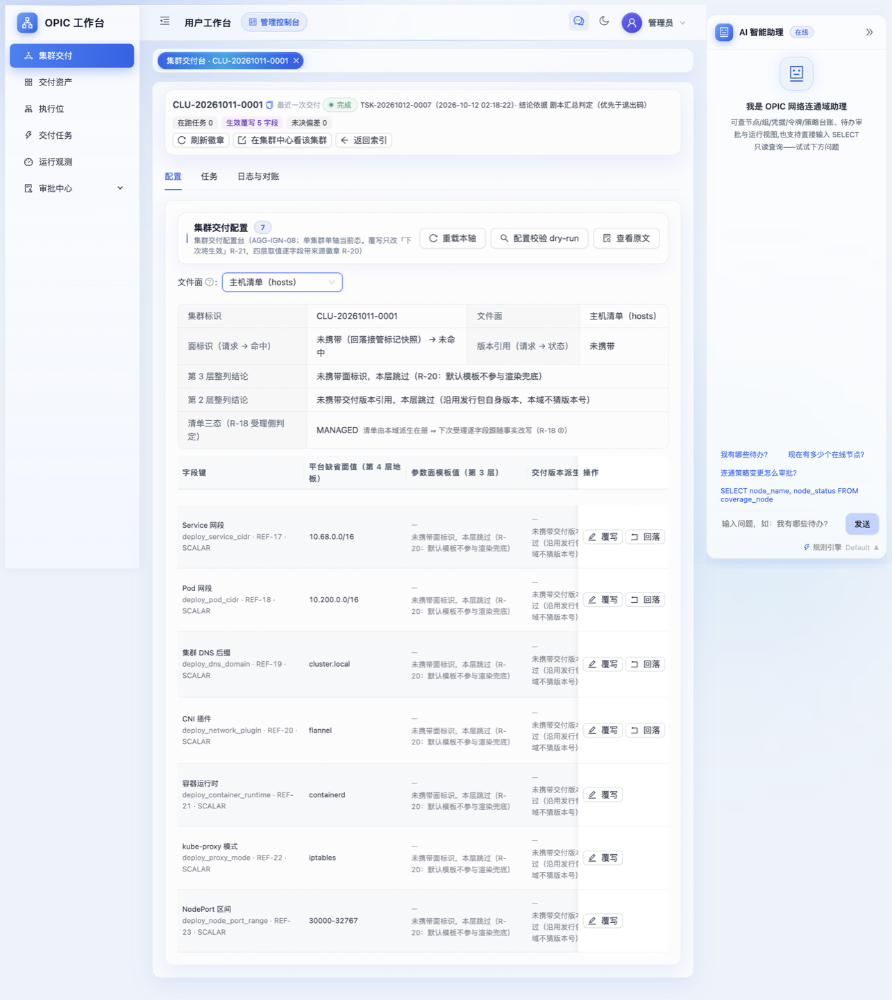
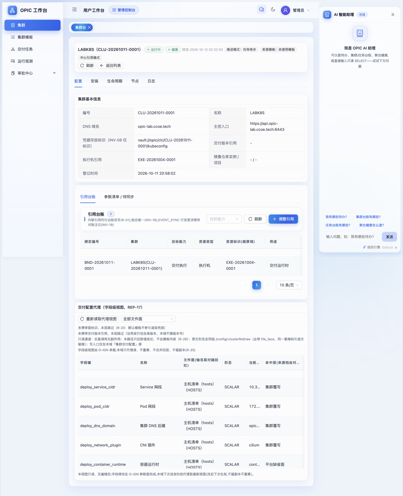
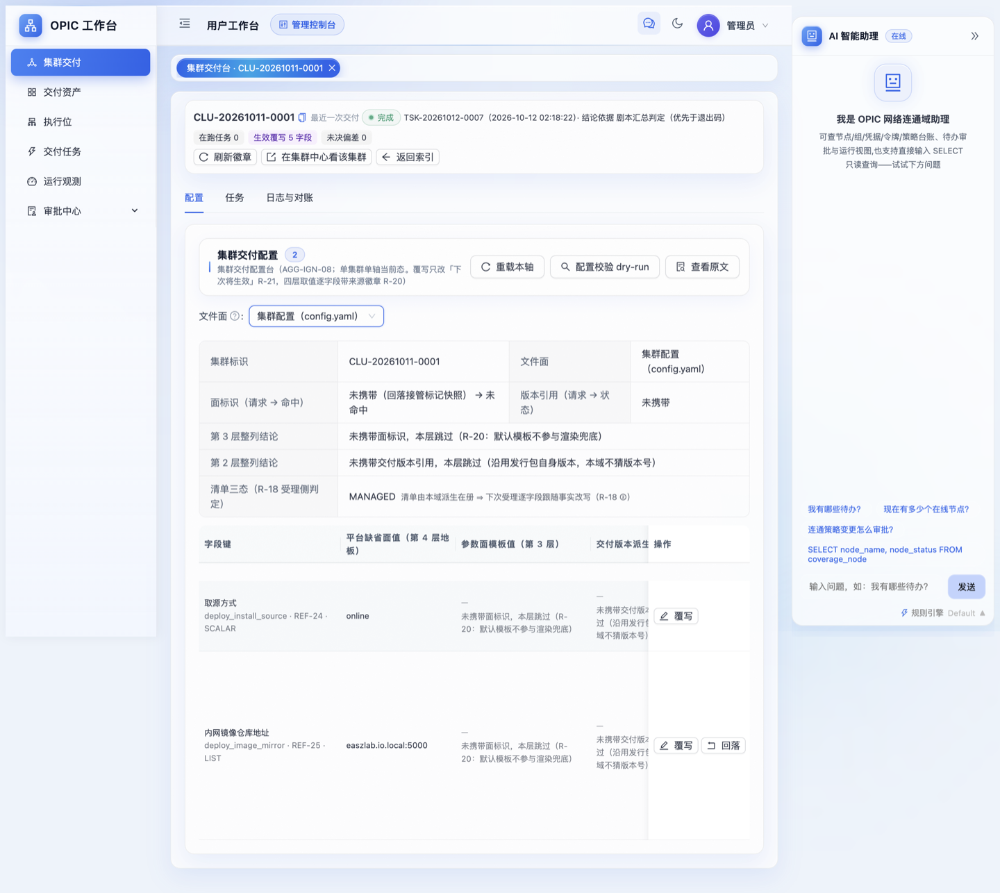
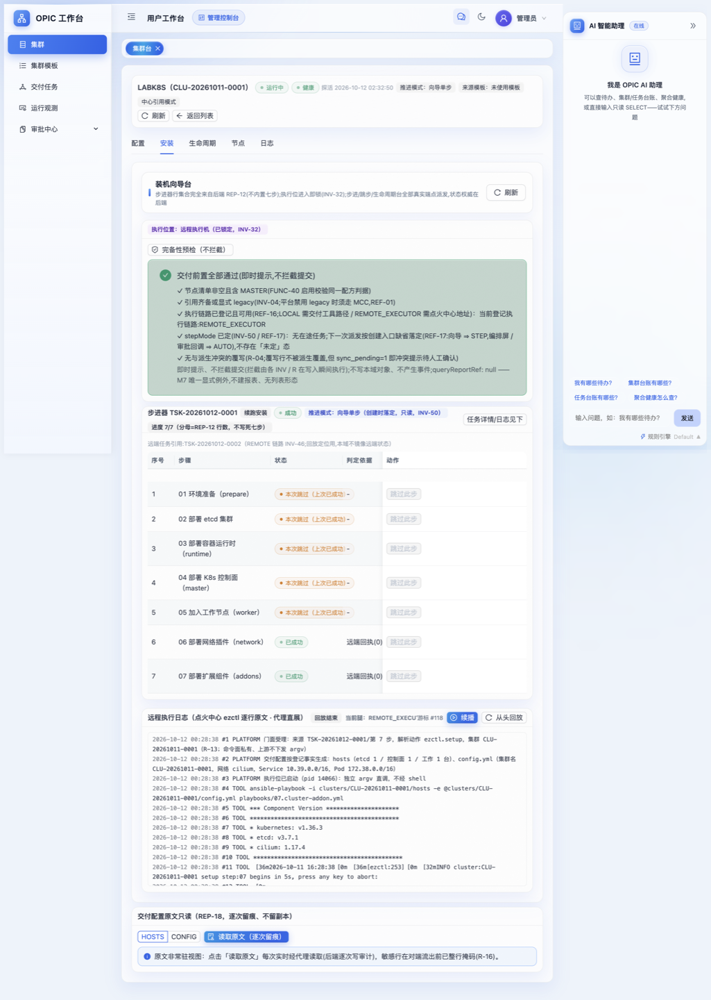
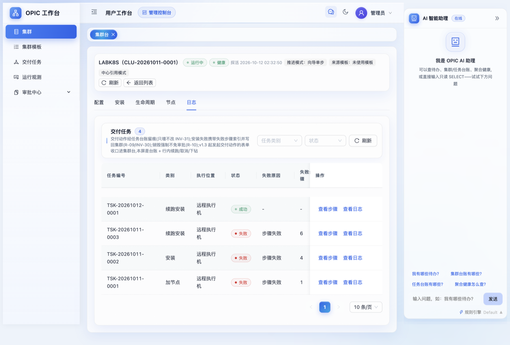
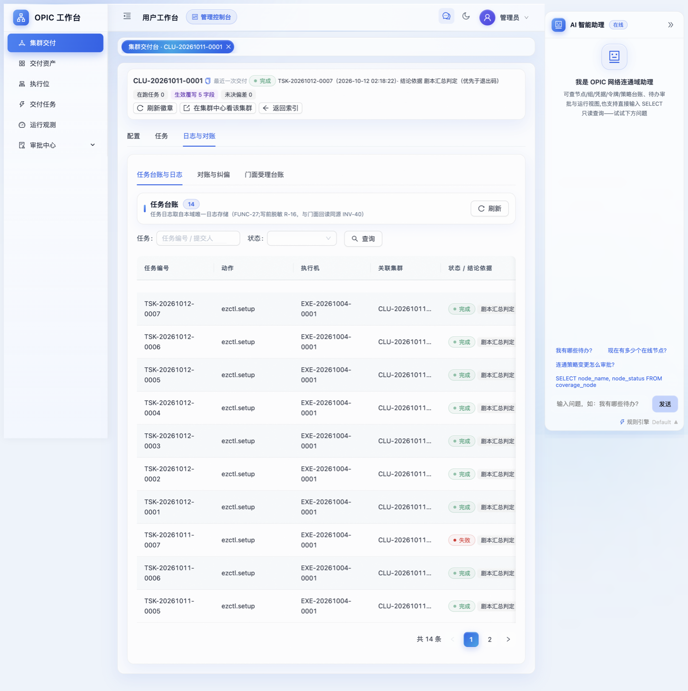
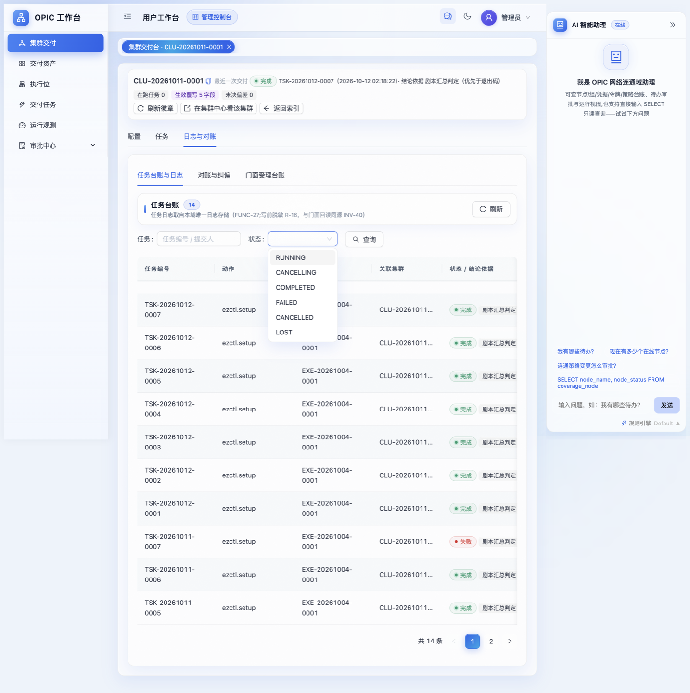
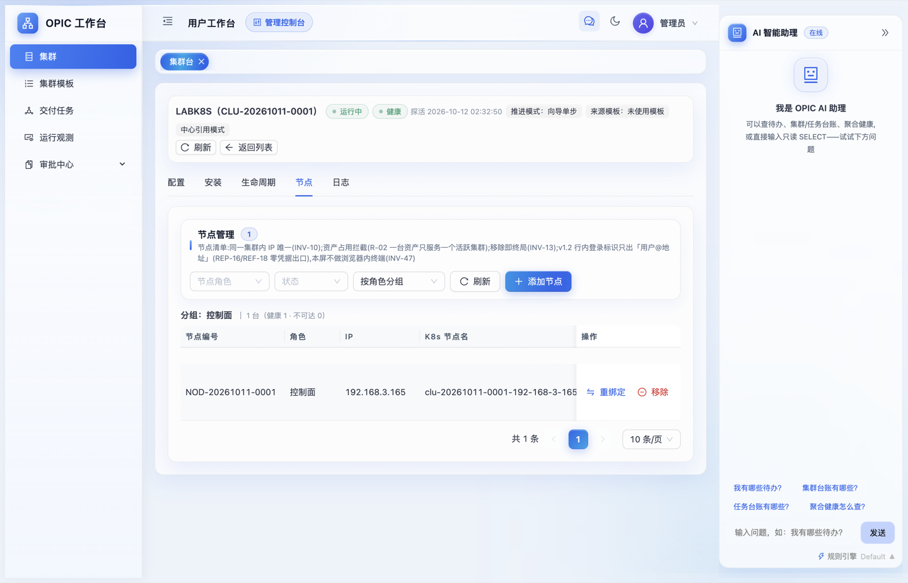

# LABK8S 集群交付用户手册
## —— 用「点火中心 + 集群中心」的用户工作台，把一台裸机装成可验收的 K8S 集群

| 项 | 值 |
| --- | --- |
| 交付对象 | 集群 `LABK8S`（编号 `CLU-20261011-0001`），单节点 `192.168.3.165` |
| 交付方式 | 全程通过两个能力中心的**用户工作台**界面完成，不手工敲 `ezctl` |
| 涉及系统 | 点火中心 ignition-center（`https://ign.opic-ai.ccoe.tech`）、集群中心 cluster-center-mcc（`https://clc.opic-ai.ccoe.tech`），均部署在 `192.168.3.200` |
| 交付底座 | kubeasz 3.7.0 + 执行位 `EXE-20261004-0001`（local-ignition） |
| 私有镜像仓库 | Harbor 2.12.2 `http://harbor.cic.ccoe.tech:18700`（`192.168.3.200:18700`） |
| 手册日期 | 2026-10-12（验收实测数据均为当日采集） |
| 读者 | 新人：照第 4~6 章顺序做即可交付一套集群；管理员：重点看第 7~12 章（定制点、缺陷修复、失败重派、运维 SOP） |

> 本手册所有截图来自本次真实交付界面，存放于 `labk8s-shots/`。所有结论都有对应实测命令与输出，见第 6 章与附录 A。

---

## 目录

1. [本次任务书与最终结果](#1-本次任务书与最终结果)
2. [系统地图：两个中心各管什么](#2-系统地图两个中心各管什么)
3. [动手前检查清单](#3-动手前检查清单)
4. [操作流程 A：在点火中心把"怎么装"定下来](#4-操作流程-a在点火中心把怎么装定下来)
5. [操作流程 B：在集群中心跑七步装机向导](#5-操作流程-b在集群中心跑七步装机向导)
6. [交付验收：逐项对账](#6-交付验收逐项对账)
7. [本次交付的三个定制点](#7-本次交付的三个定制点)
8. [私有镜像仓库接管：Harbor 侧要做的事](#8-私有镜像仓库接管harbor-侧要做的事)
9. [失败与重派：单步重试 / 跳步 / 破门径重派](#9-失败与重派单步重试--跳步--破门径重派)
10. [日常运维 SOP](#10-日常运维-sop)
11. [已知偏差与产品缺口（诚实披露）](#11-已知偏差与产品缺口诚实披露)
12. [常见坑速查](#12-常见坑速查)
- [附录 A：本次交付的台账数据快照](#附录-a本次交付的台账数据快照)
- [附录 B：完整时间线](#附录-b完整时间线)
- [附录 C：术语速查](#附录-c术语速查)

---

## 1. 本次任务书与最终结果

### 1.1 任务书原文口径

> 使用点火中心、集群中心的用户工作台，为 `192.168.3.165` 安装名为 `LABK8S` 的 K8S 集群。组件配置：k8s v1.36.3、etcd v3.7.1、containerd 2.3.3、runc v1.5.1、cni v1.9.1、coredns 1.14.6、pause 3.10.2、headlamp 0.43.0、higress 2.2.3、cilium 1.17.4、node-problem-detector v1.35.3、kube-prometheus-stack 88.1.5；`SERVICE_CIDR=10.39.0.0/16`、`CLUSTER_CIDR=172.38.0.0/16`；域名使用 `*.opic-lab.ccoe.tech`；私有镜像仓库使用 `http://harbor`。

### 1.2 最终结果（一句话）

**已交付并通过实测验收**：`LABK8S` 在集群中心台账为 `运行中 / 健康`，节点 `192.168.3.165` 状态 `Ready`，12 项组件版本与任务书**逐字一致**，两个网段、域名、私有仓库三项环境口径全部落地；集群内 16 个 Pod 全部 `Running`，Prometheus 17 个抓取目标全部 `up`。

### 1.3 需要你知道的两处"绕了一下"

1. 任务书要求的 12 个版本**恰好等于 kubeasz 3.7.0 发行包的默认版本目录**，所以组件版本一个都没覆写——这不是偷懒，而是"选对交付版本"就能少改配置的正确用法（见 4.2）。
2. 私有镜像仓库这项**不是一次装好的**：集群先按默认离线仓库装完，再切到 Harbor，切换过程需要重跑第 03、07 两步（见第 8、9 章）。这条路径值得新人重点读，因为它就是日常"改配置后怎么让已交付集群跟上"的标准答案。

---

## 2. 系统地图：两个中心各管什么

一句话分工：**集群中心管"我要什么集群"（业务台账），点火中心管"具体怎么装出来"（交付执行）**。

```
你（运维） 
   │
   ├─ 集群中心 CLC  https://clc.opic-ai.ccoe.tech
   │     菜单：集群 / 集群模板 / 交付任务 / 运行观测 / 审批中心
   │     集群台页签：配置 · 安装 · 生命周期 · 节点 · 日志
   │     职责：集群台账、节点登记、七步向导推进、探活与健康态、生命周期动作
   │                    │  交付动作派发（HTTP 门面，绑定执行位）
   │                    ▼
   ├─ 点火中心 IGN  https://ign.opic-ai.ccoe.tech
   │     菜单：集群交付 / 交付资产 / 执行位 / 交付任务 / 运行观测 / 审批中心
   │     集群交付台页签：配置 · 任务 · 日志与对账
   │     职责：交付配置四层取值（hosts 面 / config 面）、参数覆写、
   │            配置校验 dry-run、执行 ezctl.setup 01~07、任务与原文日志
   │                    │  SSH / ansible
   │                    ▼
   └─ 执行位 EXE-20261004-0001（192.168.3.200 上的 kubeasz 3.7.0）
         └─ 目标节点 192.168.3.165（被装成 LABK8S 的 master/worker）
         └─ 周边：Harbor :18700（镜像）、DNS（*.opic-lab.ccoe.tech → 165）
```

三个必须建立的心智模型：

| 模型 | 含义 | 为什么重要 |
| --- | --- | --- |
| **步骤号是共用的** | `01 环境准备 / 02 etcd / 03 容器运行时 / 04 控制面 / 05 工作节点 / 06 网络插件 / 07 扩展组件`，CLC 向导与 IGN 的 `ezctl.setup` 一一对应 | 排障时你在两边说的是同一件事 |
| **配置只有一份** | 落盘配置在 IGN 侧生成（`/etc/kubeasz/clusters/CLU-20261011-0001/{hosts,config.yml}`），CLC 只做**只读代理视图**（REP-17/REP-18） | 改配置只能在点火中心改，在集群中心改不动也不该改 |
| **覆写"下次生效"** | 规则 R-21：点火中心的覆写只影响**下一次派发**，不会自动重跑已完成的步骤 | 这是第 9 章"重派"存在的根本原因 |

---

## 3. 动手前检查清单

开始前 10 分钟把这张表打勾，能省掉后面一半的返工。

| # | 检查项 | 怎么查 | 本次实测值 |
| --- | --- | --- | --- |
| 1 | 两个中心可登录 | 浏览器打开 CLC / IGN，用工作台账号登录 | 管理员账号可登录，菜单齐 |
| 2 | 目标机 SSH 可达、可 root | 从执行位 `ssh root@<目标IP>` | `192.168.3.200 → 192.168.3.165` 通 |
| 3 | 执行位 `READY` | IGN → 执行位 | `EXE-20261004-0001 local-ignition 127.0.0.1:9709 READY`，能力 `DEPLOY,SKOPEO,BACKUP,PREFLIGHT,OFFLINE` |
| 4 | 交付版本已入库且含所需组件目录 | IGN → 交付资产 / 交付版本 | `VER-20261006-0001`（`kubeasz-3.7.0-k8s-1.36.3`） |
| 5 | 镜像可取（离线包或仓库） | 节点上 `crictl images` / 仓库 catalog | 见第 8 章 |
| 6 | **域名已解析到目标节点** | `getent hosts api.<你的域>` | `api/headlamp/console.opic-lab.ccoe.tech → 192.168.3.165` |
| 7 | **目标机端口没被别人占** | `ss -lntp` | `80/443` 被他人容器占（`docker-proxy`）、`9100` 被 ongrid 占 → 触发第 7 章定制点 |
| 8 | 目标机无残留 swap/防火墙干扰 | kubeasz 的 01 步会做，但先自查更快 | 01 步通过 |
| 9 | 你要的网段不与现有网络冲突 | 对照 `192.168.3.0/24`、已有集群网段 | `10.39.0.0/16`、`172.38.0.0/16` 均空闲 |
| 10 | 若已有同名集群：**别碰它** | CLC → 集群列表核对编号 | 既有真集群 `CLU-20261007-0001` 全程未被触碰 |

> 新人提示：第 6、7 两项是"装完才发现不对"的高发区。域名不解析→证书 SAN 不对；端口被占→higress/node-exporter 起不来。

---

## 4. 操作流程 A：在点火中心把"怎么装"定下来

入口：**IGN → 集群交付**，进入某个集群的"集群交付台"（页面标题形如 `集群交付台 · CLU-20261011-0001`）。页内三个页签：**配置 / 任务 / 日志与对账**。



### 4.1 第 1 步：绑定执行位（谁来装）

集群台账与执行位的绑定在**集群中心**侧登记（配置页 → 引用台账），点火中心按绑定接单。本次绑定关系：

| 绑定编号 | 集群 | 目标能力 | 资源类型 | 资源标识 | 用途 |
| --- | --- | --- | --- | --- | --- |
| `BND-20261011-0001` | LABK8S(CLU-20261011-0001) | 交付执行 | 执行机 | `EXE-20261004-0001` | 交付运行时 |



### 4.2 第 2 步：选交付版本（决定 12 个组件的默认版本）

点火中心的配置是**四层取值**（规则 R-20），优先级从低到高：

```
第 4 层 平台缺省面  →  第 3 层 参数面模板值  →  第 2 层 交付版本派生  →  第 1 层 集群覆写（最高，界面标"生效覆写"）
```

**做法**：在配置页选对交付版本，让第 2 层直接给你要的默认值；只有版本目录给不了的字段才做集群覆写。

本次核对结果（重要经验）：kubeasz 3.7.0 的发行默认版本目录已包含任务书全部 12 项——

```
k8s v1.36.3 / etcd v3.7.1 / containerd 2.3.3 / runc v1.5.1 / cni v1.9.1
coredns 1.14.6 / pause 3.10.2 / headlamp 0.43.0 / higress 2.2.3
cilium 1.17.4 / node-problem-detector v1.35.3 / kube-prometheus-stack 88.1.5
```

所以**组件版本零覆写**，配置页顶部"生效覆写"只有 5 个字段（都是网络与仓库口径，见 4.3）。

> 判断依据在界面上是可见的：配置页每行都有"命中层（来源档）"，本次 12 个版本字段的来源档都是"交付版本派生 / 发行包自身版本"，不是"集群覆写"。

### 4.3 第 3 步：做 5 条覆写（网络与仓库口径）

在配置页用**文件面下拉**切换两张表：`主机清单（hosts）` 与 `集群配置（config.yaml）`。每行右侧有 `覆写` / `回落` 按钮。



本次实际写入的 5 条覆写（含界面上填写的理由，理由会落库、可追溯）：

| 文件面 | 字段键 | 名称 | 平台缺省 | 覆写值 | 形态 | 理由（界面填写） |
| --- | --- | --- | --- | --- | --- | --- |
| HOSTS | `deploy_service_cidr` | Service 网段 | `10.68.0.0/16` | `10.39.0.0/16` | SCALAR | 任务书指定 `SERVICE_CIDR` |
| HOSTS | `deploy_pod_cidr` | Pod 网段 | `10.200.0.0/16` | `172.38.0.0/16` | SCALAR | 任务书指定 `CLUSTER_CIDR` |
| HOSTS | `deploy_dns_domain` | 集群 DNS 后缀 | `cluster.local` | `opic-lab.ccoe.tech` | SCALAR | 域名口径 `*.opic-lab.ccoe.tech`，与集群台账 `cluster_dns_domain` 同源 |
| HOSTS | `deploy_network_plugin` | CNI 插件 | `flannel` | `cilium` | SCALAR | 任务书列明 cilium 1.17.4 作为 CNI（枚举受 REF-20 约束） |
| CONFIG | `deploy_image_mirror` | 内网镜像仓库地址 | `easzlab.io.local:5000` | `harbor.cic.ccoe.tech:18700` | LIST | 私有仓库收敛为内网 Harbor 单点（详见第 8 章） |

未覆写、保持平台缺省的字段（同样值得记住，说明"能不改就不改"）：`deploy_container_runtime=containerd`、`deploy_proxy_mode=iptables`、`deploy_node_port_range=30000-32767`、`deploy_install_source=online`。

**填完必做**：点配置页顶部 `配置校验 dry-run`，再点 `查看原文` 核对渲染出的 `hosts` / `config.yml` 关键行。本次核对到的生效行：

```ini
# hosts
[all:vars]
CLUSTER_NETWORK="cilium"
PROXY_MODE="iptables"
SERVICE_CIDR="10.39.0.0/16"
CLUSTER_CIDR="172.38.0.0/16"
CLUSTER_DNS_DOMAIN="opic-lab.ccoe.tech"
NODE_PORT_RANGE="30000-32767"
NODE_CIDR_LEN=24            # 单节点集群：每节点一个 /24

# config.yml（关键行）
K8S_VER: "1.36.3"
ENABLE_MIRROR_REGISTRY: "true"
INSECURE_REG:
  - "http://harbor.cic.ccoe.tech:18700"     # 只留 Harbor，见 8.3
SANDBOX_IMAGE: "harbor.cic.ccoe.tech:18700/easzlab/pause:3.10.2"
MASTER_CERT_HOSTS: ["192.168.3.165","api.opic-lab.ccoe.tech"]
cilium_ver: "1.17.4"   corednsVer: "1.14.6"   headlampVer: "0.43.0"
prom_chart_ver: "88.1.5"   node_problem_detector_ver: "v1.35.3"   higress_ver: "2.2.3"
```

> 界面顶部徽标 `生效覆写 5 字段 · 未决偏差 0` 就是"配置已定稿"的信号；`未决偏差` 非 0 时不要开始装机。

### 4.4 第 4 步：登记节点（在哪几台机器上装）

节点在**集群中心 → 集群台 → 节点**页签登记（IP、角色、期望的 `k8s_nodename`）。单节点 all-in-one 部署时，同一台机器同时进 `etcd / kube_master / kube_node` 三个组，IGN 会据此渲染 hosts：

```
[etcd]
192.168.3.165 k8s_nodename=clu-20261011-0001-192-168-3-165
[kube_master]
192.168.3.165
[kube_node]
192.168.3.165
```

节点命名规则：`<集群编号小写>-<IP 用短横替换>`，便于多集群共用节点时不串号。

---

## 5. 操作流程 B：在集群中心跑七步装机向导

入口：**CLC → 集群 → 打开 LABK8S → 页签「安装」**。



### 5.1 第 1 步：完备性预检（FUNC-50）

页签顶部是预检面板，把"装下去会不会白装"的前置条件一次查完（执行位绑定、交付版本、节点登记、必填参数、镜像口径…）。**全通过再往下走**，本次预检结果：全部通过。

> 预检不通过时，界面会指出缺哪一项、去哪个页签补。这是新人和"直接敲 ezctl"最大的差别：系统替你把门。

### 5.2 第 2 步：选推进模式

向导支持两种模式，界面上是"推进模式"徽标：

| 模式 | 徽标文案 | 行为 | 适合谁 |
| --- | --- | --- | --- |
| 整装 | 一次跑完 01~07 | 提交后自动串完七步 | 环境干净、想一把梭 |
| **向导单步**（本次用） | `推进模式：向导单步` | 每步一个"运行第 0X 步"按钮，跑完一步看一眼再点下一步 | 新人学习、共享主机、需要中途改配置 |

单步模式下每步右侧都有 WebSSH 入口，方便你直接去节点上验证（`kubectl get pod -A`、`crictl images` 等）。

### 5.3 第 3 步：依次跑 01~07

七步的界面名称与本次实际结果：

| 步 | 名称 | 本步做什么 | 本次结果 |
| --- | --- | --- | --- |
| 01 | 环境准备（prepare） | 内核参数、swap、时间同步、目录与二进制分发 | 成功（耗时 58s） |
| 02 | 部署 etcd 集群 | 生成 etcd 证书、拉起 etcd | 成功（13s） |
| 03 | 部署容器运行时（runtime） | 装 containerd + 写 `config.toml`、`certs.d` 取像配置 | 成功（19s；后因切 Harbor 重跑 2 次） |
| 04 | 部署 K8s 控制面（master） | apiserver/controller-manager/scheduler + 证书 SAN | **首次失败**（代理劫持域名访问），修复后成功（71s） |
| 05 | 加入工作节点（worker） | kubelet + kube-proxy（systemd 单元） | 成功（4s） |
| 06 | 部署网络插件（network） | cilium 1.17.4 | **首次失败**（取像路径），修复后成功（25s） |
| 07 | 部署扩展组件（addons） | coredns / metrics-server / headlamp / npd / prometheus-stack / higress | **首次失败**（共享主机端口冲突），定制后成功（47s；后又重跑 3 次） |

每步的"远端回执（0）"表示 `ezctl` 退出码 0 且 ansible `PLAY RECAP` 无 `failed`；这是界面判定成功的依据（结论依据列写"脚本汇总判定"）。

### 5.4 第 4 步：看日志（两边都能看，看的是同一份）

- **CLC → 集群台 → 日志**：交付任务台账（4 条），每行 `查看步骤` / `查看日志`。

  

- **IGN → 集群交付台 → 日志与对账 → 任务台账与日志**：本集群 14 条 `ezctl.setup` 执行记录，可下钻到 ezctl 原文日志（Q-125 打通的 FUNC-51 代理通道，CLC 侧也能直接看到同一份原文）。

  
  

### 5.5 第 5 步：节点登记确认 + 探活

装完后到 **节点** 页签确认节点从"已登记"变成 `ADDED / 健康`，然后到 **配置** 页签点 `探活`（FUNC-26）。



**必须理解的规则（R-08 / REF-03 / REF-11）**：健康态转换要**连续 3 次**同向探活才翻转（防抖）。所以刚装完时集群是 `UNKNOWN`，需要连点 3 次探活才会变 `HEALTHY`——这不是 bug，是防抖动设计。本次正是 3 次人工探活（`PRB-20261012-0001/0002/0003`）把 LABK8S 从 `UNKNOWN` 推到 `HEALTHY`。

探活记录字段：`apiserver_reachable`、`tls_handshake_ok`、`ready_nodes`、`total_nodes`、`probe_result`；失败时 `fail_reason` 必填（INV-34）。

### 5.6 交付完成后你会得到

| 项 | 值 |
| --- | --- |
| 主控入口 | `https://api.opic-lab.ccoe.tech:6443`（台账 `master_endpoints`） |
| 凭据存放标识 | `vault://opic/clc/CLU-20261011-0001/kubeconfig`（**只登记标识，内容不入库**，INV-07/INV-08） |
| kubeconfig 实际位置 | 执行位上 `/etc/kubeasz/clusters/CLU-20261011-0001/kubectl.kubeconfig` |
| 集群内访问 | `headlamp.opic-lab.ccoe.tech`（NodePort 31800）、`console.opic-lab.ccoe.tech`（higress-console NodePort 31299） |
| 业务入口 | higress-gateway NodePort `30238`(80) / `32231`(443) |

> 注意 kubeconfig 里的 `server` 默认是 IP（`https://192.168.3.165:6443`）。要用域名访问，显式覆盖：
> `SERVER=https://api.opic-lab.ccoe.tech:6443 kubectl --kubeconfig=<...> get --raw=/version`

---

## 6. 交付验收逐项对账

### 6.1 组件版本对账（12/12 一致）

| 任务书要求 | 实测（采集于 2026-10-12） | 证据来源 | 结论 |
| --- | --- | --- | --- |
| k8s v1.36.3 | `v1.36.3` | `kubectl get node`、`kubectl version`（client+server） | ✅ |
| etcd v3.7.1 | `etcd Version: 3.7.1`；`endpoint health` 4.8ms 健康 | 节点 `/opt/kube/bin/etcd --version` | ✅ |
| containerd 2.3.3 | **运行中的 daemon = v2.3.3**（`/opt/kube/bin/containerd-bin/containerd`；kubelet 上报 `containerd://2.3.3`） | systemd `ExecStart` 指向的二进制 + `node.status.nodeInfo.containerRuntimeVersion` | ✅（⚠️ 测量口径见 12.4） |
| runc v1.5.1 | `runc version 1.5.1` | 节点 `runc --version` | ✅ |
| cni v1.9.1 | `CNI bridge plugin v1.9.1` | 节点 `/opt/cni/bin/bridge --version` | ✅ |
| coredns 1.14.6 | `easzlab.io.local:5000/easzlab/coredns:1.14.6` | Pod spec | ✅ |
| pause 3.10.2 | `sandbox = 'harbor.cic.ccoe.tech:18700/easzlab/pause:3.10.2'` | 节点 `/etc/containerd/config.toml` | ✅ |
| headlamp 0.43.0 | `easzlab/headlamp:v0.43.0` | Pod spec | ✅ |
| higress 2.2.3 | chart 2.2.3 + 镜像 `higress/{higress,pilot,gateway,console}:2.2.3` | helm release + Pod spec | ✅ |
| cilium 1.17.4 | `Client: 1.17.4` / `Daemon: 1.17.4` | `cilium-agent` 容器内 `cilium version` | ✅ |
| node-problem-detector v1.35.3 | 镜像 `easzlab/node-problem-detector:v1.35.3` | Pod spec（⚠️ chart 元数据 `appVersion` 显示 v1.35.1，属上游元数据陈旧，见 11.4） | ✅ |
| kube-prometheus-stack 88.1.5 | chart `88.1.5` | helm release | ✅ |

### 6.2 网络与域名对账

| 口径 | 要求 | 配置层证据 | 运行时证据 | 结论 |
| --- | --- | --- | --- | --- |
| Service 网段 | `10.39.0.0/16` | `hosts: SERVICE_CIDR` | apiserver/kcm 参数 `--service-cluster-ip-range=10.39.0.0/16`；实际 ClusterIP `10.39.0.1/10.39.0.2/10.39.91.117…` | ✅ |
| Pod 网段 | `172.38.0.0/16` | `hosts: CLUSTER_CIDR` | kcm `--cluster-cidr=172.38.0.0/16 --node-cidr-mask-size=24`；节点 `podCIDR=172.38.0.0/24`；Pod IP `172.38.0.x` | ✅ |
| 集群 DNS 后缀 | `opic-lab.ccoe.tech` | `hosts: CLUSTER_DNS_DOMAIN` | svc FQDN 后缀 `…svc.opic-lab.ccoe.tech` 出现在 apiserver 证书 SAN | ✅ |
| 外部域名 | `*.opic-lab.ccoe.tech` | `MASTER_CERT_HOSTS` 含 `api.opic-lab.ccoe.tech` | DNS 解析到 `192.168.3.165`；`openssl s_client` SAN 含该 DNS 名；带凭据 `kubectl --server=https://api.opic-lab.ccoe.tech:6443 get --raw=/version` 返回 `v1.36.3` | ✅ |

### 6.3 集群健康对账

| 指标 | 实测 |
| --- | --- |
| 节点 | `clu-20261011-0001-192-168-3-165 Ready master 171m v1.36.3`（1/1 Ready） |
| Pod | 全集群 16 个 Pod，**16 个 Running**，无未就绪 |
| 监控 | Prometheus `targets=17 up=17`（apiserver/kubelet×3/etcd/coredns/kube-proxy/scheduler/controller-manager/kube-state-metrics/node-exporter/grafana/alertmanager×2/operator/prometheus） |
| DaemonSet | `cilium 1/1`、`node-local-dns 1/1`、`node-problem-detector 1/1`、`prometheus-node-exporter 1/1` |
| 台账 | CLC：`RUNNING / HEALTHY`，最后探活 `2026-10-12 02:32:50`；IGN：最近一次交付 `完成 TSK-20261012-0007`，`未决偏差 0` |

### 6.4 验收复核命令（管理员直接抄）

```bash
# 在 192.168.3.200 上执行；务必显式指定 kubeconfig，否则会落到别的上下文
export KUBECONFIG=/etc/kubeasz/clusters/CLU-20261011-0001/kubectl.kubeconfig
export NO_PROXY="*"            # 见 12.1：3.200 有全局代理，域名访问会被代理拒
kubectl get node -o wide
kubectl get pods -A --no-headers | awk '$4!="Running"'      # 期望：无输出
kubectl get pods -A -o json | python3 -c "import json,sys;d=json.load(sys.stdin);print(*sorted({c['image'] for p in d['items'] for c in p['spec']['containers']}),sep='\n')"
kubectl get --raw "/api/v1/namespaces/monitor/services/http:prometheus-operated:9090/proxy/api/v1/targets" \
  | python3 -c "import json,sys;d=json.load(sys.stdin)['data']['activeTargets'];print('targets',len(d),'up',sum(t['health']=='up' for t in d))"

# 节点侧版本（etcd/kubelet/cni 二进制在 /opt/kube/bin，不在 PATH）
ssh root@192.168.3.165 '/opt/kube/bin/etcd --version | head -1; runc --version | head -1; /opt/cni/bin/bridge --version'
# containerd：看 systemd 真正用的那个二进制，别看 PATH
ssh root@192.168.3.165 'systemctl show -p ExecStart --value containerd; /opt/kube/bin/containerd-bin/containerd --version | head -1'
```

---

## 7. 本次交付的三个定制点

kubeasz 的官方个性化点是**角色模板**（`roles/<role>/templates/**.j2`）。改模板前先留 `.orig-bak` 备份，改完在 `/etc/kubeasz` 里 `git diff` 一目了然：

```
 M roles/cluster-addon/templates/higress/values.yaml.j2
 M roles/cluster-addon/templates/prometheus/values.yaml.j2
 M roles/containerd/templates/easzlab.io.local_5000/hosts.toml.j2
```

### 7.1 higress：关掉 hostNetwork，改用 NodePort

**症状**：07 步跑完，`higress-gateway` 起不来。
**根因**：`192.168.3.165` 是**共享主机**，`80/443` 已被他人容器占用（`ss -lntp` 显示 `docker-proxy`）。kubeasz 默认让 higress-gateway 用 `hostNetwork: true` 直接占主机端口。
**改法**（官方个性化点，不改代码逻辑）：

```diff
 higress-core:
   gateway:
     replicas: 1
-    hostNetwork: true
+    hostNetwork: false
     nodeSelector:
       ingress-controller/provider: higress
     service:
-      type: ClusterIP
+      type: NodePort
```

**结果**：`higress-gateway` 走 Pod 网络 + NodePort `30238/32231`，`1/1 Running`；对外访问用 NodePort 或把域名反代到该端口。
**别忘了**：gateway 有 `nodeSelector`，节点必须打标签，否则 Pending：

```bash
kubectl label node clu-20261011-0001-192-168-3-165 ingress-controller/provider=higress
```

### 7.2 higress-console：镜像显式走内网仓库

**症状**：console 镜像引用会落到公网 hub，节点取不到。
**改法**：

```diff
 higress-console:
+  image:
+    repository: easzlab.io.local:5000/higress/console
+    tag: "2.2.3"
   replicaCount: 1
```

引用坐标统一走 `easzlab.io.local:5000`（再由 7.3 的重定向落到 Harbor），集群里所有 addon 镜像都是同一口径：`cilium`、`prometheus`、`headlamp`、`node-problem-detector` 的 values 里 `registry/repository` 全部指向 `easzlab.io.local:5000`。

### 7.3 prometheus-node-exporter：关掉 hostNetwork

**症状**：node-exporter CrashLoop / 端口绑定失败。
**根因**：主机 `9100` 已被 ongrid 容器占用，而 node-exporter 默认 `hostNetwork: true` 要占 `9100`。
**改法**：

```diff
 prometheus-node-exporter:
+  hostNetwork: false
   image:
     registry: easzlab.io.local:5000
```

**结果**：`node-exporter` 用 Pod IP 提供指标，Prometheus 抓取正常（`node-exporter up`）。
**代价（管理员需知）**：非 hostNetwork 下 exporter 看到的是 Pod 网络视角，部分宿主网卡/文件系统指标语义会变；独占主机上建议改回 `hostNetwork: true` 或换端口。

### 7.4 改完模板后怎么让它生效

模板只影响**下一次渲染**，所以要走第 9 章的重派流程（本次是删在位 Deployment + 重跑 07 步）。

---

## 8. 私有镜像仓库接管：Harbor 侧要做的事

任务书要求"私有镜像仓库使用 `http://harbor`"。本章是完整做法 + 本次踩到的 Harbor 存量缺陷。

### 8.1 目标形态

```
Pod spec 里的镜像引用（保持不变）      containerd certs.d 重定向            实际服务方
easzlab.io.local:5000/cilium/cilium  ───────────────────────────▶  harbor.cic.ccoe.tech:18700/cilium/cilium
easzlab.io.local:5000/easzlab/pause  （pause 直接写成 Harbor 地址）  harbor.cic.ccoe.tech:18700/easzlab/pause
```

好处：**镜像引用不用改**，只改取像路径；回退时把 `hosts.toml` 换回去即可。

### 8.2 把镜像装进 Harbor（本次用"复制拉取"，不用 push）

Harbor 建好同名 project（`easzlab` / `cilium` / `higress` / `prometheus` / `flannel`，本次设为公开，节点可匿名 bearer-token 拉取），然后配一个从本地离线仓库 `:5000` **拉取**的复制策略 `lab-from-ign-mirror` 并触发 execution：

```
2026-10-12 01:55:05 ~ 01:55:22   execution 24  Succeed
落库仓库数：easzlab 9 + cilium 2 + higress 4 + prometheus 7 (+ flannel 2) = 24 个仓库
```

**为什么用复制拉取而不是 push**：本次 push 路径当时不可用（见 8.4 缺陷），而 Harbor 的"从源仓库 pull"能绕开写入鉴权链路，且不动别人的镜像。

凭据使用纪律（**新人务必照做**）：Harbor 账号口令放在一个 root-only 的 curl 配置文件里（本次 `/tmp/harbor.cfg`，位于 3.200），只允许 `curl -K /tmp/harbor.cfg` 这种形式引用；**绝不 `cat` 该文件**、绝不把口令写进任何交付物/日志/命令行参数。

### 8.3 节点侧：certs.d 重定向 + INSECURE_REG 的坑

改 kubeasz 的 containerd 角色模板，让离线仓库的取像路径指向 Harbor：

```diff
 # roles/containerd/templates/easzlab.io.local_5000/hosts.toml.j2
-server = "http://easzlab.io.local:5000"
+# 离线包暂存仓库(easzlab.io.local:5000)的取像路径改由内网 Harbor 承载：
+# 引用坐标保持不变，实际由 harbor.cic.ccoe.tech:18700 服务（同一 project/repo 路径）。
+server = "http://harbor.cic.ccoe.tech:18700"
 
-[host."http://easzlab.io.local:5000"]
+[host."http://harbor.cic.ccoe.tech:18700"]
   capabilities = ["pull", "resolve"]
   skip_verify = true
```

落盘结果（节点上 `/etc/containerd/certs.d/easzlab.io.local:5000/hosts.toml`）与之一致；`/etc/hosts` 保留 `192.168.3.200 easzlab.io.local` 作为兜底。

**⚠️ 关键坑（本次踩过，务必记住）**：kubeasz 的 containerd 角色会按 `INSECURE_REG` 列表**逐条回写** `certs.d/<host>/hosts.toml`，最后一条会覆盖同名文件。如果 `INSECURE_REG` 里同时有 `easzlab.io.local:5000`，你手工改的重定向模板就会被**冲掉**回默认值。

```yaml
# config.yml —— 正确写法：只留 Harbor，不要加 easzlab
INSECURE_REG:
  - "http://harbor.cic.ccoe.tech:18700"
```

这也是为什么 `deploy_image_mirror`（REF-25，LIST 形态）在界面上要收敛成**只填 Harbor 一项**。

改完 `config.yml` / 模板后，**必须重跑 03 步**（容器运行时）才会把 `certs.d` 重写；再重跑 07 步让 addons 从 Harbor 取镜像。本次即 `IGN → 交付任务 → 重派 03 → 重派 07`（见 9.3）。

### 8.4 Harbor 存量缺陷与修复记录（管理员案例）

**症状**：向 Harbor 推送/复制镜像一律失败（v2 写入路径报 400/401），但**匿名拉取公开项目完全正常**——很容易误判成"网络或权限问题"。

**定位过程**（全部只读排查）：

1. `docker ps` 看 Harbor 组件全 `healthy`，`/api/v2.0/health` 也全绿 → 不是组件挂了。
2. 看 registry 配置：`/opt/harbor/common/config/registry/config.yml`（Harbor 2.12 的 `registry` 容器把该目录挂到 `/etc/registry`）：

   ```yaml
   auth:
     htpasswd:
       realm: harbor-registry-basic-realm
       path: /etc/registry/passwd
   ```

   即：registry 的写入鉴权依赖 `/etc/registry/passwd`。
3. 进容器看这个路径 → **容器里的 `/etc/registry` 是空的/旧的**：宿主机上该配置目录在容器启动之后被重建过，容器的 bind mount 仍指向**已删除的旧 inode**（stale mount）。于是 registry 读不到当前 `passwd`，与 harbor-core 注入的 Basic 凭据**失配** → 所有 v2 写请求被拒。

**结论**：这是 Harbor 实例的**存量偏差**，与本次交付动作无关；拉取不受影响是因为公开项目匿名 token 路径不经过这条 htpasswd 校验。

**修复**：根因修复 = 让 bind mount 重新解析 → `docker restart registry`（只重启 registry 一个容器，不动整个 Harbor、不重启 dockerd）。

```
registry 容器 StartedAt = 2026-10-11T17:52:36Z（本地 01:52:36），RestartCount=0
重启后 01:55:05~01:55:22 复制 execution 24 成功装载 24 个仓库
```

**给管理员的两条经验**：
- 判断"stale mount"的通用手法：`docker inspect <c> --format '{{range .Mounts}}{{.Source}} -> {{.Destination}}{{end}}'` 拿到宿主源路径，比较宿主目录 **ctime/inode** 与容器启动时间；若宿主目录比容器新，八成是挂载陈旧。
- 重启共享组件前先确认：它当前**已经是坏的**（重启是修复而非碰运气）、影响面（只有 registry）、以及是否有他人在用。本次符合"根因修复"而非"走捷径重启共享设施"。

---

## 9. 失败与重派：单步重试 / 跳步 / 破门径重派

### 9.1 单步重试（最常用）

**入口**：CLC → 集群台 → 安装页签 → 失败步骤上的"重试本步"（FUNC-44），或 IGN → 交付任务 → 对该步重派 `ezctl.setup <步>`。

**规则 INV-03**：续跑安装时，**上次已成功的步骤不会重跑**，界面上显示 `本次跳过（上次已成功）`。本次最后一条成功任务 `TSK-20261012-0001` 的步骤行就是活教材：

```
1|01 环境准备（prepare）      SKIPPED   上次任务该步已成功（INV-03 不重跑）
2|02 部署 etcd 集群           SKIPPED   同上
3|03 部署容器运行时（runtime） SKIPPED   同上
4|04 部署 K8s 控制面（master） SKIPPED   同上
5|05 加入工作节点（worker）    SKIPPED   同上
6|06 部署网络插件（network）   SUCCEEDED setup CLU-20261011-0001 06
7|07 部署扩展组件（addons）    SUCCEEDED setup CLU-20261011-0001 07
```

### 9.2 跳步（FUNC-45）

某步确实不需要（例如插件已在别处装好），可在向导里跳步。**慎用**：跳过 03/06 这类基础步会让后续步骤在错误前提上运行。

### 9.3 破门径重派（改完配置让已完成的步骤重跑）

**问题**：INV-03 让"上次成功"的步骤不再重跑，但**配置改了必须重跑**（例如 8.3 改了 `certs.d` 模板、7.x 改了 values）。

**口径**（本次实际用过 5 次，全部成功）：

1. 在 IGN 配置页确认覆写/模板已改好，`配置校验 dry-run` 通过；
2. **删掉在位的旧对象**，让重跑的步骤有"可写"的落点：

   ```bash
   # 例：改了 higress values 后，删在位 Deployment 让 07 步重建
   kubectl -n higress-system delete deploy higress-gateway higress-console
   # 例：改了 node-exporter values 后
   kubectl -n monitor delete ds prometheus-prometheus-node-exporter
   ```

   helm release 仍在位，所以 07 步会走 `upgrade`；删的是渲染产物，不是发布记录。
3. 在 IGN 交付任务台对该步**人工重派**（本次 `ezctl.setup 03` 两次、`07` 三次，任务号 `TSK-20261012-0003 ~ 0007`，提交人 `admin`，全部 `COMPLETED`）；
4. 回 CLC 配置页签点 `探活`，必要时连续 3 次让健康态翻转；
5. 到 IGN 配置页确认 `未决偏差 0`。

**为什么界面上"应用追溯"还显示未应用**：见 11.2（覆写无即时应用腿，属已知产品缺口，本次用"派生值前移"手工闭合）。

### 9.4 本次真实失败与修复对照（新人最该看的一节）

| 失败点 | 现象 | 根因 | 修复 | 复跑结果 |
| --- | --- | --- | --- | --- |
| 04 步（首次） | 控制面组件访问 apiserver `Forbidden` | 3.200 全局代理 `NO_PROXY` 不含 `*.opic-lab.ccoe.tech`，域名流量被代理劫持 | 访问侧显式 `NO_PROXY="*"` / `--noproxy '*'`；域名口径本身正确 | 04 步 71s 成功 |
| 06 步（首次） | cilium 镜像取不到 | 离线仓库 catalog 缺 cilium 相关仓库 | 补齐 `cilium/{cilium,operator-generic}` 到镜像源 | 06 步 25s 成功 |
| 07 步（首次） | gateway / node-exporter 起不来 | 共享主机 `80/443/9100` 被他人容器占用 | 7.1 / 7.3 两个定制点 + 9.3 破门径重派 | 07 步 47s 成功，后续 3 次重派均成功 |
| 切 Harbor 后 | 节点仍从 `:5000` 取像 | `INSECURE_REG` 含 easzlab 时会回写并覆盖 `hosts.toml` | `INSECURE_REG` 只留 Harbor + 重跑 03/07 | 未缓存镜像实测由 Harbor 服务 |

---

## 10. 日常运维 SOP

| 频次 | 动作 | 界面入口 | 判据 |
| --- | --- | --- | --- |
| 每日 | 集群探活 | CLC → 集群台 → 配置 → `探活` | `apiserver_reachable=1`、`tls_handshake_ok=1`、`ready_nodes=total_nodes` |
| 每日 | 看健康聚合 | CLC → 运行观测（`GET /api/clc/health/aggregate`） | 无 `DEGRADED`/`UNHEALTHY` |
| 每日 | 看未决偏差 | IGN → 集群交付台顶部徽标 | `未决偏差 0` |
| 每周 | 节点/组件盘点 | CLC → 节点页签（分组视图）+ `kubectl get pods -A` | 无 `ADDED` 之外的悬挂节点；无非 Running Pod |
| 变更 | 改配置 → 重派 | IGN 配置页覆写 → 9.3 破门径重派 | 任务 `COMPLETED`、`dry-run` 通过 |
| 变更 | 证书临期 | 生命周期台"证书轮换"动作（FUNC-46 派发） | 平台参数 `cert_renew_days=14` 提前量 |
| 备份 | 集群 etcd 快照 | 生命周期台"备份"动作 | 快照落 `/etc/kubeasz/clusters/<no>/backup` |
| 收尾 | 销毁集群 | 生命周期台"销毁"（**强制不免审批**，R-09/R-10/R-30） | 台账 `DESTROYED`；失败可重新申请销毁 |

**健康态语义**（别误读）：`UNKNOWN` = 还没探够次数；`HEALTHY` = 连续 3 次通过；`DEGRADED` = 部分不可用（探活不会覆盖它，INV-06）；`UNHEALTHY` = 连续 3 次失败。

**目前没有定时探活**：FUNC-26 是**人工探活**入口，健康态不会自己刷新（见 11.3）。巡检时"探活时间"落后就要手动点一次。

---

## 11. 已知偏差与产品缺口（诚实披露）

| # | 现象 | 影响 | 本次怎么绕过 | 建议 |
| --- | --- | --- | --- | --- |
| 11.1 | CLC 集群台账 `registry_ref` / `registry_project_ref` / `version_ref` 留空，配置页"镜像仓库实例/项目"显示 `- / -` | 聚合视图看不到仓库归属 | 取像口径统一放在 IGN 参数面（`deploy_image_mirror`）+ 节点 `certs.d` | 填这三列需要**镜像仓库中心的真实实例引用**；宁缺不假——不要为了界面好看填一个主机名字符串 |
| 11.2 | `deploy_image_mirror` 覆写行的 `applied_task_no` 为空 → 界面显示"当前落盘 = harbor 值"但"应用追溯 = 未应用" | 看起来矛盾，容易误判配置没生效 | 磁盘值是在安装族受理**之外**前移落盘的（人工重派 03/07），故无追溯号 | 产品缺口：**覆写缺"即时应用腿"**。需要"改一次配置就重放到在跑集群"的能力 |
| 11.3 | 无定时探活（只有人工探活） | 健康态可能长期停留在旧值 | 每日巡检手动探活 | 建议加平台级定时探活任务 |
| 11.4 | node-problem-detector chart 的 `appVersion` 元数据写 `v1.35.1`，实际镜像 `v1.35.3` | 只看 helm 元数据会误判版本不符 | 以 **Pod spec 镜像 tag** 为验收依据 | 上游 chart 元数据陈旧，反馈即可 |
| 11.5 | 交付版本 `VER-20261006-0001` 状态为 `DRAFT` | 若启用"版本须可用"强校验（REF-19）会拦住受理 | 本次装机在该状态下完成 | 正式环境请把版本置为可用态再交付 |
| 11.6 | kube-proxy 在 kubeasz 是 **systemd 单元**，不是 DaemonSet；k8s 1.36 节点 `kubeProxyVersion` 字段为空 | 用 `kubectl get ds -A` 找不到 kube-proxy 会以为没装 | 查 `systemctl status kube-proxy` 与 Prometheus `kube-proxy` target（本次 `up`） | 写巡检脚本时别按 DaemonSet 假设 |

---

## 12. 常见坑速查

### 12.1 开发测试环境的全局代理会劫持域名

3.200 环境有海外出口代理：

```
https_proxy=http://10.26.8.196:3228
NO_PROXY=localhost,127.0.0.1,192.168.0.0/16,10.0.0.0/8,.opic-ai.ccoe.tech,.svc,.cluster.local
```

`NO_PROXY` 里**没有** `*.opic-lab.ccoe.tech`，于是 `curl https://api.opic-lab.ccoe.tech:6443` 得到 `CONNECT tunnel failed, response 403`、`kubectl` 得到 `Unable to connect to the server: Forbidden`。
**这是环境事实，不是集群缺陷。** 处置：`export NO_PROXY="*"`（或 `--noproxy '*'`、把域名加进 `NO_PROXY`）。

### 12.2 必须显式指定 kubeconfig

`/etc/kubeasz/clusters/CLU-20261011-0001/kubectl.kubeconfig` **只存在于 3.200**。在 165 上用这个路径不会报错、会静默回落到别处上下文。多集群环境请始终 `export KUBECONFIG=<完整路径>`。

### 12.3 工具不在 PATH

| 工具 | 实际路径 | 位置 |
| --- | --- | --- |
| `etcdctl` / `etcd` / `kubelet` / `kubectl` | `/opt/kube/bin/` | 节点 165 |
| `helm` | `/etc/kubeasz/bin/helm` | 执行位 3.200 |
| `ezctl` | `/etc/kubeasz/ezctl` | 执行位 3.200 |

### 12.4 containerd 版本要用"真正在跑的那个二进制"测

```
containerd --version                        → v2.3.6   ← PATH 上的发行版二进制，k8s 没用它
systemctl show -p ExecStart --value containerd → /opt/kube/bin/containerd-bin/containerd
/opt/kube/bin/containerd-bin/containerd --version → v2.3.3   ← 正确
kubectl get node -o jsonpath='{...containerRuntimeVersion}' → containerd://2.3.3  ← 最权威
```

### 12.5 etcd 健康检查别连 localhost

etcd 的 `127.0.0.1:2379` 监听是**明文**，用 https 连会报 `unhealthy / context deadline exceeded`。正确：

```bash
/opt/kube/bin/etcdctl --endpoints=https://192.168.3.165:2379 \
  --cacert=/etc/kubernetes/ssl/ca.pem --cert=/etc/kubernetes/ssl/etcd.pem --key=/etc/kubernetes/ssl/etcd-key.pem \
  endpoint health          # → healthy: successfully committed proposal: took = 4.8ms
```

### 12.6 节点重装后 SSH 主机指纹变了

`REMOTE HOST IDENTIFICATION HAS CHANGED` → 内层 ssh 加 `-o StrictHostKeyChecking=no -o UserKnownHostsFile=/dev/null`（本次装机过程中 165 的主机密钥被重建）。

### 12.7 Harbor 匿名 HEAD 返回 401 是正常的

Harbor 的 token 认证会先回 `401 + WWW-Authenticate` 挑战。判断"能不能拉"要走完整 token 流程（`page.fetch` / `curl -K <cfg>`），别把 HEAD 401 当故障。

### 12.8 数据库排查：连接方式与列名

- PG 在 3.200 **宿主 :5433** 监听（不是容器内 socket），连接参数从 `opic-clc-app` / `opic-ign-app` 容器 env 读；
- 必须 **schema 限定**表名（`clc.clc_cluster`、`ign.exec_task`），`search_path` 没设；
- 时间列多为 `text`（`to_char` 存），别再套 `to_char(col,'...')`；
- 关联列叫 `cluster_ref`（值形如 `CLU-20261011-0001` 或数字 id），不是 `cluster_no`；
- 口令只从 env 读、只用于连接，**绝不打印**（白名单脱敏要整键匹配，`PASS|SECRET` 挡不住 `DB_PASSWORD`）。

---

## 附录 A：本次交付的台账数据快照

### A.1 集群中心（schema `clc`）

**集群** `clc.clc_cluster`：

```
id=55 | cluster_no=CLU-20261011-0001 | name=LABK8S | status=RUNNING | health=HEALTHY
master_endpoints=https://api.opic-lab.ccoe.tech:6443
kubeconfig_ref=vault://opic/clc/CLU-20261011-0001/kubeconfig
cluster_dns_domain=opic-lab.ccoe.tech | run_mode=MCC | install_step_index=NULL（已清空=装完）
version_ref=(空) | registry_ref=(空) | registry_project_ref=(空)      ← 见 11.1
created_at=2026-10-11 20:58:02 | last_probe_at=2026-10-12 02:32:50
```

**任务** `clc.clc_task`（执行路径全部 `REMOTE_EXECUTOR`，`remote_task_ref` 指向 IGN 任务）：

| 任务号 | 类别 | 状态 | 失败原因 | 失败步骤 | 远端任务 | 起止 |
| --- | --- | --- | --- | --- | --- | --- |
| TSK-20261011-0001 | 加节点 | FAILED | STEP_FAILED | 1 | - | 10-11 21:01:07 |
| TSK-20261011-0002 | 安装 | FAILED | STEP_FAILED | 4 | TSK-20261011-0004 | 10-11 21:04:45 → 23:35:08 |
| TSK-20261011-0003 | 续跑安装 | FAILED | STEP_FAILED | 6 | TSK-20261011-0007 | 10-11 23:47:14 → 23:52:06 |
| TSK-20261012-0001 | 续跑安装 | **SUCCEEDED** | - | - | TSK-20261012-0002 | 10-12 00:26:00 → 00:29:28 |

**节点** `clc.clc_cluster_node`：

```
NOD-20261011-0001 | MASTER | 192.168.3.165 | clu-20261011-0001-192-168-3-165 | ADDED | HEALTHY（2026-10-12 00:29:28）
```

**探活** `clc.clc_probe`：

```
PRB-20261012-0001 | 02:31:54 | MANUAL | apiserver=1 tls=1 ready=1/1 | HEALTHY
PRB-20261012-0002 | 02:32:50 | MANUAL | apiserver=1 tls=1 ready=1/1 | HEALTHY
PRB-20261012-0003 | 02:32:50 | MANUAL | apiserver=1 tls=1 ready=1/1 | HEALTHY
```

**绑定** `clc.clc_binding`：`BND-20261011-0001 | EXECUTOR | EXE-20261004-0001 | EXECUTOR_RUNTIME | IGNITION | MANUAL`

### A.2 点火中心（schema `ign`）

**执行位**：`EXE-20261004-0001 local-ignition | LOCAL 127.0.0.1:9709 | READY | 能力 DEPLOY,SKOPEO,BACKUP,PREFLIGHT,OFFLINE`
**交付版本**：`VER-20261006-0001 kubeasz-3.7.0-k8s-1.36.3`（tool 3.7.0，包内默认 CNI 为 flannel，故 CNI 走覆写切 cilium）

**执行任务台账** `ign.exec_task`（本集群 14 条，动作均为 `ezctl.setup`，结论依据 `PLAY_RECAP`）：

| 任务号 | 步 | 状态 | 耗时 | 提交人 | 来源任务 |
| --- | --- | --- | --- | --- | --- |
| TSK-20261011-0001 | 01 | COMPLETED | 58s | ignition-agent | TSK-20261011-0002 |
| TSK-20261011-0002 | 02 | COMPLETED | 13s | ignition-agent | 同上 |
| TSK-20261011-0003 | 03 | COMPLETED | 19s | ignition-agent | 同上 |
| TSK-20261011-0004 | 04 | **FAILED** | 17s | ignition-agent | 同上 |
| TSK-20261011-0005 | 04 | COMPLETED | 71s | ignition-agent | TSK-20261011-0003 |
| TSK-20261011-0006 | 05 | COMPLETED | 4s | ignition-agent | TSK-20261011-0003 |
| TSK-20261011-0007 | 06 | **FAILED** | 7s | ignition-agent | TSK-20261011-0003 |
| TSK-20261012-0001 | 06 | COMPLETED | 25s | ignition-agent | TSK-20261012-0001 |
| TSK-20261012-0002 | 07 | COMPLETED | 47s | ignition-agent | TSK-20261012-0001 |
| TSK-20261012-0003 | 07 | COMPLETED | 7s | **admin（人工重派）** | - |
| TSK-20261012-0004 | 07 | COMPLETED | 27s | admin | - |
| TSK-20261012-0005 | 03 | COMPLETED | 11s | admin | - |
| TSK-20261012-0006 | 03 | COMPLETED | 11s | admin | - |
| TSK-20261012-0007 | 07 | COMPLETED | 11s | admin | - |

**覆写台账** `ign.ign_cluster_config_override`：5 行，`override_status=EFFECTIVE`；4 行 HOSTS 面已带 `applied_task_no=TSK-20261012-0002`，CONFIG 面 `deploy_image_mirror` 的 `applied_task_no` 为空（见 11.2）。

---

## 附录 B：完整时间线

| 时间（本地） | 事件 |
| --- | --- |
| 10-11 20:58 | CLC 创建 LABK8S 台账（`id=55`） |
| 10-11 21:01 | 加节点任务失败（步骤 1，前置不足） |
| 10-11 21:04 | 安装族首次受理，01/02/03 连跑成功 |
| 10-11 23:34 | 04 步失败（代理劫持域名） |
| 10-11 23:47 | 04 步重试成功、05 成功 |
| 10-11 23:51 | 06 步失败（cilium 镜像缺） |
| 10-12 00:26 | 续跑安装 `TSK-20261012-0001`：06/07 成功，**集群交付完成** |
| 10-12 00:29 | 节点转 `ADDED`，台账 `RUNNING` |
| 10-12 01:05~02:13 | 私有仓库切 Harbor：填 Harbor 24 仓库、改 `certs.d` 模板、`INSECURE_REG` 收敛 |
| 10-12 01:52 | Harbor `registry` 容器重启（stale mount 根因修复） |
| 10-12 01:55 | 复制 execution 24 成功装载 24 仓库 |
| 10-12 01:24~02:18 | 人工重派 5 次（07×3、03×2），端口冲突定制点生效 |
| 10-12 02:31~02:32 | 连续 3 次人工探活 → 健康态 `UNKNOWN → HEALTHY` |
| 10-12 02:34~02:40 | 界面取证（9 张截图）+ 全量实测对账（16 Pod / 17 target） |

---

## 附录 C：术语速查

| 术语 | 含义 |
| --- | --- |
| **集群中心 CLC** | 集群台账与生命周期管理；`https://clc.opic-ai.ccoe.tech`，API 前缀 `/api/clc/...` |
| **点火中心 IGN** | 交付执行与配置权威；`https://ign.opic-ai.ccoe.tech`，API 前缀 `/api/v1/ign/...` |
| **用户工作台** | 业务界面（本手册全部用它）；`管理控制台` 是 `/admin/*`，另一套东西 |
| **集群台 / 集群交付台** | 两个中心各自的"单集群详情页"，页签组织 |
| **执行位 / 执行机** | 真正跑 `ezctl` 的机器（本次 `EXE-20261004-0001`） |
| **交付版本** | 组件版本目录（`VER-*`），决定第 2 层派生值 |
| **文件面** | 配置落点的分类：`主机清单（hosts）` / `集群配置（config.yaml）` |
| **四层取值 R-20** | 平台缺省面 → 交付版本派生 → 参数面模板 → 集群覆写 |
| **下次将生效 R-21** | 覆写只影响下一次派发，不自动重跑已完成步骤 |
| **INV-03** | 续跑时上次成功的步骤跳过 |
| **破门径重派** | 删在位渲染产物 + 人工重派该步，让改后的配置落到在跑集群（9.3） |
| **探活（FUNC-26）** | 人工触发的 apiserver/TLS/节点就绪检查；连续 3 次同向才翻转健康态 |
| **凭据存放标识 INV-07/INV-08** | 台账只存 `vault://...` 这类标识，凭据内容不进数据库 |
| **OPIC 统一响应** | `{"returnInfo":{"returnCode":"SUC0000","errorMsg":""},"data":...}` |

---

### 交付物清单

| 文件 | 说明 |
| --- | --- |
| `docs/LABK8S交付用户手册-2026-10-12.md` | 本手册（Markdown 源） |
| `docs/LABK8S交付用户手册-2026-10-12.html` | 本手册（可直接浏览器打开/打印） |
| `docs/labk8s-shots/*.png` | 9 张真实界面截图（统一 1440px 宽） |
